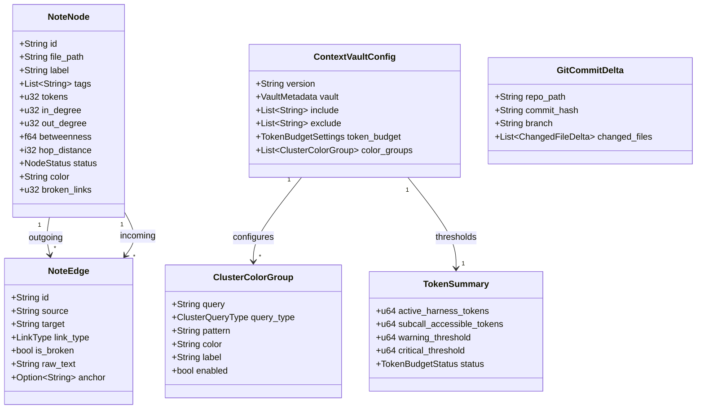
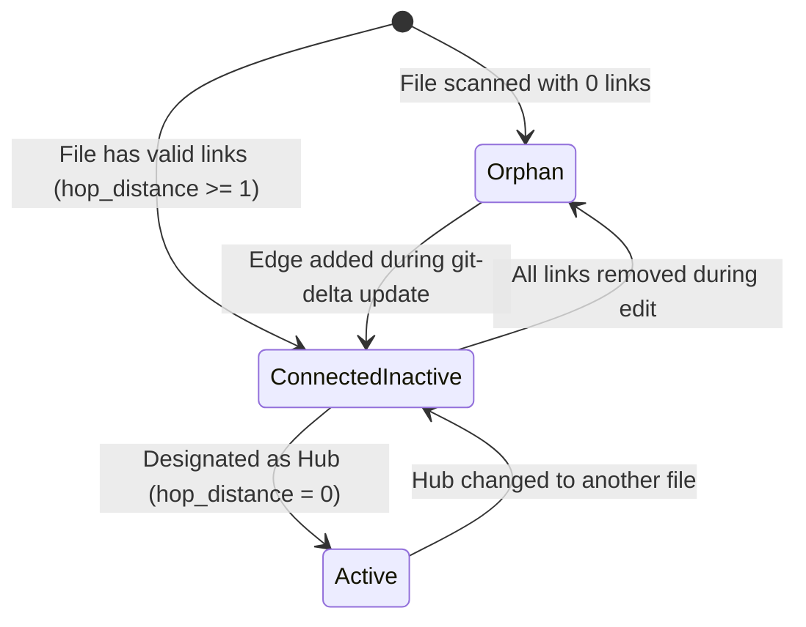

# Phase 1 Data Model: Domain Entities & Schema Specifications

**Feature**: LLM Wiki Extension for VS Code (`llm_wiki_ext4vsc`)  
**Branch**: `001-llm-wiki-ext`  
**Date**: 2026-09-11  
**Status**: Approved  

---

## 1. Entity Overview & Relationship Diagram



---

## 2. Entity Definitions & Fields

### 2.1. `NoteNode`
Represents an individual Markdown note in the workspace knowledge graph.

| Field | Type | Description | Validation / Constraints |
| :--- | :--- | :--- | :--- |
| `id` | `String` | Unique canonical relative POSIX path | Non-empty, e.g. `docs/architecture/system-design.md` |
| `file_path` | `String` | Absolute filesystem path | Must resolve on host filesystem |
| `label` | `String` | Human-readable node title | Derived from first `# Title` or file basename |
| `tags` | `Vec<String>` | Normalized hashtag collection | Lowercase, e.g. `["architecture", "security"]` |
| `tokens` | `u32` | Exact BPE token count | Computed via `tiktoken-rs` (`cl100k_base`) |
| `in_degree` | `u32` | Number of incoming valid edges | $\ge 0$ |
| `out_degree` | `u32` | Number of outgoing valid edges | $\ge 0$ |
| `betweenness` | `f64` | Brandes centrality coefficient | Normalized in range $[0.0, 1.0]$ |
| `hop_distance` | `i32` | BFS distance from designated Hub | $0$ for Hub, $\ge 1$ for hops, $-1$ for orphan |
| `status` | `NodeStatus` | Operational LLM context state | Enum: `active`, `connected_inactive`, `orphan` |
| `color` | `String` | Resolved base color (Hex) | Valid Hex `#RRGGBB` from cluster rules or defaults |
| `broken_links` | `u32` | Count of dead links in this note | $\ge 0$ |

#### Node Status Transitions


---

### 2.2. `NoteEdge`
Represents a directed reference between two markdown documents.

| Field | Type | Description | Validation / Constraints |
| :--- | :--- | :--- | :--- |
| `id` | `String` | Unique edge identifier | Format: `${source}->${target}` |
| `source` | `String` | Canonical ID of the originating node | References existing `NoteNode.id` |
| `target` | `String` | Canonical ID of the target document | May reference non-existent ID if broken |
| `link_type` | `LinkType` | Syntax style used in source note | Enum: `markdown` (`[text](url)`), `wikilink` (`[[note]]`) |
| `is_broken` | `bool` | Dead link indicator | `true` if target file does not exist on disk OR if `#anchor` does not match any heading in target AST (Principle V) |
| `raw_text` | `String` | Exact link text extracted from AST | Raw AST string |
| `anchor` | `Option<String>` | Section anchor if specified | e.g. `#section-heading` or `None` (validated against target note AST) |
| `line` | `Option<u32>` | 1-based line number in source file | Derived from AST byte offset / newline count for direct QuickPick editor jumping |

---

### 2.3. `ClusterColorGroup`
Defines a chromatic clustering rule mapping hashtag queries or filesystem directory paths to base hues.

| Field | Type | Description | Validation / Constraints |
| :--- | :--- | :--- | :--- |
| `query` | `String` | Raw query string | Must start with `tag:#` or `path:` |
| `query_type` | `ClusterQueryType` | Discriminator type | Enum: `tag`, `path` |
| `pattern` | `String` | Parsed pattern to match | e.g. `#architecture` or `docs/tests/**` |
| `color` | `String` | Base color code | 7-character Hex `#RRGGBB` |
| `label` | `String` | Display label for UI sidebar | Non-empty string |
| `enabled` | `bool` | Active toggle status | Defaults to `true` |

#### Color Rule Matching Algorithm
1. **Hashtag Rules**: If note has `#tag` matching `rule.pattern`, assign `rule.color`. First matching rule wins.
2. **Path Rules**: If note relative path matches glob `rule.pattern`, assign `rule.color`. First matching rule wins.
3. **Default Fallback**:
   - Level 0 (Hub): Active blue (`#3B82F6`)
   - Connected (Level 1+): Neutral slate (`#64748B`)
   - Orphan: Muted gray (`#6B7280`)
4. **Opacity Invariant**:
   $$\text{Final Color} = \text{rgba}(R_{\text{base}}, G_{\text{base}}, B_{\text{base}}, \alpha_{\text{hop}})$$
   where $\alpha_{0} = 1.0$, $\alpha_{1} = 0.6$, $\alpha_{2} = 0.3$, $\alpha_{\ge 3} = 0.15$.
   For orphan nodes (`hop_distance == -1`): $\alpha_{\text{orphan}} = 0.15$ (matching peripheral deep hops) if matching a custom cluster color rule, or $\alpha_{\text{orphan}} = 0.4$ with default muted gray (`#6B7280`).

---

### 2.4. `TokenSummary`
Tracks real-time context token usage against LLM model context ceilings.

| Field | Type | Description | Validation / Constraints |
| :--- | :--- | :--- | :--- |
| `active_harness_tokens` | `u64` | Total BPE tokens of Level 0 files | Direct prompt overhead |
| `subcall_accessible_tokens`| `u64` | Total BPE tokens of reachable Level 1+ files | On-demand context payload |
| `warning_threshold` | `u64` | Soft alert ceiling | Default: 60,000 tokens |
| `critical_threshold` | `u64` | Hard alert ceiling | Default: 100,000 tokens |
| `status` | `TokenBudgetStatus` | Health evaluation | Enum: `normal` ($<60\text{k}$), `warning` ($60\text{k}\text{--}100\text{k}$), `critical` ($>100\text{k}$) |

---

### 2.5. `GitCommitDelta`
Payload emitted by Git hook (`prek` / `post-commit`) and processed incrementally by the Rust core.

| Field | Type | Description | Validation / Constraints |
| :--- | :--- | :--- | :--- |
| `repo_path` | `String` | Root path of the git repository | Valid directory path |
| `commit_hash` | `String` | Git commit SHA | 7 to 40 hex characters |
| `branch` | `String` | Current Git branch | Non-empty string |
| `changed_files` | `Vec<ChangedFileDelta>` | List of modified Markdown files | Array of path + change status |

```json
{
  "path": "docs/architecture/system-design.md",
  "status": "modified"
}
```
*Status values*: `added`, `modified`, `deleted`.

---

### 2.6. `ContextVaultConfig`
Workspace-level configuration parsed from `.context-vault.yaml` defining scanning scope, hubs, budget alerts, and color groups.

| Field | Type | Description | Validation / Constraints |
| :--- | :--- | :--- | :--- |
| `version` | `String` | Configuration format version | Default: `"1.0"` |
| `vault` | `VaultSettings` | Vault identity and hub configuration | Required object |
| `include` | `Vec<String>` | Glob patterns to scan for Markdown notes | Default: `["**/*.md"]` |
| `exclude` | `Vec<String>` | Glob patterns to ignore during scan | Default: `["node_modules/**", ".git/**", "target/**", "dist/**"]` |
| `token_budget` | `TokenBudgetSettings` | BPE token alert thresholds | Warning (default 60,000) and Critical (default 100,000) |
| `color_groups` | `Vec<ClusterColorGroup>` | Chromatic cluster mapping rules | List of hashtag/path rules |

#### `VaultSettings`
| Field | Type | Description | Validation / Constraints |
| :--- | :--- | :--- | :--- |
| `name` | `String` | Human-readable vault name | Default: `"Workspace Context"` |
| `mode` | `VaultMode` | Operational vault mode | Enum: `single-repo`, `multi-repo`, `vault` |
| `auto_discovered_hub` | `Option<String>` | Automatically selected high-centrality Hub | Optional relative path (e.g. `AGENTS.md`) |
| `hubs` | `Vec<String>` | Explicit user-designated Level 0 Hub files | List of relative file paths |

#### `TokenBudgetSettings`
| Field | Type | Description | Validation / Constraints |
| :--- | :--- | :--- | :--- |
| `warning_threshold` | `u64` | Soft alert threshold for Active Prompt Load | Min: 0, Default: 60,000 |
| `critical_threshold` | `u64` | Hard alert threshold for Active Prompt Load | Min: 0, Default: 100,000 |

