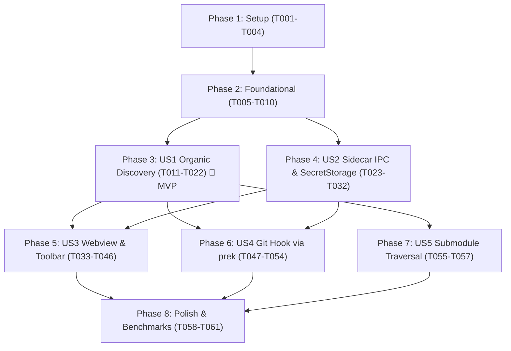

# Tasks: LLM Wiki Extension for VS Code (`llm_wiki_ext4vsc`)

**Branch**: `001-llm-wiki-ext` | **Date**: 2026-09-11 | **Plan**: [`plan.md`](plan.md) | **Spec**: [`spec.md`](spec.md)

---

## Phase 1: Setup (Shared Infrastructure)

**Purpose**: Project initialization, monorepo directory layout, dependencies, and linting configuration.

- [ ] T001 Create project directory structure for Cargo workspace (`crates/core`) and VS Code Extension (`extension/`) per implementation plan
- [ ] T002 [P] Initialize Cargo workspace root `Cargo.toml` and core sidecar manifest `crates/core/Cargo.toml` with dependencies (`pulldown-cmark`, `petgraph`, `tiktoken-rs`, `tokio`, `tokio-tungstenite`, `serde`, `serde_json`, `serde_yaml`, `clap`, `glob`)
- [ ] T003 [P] Initialize TypeScript extension host `extension/package.json`, `extension/tsconfig.json`, and `extension/esbuild.js` with dependencies (`ws`, `d3-force`, `@vscode/webview-ui-toolkit`, `@types/vscode`)
- [ ] T004 [P] Configure code linting and formatting configs: `rustfmt.toml`, `clippy.toml` in repo root, and `extension/.eslintrc.json`, `extension/.prettierrc`

---

## Phase 2: Foundational (Blocking Prerequisites)

**Purpose**: Core domain models, serialization protocols, error handling, and shared contracts that MUST be complete before ANY user story can be implemented.

**⚠️ CRITICAL**: No user story work can begin until this phase is complete.

- [ ] T005 [P] Define core domain types and enums (`NodeStatus` with enum `['active', 'connected_inactive', 'orphan']`, `LinkType` with enum `['markdown', 'wikilink']`, `ClusterQueryType` with enum `['tag', 'path']`) in `crates/core/src/types.rs`
- [ ] T006 [P] Implement `NoteNode` and `NoteEdge` structs with serde serialization in `crates/core/src/models/mod.rs` enforcing constraints: `id` non-empty POSIX path, `color` 7-char Hex `#RRGGBB`, `hop_distance` $0$ for Hub, $\ge 1$ for hops, $-1$ for orphan
- [ ] T007 [P] Implement `ContextVaultConfig` and `ClusterColorGroup` schema in `crates/core/src/config/schema.rs` adhering to `contracts/context_vault_schema.json` with regex validation for `query` (`^(tag:#[a-zA-Z0-9_/-]+|path:.+)$`)
- [ ] T008 [P] Implement JSON-RPC 2.0 protocol types (`JsonRpcRequest`, `JsonRpcResponse`, `JsonRpcError`) adhering to `contracts/ipc_jsonrpc_protocol.json` in `crates/core/src/ipc/protocol.rs`
- [ ] T009 [P] Define shared TypeScript interfaces for JSON-RPC messages and Webview RPC in `extension/src/types/protocol.ts` adhering to `contracts/ipc_jsonrpc_protocol.json` and `contracts/webview_rpc_protocol.json`
- [ ] T010 Implement error handling and result types (`WikiError`, `Result<T>`) in `crates/core/src/error.rs`

**Checkpoint**: Foundation ready — user story implementation can now begin in parallel.

---

## Phase 3: User Story 1 - Organic Vault Discovery & Graph Centrality Computation (Priority: P1) 🎯 MVP

**Goal**: Automatically discover all Markdown files in a workspace, parse standard links and Obsidian wikilinks without requiring frontmatter, construct a directed graph in `petgraph`, calculate degree and Brandes betweenness centrality, assign hop distances via BFS, compute exact `cl100k_base` BPE tokens via `tiktoken-rs`, and flag dead links (including missing section `#heading` anchors per Constitution Principle V).

**Independent Test**: Execute `cargo test -p llm-wiki-core --test ast_test --test graph_test --test token_test` and run `target/release/llm-wiki-core scan <dir> --format json` verifying $<200\text{ ms}$ parse for 1,000 files, exact BPE tokens, top betweenness node as suggested hub, and dead links flagged.

### Tests for User Story 1 (TDD First) ⚠️
> **NOTE: Write these tests FIRST, ensure they FAIL before implementation**

- [ ] T011 [P] [US1] Write unit tests for Markdown AST link and hashtag parsing (code-block link immunity, wikilinks, inline `#tags`) in `crates/core/tests/ast_test.rs`
- [ ] T012 [P] [US1] Write unit tests for graph centrality (in-degree, out-degree, Brandes betweenness) and circular link BFS hop distance in `crates/core/tests/graph_test.rs`
- [ ] T013 [P] [US1] Write unit tests for BPE token calculation (`cl100k_base`) with 0% deviation in `crates/core/tests/token_test.rs`

### Implementation for User Story 1
- [ ] T014 [P] [US1] Implement `pulldown-cmark` streaming pull parser ignoring links in code blocks (`CodeBlock`) and code spans, splitting URL anchor fragments (`#section`) into `NoteEdge.anchor` in `crates/core/src/ast/parser.rs`
- [ ] T015 [P] [US1] Implement Obsidian wikilink tokenizer (`[[target|label]]`) and anchor parser (`#section`) in `crates/core/src/ast/wikilink.rs`
- [ ] T016 [P] [US1] Implement hashtag and YAML frontmatter tag extractor normalizing to lowercase in `crates/core/src/ast/tags.rs`
- [ ] T017 [US1] Implement relative file path resolver and dead link detector (verifying disk existence, recording 1-based source line numbers in `NoteEdge.line`, and validating `#section` heading anchors against target note AST, setting `is_broken: true`) in `crates/core/src/graph/resolver.rs`
- [ ] T018 [US1] Implement `petgraph::DiGraph` graph builder mapping parsed notes and edges in `crates/core/src/graph/builder.rs`
- [ ] T019 [US1] Implement Brandes betweenness centrality algorithm and degree calculator in `crates/core/src/graph/centrality.rs`
- [ ] T020 [US1] Implement BFS shortest-path hop resolver assigning Level 0 (Hub), Level 1, Level 2, Level 3+, and Orphan (-1) in `crates/core/src/graph/hops.rs`
- [ ] T021 [US1] Implement exact BPE token counter (`cl100k_base`) and cumulative branch token accumulator in `crates/core/src/tokens/counter.rs`
- [ ] T022 [US1] Implement CLI `scan` subcommand outputting full JSON topology in `crates/core/src/cli/scan.rs` and wire into `crates/core/src/main.rs`

**Checkpoint**: User Story 1 is fully functional and headless testable (MVP complete).

---

## Phase 4: User Story 2 - Sidecar Process Lifecycle & Typed WebSocket IPC (Priority: P1)

**Goal**: VS Code Extension Host automatically manages the Rust sidecar daemon lifecycle (spawning on activation, health monitoring with exponential backoff, clean termination on deactivation), establishes local WebSocket IPC over `127.0.0.1:<ephemeral_port>` with cryptographic auth token stored via `vscode.SecretStorage` (Constitution Principle VI), and auto-generates `.context-vault.yaml`.

**Independent Test**: Headless extension integration tests (`extension/test/suite/ipc.test.ts`) verify sidecar binary discovery, process spawning, WebSocket handshake, bidirectional ping/pong $<5\text{ ms}$, auto-restart on kill, and clean shutdown on `deactivate()`.

### Tests for User Story 2 (TDD First) ⚠️
- [ ] T023 [P] [US2] Write unit tests for sidecar WebSocket JSON-RPC server and message routing in `crates/core/tests/ipc_test.rs`
- [ ] T024 [P] [US2] Write headless integration tests for Extension Host process manager, SecretStorage, and WebSocket client in `extension/test/suite/ipc.test.ts`

### Implementation for User Story 2
- [ ] T025 [US2] Implement async WebSocket JSON-RPC 2.0 daemon server using `tokio-tungstenite` with auth token handshake (accepting unauthenticated loopback write-only `git/commitDelta` notifications on `127.0.0.1`) in `crates/core/src/ipc/server.rs`
- [ ] T026 [US2] Implement `workspace/scan` and `graph/setHub` request handlers in `crates/core/src/ipc/handlers.rs`
- [ ] T027 [P] [US2] Implement `.context-vault.yaml` auto-generator with discovered hub and default globs in `crates/core/src/config/generator.rs`
- [ ] T028 [US2] Implement Rust binary locator for multi-platform binaries (`linux-x64`, `linux-arm64`, `darwin-x64`, `darwin-arm64`, `win32-x64`) in `extension/src/lifecycle/binaryResolver.ts`
- [ ] T029 [US2] Implement sidecar process supervisor with spawn, auto-restart exponential backoff (max 3 retries), and graceful kill on deactivation in `extension/src/lifecycle/processManager.ts`
- [ ] T030 [US2] Implement SecretStorage manager in `extension/src/lifecycle/secretManager.ts` to securely generate, store, and retrieve daemon authentication tokens without plaintext disk artifacts, injecting `LLM_WIKI_AUTH_TOKEN` into daemon process environment and `vscode.EnvironmentVariableCollection`
- [ ] T031 [US2] Implement typed WebSocket JSON-RPC 2.0 client with `requestId` correlation and reconnection logic in `extension/src/ipc/client.ts`
- [ ] T032 [US2] Wire extension activation lifecycle, secret initialization, and status bar indicator in `extension/src/extension.ts`

**Checkpoint**: User Stories 1 AND 2 operate together via bidirectional IPC with zero plaintext secrets.

---

## Phase 5: User Story 3 - Interactive Force-Directed Webview with Hop Opacity, Cluster Hashtag / Path Coloring & Token Economics (Priority: P2)

**Goal**: Render an interactive 60 FPS HTML5 Canvas force-directed graph in a sandboxed Webview enforcing strict CSP nonces, Hue + Opacity decay law ($\alpha_0=1.0, \alpha_1=0.6, \alpha_2=0.3, \alpha_{\ge 3}=0.15$), cluster coloring (`tag:#...`, `path:...`), active vs reachable token budget counters, quick actions toolbar (Set as Hub, Rescan Vault, Fix Broken Links), and node click navigation.

**Independent Test**: Webview tests and visual verification: verify CSP header contains random nonce, canvas renders at 60 FPS, nodes with `#architecture` take purple base hue modulated by hop distance alpha, active tokens sum Level 0 nodes, and clicking a node dispatches `openFile` to open editor document.

### Tests for User Story 3 (TDD First) ⚠️
- [ ] T033 [P] [US3] Write unit tests for Hue + Opacity color composition invariant and cluster rule matching in `extension/webview-ui/test/colorResolver.test.ts`
- [ ] T034 [P] [US3] Write unit tests for Webview typed RPC message dispatcher and CSP generator in `extension/test/suite/webview.test.ts`

### Implementation for User Story 3
- [ ] T035 [P] [US3] Implement CSP helper generating cryptographic nonces (`script-src 'nonce-${nonce}'`) and `asWebviewUri` resource mapping in `extension/src/webview/cspHelper.ts`
- [ ] T036 [US3] Implement `WebviewPanel` lifecycle manager with `vscode.setState()`/`getState()` and `WebviewPanelSerializer` (no `retainContextWhenHidden`) in `extension/src/webview/panelManager.ts`
- [ ] T037 [P] [US3] Implement Webview HTML template and theme CSS custom properties in `extension/webview-ui/index.html` and `extension/webview-ui/src/theme.css`
- [ ] T038 [US3] Implement 2D Canvas force-directed graph renderer with RequestAnimationFrame loop and DPR scaling in `extension/webview-ui/src/graph/canvasRenderer.ts`
- [ ] T039 [US3] Implement `d3-force` physics simulation (link force, charge repulsion, center force) in `extension/webview-ui/src/graph/physics.ts`
- [ ] T040 [US3] Implement Hue + Opacity color resolver applying cluster rule base hue with hop distance alpha decay in `extension/webview-ui/src/graph/colorResolver.ts`
- [ ] T041 [P] [US3] Implement diagnostic token counter widget displaying active harness tokens, reachable subcall tokens, and threshold alert badges in `extension/webview-ui/src/components/tokenCounter.ts`
- [ ] T042 [P] [US3] Implement interactive Cluster Groups manager UI (add/edit/toggle tag/path rules) with live preview and save in `extension/webview-ui/src/components/colorManager.ts`
- [ ] T043 [P] [US3] Implement `actionsToolbar.ts` in `extension/webview-ui/src/components/actionsToolbar.ts` providing quick action buttons (Set as Hub, Rescan Vault, and Fix Broken Links)
- [ ] T044 [US3] Implement Webview client RPC bridge handling `openFile`, `setHub`, `updateColorGroups`, `fixBrokenLinks`, and `graphDataUpdate` in `extension/webview-ui/src/rpc/webviewRpc.ts`
- [ ] T045 [US3] Implement Extension Host command `llmWiki.showKnowledgeGraph` (`LLM Wiki: Show Knowledge Graph`) in `extension/src/commands/showGraph.ts`
- [ ] T046 [US3] Implement extension commands `llmWiki.setHub` (`setHub.ts`), `llmWiki.rescanVault` (`rescanVault.ts`), and `llmWiki.fixBrokenLinks` (`fixBrokenLinks.ts` with QuickPick dead link navigation) in `extension/src/commands/`

**Checkpoint**: Full visual graph interface operational with context economics, toolbar quick actions, and cluster coloring.

---

## Phase 6: User Story 4 - Event-Driven Git Hook Synchronization with Rust-Native `prek` Orchestration (Priority: P2)

**Goal**: Provide event-driven Git hook synchronization using `prek`, generating `.pre-commit-config.yaml` with declarative regex file filtering (`files: '(?i)\.md$'`), executing `llm-wiki-core git-delta` CLI, patching in-memory graph within 50ms, and strictly enforcing $\le 500\text{ ms}$ non-blocking fail-open bypass.

**Independent Test**: Execute `cargo test -p llm-wiki-core --test delta_test`, commit a `.rs` file (verify `prek` skips hook in $<2\text{ ms}$), commit a `.md` file (verify `git-delta` updates graph in $<50\text{ ms}$), and commit with offline daemon (verify hook exits 0 in $<500\text{ ms}$).

### Tests for User Story 4 (TDD First) ⚠️
- [ ] T047 [P] [US4] Write unit tests for incremental delta graph patching (add/modify/delete file) in `crates/core/tests/delta_test.rs`
- [ ] T048 [P] [US4] Write unit tests for `llm-wiki-core git-delta` CLI non-blocking fail-open timeout ($\le 500\text{ ms}$) in `crates/core/tests/cli_delta_test.rs`
- [ ] T049 [P] [US4] Write unit tests for `prek` installer and 3-tier fallback detection in `extension/test/suite/hooks.test.ts`

### Implementation for User Story 4
- [ ] T050 [US4] Implement `llm-wiki-core git-delta` CLI subcommand with 500ms timeout discovering active daemon port via `.git/llm-wiki.port` (fallback 8989) and dispatching loopback `git/commitDelta` notification to daemon socket in `crates/core/src/cli/delta.rs`
- [ ] T051 [US4] Implement in-memory incremental graph updater patching nodes, edges, betweenness, and tokens in $\le 50\text{ ms}$ in `crates/core/src/delta/updater.rs`
- [ ] T052 [P] [US4] Implement declarative `.pre-commit-config.yaml` writer with `files: '(?i)\.md$'` and `prek install` runner in `extension/src/hooks/prekInstaller.ts`
- [ ] T053 [P] [US4] Implement 3-tier fallback installer (Tier 1 `prek`, Tier 2 `pre-commit`, Tier 3 `.git/hooks/post-commit` shell script) in `extension/src/hooks/fallbackInstaller.ts`
- [ ] T054 [US4] Implement VS Code command `LLM Wiki: Install Git Hooks` in `extension/src/commands/installHooks.ts`

**Checkpoint**: Event-driven Git hook synchronization functional with zero keystroke polling.

---

## Phase 7: User Story 5 - Multi-Repo, Unified Vault & Git Submodule Resolution (Priority: P3)

**Goal**: Support cross-submodule relative links (`../submodule/README.md`) and multi-repo boundary traversal without broken phantom links in `mode: multi-repo` and `mode: vault`.

**Independent Test**: Integration test scanning multi-repo fixture with git submodules; verify cross-boundary relative links resolve without error and dead link detector correctly distinguishes existing submodule targets.

### Tests for User Story 5 (TDD First) ⚠️
- [ ] T055 [P] [US5] Write integration tests for cross-submodule link resolution and boundary traversal in `crates/core/tests/submodule_test.rs`

### Implementation for User Story 5
- [ ] T056 [US5] Implement cross-submodule relative path resolver and vault boundary traversal in `crates/core/src/graph/resolver.rs`
- [ ] T057 [US5] Support `mode: multi-repo` and `mode: vault` path normalization in `crates/core/src/config/schema.rs` and `crates/core/src/graph/builder.rs`

**Checkpoint**: All 5 User Stories complete and verified.

---

## Phase 8: Polish & Cross-Cutting Concerns

**Purpose**: Final packaging, memory and latency benchmarks, `.vscodeignore` hygiene, and end-to-end quickstart validation.

- [ ] T058 [P] Add `.vscodeignore` exclusions for test files, Rust source code, and intermediate build artifacts per CTaaS GAP-028 in `extension/.vscodeignore`
- [ ] T059 [P] Configure multi-target `.vsix` packaging script with target binary injection in `extension/package.json` and `scripts/package-all.sh`
- [ ] T060 Verify resident memory footprint ($\le 35\text{ MB}$ RAM) and graph calculation latency ($\le 200\text{ ms}$ for 1,000 notes) with Criterion benchmarks in `crates/core/benches/graph_bench.rs`
- [ ] T061 Execute all validation scenarios from `specs/001-llm-wiki-ext/quickstart.md` and document verification results

---

## Dependencies & Execution Order

### Phase Dependencies


- **Phase 1 (Setup)**: No dependencies — can start immediately.
- **Phase 2 (Foundational)**: Depends on Setup completion — BLOCKS all user stories.
- **Phase 3 (User Story 1 - P1)**: Depends on Foundational completion. Delivers the standalone CLI MVP.
- **Phase 4 (User Story 2 - P1)**: Depends on Foundational completion. Can run in parallel with US1.
- **Phase 5 (User Story 3 - P2)**: Depends on US1 (graph data) and US2 (IPC bridge).
- **Phase 6 (User Story 4 - P2)**: Depends on US1 (graph update) and US2 (daemon socket).
- **Phase 7 (User Story 5 - P3)**: Depends on US1 (link resolver).
- **Phase 8 (Polish)**: Depends on all user stories being implemented.

---

## Parallel Opportunities

### Within Setup & Foundational:
```bash
# Launch Phase 1 Setup tasks in parallel:
Task: T002 "Initialize Cargo workspace root Cargo.toml and core sidecar manifest"
Task: T003 "Initialize TypeScript extension host extension/package.json"
Task: T004 "Configure code linting and formatting configs"

# Launch Phase 2 Foundational tasks in parallel:
Task: T005 "Define core domain types and enums in crates/core/src/types.rs"
Task: T006 "Implement NoteNode and NoteEdge structs in crates/core/src/models/mod.rs"
Task: T007 "Implement ContextVaultConfig and ClusterColorGroup schema in crates/core/src/config/schema.rs"
Task: T008 "Implement JSON-RPC 2.0 protocol types in crates/core/src/ipc/protocol.rs"
Task: T009 "Define shared TypeScript interfaces in extension/src/types/protocol.ts"
```

### Across User Stories:
- Once Phase 2 (Foundational) is completed, **User Story 1 (Rust CLI)** and **User Story 2 (Extension Host Process Manager)** can be implemented concurrently by independent developers/agents.
- Within User Story 1: T011, T012, T013 (TDD unit tests) can be written simultaneously. T014, T015, T016 (AST pull parsers) can be built in parallel.
- Within User Story 3: T035 (CSP helper), T037 (HTML/CSS template), T041 (token counter widget), T042 (color manager), and T043 (actions toolbar) can be built in parallel before canvas integration.

---

## Implementation Strategy

### MVP First (User Story 1)
1. Complete **Phase 1: Setup** (T001–T004).
2. Complete **Phase 2: Foundational** (T005–T010).
3. Complete **Phase 3: User Story 1** (T011–T022).
4. **STOP and VALIDATE**: Run `cargo test` and `llm-wiki-core scan /home/ds/projects/notes`. We now have a high-performance standalone CLI tool that organically discovers documentation, calculates centrality, validates section heading anchors, and budgets tokens in $<200\text{ ms}$.

### Incremental Feature Delivery
1. **Increment 1 (MVP)**: Standalone CLI engine (`llm-wiki-core scan`).
2. **Increment 2**: Extension Host supervisor, SecretStorage token management, and WebSocket bridge (`workspace/scan` over IPC).
3. **Increment 3**: Sandboxed Webview with Canvas physics, hop opacity decay, toolbar quick actions, and cluster color manager.
4. **Increment 4**: Event-driven `prek` Git hook integration with $\le 500\text{ ms}$ fail-open timeout.
5. **Increment 5**: Multi-repo & Git submodule resolution.
6. **Increment 6**: Packaging (`.vsix`), memory/latency verification, and distribution readiness.
