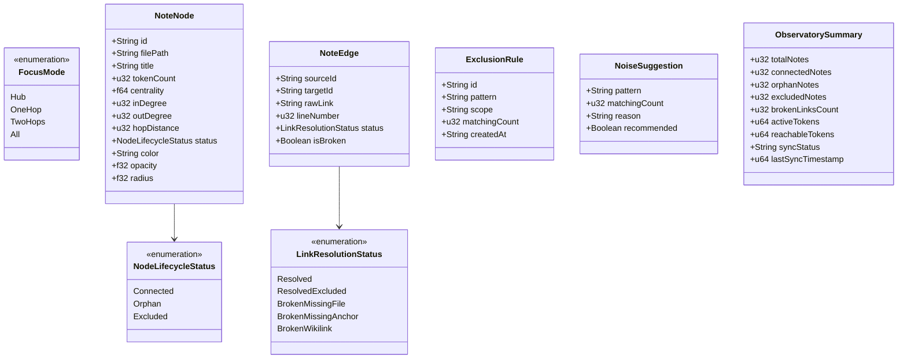

# Phase 1 Data Model: AI Context Observatory & Curated Knowledge UX (`002-context-observatory-ux`)

**Feature Branch**: `002-context-observatory-ux`  
**Date**: 2026-09-11  
**Status**: Completed  
**Source Inputs**: `spec.md`, `research.md`, Constitution v1.3.0

---

## 1. Domain Entities & State Models



---

## 2. Entity Specifications & Field Constraints

### 2.1 `NoteNode` (Enhanced)
Represents a Markdown document within the vault.
- `id` (`String`, required): Unique canonical relative path from vault root (e.g. `notes/01_projects/llm_wiki.md`).
- `filePath` (`String`, required): Absolute filesystem path.
- `title` (`String`, required): H1 title or filename stem.
- `tokenCount` (`u32`, required, $\ge 0$): Exact BPE token count (`cl100k_base`).
- `centrality` (`f64`, required, $0.0 \le c \le 1.0$): Normalized betweenness centrality.
- `inDegree` (`u32`, required, $\ge 0$): Number of incoming links.
- `outDegree` (`u32`, required, $\ge 0$): Number of outgoing links.
- `hopDistance` (`u32`, required, $\ge 0$): Shortest BFS distance from active hub ($0 = \text{Hub}, 1 = \text{Direct}, 2 = \text{Transitive}, \infty = \text{Orphan}$).
- `status` (`NodeLifecycleStatus`, required): Exactly one of:
  - `Connected`: $inDegree + outDegree > 0$ and not excluded.
  - `Orphan`: $inDegree = 0 \land outDegree = 0$ and not excluded.
  - `Excluded`: Matches an active `graph.exclude` glob pattern.
- `radius` (`f32`, required): Semantic visual radius in pixels:
  - Level 0 (Hub): $14.0\text{px}$
  - Level 1: $9.0\text{px}$
  - Level 2: $6.0\text{px}$
  - Level 3+: $4.0\text{px}$
  - Orphan: $4.0\text{px}$

### 2.2 `NoteEdge` (Enhanced)
Represents a directed link between documents.
- `sourceId` (`String`, required): Source note ID.
- `targetId` (`String`, required): Target note canonical ID or unresolved target name.
- `rawLink` (`String`, required): Verbatim Markdown link destination or wikilink body.
- `lineNumber` (`u32`, required, $\ge 1$): 1-indexed source file line location.
- `status` (`LinkResolutionStatus`, required): Exactly one of:
  - `Resolved`: Target note exists on disk and is part of the active graph.
  - `ResolvedExcluded`: Target note exists on disk but matches `graph.exclude`. The edge is preserved for integrity but omitted from default canvas rendering.
  - `BrokenMissingFile`: Target note does not exist on disk.
  - `BrokenMissingAnchor`: Target note exists, but the specified `#section` anchor heading was not found in the target AST.
  - `BrokenWikilink`: Unresolvable wikilink syntax.
- `isBroken` (`Boolean`, required): `true` if `status` is any of the `Broken*` variants; `false` otherwise.

### 2.3 `ExclusionRule`
Represents an active path ignore or graph exclusion rule in `.context-vault.yaml`.
- `id` (`String`, required): Unique rule UUID or slug.
- `pattern` (`String`, required): Standard glob pattern (e.g. `packages/**/README.md`, `vendor/**`).
- `scope` (`String`, required, enum: `["scan", "graph"]`):
  - `scan`: Technical bypass (never parsed or indexed).
  - `graph`: Curated exclusion (parsed for link resolution, but excluded from graph and orphan metrics).
- `matchingCount` (`u32`, optional): Number of workspace files matching this glob.
- `createdAt` (`String`, required): ISO 8601 creation timestamp.

### 2.4 `ExclusionPreview`
Payload returned when simulating a prospective exclusion rule.
- `pattern` (`String`, required): Evaluated glob pattern.
- `matchingCount` (`u32`, required, $\ge 0$): Total number of files matching.
- `samplePaths` (`Array<String>`, required, max 10 items): Sample matching file paths for UI preview.

### 2.5 `NoiseSuggestion`
Automated recommendation generated by the sidecar for noisy clusters of disconnected files.
- `pattern` (`String`, required): Suggested glob pattern (e.g. `**/README.md`, `vendor/**`).
- `matchingCount` (`u32`, required, $\ge 5$): Number of disconnected orphan notes matching.
- `reason` (`String`, required): Human-readable rationale (e.g. `"84 disconnected README files found across subdirectories"`).
- `recommended` (`Boolean`, required): `true` if high confidence; `false` otherwise.

### 2.6 `ObservatorySummary`
Aggregated vault health, token load, and topology metrics displayed in the left sidebar.
- `totalNotes` (`u32`, required): Total scanned Markdown files.
- `connectedNotes` (`u32`, required): Count of notes with $\ge 1$ link.
- `orphanNotes` (`u32`, required): Count of notes with $0$ links that are NOT excluded.
- `excludedNotes` (`u32`, required): Count of notes matching `graph.exclude`.
- `brokenLinksCount` (`u32`, required): Count of broken links.
- `activeTokens` (`u64`, required): Sum of BPE tokens in Level 0 active prompt files.
- `reachableTokens` (`u64`, required): Cumulative sum of tokens reachable within 2 hops.
- `syncStatus` (`String`, required, enum: `["synced", "syncing", "error"]`).
- `lastSyncTimestamp` (`u64`, required): Epoch milliseconds of last synchronization.

### 2.7 `FocusMode` Serialization Mapping
Maps discrete hop view horizons to wire protocol and configuration values:
- `Hub`: `"hub"` — Level 0 active hub only ($r=14\text{px}$, 100% opacity).
- `OneHop`: `"1_hop"` (`#[serde(rename = "1_hop")]`) — Hub + Level 1 direct hops.
- `TwoHops`: `"2_hops"` (`#[serde(rename = "2_hops")]`) — Hub + Level 1 + Level 2 transitive hops.
- `All`: `"all"` — Full vault graph.

### 2.8 Contextual Inspector Action Envelopes
- `OpenFileAction`: Dispatches `webview/openFile` with target `filePath` and `lineNumber` to open editor tab in `ViewColumn.Beside`.
- `SetCentralHubAction`: Dispatches `graph/setCentralHub` with `hubPath` updating `.context-vault.yaml` and recalculating BFS hops.
- `FixBrokenLinkAction`: Dispatches `webview/fixBrokenLink` with `sourcePath`, `targetPath`, and `lineNumber` to open QuickPick target picker in VS Code.

---

## 3. State Transitions & Invariants

### 3.1 Node Lifecycle Invariant
```text
Total Files = (Technical Excluded via scan.exclude [not indexed]) 
            + Connected Notes 
            + Orphan Notes 
            + Curated Excluded Notes (graph.exclude)
```
- A note MUST NOT be classified as both `Orphan` and `Excluded`.
- Transition to `Excluded`: When a user excludes a file or folder, matching notes transition immediately from `Connected` or `Orphan` $\rightarrow$ `Excluded`.
- Transition from `Excluded`: When an exclusion rule is deleted, notes transition to `Connected` (if they have links) or `Orphan` (if unlinked).

### 3.2 Target Resolvability Invariant
- If Note A contains a link to Note B:
  - If B exists on disk and B is in `graph.exclude` $\rightarrow$ Edge is marked `ResolvedExcluded`.
  - Edge is **not** rendered on default canvas.
  - Edge **does not** increment broken link count.
  - Link integrity validation passes with 0 errors.
