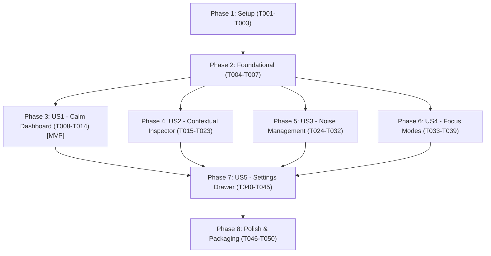

# Tasks: AI Context Observatory & Curated Knowledge UX (`002-context-observatory-ux`)

**Input**: [`specs/002-context-observatory-ux/plan.md`](plan.md), [`spec.md`](spec.md), [`data-model.md`](data-model.md), [`contracts/observatory_rpc_protocol.json`](contracts/observatory_rpc_protocol.json)  
**Status**: Ready for Execution

---

## Phase 1: Setup & Shared Infrastructure

**Purpose**: Scaffolding new modules and schema definitions for v2 Observatory UX.

- [ ] T001 Update `.context-vault.yaml` deserializer in `crates/core/src/config/schema.rs` to support two-tier `scan.exclude` and `graph.exclude` arrays with default fallback to v1 schema.
- [ ] T002 [P] Update TypeScript config definitions in `extension/src/types.ts` to mirror the two-tier exclusion, focus mode schemas, and serializations.
- [ ] T003 [P] Add new JSON-RPC message types for exclusion preview, path exclusion, set central hub, and focus mode in `crates/core/src/ipc/protocol.rs`.

---

## Phase 2: Foundational (Blocking Prerequisites)

**Purpose**: Core engine link resolution and exclusion matching that MUST be complete before UI stories begin.

**⚠️ CRITICAL**: Blocks all user stories.

- [ ] T004 Implement `ExclusionEngine` in `crates/core/src/graph/exclusions.rs` using `globset::GlobSet` for compiled high-speed glob evaluation over workspace paths.
- [ ] T005 [P] Extend `crates/core/src/graph/resolver.rs` to validate link targets against `graph.exclude` files, emitting `LinkResolutionStatus::ResolvedExcluded` with `is_broken: false` to uphold the Target Resolvability Invariant.
- [ ] T006 Update `crates/core/src/graph/mod.rs` to compute `ObservatorySummary` with distinct `connectedNotes`, `orphanNotes`, and `excludedNotes` metrics, ensuring excluded notes never increment the orphan counter.
- [ ] T007 [P] Implement RPC handlers for `graph/previewExclusion`, `graph/excludePath`, `graph/setCentralHub`, and `graph/suggestExclusions` in `crates/core/src/ipc/handlers.rs`.

**Checkpoint**: Core engine handles exclusions, hub updates, and summary metrics; user story implementations can now proceed.

---

## Phase 3: User Story 1 (P0) — Calm Status Dashboard & Zero Action Duplication 🎯 MVP

**Goal**: Redesign the left sidebar into a calm status dashboard answering *"What is important about my knowledge base right now?"* and remove all 5 duplicate action buttons.

**Independent Test**: Load the Webview in VS Code; verify the left sidebar displays Knowledge, AI Context, and Central Hub & Health cards with zero duplicate action buttons (`Open Knowledge Graph`, `Set Central Hub`, `Rescan Vault`, `Fix Broken Links`, `Install Git Hooks` are gone).

### Tests for User Story 1
- [ ] T008 [P] [US1] Create unit test in `extension/test/suite/statusDashboard.test.ts` verifying `StatusDashboard` renders correct note/token metrics and omits obsolete action buttons.

### Implementation for User Story 1
- [ ] T009 [US1] Create `StatusDashboard` component in `extension/webview-ui/src/components/statusDashboard.ts` rendering the 3 pillars: KNOWLEDGE (notes, links), AI CONTEXT (L0 tokens, reachable tokens, progress bar), and CENTRAL HUB / HEALTH (`[Change]` hub link, `● Synced` status).
- [ ] T010 [US1] Streamline `extension/webview-ui/src/components/actionsToolbar.ts` to strictly contain view-manipulation tools: Token status pill (`4.9k active`), Search (`🔍`), Focus mode dropdown (`🎯 Focus: All ▾`), Reset Disposition (`📌`), and More (`⋯`).
- [ ] T011 [US1] Remove obsolete buttons and references from `extension/webview-ui/index.html` and clean up `extension/package.json` contributes menus to prevent action duplication in the editor context menu.
- [ ] T012 [US1] Implement state-driven attention card in `extension/webview-ui/src/components/statusDashboard.ts` that conditionally renders `⚠ X broken links [Review issues]` opening Settings Drawer broken links tab when broken links $> 0$.
- [ ] T013 [US1] Wire `StatusDashboard` into `extension/webview-ui/src/main.ts` updating metrics dynamically on graph delta payloads.
- [ ] T014 [US1] Add responsive layout styles in `extension/webview-ui/src/theme.css` for the calm dashboard, status indicators, and streamlined toolbar.

**Checkpoint**: User Story 1 (MVP) complete. The user sees a calm, uncluttered dashboard and toolbar with zero action duplication.

---

## Phase 4: User Story 2 (P1) — Contextual Selection Inspector for Nodes, Edges & Health

**Goal**: Provide a slide-over Contextual Inspector drawer that displays relevant metadata and actionable operations whenever a node, edge, or token status metric is selected.

**Independent Test**: Click a note node, a broken link edge, and the token badge; verify the inspector slides open with line-precise coordinates, token weights, and working `[Open file]`, `[Set as hub]`, and `[Fix reference]` buttons.

### Tests for User Story 2
- [ ] T015 [P] [US2] Create unit test in `extension/test/suite/inspector.test.ts` verifying inspector model populates correct tier, token count, in/out links, and token pill context breakdown.

### Implementation for User Story 2
- [ ] T016 [US2] Create `InspectorDrawer` component in `extension/webview-ui/src/components/inspectorDrawer.ts` with slide-over container, close button, and dynamic content slots for nodes and edges.
- [ ] T017 [US2] Implement node inspection view in `extension/webview-ui/src/components/inspectorDrawer.ts`: display note title, path, context hop tier, exact BPE tokens, incoming/outgoing link lists, and primary actions `[Open file]`, `[Set as hub]`.
- [ ] T018 [US2] Implement broken link edge inspection view in `extension/webview-ui/src/components/inspectorDrawer.ts`: display source file, line number, missing destination, error type, and actions `[Open source]` and `[Fix reference]`.
- [ ] T019 [US2] Implement Token Economics breakdown view in `extension/webview-ui/src/components/inspectorDrawer.ts` displaying Active Prompt Load (L0) vs Reachable Context (L1+) with budget health alerts, and wire click events from the toolbar token pill (FR-053).
- [ ] T020 [US2] Wire selection events in `extension/webview-ui/src/graph/canvas.ts` on node click and edge click to dispatch selection payloads to `InspectorDrawer`.
- [ ] T021 [US2] Wire `[Open file]` and `[Open source]` action handlers in `extension/src/webview/rpc.ts` to call `vscode.window.showTextDocument` with `ViewColumn.Beside`, and wire `[Fix reference]` to show `vscode.window.showQuickPick` allowing user to select a replacement note target (FR-052).
- [ ] T022 [US2] Wire `[Set as hub]` action handler in `extension/src/webview/rpc.ts` and `crates/core/src/config/mod.rs` to persist `hub.primary_hub` into `.context-vault.yaml` and recalculate BFS hops (FR-051).
- [ ] T023 [US2] Add CSS styles and slide animations in `extension/webview-ui/src/theme.css` for `.inspector-drawer`, token breakdown bars, and action button groups.

**Checkpoint**: User Story 2 complete. The UI adapts dynamically to user selection with zero static clutter.

---

## Phase 5: User Story 3 (P1) — Noise Management & First-Class Graph Exclusions

**Goal**: Enable developers to exclude noisy documentation (e.g. package `README.md` files) via right-click or contextual menus, with preview matching and automated noise suggestions.

**Independent Test**: Open exclusion preview for `packages/**/README.md`; verify matching file count; apply exclusion and verify matching notes disappear from the canvas and orphan count without causing any broken links.

### Tests for User Story 3
- [ ] T024 [P] [US3] Create unit test in `extension/test/suite/exclusions.test.ts` verifying exclusion preview counts, path exclusions, and Target Resolvability Invariant.
- [ ] T025 [P] [US3] Create Rust unit test in `crates/core/tests/exclusions_test.rs` validating glob pattern matching and noise clustering algorithms.

### Implementation for User Story 3
- [ ] T026 [US3] Create `ExclusionModal` component in `extension/webview-ui/src/components/exclusionModal.ts` displaying evaluated glob pattern, affected file count, sample path chips, and `[Cancel]` / `[Apply Exclusion]` buttons.
- [ ] T027 [US3] Add contextual exclusion actions (`Exclude this file`, `Exclude this folder`, `Exclude pattern...`) to `InspectorDrawer` more menu and canvas context menu.
- [ ] T028 [US3] Wire exclusion preview request `graph/previewExclusion` through `extension/src/sidecar/client.ts` to `ExclusionModal`.
- [ ] T029 [US3] Wire `graph/excludePath` execution in `crates/core/src/config/mod.rs` to persist new rules into `.context-vault.yaml` and trigger incremental graph broadcast.
- [ ] T030 [US3] Implement automated noise detection in `crates/core/src/graph/exclusions.rs` clustering disconnected orphan files by stem (`README.md`) or directory (`vendor/**`).
- [ ] T031 [US3] Add `Suggested Exclusions` notification card in `StatusDashboard` with one-click `[Review suggestions]` batch approval workflow.
- [ ] T032 [US3] Implement optional `Show excluded` diagnostic toggle in Filter popover, rendering excluded nodes as faint, ghosted dotted outlines.

**Checkpoint**: User Story 3 complete. Monorepo orphan noise is reduced by $\ge 70\%$ while link integrity remains 100% preserved.

---

## Phase 6: User Story 4 (P1) — Hop-Constrained Focus Modes & Semantic Visual Sizing

**Goal**: Allow developers to restrict visualization to `Hub`, `1 hop`, `2 hops`, or `All`, and render node sizes according to their context tier.

**Independent Test**: Cycle focus modes on a 500+ note graph; verify canvas filters nodes beyond the hop horizon within 16 ms and re-heats simulation smoothly; verify node sizes follow semantic tier hierarchy ($r=14, 9, 6, 4$).

### Tests for User Story 4
- [ ] T033 [P] [US4] Create unit test in `extension/test/suite/focusEngine.test.ts` verifying hop-distance subgraph filtering and orphan toggling.

### Implementation for User Story 4
- [ ] T034 [US4] Create `FocusEngine` module in `extension/webview-ui/src/graph/focusEngine.ts` filtering node and edge arrays by `focusMode` (`hub`, `1_hop`, `2_hops`, `all`) and `showOrphans` boolean.
- [ ] T035 [US4] Add `Focus Mode` selector dropdown (`🎯 Focus: All ▾`) to the floating toolbar in `extension/webview-ui/src/components/actionsToolbar.ts`.
- [ ] T036 [US4] Update `extension/webview-ui/src/graph/canvas.ts` to calculate semantic node radius based on `node.hopDistance` ($r_0=14\text{px}, r_1=9\text{px}, r_2=6\text{px}, r_{\ge 3}=4\text{px}, r_{\text{orphan}}=4\text{px}$) and enforce the Opacity Decay Law ($\alpha_0=1.0, \alpha_1=0.6, \alpha_2=0.3, \alpha_{\ge 3}=0.15, \alpha_{\text{orphan}}=0.40$) composed with cluster hues (FR-064, Constitution Principle IV).
- [ ] T037 [US4] Update `extension/webview-ui/src/graph/physics.ts` to re-simulate filtered subgraphs with gentle reheat ($\alpha=0.3$) when focus mode changes.
- [ ] T038 [US4] Add `Show orphans` checkbox toggle in Filter popover in `actionsToolbar.ts` to toggle unlinked node visibility.
- [ ] T039 [US4] Style focus dropdown and semantic labels in `extension/webview-ui/src/theme.css`.

**Checkpoint**: User Story 4 complete. Graph visualization is calm, focused, and semantically sized.

---

## Phase 7: User Story 5 (P2) — Advanced Settings Drawer & Progressive Disclosure

**Goal**: House administrative tasks (Git hooks, hub rules, exclusion paths manager, cluster color groups, and diagnostics) in an Advanced Settings slide-over drawer accessed via `⋯`.

**Independent Test**: Click `⋯ More → Settings`; verify slide-over drawer opens with sections for Hub, Excluded paths, Git synchronization (`prek`), and Diagnostics, with working rule management.

### Implementation for User Story 5
- [ ] T040 [US5] Create `SettingsDrawer` component in `extension/webview-ui/src/components/settingsDrawer.ts` with tabbed navigation: `Knowledge`, `Excluded Paths`, `Cluster Groups`, `Git Sync`, and `Diagnostics` (FR-066).
- [ ] T041 [US5] Implement `Excluded Paths Manager` in `SettingsDrawer` with rule list, match counts, test preview input, and `[+ Add]` / `[Delete]` buttons.
- [ ] T042 [US5] Move `Git synchronization` controls (prek hook status, latency, reinstall button) from old sidebar into `SettingsDrawer` under `Git Sync`.
- [ ] T043 [US5] Move `Cluster Groups Manager` into `SettingsDrawer` under `Cluster Groups`.
- [ ] T044 [US5] Wire `⋯ More` menu item `Settings` in `actionsToolbar.ts` to open `SettingsDrawer`.
- [ ] T045 [US5] Add CSS styles for tabbed settings drawer and forms in `extension/webview-ui/src/theme.css`.

**Checkpoint**: User Story 5 complete. Full administrative power is preserved without cluttering daily workflows.

---

## Phase 8: Polish & Cross-Cutting Concerns

**Purpose**: End-to-end verification, performance optimization, and packaging.

- [ ] T046 [P] Run `cargo clippy -- -D warnings` and `cargo fmt --check` across `crates/core/`.
- [ ] T047 [P] Run `npm run lint` and `npm test` across `extension/`.
- [ ] T048 Benchmark glob exclusion evaluation in Criterion to guarantee $\le 10\text{ ms}$ for 5,000 files.
- [ ] T049 Execute all 4 runnable validation scenarios in `specs/002-context-observatory-ux/quickstart.md`.
- [ ] T050 Re-package extension with `./scripts/package-all.sh` and install verified VSIX in VS Code.

---

## Dependencies & Execution Order

### Parallel Opportunities:
- **Phase 1**: T002 and T003 can execute in parallel.
- **Phase 2**: T004, T005, and T007 can execute in parallel.
- **User Stories (Phase 3-6)**: Once Foundational (Phase 2) is complete, US1, US2, US3, and US4 can proceed in parallel.
- **Shared File Coordination Note**: When implementing US1, US4, and US5 concurrently, coordinate edits to `actionsToolbar.ts` and `theme.css` to avoid merge conflicts.
- **Tests**: T008, T015, T024, T025, and T033 can all be written concurrently.

---

## Implementation Strategy (MVP First)

1. **Step 1 (MVP)**: Implement Phase 1, Phase 2, and Phase 3 (US1). Stop and validate the clean dashboard in VS Code. All duplicate buttons are gone.
2. **Step 2 (Interactivity)**: Implement Phase 4 (US2 - Contextual Inspector). Clicking nodes, broken edges, and the token pill reveals rich metadata and line navigation.
3. **Step 3 (Signal over Noise)**: Implement Phase 5 (US3 - Curated Exclusions) and Phase 6 (US4 - Focus Modes). Clutter is eliminated; large repositories become calm.
4. **Step 4 (Polish & Settings)**: Implement Phase 7 (US5 - Settings Drawer) and Phase 8 (Benchmarks & VSIX packaging).
