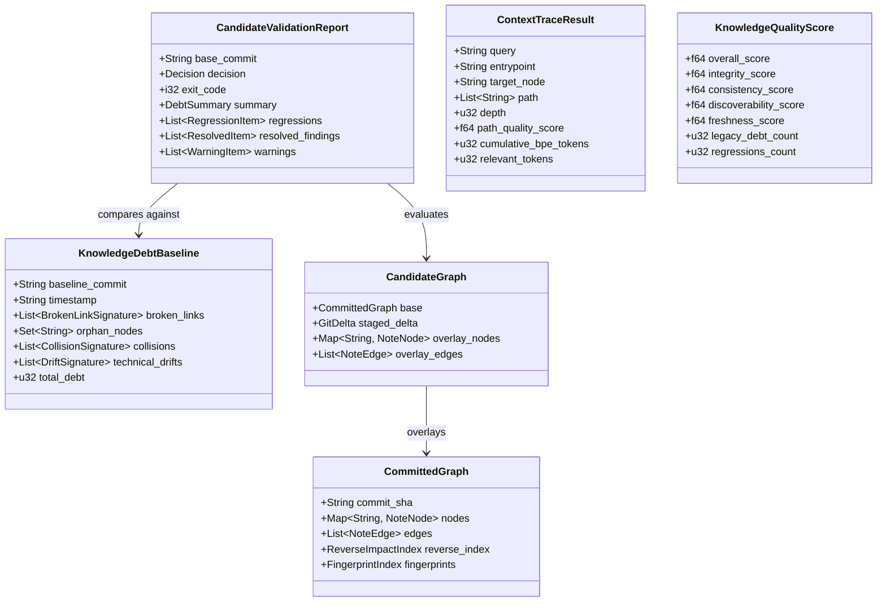

---
wiki:
  content_hash: 7d813fc3d74814523e4a05400a0e070383feb07b6dc89f97840223a8c7a084a1
  fragments:
    data-model-knowledge-quality-admission-control-continuous-enforcement:
      tokens: 2305
      inbound: 0
      outbound: 0
    1-domain-entities-memory-architecture:
      tokens: 402
      inbound: 0
      outbound: 0
    2-core-structures:
      tokens: 1838
      inbound: 0
      outbound: 0
    21-knowledge-debt-baseline-knowledgedebtbaseline:
      tokens: 304
      inbound: 0
      outbound: 0
    22-ephemeral-candidate-graph-candidategraph:
      tokens: 135
      inbound: 0
      outbound: 0
    23-candidate-validation-report-candidatevalidationreport:
      tokens: 465
      inbound: 0
      outbound: 0
    24-semantic-fingerprint-collision-model:
      tokens: 273
      inbound: 0
      outbound: 0
    25-reverse-impact-index-technical-drift-model:
      tokens: 289
      inbound: 0
      outbound: 0
    26-context-trace-model:
      tokens: 124
      inbound: 0
      outbound: 0
    27-knowledge-quality-score-model:
      tokens: 241
      inbound: 0
      outbound: 0
---
# Data Model: Knowledge Quality Admission Control & Continuous Enforcement

**Feature Branch:** `003-knowledge-admission-control`  
**Target Delivery:** `llm_wiki_ext4vsc` (`llm-wiki-core` in Rust + TypeScript Extension Host)  
**Status:** In Review / Data Model Specification  

---

## 1. Domain Entities & Memory Architecture



---

## 2. Core Structures

### 2.1 Knowledge Debt Baseline (`KnowledgeDebtBaseline`)

Persistent snapshot of legacy debt established on repository onboarding or baseline reset.

```rust
#[derive(Debug, Clone, PartialEq, Serialize, Deserialize)]
pub struct KnowledgeDebtBaseline {
    /// Commit hash when this baseline was created
    pub baseline_commit: String,
    /// RFC 3339 timestamp of baseline generation
    pub timestamp: String,
    /// Known legacy broken link signatures
    pub broken_links: Vec<BrokenLinkSignature>,
    /// Known legacy orphan document paths
    pub orphan_nodes: HashSet<String>,
    /// Known legacy semantic collision pairs
    pub collisions: Vec<CollisionSignature>,
    /// Known legacy technical drift findings
    pub technical_drifts: Vec<DriftSignature>,
    /// Aggregate legacy debt counter
    pub total_debt: u32,
}

#[derive(Debug, Clone, PartialEq, Eq, Hash, Serialize, Deserialize)]
pub struct BrokenLinkSignature {
    pub source_path: String,
    pub target_ref: String,
    pub line_number: u32,
}

#[derive(Debug, Clone, PartialEq, Eq, Hash, Serialize, Deserialize)]
pub struct CollisionSignature {
    pub doc_a: String,
    pub doc_b: String,
}

#[derive(Debug, Clone, PartialEq, Eq, Hash, Serialize, Deserialize)]
pub struct DriftSignature {
    pub doc_path: String,
    pub referenced_code_path: String,
    pub symbol: String,
}
```

---

### 2.2 Ephemeral Candidate Graph (`CandidateGraph`)

Constructed in RAM only during pre-commit admission control; discarded immediately upon hook completion.

```rust
pub struct CandidateGraph<'a> {
    /// Reference to persistent committed graph
    pub base_graph: &'a GraphTopology,
    /// Staged Git delta
    pub staged_delta: &'a GitDelta,
    /// In-memory mutated nodes (added or modified)
    pub candidate_nodes: HashMap<String, NoteNode>,
    /// In-memory mutated edges
    pub candidate_edges: Vec<NoteEdge>,
    /// Candidate debt evaluation result
    pub evaluation: CandidateValidationReport,
}
```

---

### 2.3 Candidate Validation Report (`CandidateValidationReport`)

Evaluation outcome of pre-commit admission control, determining commit exit code (`PASS`=0, `WARN`=0, `BLOCK`=1).

```rust
#[derive(Debug, Clone, PartialEq, Serialize, Deserialize)]
pub struct CandidateValidationReport {
    pub base_commit: String,
    pub decision: AdmissionDecision,
    pub exit_code: i32,
    pub summary: DebtAccountingSummary,
    pub regressions: Vec<RegressionItem>,
    pub resolved_findings: Vec<ResolvedItem>,
    pub warnings: Vec<WarningItem>,
}

#[derive(Debug, Clone, Copy, PartialEq, Eq, Serialize, Deserialize)]
#[serde(rename_all = "snake_case")]
pub enum AdmissionDecision {
    Pass,
    Warn,
    Block,
}

#[derive(Debug, Clone, PartialEq, Serialize, Deserialize)]
pub struct DebtAccountingSummary {
    pub total_debt: u32,
    pub legacy_debt: u32,
    pub new_debt: u32,
    pub resolved_debt: u32,
    pub regressions: u32,
}

#[derive(Debug, Clone, PartialEq, Serialize, Deserialize)]
pub struct RegressionItem {
    pub id: String,
    pub category: RegressionCategory,
    pub severity: RegressionSeverity,
    pub file_path: String,
    pub line_number: Option<u32>,
    pub message: String,
    pub remediation_hint: String,
}

#[derive(Debug, Clone, PartialEq, Eq, Serialize, Deserialize)]
#[serde(rename_all = "snake_case")]
pub enum RegressionCategory {
    BrokenReference,
    InvalidHeadingAnchor,
    SemanticCollision,
    TechnicalDriftContradiction,
}

#[derive(Debug, Clone, PartialEq, Eq, Serialize, Deserialize)]
#[serde(rename_all = "snake_case")]
pub enum RegressionSeverity {
    Blocker,
    Warning,
}

#[derive(Debug, Clone, PartialEq, Eq, Serialize, Deserialize)]
pub struct ResolvedItem {
    pub id: String,
    pub category: String,
    pub file_path: String,
    pub description: String,
}

#[derive(Debug, Clone, PartialEq, Eq, Serialize, Deserialize)]
pub struct WarningItem {
    pub message: String,
    pub file_path: Option<String>,
}
```

---

### 2.4 Semantic Fingerprint & Collision Model

```rust
#[derive(Debug, Clone, PartialEq, Serialize, Deserialize)]
pub struct DocumentFingerprint {
    pub doc_id: String,
    pub title_tokens: HashSet<String>,
    pub heading_tokens: HashSet<String>,
    pub term_frequencies: HashMap<String, f32>,
    pub tags: HashSet<String>,
    pub ngrams: HashSet<String>,
}

#[derive(Debug, Clone, PartialEq, Serialize, Deserialize)]
pub struct SemanticCollision {
    pub source_id: String,
    pub target_id: String,
    pub composite_similarity: f32, // 0.0 to 1.0
    pub title_similarity: f32,
    pub heading_similarity: f32,
    pub bm25_similarity: f32,
    pub ngram_similarity: f32,
    pub tag_similarity: f32,
    pub classification: CollisionClassification,
    pub shared_key_terms: Vec<String>,
    pub canonical_candidate: Option<String>,
    pub canonical_confidence: f32,
    pub canonical_evidence: Vec<String>,
}

#[derive(Debug, Clone, PartialEq, Eq, Serialize, Deserialize)]
#[serde(rename_all = "snake_case")]
pub enum CollisionClassification {
    PotentialDuplicate,
    PotentialFragmentation,
    PotentialSpecialization,
    PotentialSummary,
    PotentialConflict,
}
```

---

### 2.5 Reverse Impact Index & Technical Drift Model

```rust
#[derive(Debug, Clone, Default, Serialize, Deserialize)]
pub struct ReverseImpactIndex {
    /// Maps code file paths -> set of Markdown doc IDs that cite this path
    pub code_to_docs: HashMap<String, HashSet<String>>,
    /// Maps code symbol names (classes/functions) -> set of doc IDs citing them
    pub symbol_to_docs: HashMap<String, HashSet<String>>,
    /// Maps doc ID -> set of code paths referenced in the doc
    pub doc_to_code: HashMap<String, HashSet<String>>,
}

#[derive(Debug, Clone, PartialEq, Serialize, Deserialize)]
pub struct TechnicalDriftFinding {
    pub doc_id: String,
    pub code_target: String,
    pub symbol_name: Option<String>,
    pub citation_line: u32,
    pub drift_type: DriftType,
    pub confidence: DriftConfidence,
    pub explanation: String,
}

#[derive(Debug, Clone, PartialEq, Eq, Serialize, Deserialize)]
#[serde(rename_all = "snake_case")]
pub enum DriftType {
    DeletedCodeFile,
    RenamedCodeFile,
    DeletedSymbol,
    StaleSignature,
}

#[derive(Debug, Clone, PartialEq, Eq, Serialize, Deserialize)]
#[serde(rename_all = "snake_case")]
pub enum DriftConfidence {
    High,
    Moderate,
    Low,
}
```

---

### 2.6 Context Trace Model

```rust
#[derive(Debug, Clone, PartialEq, Serialize, Deserialize)]
pub struct ContextTraceResult {
    pub query: String,
    pub entrypoint: String,
    pub target_node: String,
    pub path: Vec<String>,
    pub depth: u32,
    pub path_quality_score: f32, // 0.0 to 100.0%
    pub cumulative_bpe_tokens: u32,
    pub relevant_tokens: u32,
    pub weak_intermediate_nodes: Vec<String>,
    pub latency_ms: u64,
}
```

---

### 2.7 Knowledge Quality Score Model

```rust
#[derive(Debug, Clone, PartialEq, Serialize, Deserialize)]
pub struct KnowledgeQualityScore {
    pub overall_score: f32, // 0.0 to 100.0
    pub integrity_score: f32, // 0.0 to 100.0
    pub consistency_score: f32, // 0.0 to 100.0
    pub discoverability_score: f32, // 0.0 to 100.0
    pub freshness_score: f32, // 0.0 to 100.0
    pub legacy_debt_count: u32,
    pub new_regressions_count: u32,
    pub resolved_debt_count: u32,
    pub central_hub_id: Option<String>,
    pub top_degradation_factors: Vec<QualityDegradationFactor>,
}

#[derive(Debug, Clone, PartialEq, Serialize, Deserialize)]
pub struct QualityDegradationFactor {
    pub category: String,
    pub affected_node: String,
    pub betweenness_weight: f32,
    pub deduction_points: f32,
    pub description: String,
}
```
