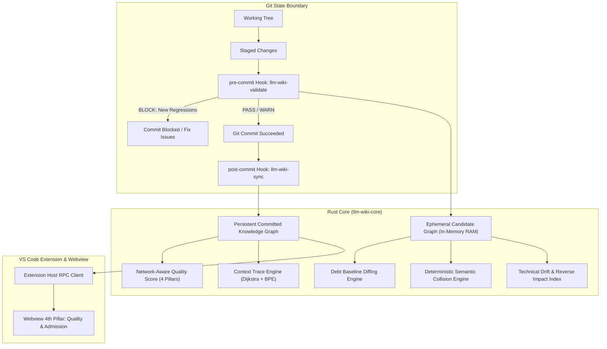

# Implementation Plan: Knowledge Quality Admission Control & Continuous Enforcement

**Feature Branch:** `003-knowledge-admission-control`  
**Target Delivery:** `llm_wiki_ext4vsc` (`llm-wiki-core` in Rust + TypeScript Extension Host)  
**Status:** In Review / Implementation Plan  
**Constitution Authority:** `CONSTITUTION.md` v1.4.0  

---

## 1. Architectural Overview & Component Topology

---

## 2. Directory & Module Layout

### Rust Core (`crates/core/src/`)
- `debt/`: Baseline persistence (`baseline.json`), signature generation, differential comparison, ratchet logic.
  - `debt/mod.rs`
  - `debt/baseline.rs`
  - `debt/signatures.rs`
  - `debt/evaluator.rs`
- `candidate/`: Ephemeral candidate overlay graph, in-memory mutation view, validation runner.
  - `candidate/mod.rs`
  - `candidate/overlay.rs`
  - `candidate/validator.rs`
- `collision/`: Deterministic multi-signal document fingerprinting, inverted index pruning, semantic scoring, canonical candidate heuristics.
  - `collision/mod.rs`
  - `collision/fingerprint.rs`
  - `collision/scorer.rs`
  - `collision/canonical.rs`
- `drift/`: Reverse code-doc impact index, symbol extraction, deletion/rename drift detection.
  - `drift/mod.rs`
  - `drift/indexer.rs`
  - `drift/detector.rs`
- `trace/`: Graph-constrained traversal from entry points, Dijkstra pathfinding, BPE token accounting (`cl100k_base`), path quality score.
  - `trace/mod.rs`
  - `trace/traversal.rs`
- `quality/`: 4-pillar topological scoring engine (Integrity, Consistency, Discoverability, Freshness) weighted by node betweenness.
  - `quality/mod.rs`
  - `quality/scorer.rs`
- `cli/`: Subcommands for `validate`, `git-delta`, `baseline`, `trace`, `quality`.
  - `cli/validate.rs`
  - `cli/baseline_cmd.rs`
  - `cli/trace_cmd.rs`
  - `cli/quality_cmd.rs`

### TypeScript Extension (`extension/src/` & `webview-ui/`)
- `extension/src/types/admission.ts`: TypeScript definitions matching JSON-RPC contracts.
- `extension/src/services/admissionManager.ts`: RPC client handlers for candidate validation and baseline status.
- `extension/webview-ui/src/components/qualityPillar.ts`: Fourth pillar dashboard for Quality Score, Debt counters, and baseline indicators.
- `extension/webview-ui/src/components/collisionInspector.ts`: Contextual drawer inspection for semantic collisions and canonical proposals.
- `extension/webview-ui/src/components/driftInspector.ts`: Contextual drawer inspection for technical code-doc drift.

---

## 3. Phased Implementation Roadmap

### Phase 1: Knowledge Debt Baseline Engine (Rust)
- Implement `BrokenLinkSignature`, `CollisionSignature`, and `DriftSignature`.
- Implement `KnowledgeDebtBaseline` serialization and persistence at `.context-vault/baseline.json`.
- Implement baseline differential comparison: $\text{New Regressions} = \text{Candidate Findings} \setminus \text{Baseline Findings}$.
- Implement baseline ratcheting on debt resolution.
- Unit tests: 100% coverage on baseline diffing, legacy tolerance, and ratcheting.

### Phase 2: In-Memory Candidate Graph & Validation Pipeline (Rust)
- Implement `CandidateGraph` overlaying `staged_delta` on `&GraphTopology` in RAM.
- Implement AST parsing for staged added/modified files.
- Implement `validate_candidate()` returning `CandidateValidationReport`.
- Verify zero mutation leaks to persistent graph on aborted/blocked validation.

### Phase 3: Dual Git Hook Orchestration (`validate` + `git-delta`)
- Implement `llm-wiki-core validate` CLI command for `pre-commit` stage with human-readable diagnostic output and JSON mode.
- Enforce strict $\le 500\text{ ms}$ non-blocking fail-open.
- Verify `llm-wiki-core git-delta` in `post-commit` stage for incremental persistent graph updates ($\le 50\text{ ms}$).
- Configure default `.pre-commit-config.yaml` template with both `llm-wiki-validate` and `llm-wiki-sync`.
- Implement 3-tier hook discovery hierarchy: Tier 1 (`prek`), Tier 2 (Python `pre-commit` / `lefthook`), Tier 3 (standalone `.git/hooks/` fallback shell scripts).

### Phase 4: Deterministic Semantic Collision Engine (Rust)
- Implement `DocumentFingerprint`: title tokens, heading tokens, BM25 term frequencies, n-grams, tags.
- Implement inverted token index for candidate filtering (top 10–50 matches, zero $O(N^2)$ all-pairs).
- Implement composite similarity formula:
  $$\text{Sim} = 0.25 \cdot \text{Title} + 0.20 \cdot \text{Heading} + 0.30 \cdot \text{BM25} + 0.15 \cdot \text{Ngram} + 0.10 \cdot \text{Tag}$$
- Implement canonical candidate heuristic (chronology, centrality, entrypoint references).

### Phase 5: Reverse Impact Index & Technical Drift Engine (Rust)
- Implement code symbol and path citation extraction from Markdown AST.
- Build bidirectional `ReverseImpactIndex`: `code_to_docs` and `doc_to_code`.
- Implement technical drift detection triggered by staged code file deletions/renames.

### Phase 6: Context Trace & BPE Token Pathfinding (Rust)
- Implement `ContextTrace`: Dijkstra shortest-path traversal from `AGENTS.md` to query targets.
- Accumulate BPE tokens (`cl100k_base`) along traversal paths.
- Calculate path quality percentage ($0\text{--}100\%$) based on depth and relevance.

### Phase 7: Network-Aware Knowledge Quality Score (Rust)
- Implement 4-pillar quality aggregator: Integrity (30%), Consistency (25%), Discoverability (25%), Freshness (20%).
- Topologically weight defect penalties using node betweenness centrality: $(1.0 + 3.0 \cdot B(v))$.
- Explicitly output Legacy Debt versus New Regressions.

### Phase 8: VS Code Extension Host & Webview UI Integration
- Add typed JSON-RPC handlers for admission control protocol.
- Render Fourth Pillar: Quality & Admission in status dashboard.
- Add Contextual Inspectors for collisions and drift findings in Webview drawer.
- Add Settings Drawer controls for Quality & Git Hooks.

### Phase 9: Automated Verification & E2E Validation
- Criterion benchmarks: candidate validation $\le 150\text{ ms}$ (`candidate_benchmark.rs`), post-commit git-delta $\le 50\text{ ms}$ (`sync_benchmark.rs`), fingerprint retrieval $\le 80\text{ ms}$ (`fingerprint_benchmark.rs`).
- Fail-open verification $\le 500\text{ ms}$ on socket hang (`hook_timeout_test.rs`).
- Complete regression simulation: zero false positive blocks on brownfield debt (`brownfield_simulation_test.rs`).
