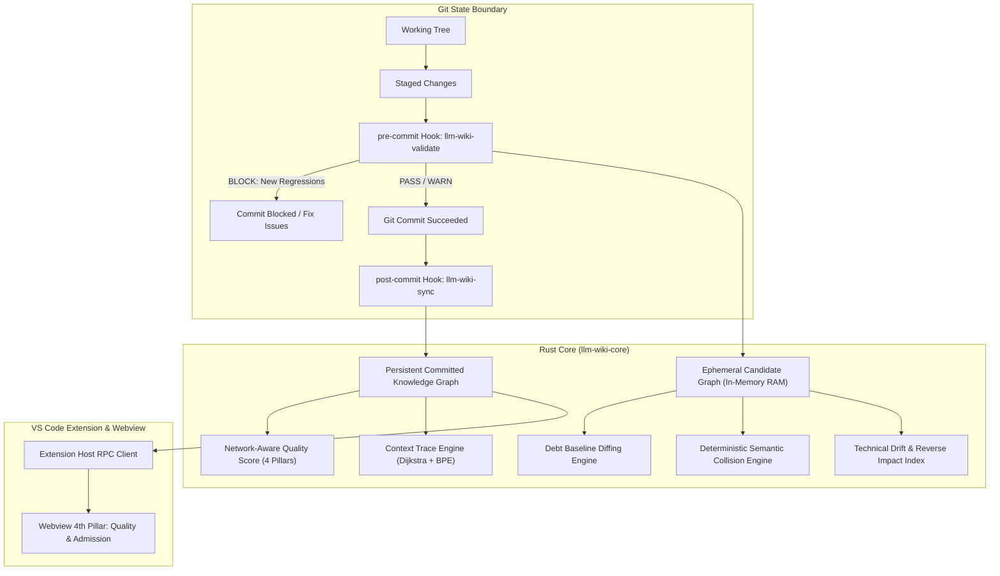

---
wiki:
  content_hash: 68533f5661e4384f15be4c246c3e9c9169b4f4a1d9121eea0ef5f422e1eadab5
  fragments:
    implementation-plan-knowledge-quality-admission-control-continuous-enforcement:
      tokens: 4242
      inbound: 0
      outbound: 0
    1-architectural-overview-component-topology:
      tokens: 307
      inbound: 0
      outbound: 0
    2-directory-module-layout:
      tokens: 943
      inbound: 0
      outbound: 0
    rust-core-cratescoresrc:
      tokens: 805
      inbound: 0
      outbound: 0
    typescript-extension-extensionsrc-webview-ui:
      tokens: 129
      inbound: 0
      outbound: 0
    3-phased-implementation-roadmap:
      tokens: 2910
      inbound: 0
      outbound: 0
    phase-1-knowledge-debt-baseline-engine-rust:
      tokens: 116
      inbound: 0
      outbound: 0
    phase-2-in-memory-candidate-graph-validation-pipeline-rust:
      tokens: 76
      inbound: 0
      outbound: 0
    phase-3-dual-git-hook-orchestration-validate-git-delta:
      tokens: 801
      inbound: 0
      outbound: 0
    phase-4-deterministic-semantic-collision-engine-rust:
      tokens: 158
      inbound: 0
      outbound: 0
    phase-5-reverse-impact-index-technical-drift-engine-rust:
      tokens: 65
      inbound: 0
      outbound: 0
    phase-6-context-trace-bpe-token-pathfinding-rust:
      tokens: 77
      inbound: 0
      outbound: 0
    phase-7-network-aware-knowledge-quality-score-rust:
      tokens: 85
      inbound: 0
      outbound: 0
    phase-8-vs-code-extension-host-webview-ui-integration:
      tokens: 68
      inbound: 0
      outbound: 0
    phase-9-automated-verification-e2e-validation:
      tokens: 1454
      inbound: 0
      outbound: 0
---
# Implementation Plan: Knowledge Quality Admission Control & Continuous Enforcement

**Feature Branch:** `003-knowledge-admission-control`  
**Target Delivery:** `llm_wiki_ext4vsc` (`llm-wiki-core` in Rust + TypeScript Extension Host)  
**Status:** In Review / Implementation Plan  
**Constitution Authority:** `CONSTITUTION.md` v1.4.0  

---

## 1. Architectural Overview & Component Topology

---

## 2. Directory & Module Layout

### Rust Core (`crates/core/src/`)
- `debt/`: Baseline persistence (*.context-vault/baseline.json*), signature generation, differential comparison, ratchet logic.
  - `crates/cli/src/commands/mod.rs`
  - `crates/cli/src/commands/baseline.rs`
  - `crates/core/src/debt/signatures.rs`
  - `crates/core/src/candidate/evaluator.rs`
- `candidate/`: Ephemeral candidate overlay graph, in-memory mutation view, validation runner.
  - `crates/cli/src/commands/mod.rs`
  - `crates/core/src/candidate/overlay.rs`
*candidate/validator.rs* *candidate/validator.rs* *candidate/validator.rs*-*candidate/validator.rs* *candidate/validator.rs*`*candidate/validator.rs*c*candidate/validator.rs*a*candidate/validator.rs*n*candidate/validator.rs*d*candidate/validator.rs*i*candidate/validator.rs*d*candidate/validator.rs*a*candidate/validator.rs*t*candidate/validator.rs*e*candidate/validator.rs*/*candidate/validator.rs*v*candidate/validator.rs*a*candidate/validator.rs*l*candidate/validator.rs*i*candidate/validator.rs*d*candidate/validator.rs*a*candidate/validator.rs*t*candidate/validator.rs*o*candidate/validator.rs*r*candidate/validator.rs*.*candidate/validator.rs*r*candidate/validator.rs*s*candidate/validator.rs*`*candidate/validator.rs*
*candidate/validator.rs*- `collision/`: Deterministic multi-signal document fingerprinting, inverted index pruning, semantic scoring, canonical candidate heuristics.
  - `crates/cli/src/commands/mod.rs`
  - `crates/core/src/collision/fingerprint.rs`
  - `crates/core/src/quality/scorer.rs`
  - `crates/core/src/collision/canonical.rs`
- `drift/`: Reverse code-doc impact index, symbol extraction, deletion/rename drift detection.
  - `crates/cli/src/commands/mod.rs`
*drift/indexer.rs* *drift/indexer.rs* *drift/indexer.rs*-*drift/indexer.rs* *drift/indexer.rs*`*drift/indexer.rs*d*drift/indexer.rs*r*drift/indexer.rs*i*drift/indexer.rs*f*drift/indexer.rs*t*drift/indexer.rs*/*drift/indexer.rs*i*drift/indexer.rs*n*drift/indexer.rs*d*drift/indexer.rs*e*drift/indexer.rs*x*drift/indexer.rs*e*drift/indexer.rs*r*drift/indexer.rs*.*drift/indexer.rs*r*drift/indexer.rs*s*drift/indexer.rs*`*drift/indexer.rs*
*drift/indexer.rs*  - `crates/core/src/drift/detector.rs`
- `trace/`: Graph-constrained traversal from entry points, Dijkstra pathfinding, BPE token accounting (`cl100k_base`), path quality score.
  - `crates/cli/src/commands/mod.rs`
  - `crates/core/src/trace/traversal.rs`
- `quality/`: 4-pillar topological scoring engine (Integrity, Consistency, Discoverability, Freshness) weighted by node betweenness.
  - `crates/cli/src/commands/mod.rs`
  - `crates/core/src/quality/scorer.rs`
- `cli/`: Subcommands for `validate`, `git-delta`, `baseline`, `trace`, `quality`.
  - `crates/cli/src/commands/validate.rs`
  - `crates/core/src/cli/baseline_cmd.rs`
  - `crates/core/src/cli/trace_cmd.rs`
  - `crates/core/src/cli/quality_cmd.rs`

### TypeScript Extension (`extension/src/` & `webview-ui/`)
- `extension/src/types/admission.ts`: TypeScript definitions matching JSON-RPC contracts.
- `extension/src/services/admissionManager.ts`: RPC client handlers for candidate validation and baseline status.
- `extension/webview-ui/src/components/qualityPillar.ts`: Fourth pillar dashboard for Quality Score, Debt counters, and baseline indicators.
- `extension/webview-ui/src/components/collisionInspector.ts`: Contextual drawer inspection for semantic collisions and canonical proposals.
- `extension/webview-ui/src/components/driftInspector.ts`: Contextual drawer inspection for technical code-doc drift.

---

## 3. Phased Implementation Roadmap

### Phase 1: Knowledge Debt Baseline Engine (Rust)
- Implement `BrokenLinkSignature`, `CollisionSignature`, and `DriftSignature`.
- Implement `KnowledgeDebtBaseline` serialization and persistence at *.context-vault/baseline.json*.
- Implement baseline differential comparison: $\text{New Regressions} = \text{Candidate Findings} \setminus \text{Baseline Findings}$.
- Implement baseline ratcheting on debt resolution.
- Unit tests: 100% coverage on baseline diffing, legacy tolerance, and ratcheting.

### Phase 2: In-Memory Candidate Graph & Validation Pipeline (Rust)
- Implement `CandidateGraph` overlaying `staged_delta` on `&GraphTopology` in RAM.
- Implement AST parsing for staged added/modified files.
- Implement `validate_candidate()` returning `CandidateValidationReport`.
- Verify zero mutation leaks to persistent graph on aborted/blocked validation.

### Phase 3: Dual Git Hook Orchestration (`validate` + `git-delta`)
- Implement `llm-wiki-core validate` CLI command for `pre-commit` stage with human-readable diagnostic output and JSON mode.
- Enforce strict $\le 500\text{ ms}$ non-blocking fail-open.
- Verify `llm-wiki-core git-delta` in `post-commit` stage for incremental persistent graph updates ($\le 50\text{ ms}$).
*.pre-commit-config.yaml*-*.pre-commit-config.yaml* *.pre-commit-config.yaml*C*.pre-commit-config.yaml*o*.pre-commit-config.yaml*n*.pre-commit-config.yaml*f*.pre-commit-config.yaml*i*.pre-commit-config.yaml*g*.pre-commit-config.yaml*u*.pre-commit-config.yaml*r*.pre-commit-config.yaml*e*.pre-commit-config.yaml* *.pre-commit-config.yaml*d*.pre-commit-config.yaml*e*.pre-commit-config.yaml*f*.pre-commit-config.yaml*a*.pre-commit-config.yaml*u*.pre-commit-config.yaml*l*.pre-commit-config.yaml*t*.pre-commit-config.yaml* *.pre-commit-config.yaml*`*.pre-commit-config.yaml*.*.pre-commit-config.yaml*p*.pre-commit-config.yaml*r*.pre-commit-config.yaml*e*.pre-commit-config.yaml*-*.pre-commit-config.yaml*c*.pre-commit-config.yaml*o*.pre-commit-config.yaml*m*.pre-commit-config.yaml*m*.pre-commit-config.yaml*i*.pre-commit-config.yaml*t*.pre-commit-config.yaml*-*.pre-commit-config.yaml*c*.pre-commit-config.yaml*o*.pre-commit-config.yaml*n*.pre-commit-config.yaml*f*.pre-commit-config.yaml*i*.pre-commit-config.yaml*g*.pre-commit-config.yaml*.*.pre-commit-config.yaml*y*.pre-commit-config.yaml*a*.pre-commit-config.yaml*m*.pre-commit-config.yaml*l*.pre-commit-config.yaml*`*.pre-commit-config.yaml* *.pre-commit-config.yaml*t*.pre-commit-config.yaml*e*.pre-commit-config.yaml*m*.pre-commit-config.yaml*p*.pre-commit-config.yaml*l*.pre-commit-config.yaml*a*.pre-commit-config.yaml*t*.pre-commit-config.yaml*e*.pre-commit-config.yaml* *.pre-commit-config.yaml*w*.pre-commit-config.yaml*i*.pre-commit-config.yaml*t*.pre-commit-config.yaml*h*.pre-commit-config.yaml* *.pre-commit-config.yaml*b*.pre-commit-config.yaml*o*.pre-commit-config.yaml*t*.pre-commit-config.yaml*h*.pre-commit-config.yaml* *.pre-commit-config.yaml*`*.pre-commit-config.yaml*l*.pre-commit-config.yaml*l*.pre-commit-config.yaml*m*.pre-commit-config.yaml*-*.pre-commit-config.yaml*w*.pre-commit-config.yaml*i*.pre-commit-config.yaml*k*.pre-commit-config.yaml*i*.pre-commit-config.yaml*-*.pre-commit-config.yaml*v*.pre-commit-config.yaml*a*.pre-commit-config.yaml*l*.pre-commit-config.yaml*i*.pre-commit-config.yaml*d*.pre-commit-config.yaml*a*.pre-commit-config.yaml*t*.pre-commit-config.yaml*e*.pre-commit-config.yaml*`*.pre-commit-config.yaml* *.pre-commit-config.yaml*a*.pre-commit-config.yaml*n*.pre-commit-config.yaml*d*.pre-commit-config.yaml* *.pre-commit-config.yaml*`*.pre-commit-config.yaml*l*.pre-commit-config.yaml*l*.pre-commit-config.yaml*m*.pre-commit-config.yaml*-*.pre-commit-config.yaml*w*.pre-commit-config.yaml*i*.pre-commit-config.yaml*k*.pre-commit-config.yaml*i*.pre-commit-config.yaml*-*.pre-commit-config.yaml*s*.pre-commit-config.yaml*y*.pre-commit-config.yaml*n*.pre-commit-config.yaml*c*.pre-commit-config.yaml*`*.pre-commit-config.yaml*.*.pre-commit-config.yaml*
*.pre-commit-config.yaml*- Implement 3-tier hook discovery hierarchy: Tier 1 (`prek`), Tier 2 (Python `pre-commit` / `lefthook`), Tier 3 (standalone `.git/hooks/` fallback shell scripts).

### Phase 4: Deterministic Semantic Collision Engine (Rust)
- Implement `DocumentFingerprint`: title tokens, heading tokens, BM25 term frequencies, n-grams, tags.
- Implement inverted token index for candidate filtering (top 10–50 matches, zero $O(N^2)$ all-pairs).
- Implement composite similarity formula:
  $$\text{Sim} = 0.25 \cdot \text{Title} + 0.20 \cdot \text{Heading} + 0.30 \cdot \text{BM25} + 0.15 \cdot \text{Ngram} + 0.10 \cdot \text{Tag}$$
- Implement canonical candidate heuristic (chronology, centrality, entrypoint references).

### Phase 5: Reverse Impact Index & Technical Drift Engine (Rust)
- Implement code symbol and path citation extraction from Markdown AST.
- Build bidirectional `ReverseImpactIndex`: `code_to_docs` and `doc_to_code`.
- Implement technical drift detection triggered by staged code file deletions/renames.

### Phase 6: Context Trace & BPE Token Pathfinding (Rust)
- Implement `ContextTrace`: Dijkstra shortest-path traversal from `AGENTS.md` to query targets.
- Accumulate BPE tokens (`cl100k_base`) along traversal paths.
- Calculate path quality percentage ($0\text{--}100\%$) based on depth and relevance.

### Phase 7: Network-Aware Knowledge Quality Score (Rust)
- Implement 4-pillar quality aggregator: Integrity (30%), Consistency (25%), Discoverability (25%), Freshness (20%).
- Topologically weight defect penalties using node betweenness centrality: $(1.0 + 3.0 \cdot B(v))$.
- Explicitly output Legacy Debt versus New Regressions.

### Phase 8: VS Code Extension Host & Webview UI Integration
- Add typed JSON-RPC handlers for admission control protocol.
- Render Fourth Pillar: Quality & Admission in status dashboard.
- Add Contextual Inspectors for collisions and drift findings in Webview drawer.
- Add Settings Drawer controls for Quality & Git Hooks.

### Phase 9: Automated Verification & E2E Validation
- Criterion benchmarks: candidate validation $\le 150\text{ ms}$ (`crates/core/benches/candidate_benchmark.rs`), post-commit git-delta $\le 50\text{ ms}$ (`crates/core/benches/sync_benchmark.rs`), fingerprint retrieval $\le 80\text{ ms}$ (`crates/core/benches/incremental_bench.rs`).
*hook_timeout_test.rs*-*hook_timeout_test.rs* *hook_timeout_test.rs*F*hook_timeout_test.rs*a*hook_timeout_test.rs*i*hook_timeout_test.rs*l*hook_timeout_test.rs*-*hook_timeout_test.rs*o*hook_timeout_test.rs*p*hook_timeout_test.rs*e*hook_timeout_test.rs*n*hook_timeout_test.rs* *hook_timeout_test.rs*v*hook_timeout_test.rs*e*hook_timeout_test.rs*r*hook_timeout_test.rs*i*hook_timeout_test.rs*f*hook_timeout_test.rs*i*hook_timeout_test.rs*c*hook_timeout_test.rs*a*hook_timeout_test.rs*t*hook_timeout_test.rs*i*hook_timeout_test.rs*o*hook_timeout_test.rs*n*hook_timeout_test.rs* *hook_timeout_test.rs*$*hook_timeout_test.rs*\*hook_timeout_test.rs*l*hook_timeout_test.rs*e*hook_timeout_test.rs* *hook_timeout_test.rs*5*hook_timeout_test.rs*0*hook_timeout_test.rs*0*hook_timeout_test.rs*\*hook_timeout_test.rs*t*hook_timeout_test.rs*e*hook_timeout_test.rs*x*hook_timeout_test.rs*t*hook_timeout_test.rs*{*hook_timeout_test.rs* *hook_timeout_test.rs*m*hook_timeout_test.rs*s*hook_timeout_test.rs*}*hook_timeout_test.rs*$*hook_timeout_test.rs* *hook_timeout_test.rs*o*hook_timeout_test.rs*n*hook_timeout_test.rs* *hook_timeout_test.rs*s*hook_timeout_test.rs*o*hook_timeout_test.rs*c*hook_timeout_test.rs*k*hook_timeout_test.rs*e*hook_timeout_test.rs*t*hook_timeout_test.rs* *hook_timeout_test.rs*h*hook_timeout_test.rs*a*hook_timeout_test.rs*n*hook_timeout_test.rs*g*hook_timeout_test.rs* *hook_timeout_test.rs*(*hook_timeout_test.rs*`*hook_timeout_test.rs*h*hook_timeout_test.rs*o*hook_timeout_test.rs*o*hook_timeout_test.rs*k*hook_timeout_test.rs*_*hook_timeout_test.rs*t*hook_timeout_test.rs*i*hook_timeout_test.rs*m*hook_timeout_test.rs*e*hook_timeout_test.rs*o*hook_timeout_test.rs*u*hook_timeout_test.rs*t*hook_timeout_test.rs*_*hook_timeout_test.rs*t*hook_timeout_test.rs*e*hook_timeout_test.rs*s*hook_timeout_test.rs*t*hook_timeout_test.rs*.*hook_timeout_test.rs*r*hook_timeout_test.rs*s*hook_timeout_test.rs*`*hook_timeout_test.rs*)*hook_timeout_test.rs*.*hook_timeout_test.rs*
*hook_timeout_test.rs**brownfield_simulation_test.rs*-*brownfield_simulation_test.rs* *brownfield_simulation_test.rs*C*brownfield_simulation_test.rs*o*brownfield_simulation_test.rs*m*brownfield_simulation_test.rs*p*brownfield_simulation_test.rs*l*brownfield_simulation_test.rs*e*brownfield_simulation_test.rs*t*brownfield_simulation_test.rs*e*brownfield_simulation_test.rs* *brownfield_simulation_test.rs*r*brownfield_simulation_test.rs*e*brownfield_simulation_test.rs*g*brownfield_simulation_test.rs*r*brownfield_simulation_test.rs*e*brownfield_simulation_test.rs*s*brownfield_simulation_test.rs*s*brownfield_simulation_test.rs*i*brownfield_simulation_test.rs*o*brownfield_simulation_test.rs*n*brownfield_simulation_test.rs* *brownfield_simulation_test.rs*s*brownfield_simulation_test.rs*i*brownfield_simulation_test.rs*m*brownfield_simulation_test.rs*u*brownfield_simulation_test.rs*l*brownfield_simulation_test.rs*a*brownfield_simulation_test.rs*t*brownfield_simulation_test.rs*i*brownfield_simulation_test.rs*o*brownfield_simulation_test.rs*n*brownfield_simulation_test.rs*:*brownfield_simulation_test.rs* *brownfield_simulation_test.rs*z*brownfield_simulation_test.rs*e*brownfield_simulation_test.rs*r*brownfield_simulation_test.rs*o*brownfield_simulation_test.rs* *brownfield_simulation_test.rs*f*brownfield_simulation_test.rs*a*brownfield_simulation_test.rs*l*brownfield_simulation_test.rs*s*brownfield_simulation_test.rs*e*brownfield_simulation_test.rs* *brownfield_simulation_test.rs*p*brownfield_simulation_test.rs*o*brownfield_simulation_test.rs*s*brownfield_simulation_test.rs*i*brownfield_simulation_test.rs*t*brownfield_simulation_test.rs*i*brownfield_simulation_test.rs*v*brownfield_simulation_test.rs*e*brownfield_simulation_test.rs* *brownfield_simulation_test.rs*b*brownfield_simulation_test.rs*l*brownfield_simulation_test.rs*o*brownfield_simulation_test.rs*c*brownfield_simulation_test.rs*k*brownfield_simulation_test.rs*s*brownfield_simulation_test.rs* *brownfield_simulation_test.rs*o*brownfield_simulation_test.rs*n*brownfield_simulation_test.rs* *brownfield_simulation_test.rs*b*brownfield_simulation_test.rs*r*brownfield_simulation_test.rs*o*brownfield_simulation_test.rs*w*brownfield_simulation_test.rs*n*brownfield_simulation_test.rs*f*brownfield_simulation_test.rs*i*brownfield_simulation_test.rs*e*brownfield_simulation_test.rs*l*brownfield_simulation_test.rs*d*brownfield_simulation_test.rs* *brownfield_simulation_test.rs*d*brownfield_simulation_test.rs*e*brownfield_simulation_test.rs*b*brownfield_simulation_test.rs*t*brownfield_simulation_test.rs* *brownfield_simulation_test.rs*(*brownfield_simulation_test.rs*`*brownfield_simulation_test.rs*b*brownfield_simulation_test.rs*r*brownfield_simulation_test.rs*o*brownfield_simulation_test.rs*w*brownfield_simulation_test.rs*n*brownfield_simulation_test.rs*f*brownfield_simulation_test.rs*i*brownfield_simulation_test.rs*e*brownfield_simulation_test.rs*l*brownfield_simulation_test.rs*d*brownfield_simulation_test.rs*_*brownfield_simulation_test.rs*s*brownfield_simulation_test.rs*i*brownfield_simulation_test.rs*m*brownfield_simulation_test.rs*u*brownfield_simulation_test.rs*l*brownfield_simulation_test.rs*a*brownfield_simulation_test.rs*t*brownfield_simulation_test.rs*i*brownfield_simulation_test.rs*o*brownfield_simulation_test.rs*n*brownfield_simulation_test.rs*_*brownfield_simulation_test.rs*t*brownfield_simulation_test.rs*e*brownfield_simulation_test.rs*s*brownfield_simulation_test.rs*t*brownfield_simulation_test.rs*.*brownfield_simulation_test.rs*r*brownfield_simulation_test.rs*s*brownfield_simulation_test.rs*`*brownfield_simulation_test.rs*)*brownfield_simulation_test.rs*.*brownfield_simulation_test.rs*
*brownfield_simulation_test.rs*