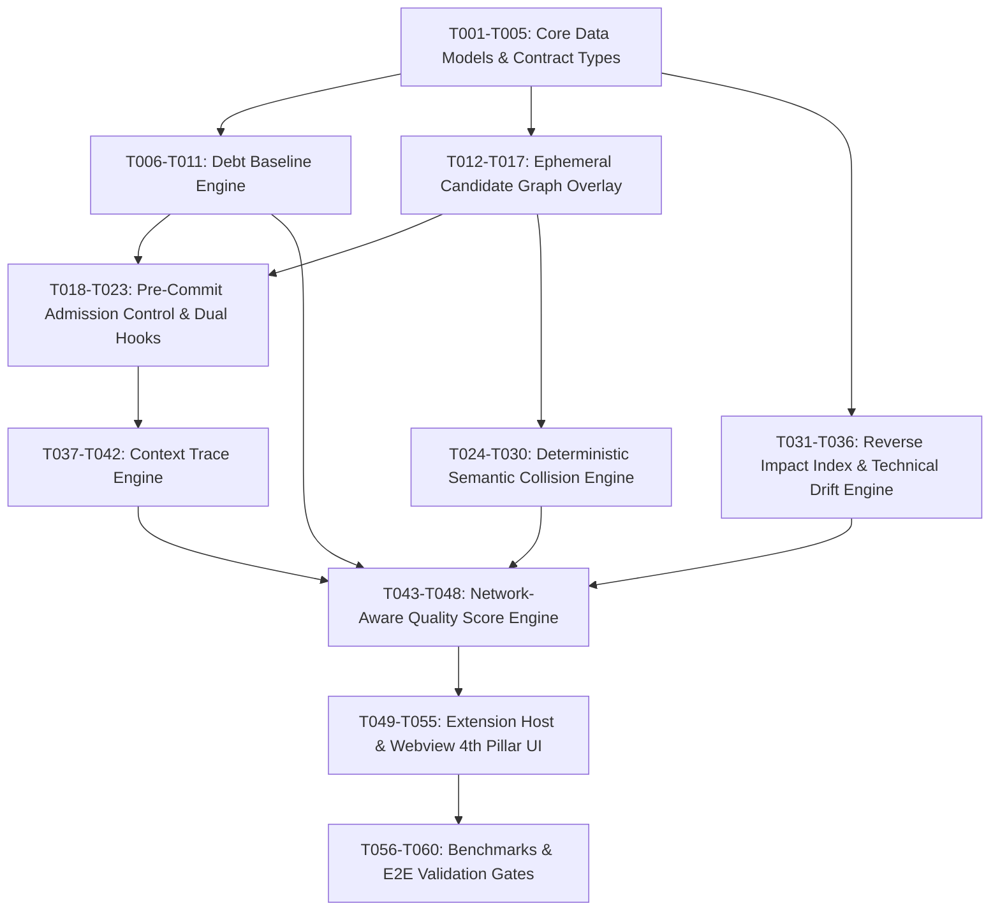

---
wiki:
  content_hash: 3318cbcf7a5f8d51edac629a6aef31fed0f02d46c3ac7cdceee4c89a05489285
  fragments:
    tasks-knowledge-quality-admission-control-continuous-enforcement:
      tokens: 8213
      inbound: 0
      outbound: 3
    task-matrix-dependencies:
      tokens: 233
      inbound: 0
      outbound: 0
    phase-1-core-data-models-contract-types-tasks-t001t005:
      tokens: 443
      inbound: 0
      outbound: 0
    phase-2-knowledge-debt-baseline-engine-tasks-t006t011:
      tokens: 496
      inbound: 0
      outbound: 0
    phase-3-ephemeral-candidate-graph-overlay-tasks-t012t017:
      tokens: 488
      inbound: 0
      outbound: 0
    phase-4-pre-commit-admission-control-cli-dual-hooks-tasks-t018t023:
      tokens: 3478
      inbound: 0
      outbound: 0
    phase-5-deterministic-semantic-collision-engine-tasks-t024t030:
      tokens: 584
      inbound: 0
      outbound: 0
    phase-6-reverse-impact-index-technical-drift-engine-tasks-t031t036:
      tokens: 433
      inbound: 0
      outbound: 0
    phase-7-context-trace-engine-bpe-token-pathfinding-tasks-t037t042:
      tokens: 439
      inbound: 0
      outbound: 0
    phase-8-network-aware-knowledge-quality-score-engine-tasks-t043t048:
      tokens: 430
      inbound: 0
      outbound: 0
    phase-9-extension-host-webview-4th-pillar-integration-tasks-t049t055:
      tokens: 619
      inbound: 0
      outbound: 0
    phase-10-criterion-benchmarking-cross-platform-e2e-verification-tasks-t056t060:
      tokens: 470
      inbound: 0
      outbound: 0
---
# Tasks: Knowledge Quality Admission Control & Continuous Enforcement

**Feature Branch:** `003-knowledge-admission-control`  
**Target Delivery:** `llm_wiki_ext4vsc` (`llm-wiki-core` in Rust + TypeScript Extension Host)  
**Status:** In Review / Tasks Breakdown  
**Specification:** [`spec.md`](spec.md) | **Plan:** [`plan.md`](plan.md) | **Data Model:** [`data-model.md`](data-model.md)  

---

## Task Matrix & Dependencies

---

## Phase 1: Core Data Models & Contract Types (Tasks T001–T005)

- [X] **T001**: Define Rust domain models in `crates/core/src/model/mod.rs` and `crates/core/src/debt/mod.rs` matching `data-model.md`: `KnowledgeDebtBaseline`, `BrokenLinkSignature`, `CollisionSignature`, and `DriftSignature`.
  - **Mapped Requirements**: FR-009, FR-016
  - **Verification**: `cargo test test_debt_model_serialization`

- [X] **T002**: Define candidate evaluation structures in `crates/core/src/candidate/mod.rs`: `CandidateGraph`, `CandidateValidationReport`, `AdmissionDecision`, `DebtAccountingSummary`, and `RegressionItem`.
  - **Mapped Requirements**: FR-002, FR-011, FR-012, FR-013, FR-014
  - **Verification**: `cargo test test_candidate_report_serialization`

- [X] **T003**: Define semantic collision and fingerprint structures in `crates/core/src/collision/mod.rs`: `DocumentFingerprint`, `SemanticCollision`, and `CollisionClassification`.
  - **Mapped Requirements**: FR-017, FR-019, FR-020
  - **Verification**: `cargo test test_collision_model_serialization`

- [X] **T004**: Define reverse impact index and technical drift structures in `crates/core/src/drift/mod.rs`: `ReverseImpactIndex`, `TechnicalDriftFinding`, `DriftType`, and `DriftConfidence`.
  - **Mapped Requirements**: FR-023, FR-024, FR-025
  - **Verification**: `cargo test test_drift_model_serialization`

- [X] **T005**: Define Context Trace and Quality Score structures in `crates/core/src/trace/mod.rs` and `crates/core/src/quality/mod.rs`: `ContextTraceResult`, `KnowledgeQualityScore`, and `QualityDegradationFactor`.
  - **Mapped Requirements**: FR-027, FR-028, FR-029, FR-030
  - **Verification**: `cargo test test_quality_model_serialization`

---

## Phase 2: Knowledge Debt Baseline Engine (Tasks T006–T011)

- [X] **T006**: Implement signature hashing algorithms in `crates/core/src/debt/signatures.rs`: deterministic SHA-256/FNV-1a digests for broken links, orphans, collisions, and technical drifts.
  - **Mapped Requirements**: FR-009
  - **Verification**: Unit tests in `crates/core/tests/debt_test.rs` validating signature stability across file path case folding.

- [X] **T007**: Implement baseline persistence engine in `crates/core/src/debt/baseline.rs`: creating, loading, and validating *.context-vault/baseline.json*.
  - **Mapped Requirements**: FR-009, FR-010
  - **Verification**: `cargo test test_baseline_save_and_load`

- [X] **T008**: Implement initial vault debt snapshot capture in `crates/core/src/candidate/evaluator.rs`: scanning an unbaselined repository, extracting all existing findings, and producing initial baseline.
  - **Mapped Requirements**: FR-010, SC-001
  - **Verification**: `cargo test test_initial_baseline_capture_on_brownfield`

- [X] **T009**: Implement baseline differential comparison in `crates/core/src/candidate/evaluator.rs`: computing $\text{New Regressions} = \text{Candidate Findings} \setminus \text{Baseline Findings}$.
  - **Mapped Requirements**: FR-011, FR-012, FR-013, SC-002
  - **Verification**: Unit test proving legacy issues do not appear in $\text{New Regressions}$.

- [X] **T010**: Implement baseline ratcheting logic in `crates/core/src/debt/baseline.rs`: automatically decrementing debt counts when commits resolve legacy broken links or orphans ($\Delta < 0$).
  - **Mapped Requirements**: FR-015, SC-005
  - **Verification**: `cargo test test_baseline_ratchet_on_resolution`

- [X] **T011**: Implement 5-dimension debt counter accounting in `crates/core/src/candidate/evaluator.rs`: calculating Total Debt, Legacy Debt, New Debt, Resolved Debt, and Regressions.
  - **Mapped Requirements**: FR-016
  - **Verification**: `cargo test test_debt_accounting_dimensions`

---

## Phase 3: Ephemeral Candidate Graph Overlay (Tasks T012–T017)

- [X] **T012**: Implement `OverlayDelta` in `crates/core/src/candidate/overlay.rs`: capturing in-memory additions, modifications, and deletions from staged Git files.
  - **Mapped Requirements**: FR-002
  - **Verification**: Unit test in `crates/core/tests/candidate_test.rs` overlaying 5 staged notes without cloning base topology.

- [X] **T013**: Implement candidate AST parser in `crates/core/src/candidate/overlay.rs`: parsing Markdown ASTs for staged file blobs directly from Git index.
  - **Mapped Requirements**: FR-002
  - **Verification**: `cargo test test_candidate_staged_ast_parsing`

- [X] **T014**: Implement candidate link and anchor resolver in `crates/core/src/candidate/evaluator.rs`: validating internal wikilinks and heading anchors in candidate state.
  - **Mapped Requirements**: FR-002, FR-013
  - **Verification**: `cargo test test_candidate_broken_link_detection`

- [X] **T015**: Implement Candidate Validation Pipeline runner in `crates/core/src/candidate/evaluator.rs`: running integrity checks, diffing against debt baseline, and populating `CandidateValidationReport`.
  - **Mapped Requirements**: FR-002, FR-003, FR-011
  - **Verification**: `cargo test test_candidate_pipeline_evaluation`

- [X] **T016**: Implement Decision Engine rules in `crates/core/src/candidate/evaluator.rs`: returning `BLOCK` (exit code 1) on new broken links or collisions, `WARN` (exit code 0) on moderate findings, and `PASS` (exit code 0) on clean changes.
  - **Mapped Requirements**: FR-012, FR-013, FR-014
  - **Verification**: `cargo test test_decision_engine_block_warn_pass`

- [X] **T017**: Implement memory disposal verification test in `crates/core/tests/candidate_test.rs`: asserting candidate graph is completely dropped from RAM and persistent graph remains 100% byte-identical after aborted evaluation.
  - **Mapped Requirements**: FR-001, FR-003, SC-003
  - **Verification**: `cargo test test_candidate_zero_persistence_leak`

---

## Phase 4: Pre-Commit Admission Control CLI & Dual Hooks (Tasks T018–T023)

- [X] **T018**: Implement CLI command `llm-wiki-core validate` in `crates/core/src/cli/validate.rs`: reading staged Git delta, executing candidate evaluation, formatting human-readable terminal output.
  - **Mapped Requirements**: FR-005, FR-008
  - **Verification**: `cargo test test_cli_validate_command`

- [X] **T019**: Add `--json` and `--quiet` flags to `llm-wiki-core validate` in `crates/core/src/cli/validate.rs` matching `specs/003-knowledge-admission-control/contracts/git_hooks_contract.json`.
  - **Mapped Requirements**: FR-008
  - **Verification**: `cargo test test_cli_validate_json_output`

- [X] **T020**: Implement non-blocking fail-open guard ($\le 500\text{ ms}$) in `crates/core/src/cli/validate.rs`: timing out to exit code 0 if socket or daemon hangs.
  - **Mapped Requirements**: FR-007, NFR-002
  - **Verification**: `cargo test test_cli_validate_fail_open_on_timeout`

- [X] **T021**: Update `llm-wiki-core git-delta` post-commit handler in `crates/core/src/cli/delta.rs`: applying committed SHA delta and triggering baseline ratchet on resolved debt.
  - **Mapped Requirements**: FR-004, FR-005, FR-015
  - **Verification**: `cargo test test_cli_git_delta_ratchet_sync`

- [X] **T022**: Create CLI subcommand `llm-wiki-core baseline init` and `baseline reset` in `crates/core/src/cli/baseline_cmd.rs`.
  - **Mapped Requirements**: FR-009, FR-010
  - **Verification**: `cargo test test_cli_baseline_init_command`

*.pre-commit-config.yaml*-*.pre-commit-config.yaml* *.pre-commit-config.yaml*[*.pre-commit-config.yaml*X*.pre-commit-config.yaml*]*.pre-commit-config.yaml* *.pre-commit-config.yaml***.pre-commit-config.yaml***.pre-commit-config.yaml*T*.pre-commit-config.yaml*0*.pre-commit-config.yaml*2*.pre-commit-config.yaml*3*.pre-commit-config.yaml***.pre-commit-config.yaml***.pre-commit-config.yaml*:*.pre-commit-config.yaml* *.pre-commit-config.yaml*U*.pre-commit-config.yaml*p*.pre-commit-config.yaml*d*.pre-commit-config.yaml*a*.pre-commit-config.yaml*t*.pre-commit-config.yaml*e*.pre-commit-config.yaml* *.pre-commit-config.yaml*d*.pre-commit-config.yaml*e*.pre-commit-config.yaml*c*.pre-commit-config.yaml*l*.pre-commit-config.yaml*a*.pre-commit-config.yaml*r*.pre-commit-config.yaml*a*.pre-commit-config.yaml*t*.pre-commit-config.yaml*i*.pre-commit-config.yaml*v*.pre-commit-config.yaml*e*.pre-commit-config.yaml* *.pre-commit-config.yaml*`*.pre-commit-config.yaml*.*.pre-commit-config.yaml*p*.pre-commit-config.yaml*r*.pre-commit-config.yaml*e*.pre-commit-config.yaml*-*.pre-commit-config.yaml*c*.pre-commit-config.yaml*o*.pre-commit-config.yaml*m*.pre-commit-config.yaml*m*.pre-commit-config.yaml*i*.pre-commit-config.yaml*t*.pre-commit-config.yaml*-*.pre-commit-config.yaml*c*.pre-commit-config.yaml*o*.pre-commit-config.yaml*n*.pre-commit-config.yaml*f*.pre-commit-config.yaml*i*.pre-commit-config.yaml*g*.pre-commit-config.yaml*.*.pre-commit-config.yaml*y*.pre-commit-config.yaml*a*.pre-commit-config.yaml*m*.pre-commit-config.yaml*l*.pre-commit-config.yaml*`*.pre-commit-config.yaml* *.pre-commit-config.yaml*t*.pre-commit-config.yaml*e*.pre-commit-config.yaml*m*.pre-commit-config.yaml*p*.pre-commit-config.yaml*l*.pre-commit-config.yaml*a*.pre-commit-config.yaml*t*.pre-commit-config.yaml*e*.pre-commit-config.yaml* *.pre-commit-config.yaml*a*.pre-commit-config.yaml*n*.pre-commit-config.yaml*d*.pre-commit-config.yaml* *.pre-commit-config.yaml*h*.pre-commit-config.yaml*o*.pre-commit-config.yaml*o*.pre-commit-config.yaml*k*.pre-commit-config.yaml* *.pre-commit-config.yaml*g*.pre-commit-config.yaml*e*.pre-commit-config.yaml*n*.pre-commit-config.yaml*e*.pre-commit-config.yaml*r*.pre-commit-config.yaml*a*.pre-commit-config.yaml*t*.pre-commit-config.yaml*o*.pre-commit-config.yaml*r*.pre-commit-config.yaml* *.pre-commit-config.yaml*i*.pre-commit-config.yaml*n*.pre-commit-config.yaml* *.pre-commit-config.yaml*`*.pre-commit-config.yaml*c*.pre-commit-config.yaml*r*.pre-commit-config.yaml*a*.pre-commit-config.yaml*t*.pre-commit-config.yaml*e*.pre-commit-config.yaml*s*.pre-commit-config.yaml*/*.pre-commit-config.yaml*c*.pre-commit-config.yaml*o*.pre-commit-config.yaml*r*.pre-commit-config.yaml*e*.pre-commit-config.yaml*/*.pre-commit-config.yaml*s*.pre-commit-config.yaml*r*.pre-commit-config.yaml*c*.pre-commit-config.yaml*/*.pre-commit-config.yaml*c*.pre-commit-config.yaml*o*.pre-commit-config.yaml*n*.pre-commit-config.yaml*f*.pre-commit-config.yaml*i*.pre-commit-config.yaml*g*.pre-commit-config.yaml*/*.pre-commit-config.yaml*g*.pre-commit-config.yaml*e*.pre-commit-config.yaml*n*.pre-commit-config.yaml*e*.pre-commit-config.yaml*r*.pre-commit-config.yaml*a*.pre-commit-config.yaml*t*.pre-commit-config.yaml*o*.pre-commit-config.yaml*r*.pre-commit-config.yaml*.*.pre-commit-config.yaml*r*.pre-commit-config.yaml*s*.pre-commit-config.yaml*`*.pre-commit-config.yaml* *.pre-commit-config.yaml*f*.pre-commit-config.yaml*o*.pre-commit-config.yaml*r*.pre-commit-config.yaml* *.pre-commit-config.yaml*T*.pre-commit-config.yaml*i*.pre-commit-config.yaml*e*.pre-commit-config.yaml*r*.pre-commit-config.yaml* *.pre-commit-config.yaml*1*.pre-commit-config.yaml* *.pre-commit-config.yaml*(*.pre-commit-config.yaml*`*.pre-commit-config.yaml*p*.pre-commit-config.yaml*r*.pre-commit-config.yaml*e*.pre-commit-config.yaml*k*.pre-commit-config.yaml*`*.pre-commit-config.yaml*)*.pre-commit-config.yaml* *.pre-commit-config.yaml*c*.pre-commit-config.yaml*o*.pre-commit-config.yaml*n*.pre-commit-config.yaml*f*.pre-commit-config.yaml*i*.pre-commit-config.yaml*g*.pre-commit-config.yaml*u*.pre-commit-config.yaml*r*.pre-commit-config.yaml*i*.pre-commit-config.yaml*n*.pre-commit-config.yaml*g*.pre-commit-config.yaml* *.pre-commit-config.yaml*d*.pre-commit-config.yaml*u*.pre-commit-config.yaml*a*.pre-commit-config.yaml*l*.pre-commit-config.yaml* *.pre-commit-config.yaml*h*.pre-commit-config.yaml*o*.pre-commit-config.yaml*o*.pre-commit-config.yaml*k*.pre-commit-config.yaml*s*.pre-commit-config.yaml*:*.pre-commit-config.yaml* *.pre-commit-config.yaml*`*.pre-commit-config.yaml*l*.pre-commit-config.yaml*l*.pre-commit-config.yaml*m*.pre-commit-config.yaml*-*.pre-commit-config.yaml*w*.pre-commit-config.yaml*i*.pre-commit-config.yaml*k*.pre-commit-config.yaml*i*.pre-commit-config.yaml*-*.pre-commit-config.yaml*v*.pre-commit-config.yaml*a*.pre-commit-config.yaml*l*.pre-commit-config.yaml*i*.pre-commit-config.yaml*d*.pre-commit-config.yaml*a*.pre-commit-config.yaml*t*.pre-commit-config.yaml*e*.pre-commit-config.yaml*`*.pre-commit-config.yaml* *.pre-commit-config.yaml*(*.pre-commit-config.yaml*s*.pre-commit-config.yaml*t*.pre-commit-config.yaml*a*.pre-commit-config.yaml*g*.pre-commit-config.yaml*e*.pre-commit-config.yaml*:*.pre-commit-config.yaml* *.pre-commit-config.yaml*`*.pre-commit-config.yaml*p*.pre-commit-config.yaml*r*.pre-commit-config.yaml*e*.pre-commit-config.yaml*-*.pre-commit-config.yaml*c*.pre-commit-config.yaml*o*.pre-commit-config.yaml*m*.pre-commit-config.yaml*m*.pre-commit-config.yaml*i*.pre-commit-config.yaml*t*.pre-commit-config.yaml*`*.pre-commit-config.yaml*)*.pre-commit-config.yaml* *.pre-commit-config.yaml*a*.pre-commit-config.yaml*n*.pre-commit-config.yaml*d*.pre-commit-config.yaml* *.pre-commit-config.yaml*`*.pre-commit-config.yaml*l*.pre-commit-config.yaml*l*.pre-commit-config.yaml*m*.pre-commit-config.yaml*-*.pre-commit-config.yaml*w*.pre-commit-config.yaml*i*.pre-commit-config.yaml*k*.pre-commit-config.yaml*i*.pre-commit-config.yaml*-*.pre-commit-config.yaml*s*.pre-commit-config.yaml*y*.pre-commit-config.yaml*n*.pre-commit-config.yaml*c*.pre-commit-config.yaml*`*.pre-commit-config.yaml* *.pre-commit-config.yaml*(*.pre-commit-config.yaml*s*.pre-commit-config.yaml*t*.pre-commit-config.yaml*a*.pre-commit-config.yaml*g*.pre-commit-config.yaml*e*.pre-commit-config.yaml*:*.pre-commit-config.yaml* *.pre-commit-config.yaml*`*.pre-commit-config.yaml*p*.pre-commit-config.yaml*o*.pre-commit-config.yaml*s*.pre-commit-config.yaml*t*.pre-commit-config.yaml*-*.pre-commit-config.yaml*c*.pre-commit-config.yaml*o*.pre-commit-config.yaml*m*.pre-commit-config.yaml*m*.pre-commit-config.yaml*i*.pre-commit-config.yaml*t*.pre-commit-config.yaml*`*.pre-commit-config.yaml*)*.pre-commit-config.yaml*.*.pre-commit-config.yaml*
*.pre-commit-config.yaml*  - **Mapped Requirements**: FR-005, FR-006
  - **Verification**: `cargo test test_dual_hook_config_generation`

*lefthook.yml*-*lefthook.yml* *lefthook.yml*[*lefthook.yml*X*lefthook.yml*]*lefthook.yml* *lefthook.yml***lefthook.yml***lefthook.yml*T*lefthook.yml*0*lefthook.yml*2*lefthook.yml*3*lefthook.yml*a*lefthook.yml***lefthook.yml***lefthook.yml*:*lefthook.yml* *lefthook.yml*I*lefthook.yml*m*lefthook.yml*p*lefthook.yml*l*lefthook.yml*e*lefthook.yml*m*lefthook.yml*e*lefthook.yml*n*lefthook.yml*t*lefthook.yml* *lefthook.yml*T*lefthook.yml*i*lefthook.yml*e*lefthook.yml*r*lefthook.yml* *lefthook.yml*2*lefthook.yml* *lefthook.yml*e*lefthook.yml*c*lefthook.yml*o*lefthook.yml*s*lefthook.yml*y*lefthook.yml*s*lefthook.yml*t*lefthook.yml*e*lefthook.yml*m*lefthook.yml* *lefthook.yml*h*lefthook.yml*o*lefthook.yml*o*lefthook.yml*k*lefthook.yml* *lefthook.yml*d*lefthook.yml*e*lefthook.yml*t*lefthook.yml*e*lefthook.yml*c*lefthook.yml*t*lefthook.yml*i*lefthook.yml*o*lefthook.yml*n*lefthook.yml* *lefthook.yml*i*lefthook.yml*n*lefthook.yml* *lefthook.yml*`*lefthook.yml*c*lefthook.yml*r*lefthook.yml*a*lefthook.yml*t*lefthook.yml*e*lefthook.yml*s*lefthook.yml*/*lefthook.yml*c*lefthook.yml*o*lefthook.yml*r*lefthook.yml*e*lefthook.yml*/*lefthook.yml*s*lefthook.yml*r*lefthook.yml*c*lefthook.yml*/*lefthook.yml*c*lefthook.yml*o*lefthook.yml*n*lefthook.yml*f*lefthook.yml*i*lefthook.yml*g*lefthook.yml*/*lefthook.yml*g*lefthook.yml*e*lefthook.yml*n*lefthook.yml*e*lefthook.yml*r*lefthook.yml*a*lefthook.yml*t*lefthook.yml*o*lefthook.yml*r*lefthook.yml*.*lefthook.yml*r*lefthook.yml*s*lefthook.yml*`*lefthook.yml*:*lefthook.yml* *lefthook.yml*d*lefthook.yml*e*lefthook.yml*t*lefthook.yml*e*lefthook.yml*c*lefthook.yml*t*lefthook.yml*i*lefthook.yml*n*lefthook.yml*g*lefthook.yml* *lefthook.yml*e*lefthook.yml*x*lefthook.yml*i*lefthook.yml*s*lefthook.yml*t*lefthook.yml*i*lefthook.yml*n*lefthook.yml*g*lefthook.yml* *lefthook.yml*P*lefthook.yml*y*lefthook.yml*t*lefthook.yml*h*lefthook.yml*o*lefthook.yml*n*lefthook.yml* *lefthook.yml*`*lefthook.yml*p*lefthook.yml*r*lefthook.yml*e*lefthook.yml*-*lefthook.yml*c*lefthook.yml*o*lefthook.yml*m*lefthook.yml*m*lefthook.yml*i*lefthook.yml*t*lefthook.yml*`*lefthook.yml* *lefthook.yml*o*lefthook.yml*r*lefthook.yml* *lefthook.yml*`*lefthook.yml*l*lefthook.yml*e*lefthook.yml*f*lefthook.yml*t*lefthook.yml*h*lefthook.yml*o*lefthook.yml*o*lefthook.yml*k*lefthook.yml*.*lefthook.yml*y*lefthook.yml*m*lefthook.yml*l*lefthook.yml*`*lefthook.yml* *lefthook.yml*a*lefthook.yml*n*lefthook.yml*d*lefthook.yml* *lefthook.yml*c*lefthook.yml*o*lefthook.yml*n*lefthook.yml*f*lefthook.yml*i*lefthook.yml*g*lefthook.yml*u*lefthook.yml*r*lefthook.yml*i*lefthook.yml*n*lefthook.yml*g*lefthook.yml* *lefthook.yml*s*lefthook.yml*t*lefthook.yml*a*lefthook.yml*g*lefthook.yml*e*lefthook.yml* *lefthook.yml*b*lefthook.yml*i*lefthook.yml*n*lefthook.yml*d*lefthook.yml*i*lefthook.yml*n*lefthook.yml*g*lefthook.yml*s*lefthook.yml* *lefthook.yml*w*lefthook.yml*i*lefthook.yml*t*lefthook.yml*h*lefthook.yml*o*lefthook.yml*u*lefthook.yml*t*lefthook.yml* *lefthook.yml*c*lefthook.yml*o*lefthook.yml*n*lefthook.yml*f*lefthook.yml*i*lefthook.yml*g*lefthook.yml* *lefthook.yml*c*lefthook.yml*o*lefthook.yml*l*lefthook.yml*l*lefthook.yml*i*lefthook.yml*s*lefthook.yml*i*lefthook.yml*o*lefthook.yml*n*lefthook.yml*s*lefthook.yml*.*lefthook.yml*
*lefthook.yml*  - **Mapped Requirements**: FR-006
  - **Verification**: `cargo test test_tier2_ecosystem_hook_detection`

- [X] **T023b**: Implement Tier 3 zero-dependency fallback shell scripts in `crates/core/src/config/generator.rs`: generating `.git/hooks/pre-commit` and `.git/hooks/post-commit` shell dispatchers with non-blocking fail-open traps.
  - **Mapped Requirements**: FR-006, FR-007
  - **Verification**: `cargo test test_tier3_standalone_shell_hook_installation`

---

## Phase 5: Deterministic Semantic Collision Engine (Tasks T024–T030)

- [X] **T024**: Implement multi-signal tokenizer in `crates/core/src/collision/fingerprint.rs`: title words, markdown headings, BM25 term frequencies, hashtags, and 3-character n-grams.
  - **Mapped Requirements**: FR-017
  - **Verification**: `cargo test test_multi_signal_fingerprint_extraction`

- [X] **T025**: Implement Inverted Index in `crates/core/src/collision/fingerprint.rs`: indexing terms across vault documents to enable candidate retrieval in $O(1)$ to $O(K)$.
  - **Mapped Requirements**: FR-018, NFR-004
  - **Verification**: `cargo test test_inverted_index_top_k_retrieval`

- [X] **T026**: Implement Candidate Pruning algorithm in `crates/core/src/collision/scorer.rs`: selecting top 10–50 candidate matches per staged document without $O(N^2)$ evaluation.
  - **Mapped Requirements**: FR-018
  - **Verification**: Benchmark test asserting $\le 50$ candidates evaluated for 5,000-note vault.

- [X] **T027**: Implement composite similarity scoring in `crates/core/src/collision/scorer.rs`: computing weighted sum of Title (0.25), Heading (0.20), BM25 (0.30), N-gram (0.15), and Tag (0.10) similarities.
  - **Mapped Requirements**: FR-019
  - **Verification**: `cargo test test_composite_similarity_calculation`

- [X] **T028**: Implement collision categorization in `crates/core/src/collision/scorer.rs`: classifying pairs into `PotentialDuplicate`, `PotentialFragmentation`, `PotentialSpecialization`, `PotentialSummary`, or `PotentialConflict`.
  - **Mapped Requirements**: FR-020
  - **Verification**: `cargo test test_collision_classification_heuristics`

- [X] **T029**: Implement Canonical Candidate heuristic in `crates/core/src/collision/canonical.rs`: evaluating Git creation chronology, betweenness centrality, and harness entrypoint references.
  - **Mapped Requirements**: FR-021, FR-022
  - **Verification**: `cargo test test_canonical_candidate_proposal`

- [X] **T030**: Integrate collision detection into candidate evaluation pipeline in `crates/core/src/candidate/evaluator.rs`: emitting `BLOCK` on new high-confidence duplicate ($\ge 85\%$) and `WARN` on moderate overlap ($75\%\le \text{sim} < 85\%$).
  - **Mapped Requirements**: FR-013, FR-014, SC-002
  - **Verification**: `cargo test test_candidate_collision_blocking`

---

## Phase 6: Reverse Impact Index & Technical Drift Engine (Tasks T031–T036)

- [X] **T031**: Implement code symbol and path citation extractor in `crates/core/src/drift/index.rs`: extracting code file paths and symbol names from Markdown link targets and code blocks.
  - **Mapped Requirements**: FR-023
  - **Verification**: `cargo test test_code_citation_extraction_from_ast`

- [X] **T032**: Implement `ReverseImpactIndex` storage and lookup in `crates/core/src/drift/index.rs`: bidirectional mapping of `code_to_docs` and `doc_to_code`.
  - **Mapped Requirements**: FR-024
  - **Verification**: `cargo test test_reverse_impact_index_lookups`

- [X] **T033**: Implement code file change inspector in `crates/core/src/drift/detector.rs`: identifying deleted, renamed, or heavily modified source code files in staged Git changes.
  - **Mapped Requirements**: FR-025
  - **Verification**: `cargo test test_staged_code_change_detection`

- [X] **T034**: Implement Technical Drift detection logic in `crates/core/src/drift/detector.rs`: flagging documentation citing deleted or renamed code targets where documentation is not concurrently updated.
  - **Mapped Requirements**: FR-025, FR-026
  - **Verification**: `cargo test test_technical_drift_on_deleted_service`

- [X] **T035**: Add explainable drift provenance generation in `crates/core/src/drift/detector.rs`: producing human-readable explanation of why documentation is stale with exact file and line coordinates.
  - **Mapped Requirements**: FR-026
  - **Verification**: `cargo test test_drift_provenance_diagnostics`

- [X] **T036**: Integrate technical drift checks into candidate pre-commit pipeline in `crates/core/src/candidate/evaluator.rs`.
  - **Mapped Requirements**: FR-014, FR-026
  - **Verification**: `cargo test test_candidate_technical_drift_warning`

---

## Phase 7: Context Trace Engine & BPE Token Pathfinding (Tasks T037–T042)

- [X] **T037**: Implement task query BM25 retriever in `crates/core/src/trace/traversal.rs`: matching query tokens against indexed Markdown notes to select target candidates.
  - **Mapped Requirements**: FR-027
  - **Verification**: `cargo test test_context_trace_target_selection`

- [X] **T038**: Implement graph-constrained shortest path algorithm in `crates/core/src/trace/traversal.rs`: running Dijkstra from entry point (`AGENTS.md`) to target notes over directed edges.
  - **Mapped Requirements**: FR-027
  - **Verification**: `cargo test test_context_trace_dijkstra_traversal`

- [X] **T039**: Implement cumulative BPE token accounting along discovery paths in `crates/core/src/trace/traversal.rs` using `tiktoken-rs` (`cl100k_base`).
  - **Mapped Requirements**: FR-027, FR-028
  - **Verification**: `cargo test test_context_trace_token_accumulation`

- [X] **T040**: Implement Path Quality scoring formula in `crates/core/src/trace/traversal.rs`: evaluating depth penalty, weak intermediate nodes, and relevance ratio ($0\text{--}100\%$).
  - **Mapped Requirements**: FR-027, FR-028
  - **Verification**: `cargo test test_context_trace_path_quality_score`

- [X] **T041**: Implement CLI command `llm-wiki-core trace <query>` in `crates/core/src/cli/trace_cmd.rs` with formatted path visualization.
  - **Mapped Requirements**: FR-028, SC-006
  - **Verification**: `cargo test test_cli_trace_command`

- [X] **T042**: Benchmark Context Trace latency in `crates/core/benches/trace_benchmark.rs`: asserting $\le 100\text{ ms}$ for 1,000 notes.
  - **Mapped Requirements**: SC-006
  - **Verification**: `cargo bench --bench trace_benchmark`

---

## Phase 8: Network-Aware Knowledge Quality Score Engine (Tasks T043–T048)

- [X] **T043**: Implement 4-pillar quality score calculator in `crates/core/src/quality/scorer.rs`: Integrity (30%), Consistency (25%), Discoverability (25%), Freshness (20%).
  - **Mapped Requirements**: FR-029
  - **Verification**: `cargo test test_quality_score_pillar_weights`

- [X] **T044**: Implement betweenness centrality topological weighting in `crates/core/src/quality/scorer.rs`: applying multiplier $(1.0 + 3.0 \cdot B(v))$ to defect deductions.
  - **Mapped Requirements**: FR-030, SC-007
  - **Verification**: Unit test proving defect on hub node drops score $\ge 2.5\times$ more than defect on leaf node.

- [X] **T045**: Integrate legacy debt and new regression counters into quality score output in `crates/core/src/quality/scorer.rs`.
  - **Mapped Requirements**: FR-029, FR-030
  - **Verification**: `cargo test test_quality_score_debt_breakdown`

- [X] **T046**: Implement top degradation factors extraction in `crates/core/src/quality/scorer.rs`: ranking the top 5 highest-impact quality issues by topological weight.
  - **Mapped Requirements**: FR-029
  - **Verification**: `cargo test test_quality_top_degradation_factors`

- [X] **T047**: Implement CLI command `llm-wiki-core quality` in `crates/core/src/cli/quality_cmd.rs`.
  - **Mapped Requirements**: FR-029
  - **Verification**: `cargo test test_cli_quality_command`

- [X] **T048**: Implement IPC request handler for `workspace/getQualityScore` in `crates/core/src/ipc/handlers.rs`.
  - **Mapped Requirements**: FR-029, FR-030
  - **Verification**: `cargo test test_ipc_get_quality_score_handler`

---

## Phase 9: Extension Host & Webview 4th Pillar Integration (Tasks T049–T055)

- [X] **T049**: Define TypeScript types in `extension/src/types/admission.ts` matching `specs/003-knowledge-admission-control/contracts/admission_control_protocol.json`.
  - **Mapped Requirements**: FR-005, FR-009, FR-027, FR-029
  - **Verification**: `npm test` compiling without type errors.

- [X] **T050**: Implement `AdmissionManager` in `extension/src/services/admissionManager.ts`: orchestrating all 5 JSON-RPC methods (`workspace/validateCandidate`, `workspace/getBaseline`, `workspace/updateBaseline`, `workspace/traceContext`, and `workspace/getQualityScore`).
  - **Mapped Requirements**: FR-005, FR-009, FR-027, FR-029, FR-033
  - **Verification**: Unit tests in `extension/test/suite/admissionManager.test.ts`.

- [X] **T051**: Build Fourth Pillar UI: Quality & Admission in `extension/webview-ui/src/components/qualityPillar.ts`: rendering Quality Score gauge ($0\text{--}100$), 4 pillar meters, and Debt Accounting breakdown (Legacy, New, Resolved).
  - **Mapped Requirements**: FR-031
  - **Verification**: Component tests in `extension/test/suite/qualityPillar.test.ts`.

- [X] **T052**: Implement Semantic Collision Contextual Inspector in `extension/webview-ui/src/components/collisionInspector.ts`: displaying composite similarity, shared terms, and `[Propose as Canonical]` button.
  - **Mapped Requirements**: FR-022, FR-032
  - **Verification**: Component tests in `extension/test/suite/collisionInspector.test.ts`.

- [X] **T053**: Implement Technical Drift Contextual Inspector in `extension/webview-ui/src/components/driftInspector.ts`: displaying out-of-sync code path, citation line, and `[Open doc]` / `[Open code]` actions.
  - **Mapped Requirements**: FR-026, FR-032
  - **Verification**: Component tests in `extension/test/suite/driftInspector.test.ts`.

- [X] **T054**: Add Quality & Git Hooks management tab in `extension/webview-ui/src/components/settingsDrawer.ts`: displaying dual hook status (`pre-commit` validate, `post-commit` sync), blocking threshold toggles, and `[Capture New Baseline]` button.
  - **Mapped Requirements**: FR-033
  - **Verification**: Component tests in `extension/test/suite/settingsDrawer.test.ts`.

- [X] **T055**: Update Webview Status Dashboard in `extension/webview-ui/src/components/statusDashboard.ts` to seamlessly display Quality Pillar alongside Knowledge, AI Context, and Central Hub & Health.
  - **Mapped Requirements**: FR-031
  - **Verification**: `npm test` verifying 4-pillar dashboard rendering.

---

## Phase 10: Criterion Benchmarking & Cross-Platform E2E Verification (Tasks T056–T060)

- [X] **T056**: Implement Criterion microbenchmark `crates/core/benches/candidate_benchmark.rs`: verifying pre-commit candidate evaluation executes in $\le 150\text{ ms}$ for staged changes.
  - **Mapped Requirements**: NFR-001, SC-004
  - **Verification**: `cargo bench --bench candidate_benchmark`

- [X] **T057a**: Implement Criterion microbenchmark `crates/core/benches/fingerprint_benchmark.rs`: verifying document fingerprint extraction executes in $\le 20\text{ ms}$ per note.
  - **Mapped Requirements**: NFR-002, SC-005
  - **Verification**: `cargo bench --bench fingerprint_benchmark`

- [X] **T057b**: Implement Criterion microbenchmark `crates/core/benches/sync_benchmark.rs`: verifying post-commit sync executes in $\le 50\text{ ms}$.
  - **Mapped Requirements**: NFR-003, SC-004
  - **Verification**: `cargo bench --bench sync_benchmark`

- [X] **T058**: Implement automated test for fail-open guarantee in `crates/core/tests/cli_validate_test.rs`: injecting artificial sleep $> 500\text{ ms}$ and asserting process exits with code 0 without blocking git.
  - **Mapped Requirements**: NFR-004, SC-003
  - **Verification**: `cargo test test_cli_validate_fail_open_on_timeout`

- [X] **T059**: Implement automated test for brownfield zero-regression guarantee in `crates/core/tests/debt_test.rs`: verifying a repository with 50 pre-existing broken links passes pre-commit without warning on unrelated file edit.
  - **Mapped Requirements**: FR-007, FR-008, SC-001
  - **Verification**: `cargo test test_brownfield_zero_regression_guarantee`

- [X] **T060**: Verify cross-platform path separator independence (POSIX forward slashes in signatures, Windows backslash tolerance) across all tests.
  - **Mapped Requirements**: NFR-005
  - **Verification**: `cargo test` and `npm test` across Windows and Linux environments.
