---
wiki:
  content_hash: 918a2df48dc1813bc2cfab825e50ed2d237722818d565c39f5bf7ea6f15fa150
  fragments:
    data-model-fragment-level-knowledge-architecture-5-pillar-quality-model:
      tokens: 4075
      inbound: 0
      outbound: 0
    1-domain-entities-class-diagram:
      tokens: 678
      inbound: 0
      outbound: 0
    2-core-rust-structs-enums-cratescoresrc:
      tokens: 1819
      inbound: 0
      outbound: 0
    21-fragment-metadata-document-node-integration-cratesclisrccommandsmodrs:
      tokens: 390
      inbound: 0
      outbound: 0
    22-edge-representation-with-fragment-targeting-cratescoresrcmodelmodrs:
      tokens: 197
      inbound: 0
      outbound: 0
    23-structural-debt-pillar-2-scoring-cratescoresrcqualitystructurers:
      tokens: 258
      inbound: 0
      outbound: 0
    24-evidence-based-freshness-model-pillar-5-cratescoresrcdriftfreshnessrs:
      tokens: 292
      inbound: 0
      outbound: 0
    25-debt-summary-entity-cratesclisrccommandsmodrs:
      tokens: 111
      inbound: 0
      outbound: 0
    26-5-pillar-quality-score-model-cratescoresrcqualityscorerrs:
      tokens: 360
      inbound: 0
      outbound: 0
    27-context-trace-section-level-result-cratesclisrccommandsmodrs:
      tokens: 193
      inbound: 0
      outbound: 0
    3-typescript-extension-host-interfaces-srctypes:
      tokens: 608
      inbound: 0
      outbound: 0
    31-fragment-node-inspector-types-srctypesfragmentts:
      tokens: 594
      inbound: 0
      outbound: 0
    4-ui-presentation-formatter-contract-srcutilsnumberformatts:
      tokens: 869
      inbound: 0
      outbound: 0
---
# Data Model: Fragment-Level Knowledge Architecture & 5-Pillar Quality Model

**Feature Branch:** `004-fragment-architecture-quality`  
**Target Delivery:** `llm_wiki_ext4vsc` (`llm-wiki-core` in Rust + TypeScript Extension Host)  
**Status:** In Review / Data Model Specification  
**Constitution Authority:** `CONSTITUTION.md` v1.5.0 (Invariants I–XII, Principles I–XI)  

---

## 1. Domain Entities & Class Diagram

```mermaid
classDiagram
    class NoteNode {
        +String path
        +String title
        +List~String~ tags
        +u32 tokens
        +u32 in_degree
        +u32 out_degree
        +f64 betweenness_centrality
        +NodeLifecycleStatus status
        +List~FragmentMetadata~ fragments
        +Option~FreshnessEvidence~ freshness
    }

    class FragmentMetadata {
        +String anchor
        +String heading
        +usize start_line
        +usize end_line
        +u32 tokens
        +u32 inbound
        +u32 outbound
    }

    class MaterializedFrontmatter {
        +WikiMetadata wiki
        +Map~String, Value~ custom_fields
    }

    class WikiMetadata {
        +Map~String, MaterializedFragmentEntry~ fragments
    }

    class MaterializedFragmentEntry {
        +u32 tokens
        +u32 inbound
        +u32 outbound
    }

    class NoteEdge {
        +String source
        +String target
        +Option~String~ target_fragment
        +LinkResolutionStatus status
        +usize source_line
    }

    class StructureDebtFinding {
        +StructureDebtType debt_type
        +String document_path
        +Option~String~ fragment_anchor
        +u32 raw_metric_value
        +String guidance
    }

    class FreshnessEvidence {
        +f64 score
        +FreshnessTier tier
        +List~String~ missing_citations
        +List~String~ code_modified_after_doc
        +List~String~ deleted_symbols
        +Option~String~ canonical_contradiction
        +List~String~ reasons
    }

    class FivePillarQualityScore {
        +f64 overall_score
        +f64 integrity_score
        +f64 structure_score
        +f64 consistency_score
        +f64 discoverability_score
        +f64 freshness_score
        +Map~QualityPillar, List~String~~ reasons
        +DebtSummary debt_summary
    }

    class DebtSummary {
        +u32 total_debt
        +u32 legacy_debt
        +u32 new_debt
        +u32 resolved_debt
        +u32 regressions
    }

    class ContextTraceSectionResult {
        +String query
        +String entrypoint
        +String target_document
        +Option~String~ target_fragment
        +List~String~ path
        +u32 depth
        +u32 document_raw_tokens
        +Option~u32~ fragment_raw_tokens
        +f64 context_reduction_percent
        +List~String~ relevance_reasons
    }

    NoteNode "1" *-- "0..*" FragmentMetadata : contains metadata
    NoteNode "1" o-- "0..1" FreshnessEvidence : evaluated
    NoteEdge "0..*" --> "0..1" FragmentMetadata : targets
    NoteNode "1" ..> "1" MaterializedFrontmatter : persists
    FivePillarQualityScore "1" *-- "1" DebtSummary : aggregates
```



---

## 2. Core Rust Structs & Enums (`crates/core/src/`)

### 2.1 Fragment Metadata & Document Node Integration (`crates/cli/src/commands/mod.rs`)

```rust
use serde::{Deserialize, Serialize};

/// Addressable section metadata derived from Markdown AST headings.
/// Invariant V: Fragments are metadata belonging to Document Nodes, NEVER independent graph nodes.
/// Invariant IX: Numerical fields MUST retain complete raw integer representations.
#[derive(Debug, Clone, PartialEq, Eq, Serialize, Deserialize)]
pub struct FragmentMetadata {
    /// Deterministic anchor derived from heading (e.g. "authentication" or "configuration-1").
    pub anchor: String,
    /// Heading plain text as written in Markdown (e.g. "## Authentication").
    pub heading: String,
    /// 1-indexed start line in source document.
    pub start_line: usize,
    /// 1-indexed end line (up to next heading of equal/higher rank or EOF).
    pub end_line: usize,
    /// Raw BPE token count (cl100k_base).
    pub tokens: u32,
    /// Inbound reference count targeting this fragment.
    pub inbound: u32,
    /// Outbound reference count originating within this fragment.
    pub outbound: u32,
}

/// Materialized frontmatter structure stored under `wiki` key in YAML.
/// Invariant VIII: Derived from and validated against Markdown AST during pre-commit.
#[derive(Debug, Clone, PartialEq, Eq, Serialize, Deserialize, Default)]
pub struct MaterializedWikiFrontmatter {
    #[serde(default, skip_serializing_if = "std::collections::BTreeMap::is_empty")]
    pub fragments: std::collections::BTreeMap<String, MaterializedFragmentEntry>,
}

#[derive(Debug, Clone, PartialEq, Eq, Serialize, Deserialize)]
pub struct MaterializedFragmentEntry {
    pub tokens: u32,
    pub inbound: u32,
    pub outbound: u32,
}
```

### 2.2 Edge Representation with Fragment Targeting (`crates/core/src/model/mod.rs`)

```rust
#[derive(Debug, Clone, PartialEq, Eq, Serialize, Deserialize)]
pub struct NoteEdge {
    /// Source document path.
    pub source: String,
    /// Target document path.
    pub target: String,
    /// Optional section fragment target (e.g. Some("authentication")).
    #[serde(default, skip_serializing_if = "Option::is_none")]
    pub target_fragment: Option<String>,
    /// Link resolution status (Valid, BrokenDocument, BrokenFragmentAnchor).
    pub status: LinkResolutionStatus,
    /// Source line in the referring document.
    pub source_line: usize,
}

#[derive(Debug, Clone, Copy, PartialEq, Eq, Serialize, Deserialize)]
#[serde(rename_all = "snake_case")]
pub enum LinkResolutionStatus {
    Valid,
    BrokenDocument,
    BrokenFragmentAnchor,
    ExcludedTarget,
}
```

### 2.3 Structural Debt & Pillar 2 Scoring (`crates/core/src/quality/structure.rs`)

```rust
#[derive(Debug, Clone, PartialEq, Eq, Serialize, Deserialize)]
#[serde(rename_all = "snake_case")]
pub enum StructureDebtType {
    /// Document exceeds 50,000 tokens or 10 headings and lacks materialized fragment metadata.
    MissingFragmentMetadata,
    /// Document exceeds 50,000 tokens total size (bloat debt).
    OversizedDocument,
    /// Single fragment absorbs >= 70% of inbound references on document with >= 50,000 tokens.
    HighReferenceConcentration,
    /// Central hub (in-degree >= 10, tokens >= 20,000) lacking heading fragments (<= 1 fragment).
    UnfragmentedCentralHub,
}

#[derive(Debug, Clone, Serialize, Deserialize)]
pub struct StructureDebtFinding {
    pub debt_type: StructureDebtType,
    pub document_path: String,
    pub fragment_anchor: Option<String>,
    /// Raw integer metric (e.g. 50231 tokens or 74% concentration scaled to 74).
    pub raw_metric_value: u32,
    pub penalty: f64,
    pub guidance: String,
}
```

### 2.4 Evidence-Based Freshness Model — Pillar 5 (`crates/core/src/drift/freshness.rs`)

```rust
#[derive(Debug, Clone, Copy, PartialEq, Eq, Serialize, Deserialize)]
#[serde(rename_all = "snake_case")]
pub enum FreshnessTier {
    /// Score >= 80
    Fresh,
    /// Score 60..79
    PotentiallyStale,
    /// Score < 60
    Stale,
}

#[derive(Debug, Clone, Serialize, Deserialize)]
pub struct FreshnessEvidence {
    /// Deterministic freshness score (0.0 .. 100.0).
    pub score: f64,
    pub tier: FreshnessTier,
    /// Code symbols or file paths cited in doc that do not exist on disk (-15 pts per broken citation).
    pub missing_citations: Vec<String>,
    /// Code files cited in doc that were modified in Git after the doc's last commit (-10 pts per unreviewed commit, max -30 pts).
    pub code_modified_after_doc: Vec<String>,
    /// Symbols cited in doc that were deleted or renamed in Git history (-20 pts per deleted symbol).
    pub deleted_symbols: Vec<String>,
    /// Path of authoritative canonical document this document contradicts (-25 pts).
    pub canonical_contradiction: Option<String>,
    /// Itemized deterministic reasons explaining deductions.
    pub reasons: Vec<String>,
}
```

### 2.5 Debt Summary Entity (`crates/cli/src/commands/mod.rs`)

```rust
/// Brownfield debt accounting summary across all 5 pillars.
/// Invariant IX: Complete integer representations.
#[derive(Debug, Clone, PartialEq, Eq, Serialize, Deserialize, Default)]
pub struct DebtSummary {
    pub total_debt: u32,
    pub legacy_debt: u32,
    pub new_debt: u32,
    pub resolved_debt: u32,
    pub regressions: u32,
}
```

### 2.6 5-Pillar Quality Score Model (`crates/core/src/quality/scorer.rs`)

```rust
#[derive(Debug, Clone, Copy, PartialEq, Eq, Hash, Serialize, Deserialize)]
#[serde(rename_all = "snake_case")]
pub enum QualityPillar {
    /// Pillar 1: 25% weight
    Integrity,
    /// Pillar 2: 20% weight (Structural metadata, bloat, concentration)
    Structure,
    /// Pillar 3: 20% weight (Collisions, conflicts)
    Consistency,
    /// Pillar 4: 20% weight (Hop distance, Context Trace depth, orphans)
    Discoverability,
    /// Pillar 5: 15% weight (Evidence of currentness)
    Freshness,
}

#[derive(Debug, Clone, Serialize, Deserialize)]
pub struct FivePillarQualityScore {
    /// Overall composite score (0.0 .. 100.0)
    pub overall_score: f64,
    /// Pillar 1: Integrity (25%)
    pub integrity_score: f64,
    /// Pillar 2: Structure (20%)
    pub structure_score: f64,
    /// Pillar 3: Consistency (20%)
    pub consistency_score: f64,
    /// Pillar 4: Discoverability (20%)
    pub discoverability_score: f64,
    /// Pillar 5: Freshness (15%)
    pub freshness_score: f64,
    /// Deterministic reasons per pillar
    pub reasons: std::collections::HashMap<QualityPillar, Vec<String>>,
    /// Brownfield accounting summary
    pub debt_summary: DebtSummary,
}
```

### 2.7 Context Trace Section-Level Result (`crates/cli/src/commands/mod.rs`)

```rust
#[derive(Debug, Clone, Serialize, Deserialize)]
pub struct ContextTraceSectionResult {
    pub query: String,
    pub entrypoint: String,
    pub target_document: String,
    /// Target fragment anchor if refined (None if document-level match only).
    pub target_fragment: Option<String>,
    pub path: Vec<String>,
    pub depth: u32,
    /// Complete integer raw tokens for full document.
    pub document_raw_tokens: u32,
    /// Complete integer raw tokens for target fragment (None if document-level match).
    pub fragment_raw_tokens: Option<u32>,
    /// Potential context reduction percentage (0.0 if no fragment targeted).
    pub context_reduction_percent: f64,
    /// Itemized justification why this path and fragment were selected.
    pub relevance_reasons: Vec<String>,
}
```

---

## 3. TypeScript Extension Host Interfaces (`src/types/`)

### 3.1 Fragment & Node Inspector Types (*src/types/fragment.ts*)

```typescript
/**
 * Invariant V: Fragments are metadata belonging to Document Nodes.
 * Invariant IX: Raw integer values.
 */
export interface FragmentMetadata {
  readonly anchor: string;
  readonly heading: string;
  readonly startLine: number;
  readonly endLine: number;
  readonly tokens: number;
  readonly inbound: number;
  readonly outbound: number;
}

export interface NoteNodeWithFragments {
  readonly path: string;
  readonly title: string;
  readonly tags: readonly string[];
  readonly tokens: number;
  readonly inDegree: number;
  readonly outDegree: number;
  readonly betweennessCentrality: number;
  readonly status: 'connected' | 'orphan' | 'excluded';
  readonly fragments: readonly FragmentMetadata[];
  readonly freshness?: FreshnessEvidence;
}

export interface FreshnessEvidence {
  readonly score: number;
  readonly tier: 'fresh' | 'potentially_stale' | 'stale';
  readonly missingCitations: readonly string[];
  readonly codeModifiedAfterDoc: readonly string[];
  readonly deletedSymbols: readonly string[];
  readonly canonicalContradiction?: string;
  readonly reasons: readonly string[];
}

export type QualityPillar =
  | 'integrity'
  | 'structure'
  | 'consistency'
  | 'discoverability'
  | 'freshness';

export type StructureDebtType =
  | 'missing_fragment_metadata'
  | 'oversized_document'
  | 'high_reference_concentration'
  | 'unfragmented_central_hub';

export interface StructureDebtFinding {
  readonly debtType: StructureDebtType;
  readonly documentPath: string;
  readonly fragmentAnchor?: string;
  readonly rawMetricValue: number;
  readonly penalty: number;
  readonly guidance: string;
}

export interface DebtSummary {
  readonly totalDebt: number;
  readonly legacyDebt: number;
  readonly newDebt: number;
  readonly resolvedDebt: number;
  readonly regressions: number;
}

export interface FivePillarQualityScore {
  readonly overallScore: number;
  readonly integrityScore: number;
  readonly structureScore: number;
  readonly consistencyScore: number;
  readonly discoverabilityScore: number;
  readonly freshnessScore: number;
  readonly reasons: Record<QualityPillar, readonly string[]>;
  readonly debtSummary: DebtSummary;
}

export interface ContextTraceSectionResponse {
  readonly query: string;
  readonly entrypoint: string;
  readonly targetDocument: string;
  readonly targetFragment?: string;
  readonly path: readonly string[];
  readonly depth: number;
  readonly documentRawTokens: number;
  readonly fragmentRawTokens?: number;
  readonly contextReductionPercent: number;
  readonly relevanceReasons: readonly string[];
}
```

---

## 4. UI Presentation Formatter Contract (*src/utils/numberFormat.ts*)

```typescript
/**
 * Invariant X: Presentation Separation.
 * All compact numeric representations MUST NOT exceed 5 characters.
 * Raw numbers MUST NEVER be replaced by formatted strings in data models.
 *
 * Mathematical Length Verification:
 *   [0 .. 999]              -> value.toString()           (1..3 chars) e.g. "543"
 *   [1,000 .. 9,999]        -> (val/1k).toFixed(2) + 'k'  (max 5 chars) e.g. "4.23k", "9.99k"
 *   [10,000 .. 99,999]      -> (val/1k).toFixed(1) + 'k'  (max 5 chars) e.g. "13.3k", "99.9k"
 *   [100,000 .. 999,999]    -> Math.round(val/1k) + 'k'   (max 4 chars) e.g. "100k", "543k"
 *   [1M .. 9,999,999]       -> (val/1M).toFixed(2) + 'M'  (max 5 chars) e.g. "1.04M", "9.99M"
 *   [10M .. 99,999,999]     -> (val/1M).toFixed(1) + 'M'  (max 5 chars) e.g. "10M", "12.5M"
 *   [100M .. 999,999,999]   -> Math.round(val/1M) + 'M'   (max 4 chars) e.g. "100M", "123M"
 *   [1B .. 9,999,999,999]   -> (val/1B).toFixed(2) + 'B'  (max 5 chars) e.g. "1B", "1.04B"
 *   [10B .. 99,999,999,999] -> (val/1B).toFixed(1) + 'B'  (max 5 chars) e.g. "10B", "12.5B"
 *   [>= 100B]               -> Math.round(val/1B) + 'B'   (max 4..5 chars) e.g. "100B", "999B"
 */
export function formatCompactNumber(value: number): string {
  if (value < 0) {
    return '0';
  }
  if (value < 1000) {
    return value.toString();
  }
  if (value < 10000) {
    return (value / 1000).toFixed(2).replace(/\.?0+$/, '') + 'k';
  }
  if (value < 100000) {
    return (value / 1000).toFixed(1).replace(/\.?0+$/, '') + 'k';
  }
  if (value < 1000000) {
    return Math.round(value / 1000) + 'k';
  }
  if (value < 10000000) {
    return (value / 1000000).toFixed(2).replace(/\.?0+$/, '') + 'M';
  }
  if (value < 100000000) {
    return (value / 1000000).toFixed(1).replace(/\.?0+$/, '') + 'M';
  }
  if (value < 1000000000) {
    return Math.round(value / 1000000) + 'M';
  }
  if (value < 10000000000) {
    return (value / 1000000000).toFixed(2).replace(/\.?0+$/, '') + 'B';
  }
  if (value < 100000000000) {
    return (value / 1000000000).toFixed(1).replace(/\.?0+$/, '') + 'B';
  }
  return Math.round(value / 1000000000) + 'B';
}
```
