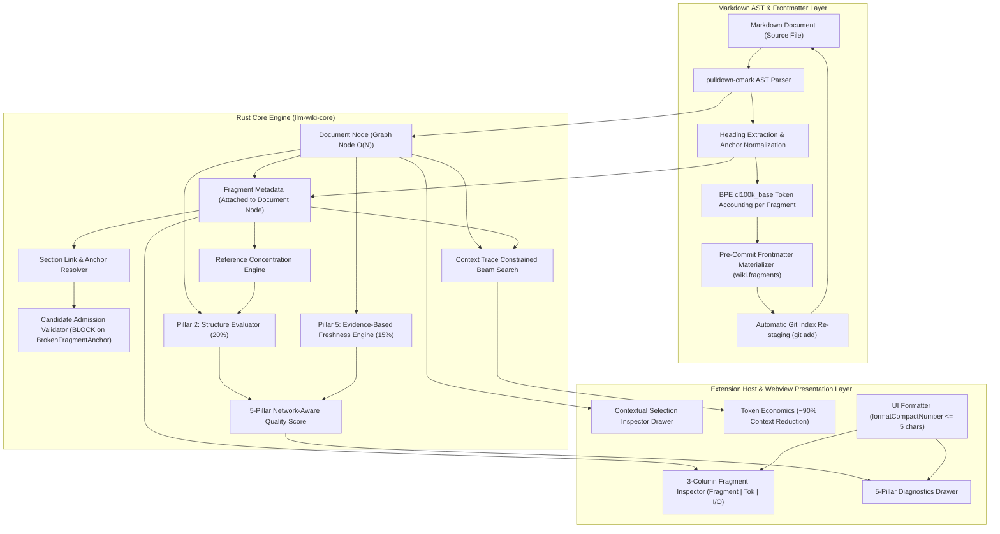

---
wiki:
  content_hash: 8e7dcb02b914ac57c2216a7285dbb72aa71729d55e289b68119d8164628a16d7
  fragments:
    implementation-plan-fragment-level-architecture-5-pillar-quality-model:
      tokens: 4563
      inbound: 0
      outbound: 0
    1-architectural-overview-component-topology:
      tokens: 480
      inbound: 0
      outbound: 0
    2-directory-module-layout:
      tokens: 3172
      inbound: 0
      outbound: 0
    rust-core-cratescoresrc:
      tokens: 1797
      inbound: 0
      outbound: 0
    vs-code-extension-host-webview-src:
      tokens: 1366
      inbound: 0
      outbound: 0
    3-execution-phases-milestones:
      tokens: 812
      inbound: 0
      outbound: 0
    phase-1-markdown-ast-fragment-extraction-anchor-normalization:
      tokens: 79
      inbound: 0
      outbound: 0
    phase-2-non-destructive-frontmatter-materialization-layer-pre-commit-staging:
      tokens: 89
      inbound: 0
      outbound: 0
    phase-3-section-fragment-link-resolution-pre-commit-admission-control:
      tokens: 89
      inbound: 0
      outbound: 0
    phase-4-reference-concentration-pillar-2-structure-engine:
      tokens: 102
      inbound: 0
      outbound: 0
    phase-5-deterministic-evidence-based-freshness-engine-pillar-5:
      tokens: 98
      inbound: 0
      outbound: 0
    phase-6-context-trace-section-level-routing-beam-search:
      tokens: 89
      inbound: 0
      outbound: 0
    phase-7-webview-fragment-inspector-compact-presentation-formatting:
      tokens: 98
      inbound: 0
      outbound: 0
    phase-8-benchmarking-end-to-end-verification-documentation:
      tokens: 157
      inbound: 0
      outbound: 0
---
# Implementation Plan: Fragment-Level Architecture & 5-Pillar Quality Model

**Feature Branch:** `004-fragment-architecture-quality`  
**Target Delivery:** `llm_wiki_ext4vsc` (`llm-wiki-core` in Rust + TypeScript Extension Host)  
**Status:** In Review / Implementation Plan  
**Constitution Authority:** `CONSTITUTION.md` v1.5.0 (Invariants I–XII, Principles I–XI)  

---

## 1. Architectural Overview & Component Topology

---

## 2. Directory & Module Layout

### Rust Core (`crates/core/src/`)
- `fragment/`: Section fragment extraction, normalization, and frontmatter materialization.
  - `crates/cli/src/commands/mod.rs`: `FragmentMetadata`, `MaterializedWikiFrontmatter`, serde types.
  - `crates/core/src/drift/extractor.rs`: CommonMark AST heading extraction, URL-safe anchor normalization, line range detection, BPE token counting.
  - `crates/core/src/fragment/frontmatter.rs`: Non-destructive YAML frontmatter reading, injection, and updating (`wiki.fragments`) preserving user keys, with automatic git staging (`git add`).
  - `crates/core/src/fragment/concentration.rs`: Reference concentration calculation ($C(f) = \text{inbound}(f) / \sum \text{inbound}$).
- `graph/`:
  - `crates/core/src/model/mod.rs`: Integrate `fragments: Vec<FragmentMetadata>` and `freshness: Option<FreshnessEvidence>` into `NoteNode`.
  - `crates/core/src/model/mod.rs`: Support `target_fragment: Option<String>` and `LinkResolutionStatus::BrokenFragmentAnchor`.
  - `crates/core/src/graph/resolver.rs`: Resolve section fragment links (`doc.md#anchor`) and detect dangling anchors.
- `candidate/`:
*candidate/validator.rs* *candidate/validator.rs* *candidate/validator.rs*-*candidate/validator.rs* *candidate/validator.rs*`*candidate/validator.rs*c*candidate/validator.rs*a*candidate/validator.rs*n*candidate/validator.rs*d*candidate/validator.rs*i*candidate/validator.rs*d*candidate/validator.rs*a*candidate/validator.rs*t*candidate/validator.rs*e*candidate/validator.rs*/*candidate/validator.rs*v*candidate/validator.rs*a*candidate/validator.rs*l*candidate/validator.rs*i*candidate/validator.rs*d*candidate/validator.rs*a*candidate/validator.rs*t*candidate/validator.rs*o*candidate/validator.rs*r*candidate/validator.rs*.*candidate/validator.rs*r*candidate/validator.rs*s*candidate/validator.rs*`*candidate/validator.rs*:*candidate/validator.rs* *candidate/validator.rs*P*candidate/validator.rs*r*candidate/validator.rs*e*candidate/validator.rs*-*candidate/validator.rs*c*candidate/validator.rs*o*candidate/validator.rs*m*candidate/validator.rs*m*candidate/validator.rs*i*candidate/validator.rs*t*candidate/validator.rs* *candidate/validator.rs*a*candidate/validator.rs*d*candidate/validator.rs*m*candidate/validator.rs*i*candidate/validator.rs*s*candidate/validator.rs*s*candidate/validator.rs*i*candidate/validator.rs*o*candidate/validator.rs*n*candidate/validator.rs* *candidate/validator.rs*c*candidate/validator.rs*o*candidate/validator.rs*n*candidate/validator.rs*t*candidate/validator.rs*r*candidate/validator.rs*o*candidate/validator.rs*l*candidate/validator.rs* *candidate/validator.rs*e*candidate/validator.rs*v*candidate/validator.rs*a*candidate/validator.rs*l*candidate/validator.rs*u*candidate/validator.rs*a*candidate/validator.rs*t*candidate/validator.rs*i*candidate/validator.rs*n*candidate/validator.rs*g*candidate/validator.rs* *candidate/validator.rs*c*candidate/validator.rs*a*candidate/validator.rs*n*candidate/validator.rs*d*candidate/validator.rs*i*candidate/validator.rs*d*candidate/validator.rs*a*candidate/validator.rs*t*candidate/validator.rs*e*candidate/validator.rs* *candidate/validator.rs*g*candidate/validator.rs*r*candidate/validator.rs*a*candidate/validator.rs*p*candidate/validator.rs*h*candidate/validator.rs*;*candidate/validator.rs* *candidate/validator.rs*e*candidate/validator.rs*n*candidate/validator.rs*f*candidate/validator.rs*o*candidate/validator.rs*r*candidate/validator.rs*c*candidate/validator.rs*e*candidate/validator.rs*s*candidate/validator.rs* *candidate/validator.rs*`*candidate/validator.rs*B*candidate/validator.rs*L*candidate/validator.rs*O*candidate/validator.rs*C*candidate/validator.rs*K*candidate/validator.rs*`*candidate/validator.rs* *candidate/validator.rs*o*candidate/validator.rs*n*candidate/validator.rs* *candidate/validator.rs*n*candidate/validator.rs*e*candidate/validator.rs*w*candidate/validator.rs* *candidate/validator.rs*`*candidate/validator.rs*B*candidate/validator.rs*r*candidate/validator.rs*o*candidate/validator.rs*k*candidate/validator.rs*e*candidate/validator.rs*n*candidate/validator.rs*F*candidate/validator.rs*r*candidate/validator.rs*a*candidate/validator.rs*g*candidate/validator.rs*m*candidate/validator.rs*e*candidate/validator.rs*n*candidate/validator.rs*t*candidate/validator.rs*A*candidate/validator.rs*n*candidate/validator.rs*c*candidate/validator.rs*h*candidate/validator.rs*o*candidate/validator.rs*r*candidate/validator.rs*`*candidate/validator.rs* *candidate/validator.rs*r*candidate/validator.rs*e*candidate/validator.rs*g*candidate/validator.rs*r*candidate/validator.rs*e*candidate/validator.rs*s*candidate/validator.rs*s*candidate/validator.rs*i*candidate/validator.rs*o*candidate/validator.rs*n*candidate/validator.rs*s*candidate/validator.rs* *candidate/validator.rs*a*candidate/validator.rs*n*candidate/validator.rs*d*candidate/validator.rs* *candidate/validator.rs*e*candidate/validator.rs*m*candidate/validator.rs*i*candidate/validator.rs*t*candidate/validator.rs*s*candidate/validator.rs* *candidate/validator.rs*`*candidate/validator.rs*W*candidate/validator.rs*A*candidate/validator.rs*R*candidate/validator.rs*N*candidate/validator.rs*`*candidate/validator.rs* *candidate/validator.rs*o*candidate/validator.rs*n*candidate/validator.rs* *candidate/validator.rs*o*candidate/validator.rs*v*candidate/validator.rs*e*candidate/validator.rs*r*candidate/validator.rs*s*candidate/validator.rs*i*candidate/validator.rs*z*candidate/validator.rs*e*candidate/validator.rs*d*candidate/validator.rs* *candidate/validator.rs*d*candidate/validator.rs*o*candidate/validator.rs*c*candidate/validator.rs*u*candidate/validator.rs*m*candidate/validator.rs*e*candidate/validator.rs*n*candidate/validator.rs*t*candidate/validator.rs*s*candidate/validator.rs* *candidate/validator.rs*l*candidate/validator.rs*a*candidate/validator.rs*c*candidate/validator.rs*k*candidate/validator.rs*i*candidate/validator.rs*n*candidate/validator.rs*g*candidate/validator.rs* *candidate/validator.rs*m*candidate/validator.rs*e*candidate/validator.rs*t*candidate/validator.rs*a*candidate/validator.rs*d*candidate/validator.rs*a*candidate/validator.rs*t*candidate/validator.rs*a*candidate/validator.rs*.*candidate/validator.rs*
*candidate/validator.rs*- `trace/`:
  - `crates/core/src/trace/beam.rs`: Constrained beam search ($W=5, D=4$) with section-level routing and context reduction calculation.
- `drift/`:
  - `crates/core/src/drift/freshness.rs`: Deterministic evidence-based freshness scoring (code citation existence, Git commit chronology, deleted symbols, canonical contradictions).
- `quality/`:
  - `crates/core/src/quality/structure.rs`: Structure debt finding engine (missing fragment metadata, oversized documents, reference concentration $\ge 70\%$, unfragmented hubs).
  - `crates/core/src/quality/scorer.rs`: Upgrade composite score to 5 pillars (Integrity 25%, Structure 20%, Consistency 20%, Discoverability 20%, Freshness 15%) with betweenness weighting and explainable reasons.
- `cli/`:
  - `crates/core/src/cli/materialize_cmd.rs`: CLI subcommand `llm-wiki-core materialize <path>`.
  - `crates/core/src/cli/trace_cmd.rs`: Update `llm-wiki-core trace` with fragment targeting and context reduction reporting.
  - `crates/core/src/cli/issues_cmd.rs`: Update issues filtering for 5 pillars.

### VS Code Extension Host & Webview (`src/`)
- *src/types/fragment.ts*: TypeScript definitions for fragments, 5-pillar scores, debt summaries, and Context Trace responses.
- *src/utils/numberFormat.ts*: Universal `formatCompactNumber` enforcing $\le 5$ character limit across all numbers.
- `extension/webview-ui/src/components/inspectorDrawer.ts`: Add collapsible "Fragments" 3-column table (`Fragment | Tok | I/O`), empty state banner (`"No heading sections found"`), progressive disclosure ordering, click-to-line navigation, and reference tooltips.
- `extension/webview-ui/src/components/settingsDrawer.ts`: Add Pillar 2 (`Structure`) and Pillar 5 (`Freshness`) to Diagnostics drawer tabs and itemized issue rendering.
- `extension/webview-ui/src/components/statusDashboard.ts`: Update Quality gauge and pillar breakdown to 5 dimensions.
*src/rpc/rpcClient.ts*-*src/rpc/rpcClient.ts* *src/rpc/rpcClient.ts*`*src/rpc/rpcClient.ts*s*src/rpc/rpcClient.ts*r*src/rpc/rpcClient.ts*c*src/rpc/rpcClient.ts*/*src/rpc/rpcClient.ts*r*src/rpc/rpcClient.ts*p*src/rpc/rpcClient.ts*c*src/rpc/rpcClient.ts*/*src/rpc/rpcClient.ts*r*src/rpc/rpcClient.ts*p*src/rpc/rpcClient.ts*c*src/rpc/rpcClient.ts*C*src/rpc/rpcClient.ts*l*src/rpc/rpcClient.ts*i*src/rpc/rpcClient.ts*e*src/rpc/rpcClient.ts*n*src/rpc/rpcClient.ts*t*src/rpc/rpcClient.ts*.*src/rpc/rpcClient.ts*t*src/rpc/rpcClient.ts*s*src/rpc/rpcClient.ts*`*src/rpc/rpcClient.ts*:*src/rpc/rpcClient.ts* *src/rpc/rpcClient.ts*S*src/rpc/rpcClient.ts*t*src/rpc/rpcClient.ts*r*src/rpc/rpcClient.ts*o*src/rpc/rpcClient.ts*n*src/rpc/rpcClient.ts*g*src/rpc/rpcClient.ts*l*src/rpc/rpcClient.ts*y*src/rpc/rpcClient.ts* *src/rpc/rpcClient.ts*t*src/rpc/rpcClient.ts*y*src/rpc/rpcClient.ts*p*src/rpc/rpcClient.ts*e*src/rpc/rpcClient.ts*d*src/rpc/rpcClient.ts* *src/rpc/rpcClient.ts*c*src/rpc/rpcClient.ts*l*src/rpc/rpcClient.ts*i*src/rpc/rpcClient.ts*e*src/rpc/rpcClient.ts*n*src/rpc/rpcClient.ts*t*src/rpc/rpcClient.ts* *src/rpc/rpcClient.ts*c*src/rpc/rpcClient.ts*a*src/rpc/rpcClient.ts*l*src/rpc/rpcClient.ts*l*src/rpc/rpcClient.ts*s*src/rpc/rpcClient.ts* *src/rpc/rpcClient.ts*f*src/rpc/rpcClient.ts*o*src/rpc/rpcClient.ts*r*src/rpc/rpcClient.ts* *src/rpc/rpcClient.ts*f*src/rpc/rpcClient.ts*r*src/rpc/rpcClient.ts*a*src/rpc/rpcClient.ts*g*src/rpc/rpcClient.ts*m*src/rpc/rpcClient.ts*e*src/rpc/rpcClient.ts*n*src/rpc/rpcClient.ts*t*src/rpc/rpcClient.ts* *src/rpc/rpcClient.ts*r*src/rpc/rpcClient.ts*e*src/rpc/rpcClient.ts*t*src/rpc/rpcClient.ts*r*src/rpc/rpcClient.ts*i*src/rpc/rpcClient.ts*e*src/rpc/rpcClient.ts*v*src/rpc/rpcClient.ts*a*src/rpc/rpcClient.ts*l*src/rpc/rpcClient.ts*,*src/rpc/rpcClient.ts* *src/rpc/rpcClient.ts*f*src/rpc/rpcClient.ts*r*src/rpc/rpcClient.ts*o*src/rpc/rpcClient.ts*n*src/rpc/rpcClient.ts*t*src/rpc/rpcClient.ts*m*src/rpc/rpcClient.ts*a*src/rpc/rpcClient.ts*t*src/rpc/rpcClient.ts*t*src/rpc/rpcClient.ts*e*src/rpc/rpcClient.ts*r*src/rpc/rpcClient.ts* *src/rpc/rpcClient.ts*m*src/rpc/rpcClient.ts*a*src/rpc/rpcClient.ts*t*src/rpc/rpcClient.ts*e*src/rpc/rpcClient.ts*r*src/rpc/rpcClient.ts*i*src/rpc/rpcClient.ts*a*src/rpc/rpcClient.ts*l*src/rpc/rpcClient.ts*i*src/rpc/rpcClient.ts*z*src/rpc/rpcClient.ts*a*src/rpc/rpcClient.ts*t*src/rpc/rpcClient.ts*i*src/rpc/rpcClient.ts*o*src/rpc/rpcClient.ts*n*src/rpc/rpcClient.ts*,*src/rpc/rpcClient.ts* *src/rpc/rpcClient.ts*a*src/rpc/rpcClient.ts*n*src/rpc/rpcClient.ts*d*src/rpc/rpcClient.ts* *src/rpc/rpcClient.ts*5*src/rpc/rpcClient.ts*-*src/rpc/rpcClient.ts*p*src/rpc/rpcClient.ts*i*src/rpc/rpcClient.ts*l*src/rpc/rpcClient.ts*l*src/rpc/rpcClient.ts*a*src/rpc/rpcClient.ts*r*src/rpc/rpcClient.ts* *src/rpc/rpcClient.ts*s*src/rpc/rpcClient.ts*c*src/rpc/rpcClient.ts*o*src/rpc/rpcClient.ts*r*src/rpc/rpcClient.ts*i*src/rpc/rpcClient.ts*n*src/rpc/rpcClient.ts*g*src/rpc/rpcClient.ts*.*src/rpc/rpcClient.ts*
*src/rpc/rpcClient.ts*
---

## 3. Execution Phases & Milestones

### Phase 1: Markdown AST Fragment Extraction & Anchor Normalization
- Unit tests for heading levels H1–H6, CommonMark URL-safe anchor normalization, line range mapping, duplicate anchor disambiguation (`#heading-1`).
- Implement `crates/core/src/drift/extractor.rs` and integrate with `tiktoken-rs` for fragment token counting.

### Phase 2: Non-Destructive Frontmatter Materialization Layer & Pre-Commit Staging
- Unit tests verifying YAML frontmatter injection and update under `wiki.fragments` while preserving existing user keys (`title`, `tags`, custom YAML).
- Implement `crates/core/src/fragment/frontmatter.rs` and pre-commit hook integration in *candidate/validator.rs* with automatic Git index re-staging (`git add <path>`).

### Phase 3: Section Fragment Link Resolution & Pre-Commit Admission Control
- Extend `NoteEdge` with `target_fragment` and `BrokenFragmentAnchor`.
- Update link resolver to check `#anchor` against target document fragments and report line-precise Integrity regressions.
- Wire `BrokenFragmentAnchor` into *candidate/validator.rs* to enforce `BLOCK` exit code 1 during pre-commit on new dangling fragment links.

### Phase 4: Reference Concentration & Pillar 2 Structure Engine
- Implement `crates/core/src/fragment/concentration.rs` and `crates/core/src/quality/structure.rs`.
- Detect oversized documents ($>50\text{k}$ tokens or $>10$ headings), high reference concentration ($C \ge 70\%$), and unfragmented central hubs.
- Integrate `Structure` as Pillar 2 (20% weight) with explainable guidance reasons.

### Phase 5: Deterministic Evidence-Based Freshness Engine (Pillar 5)
- Implement `crates/core/src/drift/freshness.rs` evaluating local code citations on disk, Git code changes occurring after doc commits (capped at -30 pts), deleted/renamed symbols, and canonical contradictions.
- Integrate `Freshness` as Pillar 5 (15% weight) with `Fresh`, `PotentiallyStale`, `Stale` classifications.

### Phase 6: Context Trace Section-Level Routing & Beam Search
- Implement `crates/core/src/trace/beam.rs` executing constrained beam search ($W=5, D=4$) from entry point (`AGENTS.md`) targeting document fragments.
- Compute and report quantitative context reduction ($\approx 90\%$) and explainable relevance justifications (with 0.0% fallback when no fragment is selected).

### Phase 7: Webview Fragment Inspector & Compact Presentation Formatting
- Implement `formatCompactNumber` with unit tests verifying $\le 5$ characters across all scales up to billions.
- Implement Fragment Inspector in `extension/webview-ui/src/components/inspectorDrawer.ts` (3-column table `Fragment | Tok | I/O`, empty state, and progressive disclosure).
- Update Diagnostics drawer in `extension/webview-ui/src/components/settingsDrawer.ts` with 5 pillar tabs.

### Phase 8: Benchmarking, End-to-End Verification & Documentation
- Criterion microbenchmarks for fragment parsing ($\le 50\text{ ms}$, NFR-001), incremental graph patch ($\le 50\text{ ms}$, NFR-002), normal git delta ($< 150\text{ ms}$, NFR-003), Context Trace beam search ($\le 100\text{ ms}$, NFR-005), and warm search ($\le 50\text{ ms}$, NFR-006).
- Complete test execution (`cargo test`, `npm test`), linter checks, packaging size check ($\le 25\text{ MB}$, NFR-009), and VSIX installation.
