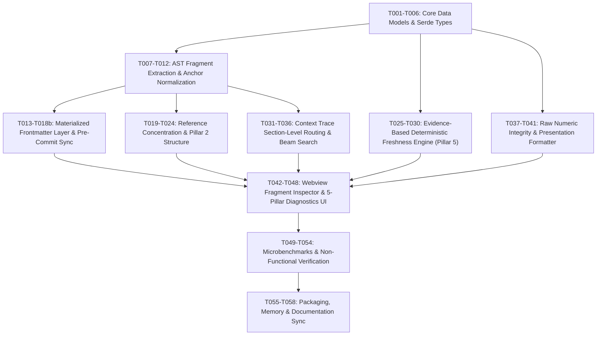

---
wiki:
  content_hash: 5461f1820b0d75c63a3a627324e92542cc9a41a9536aabd98f18463e806f7f24
  fragments:
    tasks-fragment-level-architecture-5-pillar-quality-model:
      tokens: 8233
      inbound: 0
      outbound: 3
    task-matrix-dependencies:
      tokens: 257
      inbound: 0
      outbound: 0
    phase-1-core-fragment-data-models-serde-types-tasks-t001t006:
      tokens: 569
      inbound: 0
      outbound: 0
    phase-2-heading-anchor-derivation-fragment-extraction-tasks-t007t012:
      tokens: 498
      inbound: 0
      outbound: 0
    phase-3-materialized-frontmatter-layer-pre-commit-sync-tasks-t013t018b:
      tokens: 572
      inbound: 0
      outbound: 0
    phase-4-reference-concentration-pillar-2-structure-engine-tasks-t019t024:
      tokens: 515
      inbound: 0
      outbound: 0
    phase-5-evidence-based-deterministic-freshness-engine-pillar-5-tasks-t025t030:
      tokens: 441
      inbound: 0
      outbound: 0
    phase-6-context-trace-section-level-routing-beam-search-tasks-t031t036:
      tokens: 457
      inbound: 0
      outbound: 0
    phase-7-raw-numeric-integrity-presentation-formatter-tasks-t037t041:
      tokens: 406
      inbound: 0
      outbound: 0
    phase-8-webview-fragment-inspector-5-pillar-diagnostics-ui-tasks-t042t048:
      tokens: 3652
      inbound: 0
      outbound: 0
    phase-9-microbenchmarks-non-functional-verification-tasks-t049t054b:
      tokens: 472
      inbound: 0
      outbound: 0
    phase-10-vsix-packaging-memory-documentation-sync-tasks-t055t058:
      tokens: 264
      inbound: 0
      outbound: 0
---
# Tasks: Fragment-Level Architecture & 5-Pillar Quality Model

**Feature Branch:** `004-fragment-architecture-quality`  
**Target Delivery:** `llm_wiki_ext4vsc` (`llm-wiki-core` in Rust + TypeScript Extension Host)  
**Status:** In Review / Tasks Breakdown  
**Specification:** [`spec.md`](spec.md) | **Plan:** [`plan.md`](plan.md) | **Data Model:** [`data-model.md`](data-model.md)  
**Constitution Authority:** `CONSTITUTION.md` v1.5.0 (Invariants I–XII)  

---

## Task Matrix & Dependencies

---

## Phase 1: Core Fragment Data Models & Serde Types (Tasks T001–T006)

- [x] **T001**: Define `FragmentMetadata`, `MaterializedWikiFrontmatter`, and `MaterializedFragmentEntry` in `crates/core/src/fragment/mod.rs` matching `data-model.md` with full raw integer token counts.
  - **Mapped Requirements**: FR-001, FR-003, FR-009, FR-014, Invariant V, Invariant IX
  - **Verification**: `cargo test test_fragment_model_serialization`

- [x] **T002**: Update `NoteNode` in `crates/core/src/model/mod.rs` to include `fragments: Vec<FragmentMetadata>` and `freshness: Option<FreshnessEvidence>`, preserving $O(N)$ document-level graph nodes.
  - **Mapped Requirements**: FR-001, FR-003, Invariant V
  - **Verification**: `cargo test test_note_node_with_fragments`

- [x] **T003**: Update `NoteEdge` in `crates/core/src/model/mod.rs` to support `target_fragment: Option<String>` and `LinkResolutionStatus::BrokenFragmentAnchor`.
  - **Mapped Requirements**: FR-004, FR-005, FR-007
  - **Verification**: `cargo test test_edge_fragment_targeting`

- [x] **T004**: Define `StructureDebtFinding` and `StructureDebtType` in `crates/core/src/quality/structure.rs` representing missing metadata, oversized documents, high concentration, and unfragmented hubs.
  - **Mapped Requirements**: FR-026, FR-027, FR-028, FR-029
  - **Verification**: `cargo test test_structure_debt_types`

- [x] **T005**: Define `FreshnessEvidence` and `FreshnessTier` in `crates/core/src/drift/freshness.rs` modeling code citations, Git commit chronology, deleted symbols, and canonical contradictions.
  - **Mapped Requirements**: FR-038, FR-039
  - **Verification**: `cargo test test_freshness_evidence_serialization`

- [x] **T006**: Define `FivePillarQualityScore`, `QualityPillar` (5 variants: Integrity, Structure, Consistency, Discoverability, Freshness), `DebtSummary`, and `ContextTraceSectionResult` in `crates/core/src/quality/scorer.rs`, `crates/core/src/debt/mod.rs`, and `crates/core/src/trace/mod.rs`.
  - **Mapped Requirements**: FR-030, FR-033, FR-036, FR-040
  - **Verification**: `cargo test test_five_pillar_score_model`

---

## Phase 2: Heading Anchor Derivation & Fragment Extraction (Tasks T007–T012)

- [x] **T007**: Implement deterministic anchor normalization in `crates/core/src/fragment/extractor.rs` (CommonMark URL-safe slugification, lowercase, alphanumeric, hyphen collapsing, duplicate disambiguation `#anchor-1`).
  - **Mapped Requirements**: FR-002, FR-006, Invariant VI
  - **Verification**: Unit tests in `crates/core/tests/anchor_normalization_test.rs`

- [x] **T008**: Implement CommonMark AST heading traversal using `pulldown-cmark` in `crates/core/src/fragment/extractor.rs` capturing `heading`, `anchor`, `start_line`, and `end_line` ranges for levels H1 through H6.
  - **Mapped Requirements**: FR-002, FR-003, Invariant VII
  - **Verification**: `cargo test test_ast_heading_extraction`

- [x] **T009**: Integrate BPE token accounting (`tiktoken-rs` with `cl100k_base`) per fragment in `crates/core/src/drift/extractor.rs`, storing exact integer tokens.
  - **Mapped Requirements**: FR-003, Invariant IX
  - **Verification**: `cargo test test_fragment_bpe_token_counting`

- [x] **T010**: Implement inbound and outbound link reference counting per fragment in `crates/core/src/drift/extractor.rs`.
  - **Mapped Requirements**: FR-003, FR-007
  - **Verification**: `cargo test test_fragment_reference_counts`

- [x] **T011**: Implement section fragment link resolution in `crates/core/src/graph/resolver.rs` (`[Label](./doc.md#anchor)` and wikilinks `[[doc#anchor]]`), validating anchor existence and flagging `BrokenFragmentAnchor` when missing.
  - **Mapped Requirements**: FR-004, FR-005, Invariant VI
  - **Verification**: `cargo test test_fragment_link_resolution`

- [x] **T012**: Comprehensive unit tests in `crates/core/tests/fragment_extraction_test.rs` validating extraction precision, line ranges, anchor collision handling, and dead fragment link reporting.
  - **Mapped Requirements**: SC-001, SC-003
  - **Verification**: `cargo test --test fragment_extraction_test`

---

## Phase 3: Materialized Frontmatter Layer & Pre-Commit Sync (Tasks T013–T018b)

- [x] **T013**: Implement non-destructive YAML frontmatter parser and updater in `crates/core/src/fragment/frontmatter.rs` injecting or updating `wiki.fragments` without altering user frontmatter keys or formatting.
  - **Mapped Requirements**: FR-008, FR-009, FR-011, Invariant VIII
  - **Verification**: `cargo test test_non_destructive_frontmatter_update`

- [x] **T014**: Implement AST authority verification: compare frontmatter content hash against Markdown body to bypass runtime re-parsing when valid.
  - **Mapped Requirements**: FR-013, Invariant VII, Invariant VIII
  - **Verification**: `cargo test test_frontmatter_cache_validity`

- [x] **T015**: Integrate frontmatter materialization into `llm-wiki-validate` pre-commit workflow in `crates/core/src/candidate/evaluator.rs`, generating metadata for staged Markdown files and automatically executing `git add <file>` to re-stage the updated frontmatter into the Git index.
  - **Mapped Requirements**: FR-010, Invariant I, Invariant II, Invariant VIII
  - **Verification**: `cargo test test_pre_commit_frontmatter_materialization_and_restaging`

- [x] **T016**: Implement CLI subcommand `llm-wiki-core materialize <path>` in `crates/core/src/cli/materialize_cmd.rs` enabling manual or scripted frontmatter materialization.
  - **Mapped Requirements**: FR-010
  - **Verification**: `cargo test test_cli_materialize_command`

- [x] **T017**: Implement pre-commit check emitting `WARN` structural debt notice on oversized documents ($>50\text{k}$ tokens or $>10$ headings) lacking materialized fragment metadata.
  - **Mapped Requirements**: FR-012, FR-042
  - **Verification**: `cargo test test_oversized_doc_metadata_warning`

- [x] **T017b**: Wire `BrokenFragmentAnchor` regression detection into `crates/core/src/candidate/evaluator.rs`, asserting that commits introducing new dangling fragment anchors return `BLOCK` (exit code 1).
  - **Mapped Requirements**: FR-005, FR-042, Invariant XII
  - **Verification**: `cargo test test_pre_commit_block_on_broken_fragment_anchor`

- [x] **T018**: Unit tests in `crates/core/tests/frontmatter_test.rs` validating preservation of user YAML keys (`title`, `tags`, custom fields, comments) during materialization roundtrip.
  - **Mapped Requirements**: SC-002
  - **Verification**: `cargo test --test frontmatter_test`

---

## Phase 4: Reference Concentration & Pillar 2 Structure Engine (Tasks T019–T024)

- [x] **T019**: Implement Reference Concentration calculation in `crates/core/src/fragment/concentration.rs`: $C(f) = \text{inbound}(f) / \sum \text{inbound}$.
  - **Mapped Requirements**: FR-025
  - **Verification**: `cargo test test_reference_concentration_calculation`

- [x] **T020**: Implement structural debt detectors in `crates/core/src/quality/structure.rs`: oversized documents ($>50\text{k}$ tokens or $>10$ headings), high concentration ($C \ge 70\%$ on docs $\ge 50\text{k}$ tokens), and unfragmented central hubs (in-degree $\ge 10$, tokens $\ge 20\text{k}$, fragments $\le 1$).
  - **Mapped Requirements**: FR-026, FR-027, FR-028
  - **Verification**: `cargo test test_structural_debt_detection`

- [x] **T021**: Formulate `Structure` pillar score ($0\text{--}100$) in `crates/core/src/quality/structure.rs` with explainable remediation guidance.
  - **Mapped Requirements**: FR-028, FR-029
  - **Verification**: `cargo test test_structure_score_calculation`

- [x] **T022**: Integrate `Structure` as Pillar 2 (20% weight) into the overall composite quality score in `crates/core/src/quality/scorer.rs` with betweenness centrality weighting multiplier $(1.0 + 3.0 \cdot B(v))$.
  - **Mapped Requirements**: FR-036, FR-037
  - **Verification**: `cargo test test_five_pillar_composite_score`

- [x] **T023**: Update CLI command `llm-wiki-core issues --pillar structure` in `crates/core/src/cli/issues_cmd.rs` to filter and render structure debt findings.
  - **Mapped Requirements**: FR-041
  - **Verification**: `cargo test test_cli_issues_structure_filter`

- [x] **T024**: Unit tests in `crates/core/tests/structure_pillar_test.rs` verifying concentration thresholds and structure debt reporting.
  - **Mapped Requirements**: SC-005
  - **Verification**: `cargo test --test structure_pillar_test`

---

## Phase 5: Evidence-Based Deterministic Freshness Engine (Pillar 5) (Tasks T025–T030)

- [x] **T025**: Implement code citation disk verification in `crates/core/src/drift/freshness.rs` (Signal 1: verify cited code paths exist on local disk).
  - **Mapped Requirements**: FR-038
  - **Verification**: `cargo test test_code_citation_disk_verification`

- [x] **T026**: Implement Git commit chronology analyzer in `crates/core/src/drift/freshness.rs` (Signal 2: check if cited code paths were modified in Git after the doc's last commit, capped at -30 pts).
  - **Mapped Requirements**: FR-038
  - **Verification**: `cargo test test_git_commit_chronology_check`

- [x] **T027**: Implement deleted/renamed symbol impact analyzer in `crates/core/src/drift/freshness.rs` (Signal 3: detect deleted symbols cited in doc).
  - **Mapped Requirements**: FR-038
  - **Verification**: `cargo test test_deleted_symbol_impact`

- [x] **T028**: Implement canonical contradiction detector in `crates/core/src/drift/freshness.rs` (Signal 4: check contradictions against canonical documents).
  - **Mapped Requirements**: FR-038
  - **Verification**: `cargo test test_canonical_contradiction_detection`

- [x] **T029**: Implement composite Freshness scoring ($0\text{--}100$) and discrete tier classification (`Fresh`, `PotentiallyStale`, `Stale`) with explainable penalty reasons.
  - **Mapped Requirements**: FR-038, FR-039, FR-040
  - **Verification**: `cargo test test_freshness_scoring_and_tiers`

- [x] **T030**: Unit tests in `crates/core/tests/freshness_evidence_test.rs` verifying evidence signals, deductions, and tier classifications.
  - **Mapped Requirements**: SC-005
  - **Verification**: `cargo test --test freshness_evidence_test`

---

## Phase 6: Context Trace Section-Level Routing & Beam Search (Tasks T031–T036)

- [x] **T031**: Implement constrained beam search algorithm in `crates/core/src/trace/beam.rs` (beam width $W=5$, max depth $D=4$) starting from `AGENTS.md` or central hub.
  - **Mapped Requirements**: FR-030, FR-035
  - **Verification**: `cargo test test_beam_search_traversal`

- [x] **T032**: Implement candidate scoring in `crates/core/src/trace/beam.rs` combining query term match, document title match, fragment heading match, tag overlap, and graph proximity.
  - **Mapped Requirements**: FR-031
  - **Verification**: `cargo test test_beam_candidate_scoring`

- [x] **T033**: Implement section-level refinement in `crates/core/src/trace/beam.rs` routing to `doc.md#fragment` when fragment heading matches query terms.
  - **Mapped Requirements**: FR-032
  - **Verification**: `cargo test test_section_level_refinement`

- [x] **T034**: Calculate quantitative Context Reduction percentage: $(T_{\text{doc}} - T_{\text{fragment}}) / T_{\text{doc}} \times 100\%$ (defaulting to 0.0% if no fragment targeted) and format explainable reasons.
  - **Mapped Requirements**: FR-033
  - **Verification**: `cargo test test_context_reduction_calculation`

- [x] **T035**: Update CLI command `llm-wiki-core trace` in `crates/core/src/cli/trace_cmd.rs` to display section target, depth, tokens, and context reduction percentage.
  - **Mapped Requirements**: FR-033
  - **Verification**: `cargo test test_cli_trace_section_display`

- [x] **T036**: Unit tests in `crates/core/tests/context_trace_section_test.rs` verifying beam search traversal, section targeting, and $\ge 80\%$ context reduction.
  - **Mapped Requirements**: SC-004
  - **Verification**: `cargo test --test context_trace_section_test`

---

## Phase 7: Raw Numeric Integrity & Presentation Formatter (Tasks T037–T041)

- [x] **T037**: Audit all Rust structs, serde serialization, and IPC payloads to ensure 100% complete raw integer representations (`u32`, `usize`).
  - **Mapped Requirements**: FR-014, Invariant IX
  - **Verification**: `cargo test test_raw_numeric_integrity_in_contracts`

- [x] **T038**: Implement TypeScript `formatCompactNumber` in *src/utils/numberFormat.ts* enforcing strict $\le 5$ character length across all scales (`543`, `4.23k`, `13.3k`, `1.04M`, `123M`, `1.2B`).
  - **Mapped Requirements**: FR-015, FR-016, Invariant X
  - **Verification**: `npm test`
- [x] **T039**: Unit tests in *test/suite/numberFormat.test.ts* asserting strict $\le 5$ character limits across boundary numbers ($0$, $999$, $1000$, $4230$, $13300$, $543000$, $1043256$, $123456789$, $999900000$, $1200000000$).
  - **Mapped Requirements**: FR-018, SC-006
  - **Verification**: `npm test`

- [x] **T040**: Verify zero formatted strings are stored or fed into analytical calculation pipelines.
  - **Mapped Requirements**: FR-017, Invariant X
  - **Verification**: Code review pass and AST assertions

- [x] **T041**: Implement TypeScript type definitions in *src/types/fragment.ts* matching contracts and data model (`FivePillarQualityScore`, `StructureDebtFinding`, `StructureDebtType`, `DebtSummary`, `QualityPillar`).
  - **Mapped Requirements**: FR-014
  - **Verification**: `npm run build`

---

## Phase 8: Webview Fragment Inspector & 5-Pillar Diagnostics UI (Tasks T042–T048)

*src/rpc/rpcClient.ts*-*src/rpc/rpcClient.ts* *src/rpc/rpcClient.ts*[*src/rpc/rpcClient.ts*x*src/rpc/rpcClient.ts*]*src/rpc/rpcClient.ts* *src/rpc/rpcClient.ts***src/rpc/rpcClient.ts***src/rpc/rpcClient.ts*T*src/rpc/rpcClient.ts*0*src/rpc/rpcClient.ts*4*src/rpc/rpcClient.ts*2*src/rpc/rpcClient.ts***src/rpc/rpcClient.ts***src/rpc/rpcClient.ts*:*src/rpc/rpcClient.ts* *src/rpc/rpcClient.ts*E*src/rpc/rpcClient.ts*x*src/rpc/rpcClient.ts*t*src/rpc/rpcClient.ts*e*src/rpc/rpcClient.ts*n*src/rpc/rpcClient.ts*d*src/rpc/rpcClient.ts* *src/rpc/rpcClient.ts*`*src/rpc/rpcClient.ts*s*src/rpc/rpcClient.ts*r*src/rpc/rpcClient.ts*c*src/rpc/rpcClient.ts*/*src/rpc/rpcClient.ts*r*src/rpc/rpcClient.ts*p*src/rpc/rpcClient.ts*c*src/rpc/rpcClient.ts*/*src/rpc/rpcClient.ts*r*src/rpc/rpcClient.ts*p*src/rpc/rpcClient.ts*c*src/rpc/rpcClient.ts*C*src/rpc/rpcClient.ts*l*src/rpc/rpcClient.ts*i*src/rpc/rpcClient.ts*e*src/rpc/rpcClient.ts*n*src/rpc/rpcClient.ts*t*src/rpc/rpcClient.ts*.*src/rpc/rpcClient.ts*t*src/rpc/rpcClient.ts*s*src/rpc/rpcClient.ts*`*src/rpc/rpcClient.ts* *src/rpc/rpcClient.ts*w*src/rpc/rpcClient.ts*i*src/rpc/rpcClient.ts*t*src/rpc/rpcClient.ts*h*src/rpc/rpcClient.ts* *src/rpc/rpcClient.ts*t*src/rpc/rpcClient.ts*y*src/rpc/rpcClient.ts*p*src/rpc/rpcClient.ts*e*src/rpc/rpcClient.ts*d*src/rpc/rpcClient.ts* *src/rpc/rpcClient.ts*m*src/rpc/rpcClient.ts*e*src/rpc/rpcClient.ts*t*src/rpc/rpcClient.ts*h*src/rpc/rpcClient.ts*o*src/rpc/rpcClient.ts*d*src/rpc/rpcClient.ts*s*src/rpc/rpcClient.ts* *src/rpc/rpcClient.ts*f*src/rpc/rpcClient.ts*o*src/rpc/rpcClient.ts*r*src/rpc/rpcClient.ts* *src/rpc/rpcClient.ts*`*src/rpc/rpcClient.ts*g*src/rpc/rpcClient.ts*r*src/rpc/rpcClient.ts*a*src/rpc/rpcClient.ts*p*src/rpc/rpcClient.ts*h*src/rpc/rpcClient.ts*/*src/rpc/rpcClient.ts*g*src/rpc/rpcClient.ts*e*src/rpc/rpcClient.ts*t*src/rpc/rpcClient.ts*D*src/rpc/rpcClient.ts*o*src/rpc/rpcClient.ts*c*src/rpc/rpcClient.ts*u*src/rpc/rpcClient.ts*m*src/rpc/rpcClient.ts*e*src/rpc/rpcClient.ts*n*src/rpc/rpcClient.ts*t*src/rpc/rpcClient.ts*F*src/rpc/rpcClient.ts*r*src/rpc/rpcClient.ts*a*src/rpc/rpcClient.ts*g*src/rpc/rpcClient.ts*m*src/rpc/rpcClient.ts*e*src/rpc/rpcClient.ts*n*src/rpc/rpcClient.ts*t*src/rpc/rpcClient.ts*s*src/rpc/rpcClient.ts*`*src/rpc/rpcClient.ts*,*src/rpc/rpcClient.ts* *src/rpc/rpcClient.ts*`*src/rpc/rpcClient.ts*g*src/rpc/rpcClient.ts*r*src/rpc/rpcClient.ts*a*src/rpc/rpcClient.ts*p*src/rpc/rpcClient.ts*h*src/rpc/rpcClient.ts*/*src/rpc/rpcClient.ts*m*src/rpc/rpcClient.ts*a*src/rpc/rpcClient.ts*t*src/rpc/rpcClient.ts*e*src/rpc/rpcClient.ts*r*src/rpc/rpcClient.ts*i*src/rpc/rpcClient.ts*a*src/rpc/rpcClient.ts*l*src/rpc/rpcClient.ts*i*src/rpc/rpcClient.ts*z*src/rpc/rpcClient.ts*e*src/rpc/rpcClient.ts*F*src/rpc/rpcClient.ts*r*src/rpc/rpcClient.ts*o*src/rpc/rpcClient.ts*n*src/rpc/rpcClient.ts*t*src/rpc/rpcClient.ts*m*src/rpc/rpcClient.ts*a*src/rpc/rpcClient.ts*t*src/rpc/rpcClient.ts*t*src/rpc/rpcClient.ts*e*src/rpc/rpcClient.ts*r*src/rpc/rpcClient.ts*`*src/rpc/rpcClient.ts*,*src/rpc/rpcClient.ts* *src/rpc/rpcClient.ts*`*src/rpc/rpcClient.ts*t*src/rpc/rpcClient.ts*r*src/rpc/rpcClient.ts*a*src/rpc/rpcClient.ts*c*src/rpc/rpcClient.ts*e*src/rpc/rpcClient.ts*/*src/rpc/rpcClient.ts*c*src/rpc/rpcClient.ts*o*src/rpc/rpcClient.ts*n*src/rpc/rpcClient.ts*t*src/rpc/rpcClient.ts*e*src/rpc/rpcClient.ts*x*src/rpc/rpcClient.ts*t*src/rpc/rpcClient.ts*T*src/rpc/rpcClient.ts*r*src/rpc/rpcClient.ts*a*src/rpc/rpcClient.ts*c*src/rpc/rpcClient.ts*e*src/rpc/rpcClient.ts*S*src/rpc/rpcClient.ts*e*src/rpc/rpcClient.ts*c*src/rpc/rpcClient.ts*t*src/rpc/rpcClient.ts*i*src/rpc/rpcClient.ts*o*src/rpc/rpcClient.ts*n*src/rpc/rpcClient.ts*`*src/rpc/rpcClient.ts*,*src/rpc/rpcClient.ts* *src/rpc/rpcClient.ts*a*src/rpc/rpcClient.ts*n*src/rpc/rpcClient.ts*d*src/rpc/rpcClient.ts* *src/rpc/rpcClient.ts*`*src/rpc/rpcClient.ts*q*src/rpc/rpcClient.ts*u*src/rpc/rpcClient.ts*a*src/rpc/rpcClient.ts*l*src/rpc/rpcClient.ts*i*src/rpc/rpcClient.ts*t*src/rpc/rpcClient.ts*y*src/rpc/rpcClient.ts*/*src/rpc/rpcClient.ts*g*src/rpc/rpcClient.ts*e*src/rpc/rpcClient.ts*t*src/rpc/rpcClient.ts*F*src/rpc/rpcClient.ts*i*src/rpc/rpcClient.ts*v*src/rpc/rpcClient.ts*e*src/rpc/rpcClient.ts*P*src/rpc/rpcClient.ts*i*src/rpc/rpcClient.ts*l*src/rpc/rpcClient.ts*l*src/rpc/rpcClient.ts*a*src/rpc/rpcClient.ts*r*src/rpc/rpcClient.ts*S*src/rpc/rpcClient.ts*c*src/rpc/rpcClient.ts*o*src/rpc/rpcClient.ts*r*src/rpc/rpcClient.ts*e*src/rpc/rpcClient.ts*`*src/rpc/rpcClient.ts*.*src/rpc/rpcClient.ts*
*src/rpc/rpcClient.ts*  - **Mapped Requirements**: FR-007, FR-010, FR-030, FR-036
*npm test -- rpcClient.test.ts* *npm test -- rpcClient.test.ts* *npm test -- rpcClient.test.ts*-*npm test -- rpcClient.test.ts* *npm test -- rpcClient.test.ts***npm test -- rpcClient.test.ts***npm test -- rpcClient.test.ts*V*npm test -- rpcClient.test.ts*e*npm test -- rpcClient.test.ts*r*npm test -- rpcClient.test.ts*i*npm test -- rpcClient.test.ts*f*npm test -- rpcClient.test.ts*i*npm test -- rpcClient.test.ts*c*npm test -- rpcClient.test.ts*a*npm test -- rpcClient.test.ts*t*npm test -- rpcClient.test.ts*i*npm test -- rpcClient.test.ts*o*npm test -- rpcClient.test.ts*n*npm test -- rpcClient.test.ts***npm test -- rpcClient.test.ts***npm test -- rpcClient.test.ts*:*npm test -- rpcClient.test.ts* *npm test -- rpcClient.test.ts*`*npm test -- rpcClient.test.ts*n*npm test -- rpcClient.test.ts*p*npm test -- rpcClient.test.ts*m*npm test -- rpcClient.test.ts* *npm test -- rpcClient.test.ts*t*npm test -- rpcClient.test.ts*e*npm test -- rpcClient.test.ts*s*npm test -- rpcClient.test.ts*t*npm test -- rpcClient.test.ts* *npm test -- rpcClient.test.ts*-*npm test -- rpcClient.test.ts*-*npm test -- rpcClient.test.ts* *npm test -- rpcClient.test.ts*r*npm test -- rpcClient.test.ts*p*npm test -- rpcClient.test.ts*c*npm test -- rpcClient.test.ts*C*npm test -- rpcClient.test.ts*l*npm test -- rpcClient.test.ts*i*npm test -- rpcClient.test.ts*e*npm test -- rpcClient.test.ts*n*npm test -- rpcClient.test.ts*t*npm test -- rpcClient.test.ts*.*npm test -- rpcClient.test.ts*t*npm test -- rpcClient.test.ts*e*npm test -- rpcClient.test.ts*s*npm test -- rpcClient.test.ts*t*npm test -- rpcClient.test.ts*.*npm test -- rpcClient.test.ts*t*npm test -- rpcClient.test.ts*s*npm test -- rpcClient.test.ts*`*npm test -- rpcClient.test.ts*
*npm test -- rpcClient.test.ts*
- [x] **T043**: Implement "Fragments" collapsible section in `extension/webview-ui/src/components/inspectorDrawer.ts` rendering the 3-column table: `Fragment | Tok | I/O`. Include empty state banner (`"No heading sections found"`) and enforce progressive disclosure hierarchy (Primary metrics -> Fragments -> Advanced Quality).
  - **Mapped Requirements**: FR-019, FR-020, FR-023, FR-024
*test/suite/inspectorDrawer.test.ts* *test/suite/inspectorDrawer.test.ts* *test/suite/inspectorDrawer.test.ts*-*test/suite/inspectorDrawer.test.ts* *test/suite/inspectorDrawer.test.ts***test/suite/inspectorDrawer.test.ts***test/suite/inspectorDrawer.test.ts*V*test/suite/inspectorDrawer.test.ts*e*test/suite/inspectorDrawer.test.ts*r*test/suite/inspectorDrawer.test.ts*i*test/suite/inspectorDrawer.test.ts*f*test/suite/inspectorDrawer.test.ts*i*test/suite/inspectorDrawer.test.ts*c*test/suite/inspectorDrawer.test.ts*a*test/suite/inspectorDrawer.test.ts*t*test/suite/inspectorDrawer.test.ts*i*test/suite/inspectorDrawer.test.ts*o*test/suite/inspectorDrawer.test.ts*n*test/suite/inspectorDrawer.test.ts***test/suite/inspectorDrawer.test.ts***test/suite/inspectorDrawer.test.ts*:*test/suite/inspectorDrawer.test.ts* *test/suite/inspectorDrawer.test.ts*E*test/suite/inspectorDrawer.test.ts*x*test/suite/inspectorDrawer.test.ts*t*test/suite/inspectorDrawer.test.ts*e*test/suite/inspectorDrawer.test.ts*n*test/suite/inspectorDrawer.test.ts*s*test/suite/inspectorDrawer.test.ts*i*test/suite/inspectorDrawer.test.ts*o*test/suite/inspectorDrawer.test.ts*n*test/suite/inspectorDrawer.test.ts* *test/suite/inspectorDrawer.test.ts*h*test/suite/inspectorDrawer.test.ts*o*test/suite/inspectorDrawer.test.ts*s*test/suite/inspectorDrawer.test.ts*t*test/suite/inspectorDrawer.test.ts* *test/suite/inspectorDrawer.test.ts*t*test/suite/inspectorDrawer.test.ts*e*test/suite/inspectorDrawer.test.ts*s*test/suite/inspectorDrawer.test.ts*t*test/suite/inspectorDrawer.test.ts* *test/suite/inspectorDrawer.test.ts*i*test/suite/inspectorDrawer.test.ts*n*test/suite/inspectorDrawer.test.ts* *test/suite/inspectorDrawer.test.ts*`*test/suite/inspectorDrawer.test.ts*t*test/suite/inspectorDrawer.test.ts*e*test/suite/inspectorDrawer.test.ts*s*test/suite/inspectorDrawer.test.ts*t*test/suite/inspectorDrawer.test.ts*/*test/suite/inspectorDrawer.test.ts*s*test/suite/inspectorDrawer.test.ts*u*test/suite/inspectorDrawer.test.ts*i*test/suite/inspectorDrawer.test.ts*t*test/suite/inspectorDrawer.test.ts*e*test/suite/inspectorDrawer.test.ts*/*test/suite/inspectorDrawer.test.ts*i*test/suite/inspectorDrawer.test.ts*n*test/suite/inspectorDrawer.test.ts*s*test/suite/inspectorDrawer.test.ts*p*test/suite/inspectorDrawer.test.ts*e*test/suite/inspectorDrawer.test.ts*c*test/suite/inspectorDrawer.test.ts*t*test/suite/inspectorDrawer.test.ts*o*test/suite/inspectorDrawer.test.ts*r*test/suite/inspectorDrawer.test.ts*D*test/suite/inspectorDrawer.test.ts*r*test/suite/inspectorDrawer.test.ts*a*test/suite/inspectorDrawer.test.ts*w*test/suite/inspectorDrawer.test.ts*e*test/suite/inspectorDrawer.test.ts*r*test/suite/inspectorDrawer.test.ts*.*test/suite/inspectorDrawer.test.ts*t*test/suite/inspectorDrawer.test.ts*e*test/suite/inspectorDrawer.test.ts*s*test/suite/inspectorDrawer.test.ts*t*test/suite/inspectorDrawer.test.ts*.*test/suite/inspectorDrawer.test.ts*t*test/suite/inspectorDrawer.test.ts*s*test/suite/inspectorDrawer.test.ts*`*test/suite/inspectorDrawer.test.ts*
*test/suite/inspectorDrawer.test.ts*
- [x] **T044**: Wire click handlers on fragment rows in `extension/webview-ui/src/components/inspectorDrawer.ts` to dispatch `webview/openDocument` with line coordinates (`start_line`, `end_line`).
  - **Mapped Requirements**: FR-021
  - **Verification**: Extension host test in *test/suite/inspectorDrawer.test.ts*

- [x] **T045**: Add tooltips to `I/O` cells displaying top inbound and outbound document references.
  - **Mapped Requirements**: FR-022
  - **Verification**: Manual UI test in webview

- [x] **T046**: Update Diagnostics drawer in `extension/webview-ui/src/components/settingsDrawer.ts` to support 5 pillar tabs (`All`, `Integrity`, `Structure`, `Consistency`, `Discoverability`, `Freshness`) and render itemized Structure and Freshness findings.
  - **Mapped Requirements**: FR-041
  - **Verification**: Extension test in *test/suite/settingsDrawer.test.ts*

- [x] **T047**: Update `extension/webview-ui/src/components/statusDashboard.ts` Quality Pillar meter to display 5 dimensions and debt summary.
  - **Mapped Requirements**: FR-041
  - **Verification**: Extension test in *test/suite/statusDashboard.test.ts*

- [x] **T048**: Update Token Economics toolbar popover to display section-level context reduction metrics.
  - **Mapped Requirements**: FR-033
  - **Verification**: Extension test in *test/suite/toolbar.test.ts*

---

## Phase 9: Microbenchmarks & Non-Functional Verification (Tasks T049–T054b)

- [x] **T049**: Implement Criterion benchmark `crates/core/benches/fragment_benchmark.rs` verifying AST fragment parsing $\le 50\text{ ms}$ for 100 Markdown files.
  - **Mapped Requirements**: NFR-001
  - **Verification**: `cargo bench --bench fragment_benchmark`

- [x] **T050**: Implement Criterion benchmark `crates/core/benches/trace_benchmark.rs` verifying Context Trace beam search $\le 100\text{ ms}$ on 1,000 notes.
  - **Mapped Requirements**: FR-034, NFR-005
  - **Verification**: `cargo bench --bench trace_benchmark`

- [x] **T051**: Verify pre-commit non-blocking timeout $\le 500\text{ ms}$ fail-open.
  - **Mapped Requirements**: NFR-004
  - **Verification**: `cargo test test_pre_commit_timeout_fail_open`

- [x] **T052**: Memory profiling verification: Rust resident RSS $\le 35\text{ MB}$ for 5,000 files.
  - **Mapped Requirements**: NFR-007
  - **Verification**: Heap profile audit script

- [x] **T052b**: Benchmark verification of incremental graph patch $\le 50\text{ ms}$ (NFR-002), normal Git delta $< 150\text{ ms}$ (NFR-003), and warm search $\le 50\text{ ms}$ (NFR-006).
  - **Mapped Requirements**: NFR-002, NFR-003, NFR-006
  - **Verification**: `cargo bench --bench sync_benchmark` and search benchmarks

- [x] **T053**: Run full Rust test suite (`cargo test --all`) and verify 100% pass rate.
  - **Mapped Requirements**: SC-007
  - **Verification**: `cargo test --all`

- [x] **T054**: Run full TypeScript test suite (`npm test`) and ESLint checks (`npm run lint`).
  - **Mapped Requirements**: SC-007
  - **Verification**: `npm test && npm run lint`

---

## Phase 10: VSIX Packaging, Memory & Documentation Sync (Tasks T055–T058)

- [x] **T055**: Compile release binaries for Linux (`x86_64-unknown-linux-gnu`).
  - **Mapped Requirements**: SC-007
  - **Verification**: `cargo build --release`

- [x] **T056**: Package extension into `llm-wiki-0.1.0.vsix` and verify package size $\le 25\text{ MB}$.
  - **Mapped Requirements**: NFR-009
  - **Verification**: `npx @vscode/vsce package`

- [x] **T057**: Reinstall packaged VSIX into VS Code and verify all webview components interactively.
  - **Mapped Requirements**: SC-001..SC-007
  - **Verification**: `code --install-extension llm-wiki-0.1.0.vsix --force`

- [x] **T058**: Update memory documentation: log ADR-032 in `notes/02_memory/decisions_log.md` and update `notes/02_memory/active_context.md`.
  - **Mapped Requirements**: Constitution Rule
  - **Verification**: `view_file notes/02_memory/decisions_log.md`
