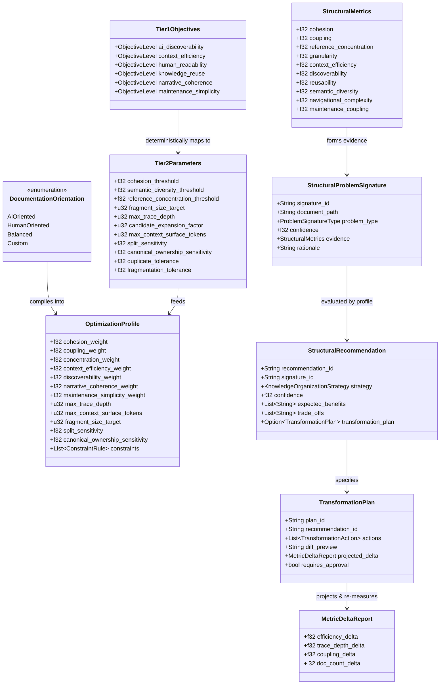

# Data Model: Knowledge Organization Systems, Structural Evidence & Trade-Offs

**Feature Branch:** `005-structural-evolution-strategies`  
**Target Delivery:** `llm_wiki_ext4vsc` (`llm-wiki-core` in Rust + TypeScript Extension Host)  
**Status:** In Review / Data Model Specification  
**Constitution Authority:** `CONSTITUTION.md` v1.6.0 (The 16 Critical Invariants, Principles I–XII)  

---

## 1. Domain Entities & Class Diagram



---

## 2. Rust Core Data Models (`crates/core/src/evolution/`)

### 2.1 Documentation Orientations & Optimization Profile

```rust
use serde::{Deserialize, Serialize};

#[derive(Debug, Clone, Copy, PartialEq, Eq, Serialize, Deserialize)]
#[serde(rename_all = "snake_case")]
pub enum DocumentationOrientation {
    AiOriented,
    HumanOriented,
    Balanced,
    Custom,
}

impl Default for DocumentationOrientation {
    fn default() -> Self {
        Self::AiOriented
    }
}

#[derive(Debug, Clone, Copy, PartialEq, Eq, Serialize, Deserialize)]
#[serde(rename_all = "snake_case")]
pub enum ObjectiveLevel {
    Low,
    Medium,
    High,
}

#[derive(Debug, Clone, Serialize, Deserialize)]
pub struct Tier1Objectives {
    pub ai_discoverability: ObjectiveLevel,
    pub context_efficiency: ObjectiveLevel,
    pub human_readability: ObjectiveLevel,
    pub knowledge_reuse: ObjectiveLevel,
    pub narrative_coherence: ObjectiveLevel,
    pub maintenance_simplicity: ObjectiveLevel,
}

#[derive(Debug, Clone, Serialize, Deserialize)]
pub struct Tier2Parameters {
    pub cohesion_threshold: f32,
    pub semantic_diversity_threshold: f32,
    pub reference_concentration_threshold: f32,
    pub fragment_size_target: u32,
    pub max_trace_depth: u32,
    pub candidate_expansion_factor: u32,
    #[serde(alias = "max_context_surface")]
    pub max_context_surface_tokens: u32,
    pub split_sensitivity: f32,
    pub canonical_ownership_sensitivity: f32,
    pub duplicate_tolerance: f32,
    pub fragmentation_tolerance: f32,
}

#[derive(Debug, Clone, Copy, PartialEq, Eq, Serialize, Deserialize)]
#[serde(rename_all = "snake_case")]
pub enum ConstraintLevel {
    Preference,
    Constraint,
    HardConstraint,
}

#[derive(Debug, Clone, Serialize, Deserialize)]
pub struct ConstraintRule {
    pub id: String,
    pub level: ConstraintLevel,
    pub rule_key: String,
    pub description: String,
}

#[derive(Debug, Clone, Serialize, Deserialize)]
pub struct ConstraintConflict {
    pub conflicting_rules: Vec<String>,
    pub reason: String,
    pub suggestion: String,
}

#[derive(Debug, Clone, Serialize, Deserialize)]
pub struct OptimizationProfile {
    pub orientation: DocumentationOrientation,
    pub cohesion_weight: f32,
    pub coupling_weight: f32,
    pub concentration_weight: f32,
    pub context_efficiency_weight: f32,
    pub discoverability_weight: f32,
    pub narrative_coherence_weight: f32,
    pub maintenance_simplicity_weight: f32,
    pub max_trace_depth: u32,
    pub max_context_surface_tokens: u32,
    pub fragment_size_target: u32,
    pub split_sensitivity: f32,
    pub canonical_ownership_sensitivity: f32,
    pub constraints: Vec<ConstraintRule>,
}
```

### 2.2 10-Dimensional Structural Analytics & Signatures

```rust
#[derive(Debug, Clone, Serialize, Deserialize)]
pub struct StructuralMetrics {
    pub cohesion: f32,
    pub coupling: f32,
    pub reference_concentration: f32,
    pub granularity: f32,
    pub context_efficiency: f32,
    pub discoverability: f32,
    pub reusability: f32,
    pub semantic_diversity: f32,
    pub navigational_complexity: f32,
    pub maintenance_coupling: f32,
}

#[derive(Debug, Clone, Copy, PartialEq, Eq, Serialize, Deserialize)]
#[serde(rename_all = "snake_case")]
pub enum ProblemSignatureType {
    GodDocument,
    ImplicitRouter,
    FragmentedConcept,
    IsolatedSilo,
    HealthyMonolith,
}

#[derive(Debug, Clone, Serialize, Deserialize)]
pub struct StructuralProblemSignature {
    pub signature_id: String,
    pub document_path: String,
    pub problem_type: ProblemSignatureType,
    pub confidence: f32,
    pub evidence: StructuralMetrics,
    pub rationale: String,
}
```

### 2.3 KOS Strategy Evaluator & Transformations

```rust
#[derive(Debug, Clone, Copy, PartialEq, Eq, Serialize, Deserialize)]
#[serde(rename_all = "snake_case")]
pub enum KnowledgeOrganizationStrategy {
    SectionAddressing,
    TopicDecomposition,
    LightweightIndex,
    FacetedClassification,
    PreserveDocument,
    Hybrid,
}

#[derive(Debug, Clone, Serialize, Deserialize)]
pub struct StructuralRecommendation {
    pub recommendation_id: String,
    pub signature_id: String,
    pub strategy: KnowledgeOrganizationStrategy,
    pub confidence: f32,
    pub expected_benefits: Vec<String>,
    pub trade_offs: Vec<String>,
    pub transformation_plan: Option<TransformationPlan>,
}

#[derive(Debug, Clone, Serialize, Deserialize)]
#[serde(tag = "type", content = "payload", rename_all = "snake_case")]
pub enum TransformationAction {
    CreateDocument {
        file_path: String,
        initial_content: String,
    },
    UpdateDocumentContent {
        file_path: String,
        updated_content: String,
    },
    RewriteLinkReferences {
        source_path: String,
        old_target: String,
        new_target: String,
    },
    InjectFragmentFrontmatter {
        file_path: String,
        fragments: Vec<MaterializedFragmentEntry>,
    },
}

#[derive(Debug, Clone, Serialize, Deserialize)]
pub struct MetricDeltaReport {
    pub efficiency_delta: f32,
    pub trace_depth_delta: f32,
    pub coupling_delta: f32,
    pub doc_count_delta: i32,
}

#[derive(Debug, Clone, Serialize, Deserialize)]
pub struct TransformationPlan {
    pub plan_id: String,
    pub recommendation_id: String,
    pub actions: Vec<TransformationAction>,
    pub diff_preview: String,
    pub projected_delta: MetricDeltaReport,
    pub requires_approval: bool,
}
```

---

## 3. TypeScript Extension & Webview Interfaces (`extension/src/types/evolution.ts`)

```typescript
export type DocumentationOrientation = 'ai_oriented' | 'human_oriented' | 'balanced' | 'custom';
export type ObjectiveLevel = 'low' | 'medium' | 'high';
export type ConstraintLevel = 'preference' | 'constraint' | 'hard_constraint';

export interface Tier1Objectives {
  aiDiscoverability: ObjectiveLevel;
  contextEfficiency: ObjectiveLevel;
  humanReadability: ObjectiveLevel;
  knowledgeReuse: ObjectiveLevel;
  narrativeCoherence: ObjectiveLevel;
  maintenanceSimplicity: ObjectiveLevel;
}

export interface Tier2Parameters {
  cohesionThreshold: number;
  semanticDiversityThreshold: number;
  referenceConcentrationThreshold: number;
  fragmentSizeTarget: number;
  maxTraceDepth: number;
  candidateExpansionFactor: number;
  maxContextSurfaceTokens: number;
  splitSensitivity: number;
  canonicalOwnershipSensitivity: number;
  duplicateTolerance: number;
  fragmentationTolerance: number;
}

export interface ConstraintRule {
  id: string;
  level: ConstraintLevel;
  ruleKey: string;
  description: string;
}

export interface ConstraintConflict {
  conflictingRules: string[];
  reason: string;
  suggestion: string;
}

export interface OptimizationProfile {
  orientation: DocumentationOrientation;
  cohesionWeight: number;
  couplingWeight: number;
  concentrationWeight: number;
  contextEfficiencyWeight: number;
  discoverabilityWeight: number;
  narrativeCoherenceWeight: number;
  maintenanceSimplicityWeight: number;
  maxTraceDepth: number;
  maxContextSurfaceTokens: number;
  fragmentSizeTarget: number;
  splitSensitivity: number;
  canonicalOwnershipSensitivity: number;
  constraints: ConstraintRule[];
}

export interface StructuralMetrics {
  cohesion: number;
  coupling: number;
  referenceConcentration: number;
  granularity: number;
  contextEfficiency: number;
  discoverability: number;
  reusability: number;
  semanticDiversity: number;
  navigationalComplexity: number;
  maintenanceCoupling: number;
}

export type ProblemSignatureType =
  | 'god_document'
  | 'implicit_router'
  | 'fragmented_concept'
  | 'isolated_silo'
  | 'healthy_monolith';

export interface StructuralProblemSignature {
  signatureId: string;
  documentPath: string;
  problemType: ProblemSignatureType;
  confidence: number;
  evidence: StructuralMetrics;
  rationale: string;
}

export type KnowledgeOrganizationStrategy =
  | 'section_addressing'
  | 'topic_decomposition'
  | 'lightweight_index'
  | 'faceted_classification'
  | 'preserve_document'
  | 'hybrid';

export interface MetricDeltaReport {
  efficiencyDelta: number;
  traceDepthDelta: number;
  couplingDelta: number;
  docCountDelta: number;
}

export type TransformationAction =
  | { type: 'create_document'; payload: { filePath: string; initialContent: string } }
  | { type: 'update_document_content'; payload: { filePath: string; updatedContent: string } }
  | { type: 'rewrite_link_references'; payload: { sourcePath: string; oldTarget: string; newTarget: string } }
  | { type: 'inject_fragment_frontmatter'; payload: { filePath: string; fragments: Array<{ id: string; anchor: string; tokens: number }> } };

export interface TransformationPlan {
  planId: string;
  recommendationId: string;
  actions: TransformationAction[];
  diffPreview: string;
  projectedDelta: MetricDeltaReport;
  requiresApproval: boolean;
}

export interface StructuralRecommendation {
  recommendationId: string;
  signatureId: string;
  strategy: KnowledgeOrganizationStrategy;
  confidence: number;
  expectedBenefits: string[];
  tradeOffs: string[];
  transformationPlan?: TransformationPlan;
}
```

---

## 4. Presentation Layer Invariants (Raw Data vs. Formatting)

Adhering strictly to **Invariant IX** (Raw Numeric Integrity) and **Invariant X** (Presentation Separation):
- Metrics are stored as raw floating point values in `StructuralMetrics` (e.g. `context_efficiency: 0.3241`, `reference_concentration: 0.7381`).
- The UI transforms values via `formatCompactNumber`:
  - `0.3241` $\to$ `"32%"`
  - `0.7381` $\to$ `"74%"`
  - `50231 tokens` $\to$ `"50.2k"`
- Formatted percentages and tokens are never fed back into calculations, profile evaluation, or recommendation logic.
