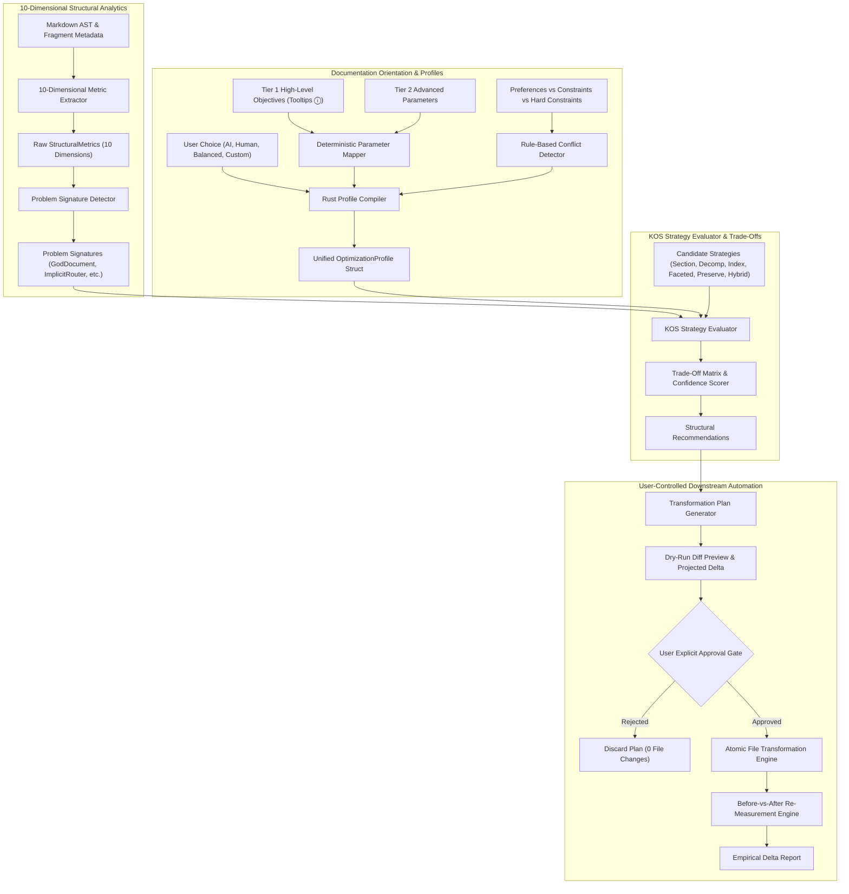

---
wiki:
  content_hash: e30d68e7bc228b4dabf7a198d061090ca098c2b772c2a2894137700ec193d654
  fragments:
    implementation-plan-knowledge-organization-systems-structural-evidence-trade-offs:
      tokens: 2648
      inbound: 0
      outbound: 0
    1-architectural-overview-component-topology:
      tokens: 454
      inbound: 0
      outbound: 0
    2-directory-module-layout:
      tokens: 550
      inbound: 0
      outbound: 0
    rust-core-cratescoresrcevolution:
      tokens: 303
      inbound: 0
      outbound: 0
    rust-ipc-integration-cratescoresrcipchandlersrs:
      tokens: 82
      inbound: 0
      outbound: 0
    typescript-extension-host-extensionsrc:
      tokens: 53
      inbound: 0
      outbound: 0
    webview-ui-extensionwebview-uisrc:
      tokens: 103
      inbound: 0
      outbound: 0
    3-integration-with-git-boundary-critical-invariants:
      tokens: 203
      inbound: 0
      outbound: 0
    4-latency-budget-verification-strategy:
      tokens: 1340
      inbound: 0
      outbound: 0
---
# Implementation Plan: Knowledge Organization Systems, Structural Evidence & Trade-Offs

**Feature Branch:** `005-structural-evolution-strategies`  
**Target Delivery:** `llm_wiki_ext4vsc` (`llm-wiki-core` in Rust + TypeScript Extension Host)  
**Status:** In Review / Implementation Plan  
**Constitution Authority:** `CONSTITUTION.md` v1.6.0 (The 16 Critical Invariants, Principles I–XII)  

---

## 1. Architectural Overview & Component Topology

---

## 2. Directory & Module Layout

### Rust Core (`crates/core/src/evolution/`)
- `crates/core/src/evolution/mod.rs`: Module exports, serde enums (`DocumentationOrientation`, `ConstraintLevel`, `KnowledgeOrganizationStrategy`, `ProblemSignatureType`).
- `crates/core/src/evolution/profile.rs`: `OptimizationProfile` struct, default AI/Human/Balanced presets.
- `crates/core/src/evolution/compiler.rs`: Deterministic compiler translating Tier 1 objectives and Tier 2 parameters into `OptimizationProfile`.
- `crates/core/src/evolution/conflict.rs`: Fast SAT rule-based evaluator detecting contradictory constraint configurations.
- `crates/core/src/evolution/metrics.rs`: 10-dimensional structural metric extractors ($C, K, R, G, E, D, U, S, N, M$).
- `crates/core/src/evolution/signatures.rs`: Problem signature detectors: `GodDocument`, `ImplicitRouter`, `FragmentedConcept`, `IsolatedSilo`, `HealthyMonolith`.
- `crates/core/src/evolution/strategies.rs`: KOS candidate strategy evaluator calculating fitness, confidence, benefits, and countervailing trade-offs.
- `crates/core/src/evolution/transformation.rs`: Plan builder, unified diff generator, atomic file modifier, and rollback safety.
- `crates/core/src/evolution/re_measure.rs`: Incremental post-apply metric re-measurer calculating $\Delta$ deltas.

### Rust IPC Integration (`crates/core/src/ipc/handlers.rs`)
- `profile/getOrientation`
- `profile/setOrientation`
- `profile/getCustomConfig`
- `profile/updateCustomConfig`
- `profile/validateConstraints`
- `analytics/getStructuralProblems`
- `recommendation/getRecommendations`
- `transformation/generatePlan`
- `transformation/applyPlan`

### TypeScript Extension Host (`extension/src/`)
- `extension/src/types/evolution.ts`: Strongly typed interfaces matching Rust models.
- `extension/src/evolution/evolutionManager.ts`: Lifecycle coordinator for active orientation, custom settings, and transformation approvals.

### Webview UI (`extension/webview-ui/src/`)
- `extension/webview-ui/src/components/orientationSelector.ts`: Radio-card selection for AI, Human, Balanced, Custom.
- `extension/webview-ui/src/components/customSettingsDrawer.ts`: Two-tier custom settings with informational tooltips (`ⓘ`) and conflict banners.
- `extension/webview-ui/src/components/evolutionTab.ts`: Dedicated tab in Settings Drawer displaying problem signatures, candidate trade-off matrices, plan diff previews, and confirmation buttons.

---

## 3. Integration with Git Boundary & Critical Invariants

1. **Candidate Isolation & Committed Truth (Invariants I & II)**:
   - Structural problem detection operates on the committed graph.
   - Proposed transformations create working-tree changes only when explicitly approved.
   - Once applied, changes enter staging and trigger pre-commit validation (`llm-wiki-validate`), ensuring the new state satisfies the debt baseline before Git commit.
2. **Deterministic Locality (Invariants III & IV)**:
   - 100% of metric computation, signature detection, and strategy evaluation runs on local CPU in Rust without network calls or external AI APIs.
3. **Document-Centricity (Invariant V)**:
   - New files created by topic decomposition become new Document Nodes ($O(N)$); section addressing adds fragment targets to existing nodes.
4. **Hard Constraint Invariant (Invariant XVI)**:
   - The transformation engine verifies that no hard constraints are breached prior to producing the `TransformationPlan`.

---

## 4. Latency Budget Verification Strategy

| Operation | Target Budget | Verification Tool |
| :--- | :--- | :--- |
| Profile Recompilation | $\le 20\text{ ms}$ | Criterion microbenchmark (`crates/core/benches/profile_benchmark.rs`) |
| 10-D Structural Analytics | $\le 150\text{ ms}$ / 1,000 files | Criterion microbenchmark (`crates/core/benches/metrics_benchmark.rs`) |
| Strategy Evaluation | $\le 50\text{ ms}$ / 50 signatures | Criterion microbenchmark (`crates/core/benches/strategy_benchmark.rs`) |
| Plan Generation & Diff | $\le 100\text{ ms}$ | Criterion microbenchmark (`crates/core/benches/transformation_benchmark.rs`) |
*benches/remeasure_benchmark.rs*|*benches/remeasure_benchmark.rs* *benches/remeasure_benchmark.rs*I*benches/remeasure_benchmark.rs*n*benches/remeasure_benchmark.rs*c*benches/remeasure_benchmark.rs*r*benches/remeasure_benchmark.rs*e*benches/remeasure_benchmark.rs*m*benches/remeasure_benchmark.rs*e*benches/remeasure_benchmark.rs*n*benches/remeasure_benchmark.rs*t*benches/remeasure_benchmark.rs*a*benches/remeasure_benchmark.rs*l*benches/remeasure_benchmark.rs* *benches/remeasure_benchmark.rs*R*benches/remeasure_benchmark.rs*e*benches/remeasure_benchmark.rs*-*benches/remeasure_benchmark.rs*M*benches/remeasure_benchmark.rs*e*benches/remeasure_benchmark.rs*a*benches/remeasure_benchmark.rs*s*benches/remeasure_benchmark.rs*u*benches/remeasure_benchmark.rs*r*benches/remeasure_benchmark.rs*e*benches/remeasure_benchmark.rs*m*benches/remeasure_benchmark.rs*e*benches/remeasure_benchmark.rs*n*benches/remeasure_benchmark.rs*t*benches/remeasure_benchmark.rs* *benches/remeasure_benchmark.rs*|*benches/remeasure_benchmark.rs* *benches/remeasure_benchmark.rs*$*benches/remeasure_benchmark.rs*\*benches/remeasure_benchmark.rs*l*benches/remeasure_benchmark.rs*e*benches/remeasure_benchmark.rs* *benches/remeasure_benchmark.rs*1*benches/remeasure_benchmark.rs*0*benches/remeasure_benchmark.rs*0*benches/remeasure_benchmark.rs*\*benches/remeasure_benchmark.rs*t*benches/remeasure_benchmark.rs*e*benches/remeasure_benchmark.rs*x*benches/remeasure_benchmark.rs*t*benches/remeasure_benchmark.rs*{*benches/remeasure_benchmark.rs* *benches/remeasure_benchmark.rs*m*benches/remeasure_benchmark.rs*s*benches/remeasure_benchmark.rs*}*benches/remeasure_benchmark.rs*$*benches/remeasure_benchmark.rs* *benches/remeasure_benchmark.rs*|*benches/remeasure_benchmark.rs* *benches/remeasure_benchmark.rs*C*benches/remeasure_benchmark.rs*r*benches/remeasure_benchmark.rs*i*benches/remeasure_benchmark.rs*t*benches/remeasure_benchmark.rs*e*benches/remeasure_benchmark.rs*r*benches/remeasure_benchmark.rs*i*benches/remeasure_benchmark.rs*o*benches/remeasure_benchmark.rs*n*benches/remeasure_benchmark.rs* *benches/remeasure_benchmark.rs*m*benches/remeasure_benchmark.rs*i*benches/remeasure_benchmark.rs*c*benches/remeasure_benchmark.rs*r*benches/remeasure_benchmark.rs*o*benches/remeasure_benchmark.rs*b*benches/remeasure_benchmark.rs*e*benches/remeasure_benchmark.rs*n*benches/remeasure_benchmark.rs*c*benches/remeasure_benchmark.rs*h*benches/remeasure_benchmark.rs*m*benches/remeasure_benchmark.rs*a*benches/remeasure_benchmark.rs*r*benches/remeasure_benchmark.rs*k*benches/remeasure_benchmark.rs* *benches/remeasure_benchmark.rs*(*benches/remeasure_benchmark.rs*`*benches/remeasure_benchmark.rs*b*benches/remeasure_benchmark.rs*e*benches/remeasure_benchmark.rs*n*benches/remeasure_benchmark.rs*c*benches/remeasure_benchmark.rs*h*benches/remeasure_benchmark.rs*e*benches/remeasure_benchmark.rs*s*benches/remeasure_benchmark.rs*/*benches/remeasure_benchmark.rs*r*benches/remeasure_benchmark.rs*e*benches/remeasure_benchmark.rs*m*benches/remeasure_benchmark.rs*e*benches/remeasure_benchmark.rs*a*benches/remeasure_benchmark.rs*s*benches/remeasure_benchmark.rs*u*benches/remeasure_benchmark.rs*r*benches/remeasure_benchmark.rs*e*benches/remeasure_benchmark.rs*_*benches/remeasure_benchmark.rs*b*benches/remeasure_benchmark.rs*e*benches/remeasure_benchmark.rs*n*benches/remeasure_benchmark.rs*c*benches/remeasure_benchmark.rs*h*benches/remeasure_benchmark.rs*m*benches/remeasure_benchmark.rs*a*benches/remeasure_benchmark.rs*r*benches/remeasure_benchmark.rs*k*benches/remeasure_benchmark.rs*.*benches/remeasure_benchmark.rs*r*benches/remeasure_benchmark.rs*s*benches/remeasure_benchmark.rs*`*benches/remeasure_benchmark.rs*)*benches/remeasure_benchmark.rs* *benches/remeasure_benchmark.rs*|*benches/remeasure_benchmark.rs*
*benches/remeasure_benchmark.rs*