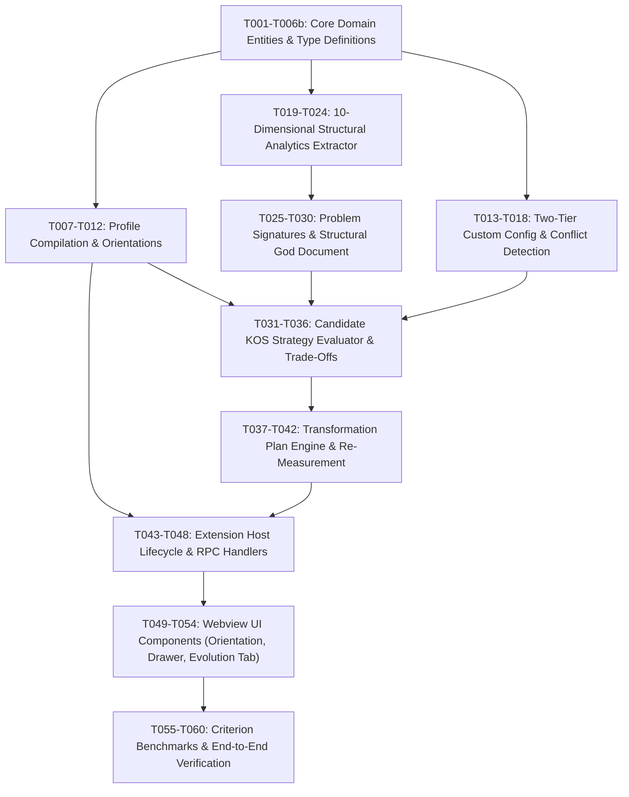

# Tasks: Knowledge Organization Systems, Structural Evidence & Trade-Offs

**Feature Branch:** `005-structural-evolution-strategies`  
**Target Delivery:** `llm_wiki_ext4vsc` (`llm-wiki-core` in Rust + TypeScript Extension Host)  
**Status:** In Review / Tasks Breakdown  
**Specification:** [`spec.md`](spec.md) | **Plan:** [`plan.md`](plan.md) | **Data Model:** [`data-model.md`](data-model.md)  
**Constitution Authority:** `CONSTITUTION.md` v1.6.0 (The 16 Critical Invariants, Principles I–XII)  

---

## Task Matrix & Dependencies

---

## Phase 1: Core Domain Entities & Type Definitions (Tasks T001–T006b)

- [x] **T001**: [P] Define core serialization enums and profile structures in `crates/core/src/evolution/mod.rs` and `crates/core/src/evolution/profile.rs` (`DocumentationOrientation`, `ConstraintLevel`, `ConstraintRule`, `OptimizationProfile` including `fragment_size_target`).
  - **Mapped Requirements**: FR-001, FR-003, FR-017, FR-018, FR-019, FR-020, NFR-001, Invariant XIV
  - **Verification**: `cargo test test_evolution_enums_and_profile_serde`

- [x] **T002**: [P] Define Tier 1 objective levels and Tier 2 engine parameter structs in `crates/core/src/evolution/compiler.rs` (`Tier1Objectives`, `Tier2Parameters` with `max_context_surface_tokens`, `ObjectiveLevel`).
  - **Mapped Requirements**: FR-009, FR-010, FR-012, Invariant XIV
  - **Verification**: `cargo test test_tier1_tier2_models`

- [x] **T003**: [P] Define `StructuralMetrics` 10-dimensional metric struct in `crates/core/src/evolution/metrics.rs` storing raw exact floats ($C, K, R, G, E, D, U, S, N, M$) $[0.0, 1.0]$.
  - **Mapped Requirements**: FR-023, FR-029, Invariant IX, Invariant X
  - **Verification**: `cargo test test_structural_metrics_struct`

- [x] **T004**: [P] Define `StructuralProblemSignature` and `ProblemSignatureType` in `crates/core/src/evolution/signatures.rs` with variants `GodDocument`, `ImplicitRouter`, `FragmentedConcept`, `IsolatedSilo`, and `HealthyMonolith`.
  - **Mapped Requirements**: FR-024, FR-025, FR-026, FR-027, FR-028, Invariant XIII
  - **Verification**: `cargo test test_problem_signature_types`

- [x] **T005**: [P] Define `StructuralRecommendation`, `KnowledgeOrganizationStrategy` (6 variants with `FacetedClassification`), and `TradeOffMatrix` in `crates/core/src/evolution/strategies.rs`.
  - **Mapped Requirements**: FR-030, FR-031, FR-032, FR-033, FR-034, Invariant XV
  - **Verification**: `cargo test test_recommendation_and_strategy_models`

- [x] **T006**: [P] Define `TransformationPlan`, `TransformationAction`, `TransformationActionType`, and `MetricDeltaReport` in `crates/core/src/evolution/transformation.rs` and `crates/core/src/evolution/re_measure.rs`.
  - **Mapped Requirements**: FR-037, FR-039, FR-040, Invariant XVI
  - **Verification**: `cargo test test_transformation_plan_serde`

- [x] **T006b**: [P] Define corresponding TypeScript interfaces, discriminated union `TransformationAction` payloads, and `OptimizationProfile` in `extension/src/types/evolution.ts` matching JSON-RPC contract `contracts/evolution_rpc_protocol.json`.
  - **Mapped Requirements**: FR-001..FR-040, SC-001..SC-007
  - **Verification**: `npm run test -- extension/src/types/evolution.test.ts`

---

## Phase 2: Profile Compilation & Documentation Orientations (Tasks T007–T012)

- [x] **T007**: Implement default profile builders for preset orientations in `crates/core/src/evolution/profile.rs` (`ai_oriented` with 3k target, `human_oriented` with 8k target, `balanced` with 5k target).
  - **Mapped Requirements**: FR-002, FR-004, FR-005, FR-006, SC-001
  - **Verification**: `cargo test test_orientation_profile_defaults`

- [x] **T008**: Implement configuration parser in `crates/core/src/config/vault.rs` loading and storing `orientation` and `custom_profile` in `.context-vault.yaml`.
  - **Mapped Requirements**: FR-007, FR-014
  - **Verification**: `cargo test test_vault_orientation_yaml_roundtrip`

- [x] **T009**: Implement deterministic compiler translating orientation presets into the unified `OptimizationProfile` struct in $\le 20\text{ ms}$ in `crates/core/src/evolution/compiler.rs`.
  - **Mapped Requirements**: FR-003, NFR-002, SC-001, Invariant XIV
  - **Verification**: `cargo test test_compile_preset_profiles`

- [x] **T010**: Implement unit tests for profile compilation ensuring mathematical weight determinism and zero heuristic drift.
  - **Mapped Requirements**: FR-003, SC-001
  - **Verification**: `cargo test test_profile_compilation_determinism`

- [x] **T011**: Implement orientation switching mechanism with dynamic re-weighting in $\le 20\text{ ms}$ without daemon restart in `crates/core/src/evolution/mod.rs`.
  - **Mapped Requirements**: FR-008, NFR-002, US1
  - **Verification**: `cargo test test_dynamic_orientation_switch_latency`

- [x] **T012**: Implement JSON-RPC handlers `profile/getOrientation` and `profile/setOrientation` in `crates/core/src/ipc/handlers.rs`.
  - **Mapped Requirements**: FR-001, FR-008, SC-001
  - **Verification**: `cargo test test_ipc_profile_orientation_methods`

---

## Phase 3: Two-Tier Custom Configuration & Parameter Mapping (Tasks T013–T018)

- [x] **T013**: Implement deterministic mapping function translating Tier 1 knobs (`low`, `medium`, `high`) to continuous Tier 2 engine variables in `crates/core/src/evolution/compiler.rs`.
  - **Mapped Requirements**: FR-010, FR-012, FR-015, SC-002
  - **Verification**: `cargo test test_tier1_to_tier2_mapping_matrix`

- [x] **T014**: Implement manual Tier 2 override preservation and custom profile builder in `crates/core/src/evolution/compiler.rs`.
  - **Mapped Requirements**: FR-015, FR-016
  - **Verification**: `cargo test test_tier2_manual_override_preservation`

- [x] **T015**: Implement parameter relationship introspection API returning dependency graphs between Tier 1 objectives and Tier 2 variables in `crates/core/src/evolution/compiler.rs` for Webview visualization.
  - **Mapped Requirements**: FR-013, US2
  - **Verification**: `cargo test test_parameter_mapping_introspection`

- [x] **T016**: Implement JSON-RPC handlers `profile/getCustomConfig`, `profile/updateCustomConfig`, and `profile/validateConstraints` in `crates/core/src/ipc/handlers.rs`.
  - **Mapped Requirements**: FR-009, FR-014, FR-022, SC-002
  - **Verification**: `cargo test test_ipc_custom_config_and_validation_handlers`

- [x] **T017**: Register built-in constraint templates in `crates/core/src/evolution/conflict.rs` (`never_split_canonical_docs`, `never_auto_split_documents` prohibiting unattended background splitting, `never_delete_content`).
  - **Mapped Requirements**: FR-021, Invariant XVI
  - **Verification**: `cargo test test_builtin_hard_constraints_registration`

- [x] **T018**: Implement fast SAT rule-based conflict detector in `crates/core/src/evolution/conflict.rs` evaluating constraint satisfiability in $\le 10\text{ ms}$ and returning actionable conflict reasons.
  - **Mapped Requirements**: FR-022, SC-002, US3
  - **Verification**: `cargo test test_constraint_conflict_detector_latency`

---

## Phase 4: 10-Dimensional Structural Analytics Extractor (Tasks T019–T024)

- [x] **T019**: [P] Implement Cohesion ($C$), Semantic Diversity ($S$), and Coupling ($K$) metric extractors in `crates/core/src/evolution/metrics.rs`.
  - **Mapped Requirements**: FR-023.1, FR-023.2, FR-023.8
  - **Verification**: `cargo test test_metrics_cohesion_diversity_coupling`

- [x] **T020**: [P] Implement Reference Concentration ($R$), Granularity ($G$), and Reusability ($U$) metric extractors in `crates/core/src/evolution/metrics.rs`.
  - **Mapped Requirements**: FR-023.3, FR-023.4, FR-023.7
  - **Verification**: `cargo test test_metrics_concentration_granularity_reusability`

- [x] **T021**: [P] Implement Context Efficiency ($E$) and Discoverability ($D$) metric extractors in `crates/core/src/evolution/metrics.rs`.
  - **Mapped Requirements**: FR-023.5, FR-023.6
  - **Verification**: `cargo test test_metrics_efficiency_discoverability`

- [x] **T022**: [P] Implement Navigational Complexity ($N$) and Maintenance Coupling ($M$) metric extractors in `crates/core/src/evolution/metrics.rs`.
  - **Mapped Requirements**: FR-023.9, FR-023.10
  - **Verification**: `cargo test test_metrics_navigational_and_maintenance`

- [x] **T023**: Implement parallel multi-file structural metric extractor using Rayon in `crates/core/src/evolution/metrics.rs` achieving $\le 150\text{ ms}$ for 1,000 files.
  - **Mapped Requirements**: FR-023, NFR-001, NFR-003
  - **Verification**: `cargo test test_parallel_10d_metrics_extraction`

- [x] **T024**: Implement unit tests verifying raw numeric integrity ($[0.0, 1.0]$ bounds, NaN guards, zero-division handling) across all 10 structural dimensions.
  - **Mapped Requirements**: FR-023, FR-029, Invariant IX, Invariant X
  - **Verification**: `cargo test test_raw_numeric_integrity_invariants`

---

## Phase 5: Problem Signature Detectors & Structural God Document (Tasks T025–T030)

- [x] **T025**: Implement structural `GodDocument` signature detector in `crates/core/src/evolution/signatures.rs` enforcing the multi-metric predicate:
  $$\text{semantic\_diversity} \ge 0.75 \land \text{reference\_concentration} \ge 0.70 \land \text{context\_efficiency} \le 0.35 \land \text{coupling} \ge 0.70$$
  - **Mapped Requirements**: FR-024, FR-025, SC-003, Invariant XIII
  - **Verification**: `cargo test test_god_document_structural_predicate`

- [x] **T026**: Implement `HealthyMonolith` signature classifier ensuring large documents ($> 50\text{k}$ tokens) with high cohesion ($C \ge 0.80$) and low concentration ($R \le 0.30$) are certified healthy without split proposals.
  - **Mapped Requirements**: FR-025, SC-003, Invariant XIII
  - **Verification**: `cargo test test_healthy_monolith_50k_tokens_not_god_doc`

- [x] **T027**: Implement `ImplicitRouter` signature detector (outbound $\ge 20$, prose $< 500$ words, betweenness centrality $\ge 0.40$) in `crates/core/src/evolution/signatures.rs`.
  - **Mapped Requirements**: FR-026, US4
  - **Verification**: `cargo test test_implicit_router_signature_detection`

- [x] **T028**: Implement `FragmentedConcept` (split across $\ge 3$ weakly linked documents with shortest hop distance $\ge 3$ or edge weight $< 0.20$) and `IsolatedSilo` signature detectors in `crates/core/src/evolution/signatures.rs`.
  - **Mapped Requirements**: FR-027, US4
  - **Verification**: `cargo test test_fragmented_concept_and_isolated_silo`

- [x] **T029**: Implement signature confidence scoring engine and rationale generator outputting detailed metric evidence in `crates/core/src/evolution/signatures.rs`.
  - **Mapped Requirements**: FR-028, SC-003
  - **Verification**: `cargo test test_signature_confidence_and_evidence_generation`

- [x] **T030**: Implement JSON-RPC handler `analytics/getStructuralProblems` in `crates/core/src/ipc/handlers.rs`.
  - **Mapped Requirements**: FR-028, FR-029, NFR-003
  - **Verification**: `cargo test test_ipc_get_structural_problems`

---

## Phase 6: Candidate KOS Strategy Evaluator & Trade-Off Matrix (Tasks T031–T036)

- [x] **T031**: Implement candidate strategy generator in `crates/core/src/evolution/strategies.rs` supporting `SectionAddressing`, `TopicDecomposition`, `LightweightIndex`, `FacetedClassification`, `PreserveDocument`, and `Hybrid`.
  - **Mapped Requirements**: FR-030, NFR-001, US5
  - **Verification**: `cargo test test_candidate_strategy_generation`

- [x] **T032**: Implement objective fitness evaluation engine scoring candidate strategies against the active `OptimizationProfile` in `crates/core/src/evolution/strategies.rs`.
  - **Mapped Requirements**: FR-031, SC-004
  - **Verification**: `cargo test test_strategy_profile_fitness_scoring`

- [x] **T033**: Implement confidence score computation $[0.0, 1.0]$ and low-confidence advisory labeling ($< 0.70$) in `crates/core/src/evolution/strategies.rs`.
  - **Mapped Requirements**: FR-032, FR-033
  - **Verification**: `cargo test test_strategy_confidence_and_advisory_label`

- [x] **T034**: Implement deterministic trade-off matrix generator itemizing expected benefits and countervailing trade-offs for each candidate in `crates/core/src/evolution/strategies.rs`.
  - **Mapped Requirements**: FR-034, SC-004, Invariant XV
  - **Verification**: `cargo test test_trade_off_matrix_generation`

- [x] **T035**: Implement high-level candidate strategy disqualification filter in `crates/core/src/evolution/strategies.rs` ensuring strategies violating user-defined hard constraints are strictly excluded from recommendation proposals.
  - **Mapped Requirements**: FR-020, SC-006, Invariant XVI
  - **Verification**: `cargo test test_hard_constraint_strategy_disqualification`

- [x] **T036**: Implement JSON-RPC handler `recommendation/getRecommendations` in `crates/core/src/ipc/handlers.rs`.
  - **Mapped Requirements**: FR-030..FR-035, NFR-004
  - **Verification**: `cargo test test_ipc_get_recommendations`

---

## Phase 7: User-Controlled Automation & Re-Measurement (Tasks T037–T042)

- [x] **T037**: Enforce strict approval protocol (`Auto-Apply: OFF`, `Require Approval: ON`) in `crates/core/src/evolution/transformation.rs`.
  - **Mapped Requirements**: FR-036, Invariant XVI
  - **Verification**: `cargo test test_automation_approval_gate_defaults`

- [x] **T038**: Implement dry-run `TransformationPlan` builder in `crates/core/src/evolution/transformation.rs` generating atomic actions, unified diff previews, and projected deltas in $\le 100\text{ ms}$.
  - **Mapped Requirements**: FR-037, NFR-001, NFR-005, SC-005
  - **Verification**: `cargo test test_transformation_plan_diff_and_deltas`

- [x] **T039**: Implement fine-grained action-level hard constraint invariant check during plan generation in `crates/core/src/evolution/transformation.rs` preventing illegal atomic file mutations.
  - **Mapped Requirements**: FR-020, FR-037, SC-006, Invariant XVI
  - **Verification**: `cargo test test_plan_hard_constraint_safety_check`

- [x] **T040**: Implement atomic file modifier in `crates/core/src/evolution/transformation.rs` with clean transactional rollback on any file write failure.
  - **Mapped Requirements**: FR-038, FR-039, Invariant XVI
  - **Verification**: `cargo test test_atomic_file_transformation_with_rollback`

- [x] **T041**: Implement incremental post-transformation re-measurer in `crates/core/src/evolution/re_measure.rs` calculating empirical Before-vs-After delta report in $\le 100\text{ ms}$.
  - **Mapped Requirements**: FR-040, NFR-006, SC-007, Invariant XVI
  - **Verification**: `cargo test test_incremental_post_apply_re_measurement`

- [x] **T042**: Implement JSON-RPC handlers `transformation/generatePlan` and `transformation/applyPlan` in `crates/core/src/ipc/handlers.rs`.
  - **Mapped Requirements**: FR-037, FR-038, FR-039, FR-040
  - **Verification**: `cargo test test_ipc_transformation_plan_handlers`

---

## Phase 8: Extension Host Lifecycle & Integration (Tasks T043–T048)

- [x] **T043**: Implement `extension/src/evolution/evolutionManager.ts` managing active orientation state, vault config syncing, and sidecar RPC dispatching.
  - **Mapped Requirements**: FR-007, FR-008, US1
  - **Verification**: `npm run test -- extension/src/evolution/evolutionManager.test.ts`

- [x] **T044**: Implement custom profile and constraint synchronization logic in `evolutionManager.ts`.
  - **Mapped Requirements**: FR-014, FR-022, US2, US3
  - **Verification**: `npm run test -- extension/src/evolution/customConfigSync.test.ts`

- [x] **T045**: Implement structural problem and recommendation subscription store in `evolutionManager.ts`.
  - **Mapped Requirements**: FR-008, FR-028, FR-030, US4, US5
  - **Verification**: `npm run test -- extension/src/evolution/problemStore.test.ts`

- [x] **T046**: Implement transformation plan confirmation workflow with VS Code modal confirmation dialogs in `evolutionManager.ts`.
  - **Mapped Requirements**: FR-038, Invariant XVI, US6
  - **Verification**: `npm run test -- extension/src/evolution/confirmationWorkflow.test.ts`

- [x] **T047**: Implement automatic Git index staging coordination after applied transformations ensuring compatibility with `llm-wiki-validate` pre-commit hooks.
  - **Mapped Requirements**: FR-039, Invariant VIII, Invariant XVI
  - **Verification**: `npm run test -- extension/src/evolution/gitStaging.test.ts`

- [x] **T048**: Wire `evolutionManager.ts` into extension activation lifecycle in `extension/src/extension.ts`.
  - **Mapped Requirements**: FR-001..FR-040
  - **Verification**: `npm run test -- extension/src/extension.test.ts`

---

## Phase 9: Webview UI Components (Tasks T049–T054)

- [x] **T049**: Implement `OrientationSelector` component in `extension/webview-ui/src/components/orientationSelector.ts` with 4 selectable radio cards (AI, Human, Balanced, Custom).
  - **Mapped Requirements**: FR-001, FR-008, US1
  - **Verification**: `npm run test -- extension/webview-ui/src/components/orientationSelector.test.ts`

- [x] **T050**: Implement `CustomSettingsDrawer` in `extension/webview-ui/src/components/customSettingsDrawer.ts` featuring Tier 1 discrete knobs, Tier 2 advanced sliders, and visual parameter relationship dependency links.
  - **Mapped Requirements**: FR-009, FR-010, FR-012, FR-013, US2
  - **Verification**: `npm run test -- extension/webview-ui/src/components/customSettingsDrawer.test.ts`

- [x] **T051**: Implement informational tooltip component (`ⓘ`) for all Tier 1 knobs detailing descriptions, higher/lower impacts, affected problems, countervailing trade-offs, and highlighting affected Tier 2 sliders.
  - **Mapped Requirements**: FR-011, FR-013, SC-002, US2
  - **Verification**: `npm run test -- extension/webview-ui/src/components/tooltip.test.ts`

- [x] **T052**: Implement conflicting constraint warning banner in `CustomSettingsDrawer` surfacing contradictory rules in $\le 10\text{ ms}$.
  - **Mapped Requirements**: FR-022, SC-002, US3
  - **Verification**: `npm run test -- extension/webview-ui/src/components/conflictBanner.test.ts`

- [x] **T053**: Implement `EvolutionTab` in `extension/webview-ui/src/components/evolutionTab.ts` displaying detected problem signatures, evidence metrics ($\le 5$ chars format), and candidate recommendations with trade-off matrices.
  - **Mapped Requirements**: FR-028, FR-029, FR-034, FR-035, Invariant X, US4, US5
  - **Verification**: `npm run test -- extension/webview-ui/src/components/evolutionTab.test.ts`

- [x] **T054**: Implement `TransformationPlanModal` in `extension/webview-ui/src/components/transformationPlanModal.ts` displaying diff previews, projected deltas, explicit `[Apply Transformation]` confirmation, and Before-vs-After delta reports while maintaining 60 FPS responsiveness.
  - **Mapped Requirements**: FR-037, FR-038, FR-040, NFR-009, US6, Invariant XVI
  - **Verification**: `npm run test -- extension/webview-ui/src/components/transformationPlanModal.test.ts`

---

## Phase 10: Performance Benchmarks & Non-Functional Verification (Tasks T055–T060)

- [x] **T055**: Implement Criterion microbenchmark `crates/core/benches/profile_benchmark.rs` verifying profile recompilation $\le 20\text{ ms}$.
  - **Mapped Requirements**: NFR-002, SC-001
  - **Verification**: `cargo bench --bench profile_benchmark`

- [x] **T056**: Implement Criterion microbenchmark `crates/core/benches/metrics_benchmark.rs` verifying 10-D metric extraction over 1,000 files $\le 150\text{ ms}$.
  - **Mapped Requirements**: NFR-003
  - **Verification**: `cargo bench --bench metrics_benchmark`

- [x] **T057**: Implement Criterion microbenchmark `crates/core/benches/strategy_benchmark.rs` verifying candidate strategy evaluation for 50 signatures $\le 50\text{ ms}$.
  - **Mapped Requirements**: NFR-004
  - **Verification**: `cargo bench --bench strategy_benchmark`

- [x] **T058**: Implement Criterion microbenchmark `crates/core/benches/transformation_benchmark.rs` verifying transformation plan generation $\le 100\text{ ms}$ and re-measurement $\le 100\text{ ms}$.
  - **Mapped Requirements**: NFR-005, NFR-006, SC-005, SC-007
  - **Verification**: `cargo bench --bench transformation_benchmark`

- [x] **T059**: Implement packaging and memory budget verification tests ensuring VSIX size $\le 25\text{ MB}$ and daemon RSS $\le 35\text{ MB}$ in idle.
  - **Mapped Requirements**: NFR-007, NFR-008
  - **Verification**: `npm run package:verify && cargo test test_daemon_idle_memory_rss`

- [x] **T060**: Implement comprehensive end-to-end integration tests in `extension/test/suite/evolution.e2e.test.ts` verifying Scenarios 1 through 4 from `quickstart.md`, local CPU execution (NFR-001), and Webview 60 FPS responsiveness under multi-card load via Chrome DevTools Protocol (NFR-009).
  - **Mapped Requirements**: SC-001, SC-002, SC-003, SC-004, SC-005, SC-006, SC-007, NFR-001, NFR-009, US1..US6
  - **Verification**: `npm run test:e2e`
