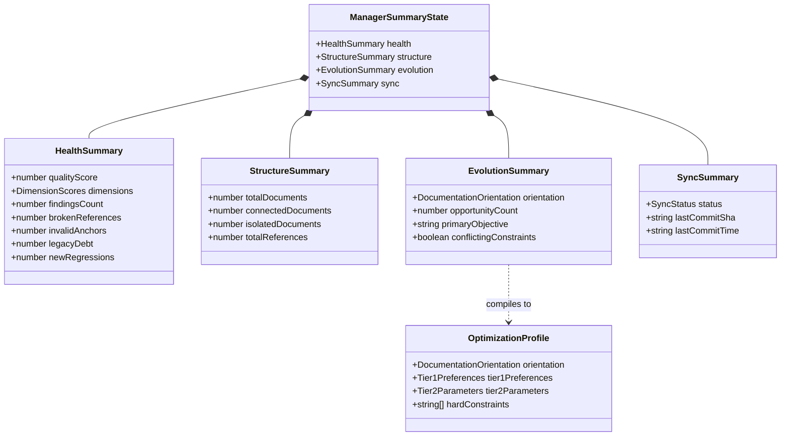

---
wiki:
  content_hash: f2744cd5dc904fa4b13188d2144696350e85519e9e2459113e126f6fe2dcd779
  fragments:
    data-model-llm-wiki-management-experience-structural-evolution-ui:
      tokens: 3209
      inbound: 0
      outbound: 0
    1-architectural-overview-separation-of-concerns:
      tokens: 420
      inbound: 0
      outbound: 0
    2-core-rust-data-models-cratescoresrcmodelmodrs-evolution:
      tokens: 1939
      inbound: 0
      outbound: 0
    21-manager-summary-model:
      tokens: 561
      inbound: 0
      outbound: 0
    22-unified-optimization-profile-invariant-xiv:
      tokens: 292
      inbound: 0
      outbound: 0
    23-structural-opportunities-10-d-evidence-models:
      tokens: 744
      inbound: 0
      outbound: 0
    24-preview-post-change-re-measurement-models:
      tokens: 318
      inbound: 0
      outbound: 0
    3-typescript-ui-models-extensionsrctypes-webview-ui:
      tokens: 475
      inbound: 0
      outbound: 0
    31-navigation-drawer-state-models:
      tokens: 128
      inbound: 0
      outbound: 0
    32-webview-presentation-state-model:
      tokens: 244
      inbound: 0
      outbound: 0
    33-informational-bubble-dictionary-model:
      tokens: 82
      inbound: 0
      outbound: 0
    4-presentation-formatting-guard-functions:
      tokens: 289
      inbound: 0
      outbound: 0
---
# Data Model: LLM Wiki Management Experience & Structural Evolution UI

**Feature:** `006-management-experience-ui`  
**Target:** Extension Host (TypeScript) & Core Engine (Rust)  
**Constitution Authority:** `CONSTITUTION.md` v1.6.0 (Invariants I, III, IV, V, IX, X, XI, XIII, XIV, XV, XVI)  

---

## 1. Architectural Overview & Separation of Concerns

The Management Experience data model enforces a strict separation between:
1. **Raw Core Models (Rust Engine)**: Stores complete, high-precision raw numbers (integers, 64-bit floats), graphs, and AST structures (Invariant IX).
2. **IPC DTOs (JSON-RPC 2.0 Contracts)**: Strongly typed message envelopes transporting unrounded raw metrics between processes.
3. **Presentation View Models (TypeScript Webview)**: Formats numbers for display ($\le 5$ chars in compact badges per Invariant X), maps raw dimensions to human-readable strings, manages active tab state, and provides `ⓘ` tooltip content.



---

## 2. Core Rust Data Models (`crates/core/src/model/mod.rs` & `evolution/`)

### 2.1 Manager Summary Model
```rust
use serde::{Deserialize, Serialize};

/// High-level persistent summary payload computed in <= 50 ms
#[derive(Debug, Clone, Serialize, Deserialize, PartialEq)]
pub struct ManagerSummary {
    pub health: HealthSummary,
    pub structure: StructureSummary,
    pub evolution: EvolutionSummary,
    pub sync: SyncSummary,
}

#[derive(Debug, Clone, Serialize, Deserialize, PartialEq)]
pub struct HealthSummary {
    /// Overall Quality Score (0..100)
    pub quality_score: u32,
    /// Breakdown across the 5 canonical dimensions (0..100 each)
    pub integrity: u32,
    pub structure: u32,
    pub consistency: u32,
    pub discoverability: u32,
    pub freshness: u32,
    /// Total actionable findings requiring attention
    pub findings_count: u32,
    /// Specific Integrity sub-counts
    pub broken_references: u32,
    pub invalid_anchors: u32,
    /// Debt tracking (Invariant XI)
    pub legacy_debt: u32,
    pub new_regressions: u32,
}

#[derive(Debug, Clone, Serialize, Deserialize, PartialEq)]
pub struct StructureSummary {
    /// Total active Markdown documents (nodes in knowledge base)
    pub total_documents: u32,
    /// Documents participating in 1+ references
    pub connected_documents: u32,
    /// Documents with zero references (unconnected notes)
    pub isolated_documents: u32,
    /// Total valid references (edges in graph)
    pub total_references: u32,
}

#[derive(Debug, Clone, Serialize, Deserialize, PartialEq)]
pub struct EvolutionSummary {
    /// Active orientation preset
    pub orientation: DocumentationOrientation,
    /// Number of detected structural opportunities
    pub opportunity_count: u32,
    /// Summary of what current orientation optimizes (strictly <= 60 chars)
    pub primary_objective: String,
    /// True if configured constraints are mathematically irreconcilable
    pub conflicting_constraints: bool,
}

#[derive(Debug, Clone, Copy, Serialize, Deserialize, PartialEq, Eq)]
#[serde(rename_all = "snake_case")]
pub enum DocumentationOrientation {
    AiOriented,
    HumanOriented,
    Balanced,
    Custom,
}

#[derive(Debug, Clone, Serialize, Deserialize, PartialEq)]
pub struct SyncSummary {
    pub status: SyncStatus,
    pub last_commit_sha: Option<String>,
    pub last_commit_time: Option<String>,
}

#[derive(Debug, Clone, Copy, Serialize, Deserialize, PartialEq, Eq)]
#[serde(rename_all = "snake_case")]
pub enum SyncStatus {
    Synced,
    Syncing,
    Error,
    Uninitialized,
}
```

### 2.2 Unified Optimization Profile (Invariant XIV)
```rust
/// Unified internal optimization profile into which all orientations compile
#[derive(Debug, Clone, Serialize, Deserialize, PartialEq)]
pub struct OptimizationProfile {
    pub orientation: DocumentationOrientation,
    pub tier1_preferences: Tier1Preferences,
    pub tier2_parameters: Tier2Parameters,
    pub hard_constraints: Vec<String>,
}

#[derive(Debug, Clone, Serialize, Deserialize, PartialEq)]
pub struct Tier1Preferences {
    pub ai_discoverability: PreferenceLevel,
    pub context_efficiency: PreferenceLevel,
    pub human_readability: PreferenceLevel,
    pub knowledge_reuse: PreferenceLevel,
    pub narrative_coherence: PreferenceLevel,
    pub maintenance_simplicity: PreferenceLevel,
}

#[derive(Debug, Clone, Copy, Serialize, Deserialize, PartialEq, Eq)]
#[serde(rename_all = "snake_case")]
pub enum PreferenceLevel {
    Low,
    Medium,
    High,
}

#[derive(Debug, Clone, Serialize, Deserialize, PartialEq)]
pub struct Tier2Parameters {
    pub cohesion_threshold: f64,
    pub semantic_diversity_threshold: f64,
    pub reference_concentration_threshold: f64,
    pub max_trace_depth: u32,
    pub max_context_surface_tokens: u32,
    pub split_sensitivity: f64,
    pub canonical_ownership_sensitivity: f64,
    pub fragment_size_target: u32,
}
```

### 2.3 Structural Opportunities & 10-D Evidence Models
```rust
#[derive(Debug, Clone, Serialize, Deserialize, PartialEq)]
pub struct StructuralOpportunity {
    pub id: String,
    pub target_document: String,
    pub signature: ProblemSignature,
    /// Confidence rating (0.0..1.0): High >= 0.80, Medium 0.50..0.79, Low < 0.50
    pub confidence: f64,
    /// Narrative explanation of WHY this opportunity was detected
    pub narrative_why: String,
    /// Multi-dimensional evidence metrics covering all 10 canonical dimensions
    pub evidence: OpportunityEvidence,
    /// Candidate strategies evaluated for this problem
    pub candidate_strategies: Vec<StrategyRecommendation>,
}

#[derive(Debug, Clone, Copy, Serialize, Deserialize, PartialEq, Eq)]
#[serde(rename_all = "snake_case")]
pub enum ProblemSignature {
    /// High context waste / structurally overloaded document
    StructurallyOverloadedDocument,
    /// Multi-document duplication or fragmentation
    KnowledgeFragmentation,
    /// Excessively long traversal path to access relevant knowledge
    WeakDiscoveryPath,
    /// Disconnected cluster of knowledge
    IsolatedKnowledgeSilo,
}

/// 10-Dimensional structural analytics evidence metrics
#[derive(Debug, Clone, Serialize, Deserialize, PartialEq)]
pub struct OpportunityEvidence {
    pub document_size_tokens: u32,
    pub reference_concentration: f64,
    pub cohesion: f64,
    pub coupling: f64,
    pub granularity: f64,
    pub context_efficiency: f64,
    pub discoverability: f64,
    pub knowledge_reuse: f64,
    pub semantic_diversity: f64,
    pub navigational_complexity: f64,
    pub maintenance_coupling: f64,
}

#[derive(Debug, Clone, Serialize, Deserialize, PartialEq)]
pub struct StrategyRecommendation {
    pub strategy: EvolutionStrategy,
    /// Mathematical fit score (0.0..1.0)
    pub fit_score: f64,
    pub confidence: f64,
    pub why: String,
    pub expected_benefits: Vec<BenefitItem>,
    pub countervailing_trade_offs: Vec<TradeOffItem>,
    pub effort: EffortLevel,
    pub is_hybrid: bool,
    pub hybrid_partner: Option<EvolutionStrategy>,
}

#[derive(Debug, Clone, Copy, Serialize, Deserialize, PartialEq, Eq)]
#[serde(rename_all = "snake_case")]
pub enum EvolutionStrategy {
    SectionAddressing,
    TopicDecomposition,
    LightweightIndex,
    FacetedClassification,
    PreserveDocument,
    Hybrid,
}

#[derive(Debug, Clone, Serialize, Deserialize, PartialEq)]
pub struct BenefitItem {
    pub metric: String,
    pub direction: MetricDirection,
    pub description: String,
}

#[derive(Debug, Clone, Serialize, Deserialize, PartialEq)]
pub struct TradeOffItem {
    pub metric: String,
    pub description: String,
}

#[derive(Debug, Clone, Copy, Serialize, Deserialize, PartialEq, Eq)]
#[serde(rename_all = "snake_case")]
pub enum MetricDirection {
    Increase,
    Decrease,
}

/// Strategy effort heuristics:
/// - Low: single-file frontmatter/anchors modifications
/// - Medium: 1 new index router document + reference updates
/// - High: multi-file document decomposition and link restructuring
#[derive(Debug, Clone, Copy, Serialize, Deserialize, PartialEq, Eq)]
#[serde(rename_all = "snake_case")]
pub enum EffortLevel {
    Low,
    Medium,
    High,
}
```

### 2.4 Preview & Post-Change Re-Measurement Models
```rust
#[derive(Debug, Clone, Serialize, Deserialize, PartialEq)]
pub struct TransformationPlanPreview {
    pub plan_id: String,
    pub target_document: String,
    pub strategy: EvolutionStrategy,
    pub hybrid_partner: Option<EvolutionStrategy>,
    pub proposed_actions: Vec<ProposedAction>,
    pub expected_impact: Vec<MetricDeltaComparison>,
    pub trade_offs: Vec<String>,
}

#[derive(Debug, Clone, Serialize, Deserialize, PartialEq)]
pub struct ProposedAction {
    pub action_type: ProposedActionType,
    pub file_path: String,
    pub details: String,
}

#[derive(Debug, Clone, Copy, Serialize, Deserialize, PartialEq, Eq)]
#[serde(rename_all = "snake_case")]
pub enum ProposedActionType {
    CreateDocument,
    UpdateDocumentLinks,
    InjectFrontmatter,
    DeleteSection,
}

#[derive(Debug, Clone, Serialize, Deserialize, PartialEq)]
pub struct MetricDeltaComparison {
    pub metric_name: String,
    pub before_value: f64,
    pub after_value: f64,
    pub unit: String,
}

#[derive(Debug, Clone, Serialize, Deserialize, PartialEq)]
pub struct ReMeasurementReport {
    pub context_efficiency_delta_pct: f64,
    pub trace_depth_delta_pct: f64,
    pub maintenance_coupling_delta_pct: f64,
    pub document_count_delta: i32,
    pub reference_count_delta: i32,
    pub narrative_summary: String,
}
```

---

## 3. TypeScript UI Models (`extension/src/types/` & `webview-ui/`)

### 3.1 Navigation & Drawer State Models
```typescript
/**
 * Primary drawer conceptual tiers
 */
export type DrawerPrimaryTab = 'insights' | 'settings';

export type InsightsSubTab = 'health' | 'structure' | 'evolution';

export type SettingsSubTab =
  | 'knowledge'
  | 'exclusions'
  | 'clusters'
  | 'git_harness'
  | 'advanced';

export interface NavigationIntent {
  primaryTab: DrawerPrimaryTab;
  subTab: InsightsSubTab | SettingsSubTab;
  targetSection?: string;
  targetId?: string;
}
```

### 3.2 Webview Presentation State Model
```typescript
export interface ManagerViewState {
  health: {
    qualityScore: number;
    integrity: number;
    structure: number;
    consistency: number;
    discoverability: number;
    freshness: number;
    findingsCount: number;
    brokenReferences: number;
    invalidAnchors: number;
    legacyDebt: number;       // Invariant XI
    newRegressions: number;   // Invariant XI & XII
  };
  structure: {
    totalDocuments: number;
    connectedDocuments: number;
    isolatedDocuments: number;
    totalReferences: number;
  };
  evolution: {
    orientation: 'ai_oriented' | 'human_oriented' | 'balanced' | 'custom';
    orientationTitle: string;
    primaryObjective: string; // Max 60 chars
    opportunityCount: number;
    hasConflictingConstraints: boolean;
  };
  sync: {
    status: 'synced' | 'syncing' | 'error' | 'uninitialized';
    lastCommitSha: string | null;
    lastCommitTime: string | null;
  };
}
```

### 3.3 Informational Bubble Dictionary Model
```typescript
export interface InfoBubbleContent {
  title: string;
  meaning: string;
  implications: {
    higher: string;
    lower: string;
  };
  whyItMatters: string;
  affects: string[];
  tradeOff: string;
}

export type InfoBubbleDictionary = Record<string, InfoBubbleContent>;
```

---

## 4. Presentation Formatting Guard Functions

Adhering strictly to **Invariant X (Presentation Separation)**, formatted strings are generated exclusively at the presentation boundary and never fed back into analysis or RPC payloads:

```typescript
/**
 * Format raw numbers to compact display format strictly <= 5 chars.
 * Guaranteed: length <= 5 for all n >= 0.
 */
export function formatCompactNumber(n: number): string {
  if (n < 1000) return n.toString();
  if (n < 10000) return (n / 1000).toFixed(1) + 'k'; // e.g. 5.1k
  if (n < 100000) return Math.round(n / 1000) + 'k'; // e.g. 42k
  if (n < 1000000) return Math.round(n / 1000) + 'k'; // e.g. 500k
  if (n < 10000000) return (n / 1000000).toFixed(1) + 'M'; // e.g. 1.2M
  return Math.round(n / 1000000) + 'M'; // e.g. 15M
}

/**
 * Format percentage display
 */
export function formatPercent(fraction: number): string {
  return `${Math.round(fraction * 100)}%`;
}
```
