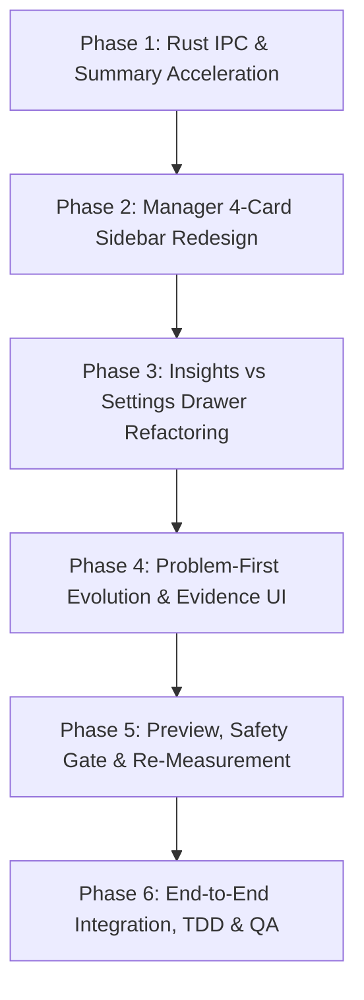

---
wiki:
  content_hash: ff37adfd4262b5b944788b8bc2a2ba26ac35f8d95213f75433a52bb04815ace2
  fragments:
    implementation-plan-llm-wiki-management-experience-structural-evolution-ui:
      tokens: 1709
      inbound: 0
      outbound: 0
    1-technical-context-architectural-baseline:
      tokens: 375
      inbound: 0
      outbound: 0
    architectural-delta:
      tokens: 250
      inbound: 0
      outbound: 0
    2-phased-implementation-breakdown:
      tokens: 767
      inbound: 0
      outbound: 0
    phase-1-rust-ipc-summary-acceleration:
      tokens: 111
      inbound: 0
      outbound: 0
    phase-2-manager-4-card-sidebar-redesign:
      tokens: 120
      inbound: 0
      outbound: 0
    phase-3-insights-vs-settings-drawer-refactoring:
      tokens: 116
      inbound: 0
      outbound: 0
    phase-4-problem-first-evolution-evidence-ui:
      tokens: 97
      inbound: 0
      outbound: 0
    phase-5-preview-safety-gate-re-measurement:
      tokens: 103
      inbound: 0
      outbound: 0
    phase-6-end-to-end-integration-tdd-verification:
      tokens: 90
      inbound: 0
      outbound: 0
    3-constitutional-invariant-alignment-matrix:
      tokens: 295
      inbound: 0
      outbound: 0
    4-risk-assessment-performance-budgets:
      tokens: 175
      inbound: 0
      outbound: 0
---
# Implementation Plan: LLM Wiki Management Experience & Structural Evolution UI

**Feature Branch:** `006-management-experience-ui`  
**Target Delivery:** `llm_wiki_ext4vsc` (VS Code Extension + Rust Core `llm-wiki-core`)  
**Status:** In Review / Plan  
**Constitution Authority:** `CONSTITUTION.md` v1.6.0 (Principles I through XII, The 16 Critical Invariants)  

---

## 1. Technical Context & Architectural Baseline

LLM Wiki already possesses a robust, high-performance foundation:
- **Rust Core Sidecar (`llm-wiki-core`)**: Fast Markdown AST parsing (`pulldown-cmark`), petgraph topology, 5-pillar health scoring, 10-dimensional structural metrics, and transformation engine.
- **VS Code Extension Host (TypeScript)**: Process lifecycle manager, SecretStorage credential management, and JSON-RPC 2.0 communication.
- **Webview UI**: High-performance 2D Canvas force-directed graph renderer and custom sliding drawer.

### Architectural Delta
This feature reorganizes the presentation and interaction layers:
1. **Sidebar Webview (`extension/src/webview/sidebarViewProvider.ts`)**: Transformed into the persistent 4-card **LLM Wiki Manager** (Health, Structure, Evolution, Sync).
2. **Detail Drawer (`extension/webview-ui/src/components/settingsDrawer.ts`)**: Restructured from an undifferentiated "Advanced Settings" drawer into **Insights** (Health, Structure, Evolution) and **Settings** (Knowledge, Exclusions, Clusters, Git/Harness, Advanced with gear icon).
3. **Manager ↔ Detail Interactivity**: Implements instant, bi-directional deep-linking (`manager/navigateToDetail`) where clicking any metric row in the Manager opens the exact sub-tab context.
4. **Structural Opportunities Panel (`extension/webview-ui/src/components/evolutionTab.ts`)**: Transformed into a problem-first interface displaying human-readable evidence metrics with `ⓘ` tooltips, fit scores, and hybrid recommendations.
5. **Transformation Preview & Re-Measurement (`extension/webview-ui/src/components/transformationPlanModal.ts`)**: Adds Before-vs-After comparison tables and post-change empirical delta reports.

---

## 2. Phased Implementation Breakdown

### Phase 1: Rust IPC & Summary Acceleration
- Implement `manager/getSummary` in `crates/core/src/ipc/handlers.rs` aggregating Health, Structure, Evolution, and Git sync status in $\le 50\text{ ms}$.
- Expose `StructuralOpportunity` evidence metrics with full human-readable labels and normalized confidence scores.
- Add hybrid strategy evaluation in `crates/core/src/evolution/strategies.rs`.
- Write unit tests in `crates/core/tests/manager_summary_test.rs`.

### Phase 2: Manager 4-Card Sidebar Redesign
- Redesign `extension/src/webview/sidebarViewProvider.ts` HTML/CSS layout into 4 calm cards: Health, Structure, Evolution, and Sync.
- Implement Health Finding vs. Quality Score visual separation.
- Consolidate broken links and invalid anchors under Integrity.
- Standardize terminology: `documents`, `references`, `connected documents`, `isolated documents`.
- Wire `[Explore graph]` button to command `llmWiki.showKnowledgeGraph`.
- Ensure scroll positions are never reset during updates via partial DOM updates.

### Phase 3: Insights vs. Settings Drawer Refactoring
- Restructure `extension/webview-ui/src/components/settingsDrawer.ts` into top-level sections:
  - **INSIGHTS**: Health, Structure, Evolution.
  - **SETTINGS**: Knowledge, Exclusions, Clusters, Git / Harness, Advanced (with gear icon).
- Implement `manager/navigateToDetail` RPC protocol handler in `extension/src/webview/panelManager.ts`.
- Ensure deep-linking from Manager cards to Drawer sub-tabs executes in $\le 16\text{ ms}$.

### Phase 4: Problem-First Evolution & Evidence UI
- Redesign `extension/webview-ui/src/components/evolutionTab.ts` to present structural opportunities before strategies.
- Render all 10 structural dimensions with full titles and active `ⓘ` informational tooltips answering the 5 mandatory questions.
- Display explainable Fit Scores with `ⓘ` tooltips.
- Surface `Recommended Hybrid Approach` cards when complementary strategies exist.
- Render yellow alert banners when Custom constraints conflict.

### Phase 5: Preview, Safety Gate & Re-Measurement
- Enhance `extension/webview-ui/src/components/transformationPlanModal.ts` to display Before $\to$ After impact tables alongside explicit countervailing trade-offs.
- Enforce default safety invariants: `Auto-Apply: OFF`, `Require Approval: ON`.
- Implement post-change re-measurement UI displaying empirical percentage deltas ($\Delta \text{Context Efficiency}$, $\Delta \text{Trace Depth}$, etc.).

### Phase 6: End-to-End Integration, TDD & Verification
- Unit and integration tests covering the 48 functional requirements.
- Verify 100% compliance with Recommendation Language Standards.
- Validate performance budgets ($\le 50\text{ ms}$ summary, 60 FPS rendering, $\le 150\text{ ms}$ re-measurement).
- Run full automated test suite: `cargo test` and `npm test`.

---

## 3. Constitutional Invariant Alignment Matrix

| Invariant | Implementation Mechanism in Plan |
| :--- | :--- |
| **Invariant I & II** (Committed Truth & Candidate Isolation) | Sync card strictly reads committed Git SHA. Candidate graph remains isolated in memory. |
| **Invariant III & IV** (Determinism & Locality) | 100% deterministic Rust calculation. Zero external AI/LLM network calls. |
| **Invariant V & VI** (Document-Centric Graph & Section Addressability) | Terminology standardized on Documents as nodes, References as edges, and Fragments as metadata. |
| **Invariant IX & X** (Raw Numeric Integrity & Presentation Separation) | Raw metrics transported via JSON-RPC. Compact formatting ($\le 5$ chars) strictly at view layer. |
| **Invariant XIII** (Non-Prescriptive Knowledge Organization) | Size is a signal, not a verdict. Healthy monolithic documents are protected from split recommendations. |
| **Invariant XIV** (Unified Optimization Profile) | All orientations compile into a single `OptimizationProfile` struct in Rust. |
| **Invariant XV** (Transparent Trade-Offs) | All strategies itemize expected benefits AND countervailing trade-offs. |
| **Invariant XVI** (User-Controlled Automation & Re-Measurement) | Strict user approval gate before disk writes. Automated Before-vs-After comparative re-measurement. |

---

## 4. Risk Assessment & Performance Budgets

| Risk | Mitigation | Budget |
| :--- | :--- | :--- |
| **Manager UI Freeze on Large Repositories** | Rust core pre-caches graph centrality and health scores; summary endpoint reads memory cache. | $\le 50\text{ ms}$ response |
| **Scroll Jump / DOM Flicker** | Partial DOM reconciliation targeting only inner metric spans (`#val-quality-score`, etc.). | 0 layout jumps |
| **Transformation Plan Timeout** | Fast deterministic template synthesis without external LLM inference. | $\le 500\text{ ms}$ response |
| **Drawer Navigation Stutter** | CSS hardware-accelerated transforms (`transform: translateX()`); pre-rendered tab bodies. | $\le 16\text{ ms}$ (60 FPS) |
