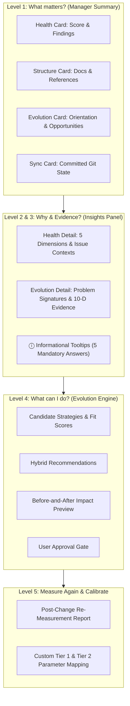

---
wiki:
  content_hash: 7cb832dbbb9fec883ab5741ba3735a8b01158c123dd168ef9f05c4ef4b264922
  fragments:
    research-ux-synthesis-llm-wiki-management-experience-structural-evolution-ui:
      tokens: 2106
      inbound: 0
      outbound: 0
    1-executive-summary-52-section-synthesis:
      tokens: 331
      inbound: 0
      outbound: 0
    2-terminology-conceptual-shift-dictionary:
      tokens: 337
      inbound: 0
      outbound: 0
    3-comprehensive-informational-bubble-dictionary:
      tokens: 1164
      inbound: 0
      outbound: 0
    31-the-10-structural-dimensions:
      tokens: 1071
      inbound: 0
      outbound: 0
    1-cohesion:
      tokens: 107
      inbound: 0
      outbound: 0
    2-coupling:
      tokens: 101
      inbound: 0
      outbound: 0
    3-reference-concentration:
      tokens: 146
      inbound: 0
      outbound: 0
    4-granularity:
      tokens: 91
      inbound: 0
      outbound: 0
    5-context-efficiency:
      tokens: 97
      inbound: 0
      outbound: 0
    6-discoverability:
      tokens: 110
      inbound: 0
      outbound: 0
    7-knowledge-reuse:
      tokens: 97
      inbound: 0
      outbound: 0
    8-semantic-diversity:
      tokens: 106
      inbound: 0
      outbound: 0
    9-navigational-complexity:
      tokens: 104
      inbound: 0
      outbound: 0
    10-maintenance-coupling:
      tokens: 101
      inbound: 0
      outbound: 0
    4-analysis-of-cognitive-load-action-duplication:
      tokens: 212
      inbound: 0
      outbound: 0
    41-the-action-duplication-problem:
      tokens: 100
      inbound: 0
      outbound: 0
    42-the-decision-oriented-solution:
      tokens: 99
      inbound: 0
      outbound: 0
---
# Research & UX Synthesis: LLM Wiki Management Experience & Structural Evolution UI

**Feature:** `006-management-experience-ui`  
**Constitution Authority:** `CONSTITUTION.md` v1.6.0 (Principles I through XII, Invariants I–XVI)  

---

## 1. Executive Summary & 52-Section Synthesis

The 52-section UX/UI specification redefines the fundamental interaction model of LLM Wiki. Rather than exposing internal engine capabilities across parallel toolbars, menus, and sidebars, the system organizes knowledge around **user questions and decisions**.

---

## 2. Terminology & Conceptual Shift Dictionary

To prevent cognitive friction and eliminate ambiguous developer jargon, the following terminology mapping is strictly enforced across all components:

| Legacy Term / Pattern | Redesigned Canonical Term | Conceptual Definition |
| :--- | :--- | :--- |
| `Node` | **Document** | A distinct Markdown note file ($O(N)$ graph unit). |
| `Edge` / `Link` | **Reference** | A directed knowledge link or wikilink connecting two documents. |
| `Fragment` | **Section / Fragment** | Addressable structural section metadata within a document. |
| `CONNECTED` (e.g. "4 CONNECTED") | **Connected Documents** | Documents participating in the link network. |
| `ORPHANS` (e.g. "47 ORPHANS") | **Isolated Documents** | Documents with zero inbound and outbound references. Neutral phrasing. |
| `Methods` (tab) | **Evolution / Structural Opportunities** | Problem-first evaluation rather than rigid methodology modes. |
| `KOS: Section Addressing` | **Strategy: Section Addressing** | A candidate structural response, not the system's identity. |
| `God Document` | **Structurally Overloaded Document** | High diversity + high concentration + context waste, not raw size. |
| `Advanced Settings Drawer` | **Detail Drawer (Insights vs Settings)** | Distinct separation between analytical insights and system configuration. |
| `Synced` implies `Healthy` | **Synced $\ne$ Healthy** | Explicit separation: Git commit sync status vs knowledge quality. |

---

## 3. Comprehensive Informational Bubble (`ⓘ`) Dictionary

Every non-obvious metric, configuration knob, and strategy fit score answers five mandatory questions:
1. **Meaning**: What does this mean?
2. **Implications**: What does a higher/lower value imply?
3. **Importance**: Why does it matter?
4. **Affects**: What does it affect?
5. **Trade-off**: What trade-off does it introduce?

### 3.1 The 10 Structural Dimensions

#### 1. Cohesion ⓘ
- **Meaning**: The degree to which headings, concepts, and code citations within a document address a single, unified topic.
- **Implications**: Higher values indicate focused, thematic content; lower values indicate multi-topic sprawling notes.
- **Importance**: High cohesion ensures that retrieving a document loads relevant context rather than unrelated background noise.
- **Affects**: Candidate expansion in Context Trace and topic decomposition recommendations.
- **Trade-off**: Maximizing cohesion on complex topics can increase document fragmentation.

#### 2. Coupling ⓘ
- **Meaning**: The density of inter-document reference dependencies between this document and others.
- **Implications**: Higher coupling implies tight interdependence; lower coupling implies self-contained knowledge units.
- **Importance**: High coupling increases the risk of ripple-effect link breakage when files are renamed or refactored.
- **Affects**: Maintenance effort estimates and impact radii.
- **Trade-off**: Extremely low coupling isolates documents, preventing graph traversability.

#### 3. Reference Concentration ⓘ
- **Meaning**: The proportion of inbound references targeting a small subset of sections within a document ($C = \text{inbound}_{\text{fragment}} / \text{inbound}_{\text{doc}}$).
- **Implications**: High concentration ($\ge 70\%$) means agents repeatedly visit a monolithic note for only 1 or 2 specific sections.
- **Importance**: Key indicator of context waste. Suggests section addressing or index routing.
- **Affects**: Strategy fit scores for Section Addressing and Lightweight Index Routers.
- **Trade-off**: Section-level addressing increases URI anchor precision but requires stable heading names.

#### 4. Granularity ⓘ
- **Meaning**: The ratio of document token size to structural section depth.
- **Implications**: Higher granularity implies fine-grained micro-notes; lower granularity implies long-form monolithic documents.
- **Importance**: Dictates chunk sizes during AI context injection.
- **Affects**: Token consumption vs navigational hops.
- **Trade-off**: High granularity reduces per-document token cost but increases graph traversal depth.

#### 5. Context Efficiency ⓘ
- **Meaning**: The ratio of directly relevant tokens to total tokens loaded during knowledge traversal.
- **Implications**: Higher values indicate that agents consume minimal irrelevant tokens to fulfill tasks.
- **Importance**: Prevents LLM context saturation and reduces API costs / inference latency.
- **Affects**: Context Trace depth penalties and section-level extraction triggers.
- **Trade-off**: May favor more granular structures and require more explicit link indexing.

#### 6. Discoverability ⓘ
- **Meaning**: The mathematical ease with which relevant knowledge can be reached from entry points (e.g. `AGENTS.md`).
- **Implications**: Higher values mean short, high-relevance traversal paths; lower values mean buried or isolated content.
- **Importance**: Ensures AI agents and engineers find canonical answers without exhaustive repository searches.
- **Affects**: Beam search candidate generation and index router recommendations.
- **Trade-off**: Maximizing discoverability requires maintaining curated hubs and index directories.

#### 7. Knowledge Reuse ⓘ
- **Meaning**: The degree to which individual sections or concepts are cross-referenced across multiple workflows.
- **Implications**: High reuse indicates core shared architecture specifications or shared operational rules.
- **Importance**: Identifies single sources of truth that must be protected against canonical drift.
- **Affects**: Canonical candidate identification and collision warnings.
- **Trade-off**: High reuse components require stricter change control to avoid widespread breakage.

#### 8. Semantic Diversity ⓘ
- **Meaning**: The variety of distinct vocabulary terms, topic clusters, and code namespaces contained in a single document.
- **Implications**: High diversity within a single file suggests it combines unrelated architectural domains.
- **Importance**: Differentiates healthy monoliths (low diversity, single topic) from overloaded "God Documents" (high diversity, multiple topics).
- **Affects**: Structural problem signature detection.
- **Trade-off**: Artificially suppressing diversity can break natural narrative explanations.

#### 9. Navigational Complexity ⓘ
- **Meaning**: The cognitive and computational path length (hops) required to traverse between related concepts.
- **Implications**: High complexity means users and agents must follow convoluted reference chains.
- **Importance**: Direct driver of user frustration and agent lost-in-the-middle phenomena.
- **Affects**: Centrality re-weighting and router synthesis.
- **Trade-off**: Flattening navigation completely creates giant index files with massive link fan-outs.

#### 10. Maintenance Coupling ⓘ
- **Meaning**: The likelihood that changes to code or schema require simultaneous edits across multiple documentation files.
- **Implications**: Higher values mean documentation easily drifts out of sync during software development.
- **Importance**: Minimizes documentation rot and brownfield debt.
- **Affects**: Freshness pillar scoring and reverse code-doc impact alerts.
- **Trade-off**: Reducing maintenance coupling may require delegating implementation details to inline docstrings.

---

## 4. Analysis of Cognitive Load & Action Duplication

### 4.1 The Action Duplication Problem
Prior to this specification, users encountered competing controls:
- **Rescan Vault**: Present in sidebar title, manager buttons, actions dropdown, and command palette.
- **Fix Broken Links**: Present in sidebar title, dashboard cards, inspector drawer, and commands.
- **Set Central Hub**: Present in manager, canvas right-click, toolbar, and commands.
- **Evolution Strategy Configuration**: Present in toolbar dropdown, right drawer, and sidebar buttons.

### 4.2 The Decision-Oriented Solution
All administrative operations now **emerge naturally from context cards**:
- Broken references are repaired inside `Health → Integrity → [Fix reference]`.
- Knowledge Graph is opened via `Structure → [Explore graph]` or editor tab.
- Evolution orientation is changed via `Evolution → [Change / Review evolution]`.
- Advanced engine diagnostics are isolated strictly under `Settings → Advanced`.
- Zero competing action buttons clutter primary exploration views.
