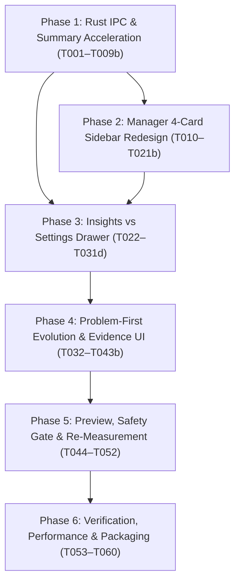

---
wiki:
  content_hash: 2207cbc55a72520d68134e62c30d15e7bc607d7f3eae0c297fe16c6bd3655a81
  fragments:
    task-breakdown-llm-wiki-management-experience-structural-evolution-ui:
      tokens: 25687
      inbound: 0
      outbound: 0
    task-priority-dependency-graph:
      tokens: 175
      inbound: 0
      outbound: 0
    phase-1-rust-core-sidecar-ipc-enhancements:
      tokens: 3163
      inbound: 0
      outbound: 0
    phase-2-manager-4-card-sidebar-redesign:
      tokens: 7981
      inbound: 0
      outbound: 0
    phase-3-insights-vs-settings-drawer-refactoring:
      tokens: 5979
      inbound: 0
      outbound: 0
    phase-4-problem-first-evolution-evidence-ui:
      tokens: 5135
      inbound: 0
      outbound: 0
    phase-5-preview-safety-gate-post-change-re-measurement:
      tokens: 2608
      inbound: 0
      outbound: 0
    phase-6-end-to-end-verification-performance-packaging:
      tokens: 556
      inbound: 0
      outbound: 0
---
# Task Breakdown: LLM Wiki Management Experience & Structural Evolution UI

**Feature Branch:** `006-management-experience-ui`  
**Target Delivery:** `llm_wiki_ext4vsc` (VS Code Extension + Rust Core `llm-wiki-core`)  
**Status:** Ready for Implementation  
**Constitution Authority:** `CONSTITUTION.md` v1.6.0 (The 16 Critical Invariants)  

---

## Task Priority & Dependency Graph

---

## Phase 1: Rust Core Sidecar & IPC Enhancements

- [x] **T001**: Implement `ManagerSummary` struct and calculation engine in `crates/core/src/evolution/mod.rs` and `crates/core/src/model/mod.rs`, computing health scores, document/reference counts, orientation info, and sync status in memory.
  - *Mapped Requirements*: FR-001, FR-002, FR-004, FR-005, FR-006, FR-007, NFR-002.
  - *Verification*: Unit tests in `crates/core/tests/manager_summary_test.rs`.
- [x] **T002**: Implement `manager/getSummary` JSON-RPC handler in `crates/core/src/ipc/handlers.rs`, reading cached state and responding in $\le 50\text{ ms}$.
  - *Mapped Requirements*: FR-002, NFR-002, Contract `manager/getSummary`.
  - *Verification*: IPC roundtrip test in `crates/core/tests/ipc_test.rs`.
- [x] **T002b**: Implement `evolution/setOrientation` and `evolution/updateCustomProfile` JSON-RPC handlers in `crates/core/src/ipc/handlers.rs`, compiling presets into a unified `OptimizationProfile` struct and persisting to `.context-vault.yaml` (Invariant XIV).
  - *Mapped Requirements*: FR-006, FR-045, FR-046, Invariant XIV, Contracts `evolution/setOrientation`, `evolution/updateCustomProfile`.
*crates/core/tests/optimization_profile_test.rs* *crates/core/tests/optimization_profile_test.rs* *crates/core/tests/optimization_profile_test.rs*-*crates/core/tests/optimization_profile_test.rs* *crates/core/tests/optimization_profile_test.rs***crates/core/tests/optimization_profile_test.rs*V*crates/core/tests/optimization_profile_test.rs*e*crates/core/tests/optimization_profile_test.rs*r*crates/core/tests/optimization_profile_test.rs*i*crates/core/tests/optimization_profile_test.rs*f*crates/core/tests/optimization_profile_test.rs*i*crates/core/tests/optimization_profile_test.rs*c*crates/core/tests/optimization_profile_test.rs*a*crates/core/tests/optimization_profile_test.rs*t*crates/core/tests/optimization_profile_test.rs*i*crates/core/tests/optimization_profile_test.rs*o*crates/core/tests/optimization_profile_test.rs*n*crates/core/tests/optimization_profile_test.rs***crates/core/tests/optimization_profile_test.rs*:*crates/core/tests/optimization_profile_test.rs* *crates/core/tests/optimization_profile_test.rs*P*crates/core/tests/optimization_profile_test.rs*r*crates/core/tests/optimization_profile_test.rs*o*crates/core/tests/optimization_profile_test.rs*f*crates/core/tests/optimization_profile_test.rs*i*crates/core/tests/optimization_profile_test.rs*l*crates/core/tests/optimization_profile_test.rs*e*crates/core/tests/optimization_profile_test.rs* *crates/core/tests/optimization_profile_test.rs*c*crates/core/tests/optimization_profile_test.rs*o*crates/core/tests/optimization_profile_test.rs*m*crates/core/tests/optimization_profile_test.rs*p*crates/core/tests/optimization_profile_test.rs*i*crates/core/tests/optimization_profile_test.rs*l*crates/core/tests/optimization_profile_test.rs*e*crates/core/tests/optimization_profile_test.rs*r*crates/core/tests/optimization_profile_test.rs* *crates/core/tests/optimization_profile_test.rs*t*crates/core/tests/optimization_profile_test.rs*e*crates/core/tests/optimization_profile_test.rs*s*crates/core/tests/optimization_profile_test.rs*t*crates/core/tests/optimization_profile_test.rs* *crates/core/tests/optimization_profile_test.rs*i*crates/core/tests/optimization_profile_test.rs*n*crates/core/tests/optimization_profile_test.rs* *crates/core/tests/optimization_profile_test.rs*`*crates/core/tests/optimization_profile_test.rs*c*crates/core/tests/optimization_profile_test.rs*r*crates/core/tests/optimization_profile_test.rs*a*crates/core/tests/optimization_profile_test.rs*t*crates/core/tests/optimization_profile_test.rs*e*crates/core/tests/optimization_profile_test.rs*s*crates/core/tests/optimization_profile_test.rs*/*crates/core/tests/optimization_profile_test.rs*c*crates/core/tests/optimization_profile_test.rs*o*crates/core/tests/optimization_profile_test.rs*r*crates/core/tests/optimization_profile_test.rs*e*crates/core/tests/optimization_profile_test.rs*/*crates/core/tests/optimization_profile_test.rs*t*crates/core/tests/optimization_profile_test.rs*e*crates/core/tests/optimization_profile_test.rs*s*crates/core/tests/optimization_profile_test.rs*t*crates/core/tests/optimization_profile_test.rs*s*crates/core/tests/optimization_profile_test.rs*/*crates/core/tests/optimization_profile_test.rs*o*crates/core/tests/optimization_profile_test.rs*p*crates/core/tests/optimization_profile_test.rs*t*crates/core/tests/optimization_profile_test.rs*i*crates/core/tests/optimization_profile_test.rs*m*crates/core/tests/optimization_profile_test.rs*i*crates/core/tests/optimization_profile_test.rs*z*crates/core/tests/optimization_profile_test.rs*a*crates/core/tests/optimization_profile_test.rs*t*crates/core/tests/optimization_profile_test.rs*i*crates/core/tests/optimization_profile_test.rs*o*crates/core/tests/optimization_profile_test.rs*n*crates/core/tests/optimization_profile_test.rs*_*crates/core/tests/optimization_profile_test.rs*p*crates/core/tests/optimization_profile_test.rs*r*crates/core/tests/optimization_profile_test.rs*o*crates/core/tests/optimization_profile_test.rs*f*crates/core/tests/optimization_profile_test.rs*i*crates/core/tests/optimization_profile_test.rs*l*crates/core/tests/optimization_profile_test.rs*e*crates/core/tests/optimization_profile_test.rs*_*crates/core/tests/optimization_profile_test.rs*t*crates/core/tests/optimization_profile_test.rs*e*crates/core/tests/optimization_profile_test.rs*s*crates/core/tests/optimization_profile_test.rs*t*crates/core/tests/optimization_profile_test.rs*.*crates/core/tests/optimization_profile_test.rs*r*crates/core/tests/optimization_profile_test.rs*s*crates/core/tests/optimization_profile_test.rs*`*crates/core/tests/optimization_profile_test.rs*.*crates/core/tests/optimization_profile_test.rs*
*crates/core/tests/optimization_profile_test.rs*- [x] **T003**: Expose `StructuralOpportunity` evidence metrics with all 10 canonical human-readable fields (`cohesion`, `coupling`, `reference_concentration`, `granularity`, `context_efficiency`, `discoverability`, `knowledge_reuse`, `semantic_diversity`, `navigational_complexity`, `maintenance_coupling`) and normalized confidence scores.
  - *Mapped Requirements*: FR-023, FR-024, FR-025, FR-029.
*crates/core/tests/structural_opportunity_test.rs* *crates/core/tests/structural_opportunity_test.rs* *crates/core/tests/structural_opportunity_test.rs*-*crates/core/tests/structural_opportunity_test.rs* *crates/core/tests/structural_opportunity_test.rs***crates/core/tests/structural_opportunity_test.rs*V*crates/core/tests/structural_opportunity_test.rs*e*crates/core/tests/structural_opportunity_test.rs*r*crates/core/tests/structural_opportunity_test.rs*i*crates/core/tests/structural_opportunity_test.rs*f*crates/core/tests/structural_opportunity_test.rs*i*crates/core/tests/structural_opportunity_test.rs*c*crates/core/tests/structural_opportunity_test.rs*a*crates/core/tests/structural_opportunity_test.rs*t*crates/core/tests/structural_opportunity_test.rs*i*crates/core/tests/structural_opportunity_test.rs*o*crates/core/tests/structural_opportunity_test.rs*n*crates/core/tests/structural_opportunity_test.rs***crates/core/tests/structural_opportunity_test.rs*:*crates/core/tests/structural_opportunity_test.rs* *crates/core/tests/structural_opportunity_test.rs*U*crates/core/tests/structural_opportunity_test.rs*n*crates/core/tests/structural_opportunity_test.rs*i*crates/core/tests/structural_opportunity_test.rs*t*crates/core/tests/structural_opportunity_test.rs* *crates/core/tests/structural_opportunity_test.rs*t*crates/core/tests/structural_opportunity_test.rs*e*crates/core/tests/structural_opportunity_test.rs*s*crates/core/tests/structural_opportunity_test.rs*t*crates/core/tests/structural_opportunity_test.rs*s*crates/core/tests/structural_opportunity_test.rs* *crates/core/tests/structural_opportunity_test.rs*i*crates/core/tests/structural_opportunity_test.rs*n*crates/core/tests/structural_opportunity_test.rs* *crates/core/tests/structural_opportunity_test.rs*`*crates/core/tests/structural_opportunity_test.rs*c*crates/core/tests/structural_opportunity_test.rs*r*crates/core/tests/structural_opportunity_test.rs*a*crates/core/tests/structural_opportunity_test.rs*t*crates/core/tests/structural_opportunity_test.rs*e*crates/core/tests/structural_opportunity_test.rs*s*crates/core/tests/structural_opportunity_test.rs*/*crates/core/tests/structural_opportunity_test.rs*c*crates/core/tests/structural_opportunity_test.rs*o*crates/core/tests/structural_opportunity_test.rs*r*crates/core/tests/structural_opportunity_test.rs*e*crates/core/tests/structural_opportunity_test.rs*/*crates/core/tests/structural_opportunity_test.rs*t*crates/core/tests/structural_opportunity_test.rs*e*crates/core/tests/structural_opportunity_test.rs*s*crates/core/tests/structural_opportunity_test.rs*t*crates/core/tests/structural_opportunity_test.rs*s*crates/core/tests/structural_opportunity_test.rs*/*crates/core/tests/structural_opportunity_test.rs*s*crates/core/tests/structural_opportunity_test.rs*t*crates/core/tests/structural_opportunity_test.rs*r*crates/core/tests/structural_opportunity_test.rs*u*crates/core/tests/structural_opportunity_test.rs*c*crates/core/tests/structural_opportunity_test.rs*t*crates/core/tests/structural_opportunity_test.rs*u*crates/core/tests/structural_opportunity_test.rs*r*crates/core/tests/structural_opportunity_test.rs*a*crates/core/tests/structural_opportunity_test.rs*l*crates/core/tests/structural_opportunity_test.rs*_*crates/core/tests/structural_opportunity_test.rs*o*crates/core/tests/structural_opportunity_test.rs*p*crates/core/tests/structural_opportunity_test.rs*p*crates/core/tests/structural_opportunity_test.rs*o*crates/core/tests/structural_opportunity_test.rs*r*crates/core/tests/structural_opportunity_test.rs*t*crates/core/tests/structural_opportunity_test.rs*u*crates/core/tests/structural_opportunity_test.rs*n*crates/core/tests/structural_opportunity_test.rs*i*crates/core/tests/structural_opportunity_test.rs*t*crates/core/tests/structural_opportunity_test.rs*y*crates/core/tests/structural_opportunity_test.rs*_*crates/core/tests/structural_opportunity_test.rs*t*crates/core/tests/structural_opportunity_test.rs*e*crates/core/tests/structural_opportunity_test.rs*s*crates/core/tests/structural_opportunity_test.rs*t*crates/core/tests/structural_opportunity_test.rs*.*crates/core/tests/structural_opportunity_test.rs*r*crates/core/tests/structural_opportunity_test.rs*s*crates/core/tests/structural_opportunity_test.rs*`*crates/core/tests/structural_opportunity_test.rs*.*crates/core/tests/structural_opportunity_test.rs*
*crates/core/tests/structural_opportunity_test.rs*- [x] **T003b**: Implement unit test in `crates/core/tests/non_prescriptive_guard_test.rs` validating Invariant XIII: healthy monolithic documents (>50k tokens) with high cohesion and low concentration do not trigger split recommendations.
  - *Mapped Requirements*: FR-028, NFR-010, Invariant XIII.
  - *Verification*: `cargo test --test non_prescriptive_guard_test`.
- [x] **T004**: Implement candidate strategy evaluation across all 6 strategies (`SectionAddressing`, `TopicDecomposition`, `LightweightIndex`, `FacetedClassification`, `PreserveDocument`, `Hybrid`) in `crates/core/src/evolution/strategies.rs`.
  - *Mapped Requirements*: FR-030, FR-034, US5.
  - *Verification*: Unit tests in `crates/core/tests/hybrid_strategies_test.rs`.
- [x] **T005**: Implement empirical Before-vs-After re-measurement calculation in `crates/core/src/evolution/re_measure.rs`, evaluating changes against an in-memory ephemeral candidate graph (preserving Invariant I until a Git commit occurs).
  - *Mapped Requirements*: FR-039, FR-040, Invariant I, Invariant XVI.
  - *Verification*: Unit tests in `crates/core/tests/re_measure_test.rs`.
- [x] **T006**: Add comprehensive unit tests for `manager/getSummary` in `crates/core/tests/manager_summary_test.rs` covering empty vaults, isolated-only notes, and densely connected graphs.
  - *Mapped Requirements*: SC-002, Edge Case 1.
  - *Verification*: `cargo test --test manager_summary_test`.
- [x] **T007**: Add unit tests for hybrid strategy generation in `crates/core/tests/hybrid_strategies_test.rs`.
  - *Mapped Requirements*: FR-034, US5.
  - *Verification*: `cargo test --test hybrid_strategies_test`.
- [x] **T008**: Add unit tests for empirical re-measurement in `crates/core/tests/re_measure_test.rs`.
  - *Mapped Requirements*: FR-040, SC-007.
  - *Verification*: `cargo test --test re_measure_test`.
- [x] **T009**: Implement Criterion benchmark `crates/core/benches/manager_summary_benchmark.rs` verifying summary generation executes in $\le 50\text{ ms}$ for 1,000 documents.
  - *Mapped Requirements*: NFR-002, SC-002.
  - *Verification*: `cargo bench --bench manager_summary_benchmark`.

---

## Phase 2: Manager 4-Card Sidebar Redesign

- [x] **T010**: Redesign HTML and CSS structure in `extension/src/webview/sidebarViewProvider.ts` into 4 calm cards: **Health**, **Structure**, **Evolution**, and **Sync**.
  - *Mapped Requirements*: FR-001, FR-002, US1.
  - *Verification*: Visual inspection and snapshot test in `extension/test/suite/sidebarViewProvider.test.ts`.
- [x] **T011**: Implement **Health Card**: render overall score ($0\text{--}100$), 5 dimension progress bars (`Integrity`, `Structure`, `Consistency`, `Discoverability`, `Freshness`), legacy debt vs new regressions, and separate finding counter (`N findings need attention`).
  - *Mapped Requirements*: FR-004, FR-011, US2, Invariant XI.
*extension/test/suite/sidebarHealthCard.test.ts* *extension/test/suite/sidebarHealthCard.test.ts* *extension/test/suite/sidebarHealthCard.test.ts*-*extension/test/suite/sidebarHealthCard.test.ts* *extension/test/suite/sidebarHealthCard.test.ts***extension/test/suite/sidebarHealthCard.test.ts*V*extension/test/suite/sidebarHealthCard.test.ts*e*extension/test/suite/sidebarHealthCard.test.ts*r*extension/test/suite/sidebarHealthCard.test.ts*i*extension/test/suite/sidebarHealthCard.test.ts*f*extension/test/suite/sidebarHealthCard.test.ts*i*extension/test/suite/sidebarHealthCard.test.ts*c*extension/test/suite/sidebarHealthCard.test.ts*a*extension/test/suite/sidebarHealthCard.test.ts*t*extension/test/suite/sidebarHealthCard.test.ts*i*extension/test/suite/sidebarHealthCard.test.ts*o*extension/test/suite/sidebarHealthCard.test.ts*n*extension/test/suite/sidebarHealthCard.test.ts***extension/test/suite/sidebarHealthCard.test.ts*:*extension/test/suite/sidebarHealthCard.test.ts* *extension/test/suite/sidebarHealthCard.test.ts*U*extension/test/suite/sidebarHealthCard.test.ts*n*extension/test/suite/sidebarHealthCard.test.ts*i*extension/test/suite/sidebarHealthCard.test.ts*t*extension/test/suite/sidebarHealthCard.test.ts* *extension/test/suite/sidebarHealthCard.test.ts*t*extension/test/suite/sidebarHealthCard.test.ts*e*extension/test/suite/sidebarHealthCard.test.ts*s*extension/test/suite/sidebarHealthCard.test.ts*t*extension/test/suite/sidebarHealthCard.test.ts*s*extension/test/suite/sidebarHealthCard.test.ts* *extension/test/suite/sidebarHealthCard.test.ts*i*extension/test/suite/sidebarHealthCard.test.ts*n*extension/test/suite/sidebarHealthCard.test.ts* *extension/test/suite/sidebarHealthCard.test.ts*`*extension/test/suite/sidebarHealthCard.test.ts*e*extension/test/suite/sidebarHealthCard.test.ts*x*extension/test/suite/sidebarHealthCard.test.ts*t*extension/test/suite/sidebarHealthCard.test.ts*e*extension/test/suite/sidebarHealthCard.test.ts*n*extension/test/suite/sidebarHealthCard.test.ts*s*extension/test/suite/sidebarHealthCard.test.ts*i*extension/test/suite/sidebarHealthCard.test.ts*o*extension/test/suite/sidebarHealthCard.test.ts*n*extension/test/suite/sidebarHealthCard.test.ts*/*extension/test/suite/sidebarHealthCard.test.ts*t*extension/test/suite/sidebarHealthCard.test.ts*e*extension/test/suite/sidebarHealthCard.test.ts*s*extension/test/suite/sidebarHealthCard.test.ts*t*extension/test/suite/sidebarHealthCard.test.ts*/*extension/test/suite/sidebarHealthCard.test.ts*s*extension/test/suite/sidebarHealthCard.test.ts*u*extension/test/suite/sidebarHealthCard.test.ts*i*extension/test/suite/sidebarHealthCard.test.ts*t*extension/test/suite/sidebarHealthCard.test.ts*e*extension/test/suite/sidebarHealthCard.test.ts*/*extension/test/suite/sidebarHealthCard.test.ts*s*extension/test/suite/sidebarHealthCard.test.ts*i*extension/test/suite/sidebarHealthCard.test.ts*d*extension/test/suite/sidebarHealthCard.test.ts*e*extension/test/suite/sidebarHealthCard.test.ts*b*extension/test/suite/sidebarHealthCard.test.ts*a*extension/test/suite/sidebarHealthCard.test.ts*r*extension/test/suite/sidebarHealthCard.test.ts*H*extension/test/suite/sidebarHealthCard.test.ts*e*extension/test/suite/sidebarHealthCard.test.ts*a*extension/test/suite/sidebarHealthCard.test.ts*l*extension/test/suite/sidebarHealthCard.test.ts*t*extension/test/suite/sidebarHealthCard.test.ts*h*extension/test/suite/sidebarHealthCard.test.ts*C*extension/test/suite/sidebarHealthCard.test.ts*a*extension/test/suite/sidebarHealthCard.test.ts*r*extension/test/suite/sidebarHealthCard.test.ts*d*extension/test/suite/sidebarHealthCard.test.ts*.*extension/test/suite/sidebarHealthCard.test.ts*t*extension/test/suite/sidebarHealthCard.test.ts*e*extension/test/suite/sidebarHealthCard.test.ts*s*extension/test/suite/sidebarHealthCard.test.ts*t*extension/test/suite/sidebarHealthCard.test.ts*.*extension/test/suite/sidebarHealthCard.test.ts*t*extension/test/suite/sidebarHealthCard.test.ts*s*extension/test/suite/sidebarHealthCard.test.ts*`*extension/test/suite/sidebarHealthCard.test.ts*.*extension/test/suite/sidebarHealthCard.test.ts*
*extension/test/suite/sidebarHealthCard.test.ts*- [x] **T012**: Consolidate broken links and invalid anchors under Integrity dimension in sidebar view, eliminating floating broken link badges.
  - *Mapped Requirements*: FR-012, FR-013, SC-001.
  - *Verification*: Unit tests in *extension/test/suite/sidebarHealthCard.test.ts*.
- [x] **T013**: Implement **Structure Card** with standardized terminology: `documents`, `references`, `connected documents`, `isolated documents`.
  - *Mapped Requirements*: FR-005, FR-018, SC-004, US3.
*extension/test/suite/sidebarStructureCard.test.ts* *extension/test/suite/sidebarStructureCard.test.ts* *extension/test/suite/sidebarStructureCard.test.ts*-*extension/test/suite/sidebarStructureCard.test.ts* *extension/test/suite/sidebarStructureCard.test.ts***extension/test/suite/sidebarStructureCard.test.ts*V*extension/test/suite/sidebarStructureCard.test.ts*e*extension/test/suite/sidebarStructureCard.test.ts*r*extension/test/suite/sidebarStructureCard.test.ts*i*extension/test/suite/sidebarStructureCard.test.ts*f*extension/test/suite/sidebarStructureCard.test.ts*i*extension/test/suite/sidebarStructureCard.test.ts*c*extension/test/suite/sidebarStructureCard.test.ts*a*extension/test/suite/sidebarStructureCard.test.ts*t*extension/test/suite/sidebarStructureCard.test.ts*i*extension/test/suite/sidebarStructureCard.test.ts*o*extension/test/suite/sidebarStructureCard.test.ts*n*extension/test/suite/sidebarStructureCard.test.ts***extension/test/suite/sidebarStructureCard.test.ts*:*extension/test/suite/sidebarStructureCard.test.ts* *extension/test/suite/sidebarStructureCard.test.ts*T*extension/test/suite/sidebarStructureCard.test.ts*e*extension/test/suite/sidebarStructureCard.test.ts*x*extension/test/suite/sidebarStructureCard.test.ts*t*extension/test/suite/sidebarStructureCard.test.ts* *extension/test/suite/sidebarStructureCard.test.ts*a*extension/test/suite/sidebarStructureCard.test.ts*s*extension/test/suite/sidebarStructureCard.test.ts*s*extension/test/suite/sidebarStructureCard.test.ts*e*extension/test/suite/sidebarStructureCard.test.ts*r*extension/test/suite/sidebarStructureCard.test.ts*t*extension/test/suite/sidebarStructureCard.test.ts*i*extension/test/suite/sidebarStructureCard.test.ts*o*extension/test/suite/sidebarStructureCard.test.ts*n*extension/test/suite/sidebarStructureCard.test.ts* *extension/test/suite/sidebarStructureCard.test.ts*t*extension/test/suite/sidebarStructureCard.test.ts*e*extension/test/suite/sidebarStructureCard.test.ts*s*extension/test/suite/sidebarStructureCard.test.ts*t*extension/test/suite/sidebarStructureCard.test.ts*s*extension/test/suite/sidebarStructureCard.test.ts* *extension/test/suite/sidebarStructureCard.test.ts*i*extension/test/suite/sidebarStructureCard.test.ts*n*extension/test/suite/sidebarStructureCard.test.ts* *extension/test/suite/sidebarStructureCard.test.ts*`*extension/test/suite/sidebarStructureCard.test.ts*e*extension/test/suite/sidebarStructureCard.test.ts*x*extension/test/suite/sidebarStructureCard.test.ts*t*extension/test/suite/sidebarStructureCard.test.ts*e*extension/test/suite/sidebarStructureCard.test.ts*n*extension/test/suite/sidebarStructureCard.test.ts*s*extension/test/suite/sidebarStructureCard.test.ts*i*extension/test/suite/sidebarStructureCard.test.ts*o*extension/test/suite/sidebarStructureCard.test.ts*n*extension/test/suite/sidebarStructureCard.test.ts*/*extension/test/suite/sidebarStructureCard.test.ts*t*extension/test/suite/sidebarStructureCard.test.ts*e*extension/test/suite/sidebarStructureCard.test.ts*s*extension/test/suite/sidebarStructureCard.test.ts*t*extension/test/suite/sidebarStructureCard.test.ts*/*extension/test/suite/sidebarStructureCard.test.ts*s*extension/test/suite/sidebarStructureCard.test.ts*u*extension/test/suite/sidebarStructureCard.test.ts*i*extension/test/suite/sidebarStructureCard.test.ts*t*extension/test/suite/sidebarStructureCard.test.ts*e*extension/test/suite/sidebarStructureCard.test.ts*/*extension/test/suite/sidebarStructureCard.test.ts*s*extension/test/suite/sidebarStructureCard.test.ts*i*extension/test/suite/sidebarStructureCard.test.ts*d*extension/test/suite/sidebarStructureCard.test.ts*e*extension/test/suite/sidebarStructureCard.test.ts*b*extension/test/suite/sidebarStructureCard.test.ts*a*extension/test/suite/sidebarStructureCard.test.ts*r*extension/test/suite/sidebarStructureCard.test.ts*S*extension/test/suite/sidebarStructureCard.test.ts*t*extension/test/suite/sidebarStructureCard.test.ts*r*extension/test/suite/sidebarStructureCard.test.ts*u*extension/test/suite/sidebarStructureCard.test.ts*c*extension/test/suite/sidebarStructureCard.test.ts*t*extension/test/suite/sidebarStructureCard.test.ts*u*extension/test/suite/sidebarStructureCard.test.ts*r*extension/test/suite/sidebarStructureCard.test.ts*e*extension/test/suite/sidebarStructureCard.test.ts*C*extension/test/suite/sidebarStructureCard.test.ts*a*extension/test/suite/sidebarStructureCard.test.ts*r*extension/test/suite/sidebarStructureCard.test.ts*d*extension/test/suite/sidebarStructureCard.test.ts*.*extension/test/suite/sidebarStructureCard.test.ts*t*extension/test/suite/sidebarStructureCard.test.ts*e*extension/test/suite/sidebarStructureCard.test.ts*s*extension/test/suite/sidebarStructureCard.test.ts*t*extension/test/suite/sidebarStructureCard.test.ts*.*extension/test/suite/sidebarStructureCard.test.ts*t*extension/test/suite/sidebarStructureCard.test.ts*s*extension/test/suite/sidebarStructureCard.test.ts*`*extension/test/suite/sidebarStructureCard.test.ts*.*extension/test/suite/sidebarStructureCard.test.ts*
*extension/test/suite/sidebarStructureCard.test.ts*- [x] **T014**: Wire `[Explore graph]` button on Structure Card to VS Code command `llmWiki.showKnowledgeGraph` using unified `$(llm-wiki-graph)` icon.
  - *Mapped Requirements*: FR-009, SC-001, US3.
  - *Verification*: Command trigger spy in *extension/test/suite/sidebarStructureCard.test.ts*.
- [x] **T014b**: Verify that opening Knowledge Graph focuses on spatial exploration (FR-019), that clicking a document opens the Inspector with a 3-column fragment table (FR-020), and that fragments remain metadata (FR-021, Invariant V).
  - *Mapped Requirements*: FR-019, FR-020, FR-021, Invariant V.
*extension/test/suite/graphInspectorIntegration.test.ts* *extension/test/suite/graphInspectorIntegration.test.ts* *extension/test/suite/graphInspectorIntegration.test.ts*-*extension/test/suite/graphInspectorIntegration.test.ts* *extension/test/suite/graphInspectorIntegration.test.ts***extension/test/suite/graphInspectorIntegration.test.ts*V*extension/test/suite/graphInspectorIntegration.test.ts*e*extension/test/suite/graphInspectorIntegration.test.ts*r*extension/test/suite/graphInspectorIntegration.test.ts*i*extension/test/suite/graphInspectorIntegration.test.ts*f*extension/test/suite/graphInspectorIntegration.test.ts*i*extension/test/suite/graphInspectorIntegration.test.ts*c*extension/test/suite/graphInspectorIntegration.test.ts*a*extension/test/suite/graphInspectorIntegration.test.ts*t*extension/test/suite/graphInspectorIntegration.test.ts*i*extension/test/suite/graphInspectorIntegration.test.ts*o*extension/test/suite/graphInspectorIntegration.test.ts*n*extension/test/suite/graphInspectorIntegration.test.ts***extension/test/suite/graphInspectorIntegration.test.ts*:*extension/test/suite/graphInspectorIntegration.test.ts* *extension/test/suite/graphInspectorIntegration.test.ts*I*extension/test/suite/graphInspectorIntegration.test.ts*n*extension/test/suite/graphInspectorIntegration.test.ts*t*extension/test/suite/graphInspectorIntegration.test.ts*e*extension/test/suite/graphInspectorIntegration.test.ts*g*extension/test/suite/graphInspectorIntegration.test.ts*r*extension/test/suite/graphInspectorIntegration.test.ts*a*extension/test/suite/graphInspectorIntegration.test.ts*t*extension/test/suite/graphInspectorIntegration.test.ts*i*extension/test/suite/graphInspectorIntegration.test.ts*o*extension/test/suite/graphInspectorIntegration.test.ts*n*extension/test/suite/graphInspectorIntegration.test.ts* *extension/test/suite/graphInspectorIntegration.test.ts*t*extension/test/suite/graphInspectorIntegration.test.ts*e*extension/test/suite/graphInspectorIntegration.test.ts*s*extension/test/suite/graphInspectorIntegration.test.ts*t*extension/test/suite/graphInspectorIntegration.test.ts*s*extension/test/suite/graphInspectorIntegration.test.ts* *extension/test/suite/graphInspectorIntegration.test.ts*i*extension/test/suite/graphInspectorIntegration.test.ts*n*extension/test/suite/graphInspectorIntegration.test.ts* *extension/test/suite/graphInspectorIntegration.test.ts*`*extension/test/suite/graphInspectorIntegration.test.ts*e*extension/test/suite/graphInspectorIntegration.test.ts*x*extension/test/suite/graphInspectorIntegration.test.ts*t*extension/test/suite/graphInspectorIntegration.test.ts*e*extension/test/suite/graphInspectorIntegration.test.ts*n*extension/test/suite/graphInspectorIntegration.test.ts*s*extension/test/suite/graphInspectorIntegration.test.ts*i*extension/test/suite/graphInspectorIntegration.test.ts*o*extension/test/suite/graphInspectorIntegration.test.ts*n*extension/test/suite/graphInspectorIntegration.test.ts*/*extension/test/suite/graphInspectorIntegration.test.ts*t*extension/test/suite/graphInspectorIntegration.test.ts*e*extension/test/suite/graphInspectorIntegration.test.ts*s*extension/test/suite/graphInspectorIntegration.test.ts*t*extension/test/suite/graphInspectorIntegration.test.ts*/*extension/test/suite/graphInspectorIntegration.test.ts*s*extension/test/suite/graphInspectorIntegration.test.ts*u*extension/test/suite/graphInspectorIntegration.test.ts*i*extension/test/suite/graphInspectorIntegration.test.ts*t*extension/test/suite/graphInspectorIntegration.test.ts*e*extension/test/suite/graphInspectorIntegration.test.ts*/*extension/test/suite/graphInspectorIntegration.test.ts*g*extension/test/suite/graphInspectorIntegration.test.ts*r*extension/test/suite/graphInspectorIntegration.test.ts*a*extension/test/suite/graphInspectorIntegration.test.ts*p*extension/test/suite/graphInspectorIntegration.test.ts*h*extension/test/suite/graphInspectorIntegration.test.ts*I*extension/test/suite/graphInspectorIntegration.test.ts*n*extension/test/suite/graphInspectorIntegration.test.ts*s*extension/test/suite/graphInspectorIntegration.test.ts*p*extension/test/suite/graphInspectorIntegration.test.ts*e*extension/test/suite/graphInspectorIntegration.test.ts*c*extension/test/suite/graphInspectorIntegration.test.ts*t*extension/test/suite/graphInspectorIntegration.test.ts*o*extension/test/suite/graphInspectorIntegration.test.ts*r*extension/test/suite/graphInspectorIntegration.test.ts*I*extension/test/suite/graphInspectorIntegration.test.ts*n*extension/test/suite/graphInspectorIntegration.test.ts*t*extension/test/suite/graphInspectorIntegration.test.ts*e*extension/test/suite/graphInspectorIntegration.test.ts*g*extension/test/suite/graphInspectorIntegration.test.ts*r*extension/test/suite/graphInspectorIntegration.test.ts*a*extension/test/suite/graphInspectorIntegration.test.ts*t*extension/test/suite/graphInspectorIntegration.test.ts*i*extension/test/suite/graphInspectorIntegration.test.ts*o*extension/test/suite/graphInspectorIntegration.test.ts*n*extension/test/suite/graphInspectorIntegration.test.ts*.*extension/test/suite/graphInspectorIntegration.test.ts*t*extension/test/suite/graphInspectorIntegration.test.ts*e*extension/test/suite/graphInspectorIntegration.test.ts*s*extension/test/suite/graphInspectorIntegration.test.ts*t*extension/test/suite/graphInspectorIntegration.test.ts*.*extension/test/suite/graphInspectorIntegration.test.ts*t*extension/test/suite/graphInspectorIntegration.test.ts*s*extension/test/suite/graphInspectorIntegration.test.ts*`*extension/test/suite/graphInspectorIntegration.test.ts*.*extension/test/suite/graphInspectorIntegration.test.ts*
*extension/test/suite/graphInspectorIntegration.test.ts*- [x] **T015**: Implement **Evolution Card**: active orientation badge with icon (`🤖 AI-Oriented`, etc.), brief objective text ($\le 60$ chars), structural opportunity count, and `[Review evolution]` button.
  - *Mapped Requirements*: FR-006, US1.
*extension/test/suite/sidebarEvolutionCard.test.ts* *extension/test/suite/sidebarEvolutionCard.test.ts* *extension/test/suite/sidebarEvolutionCard.test.ts*-*extension/test/suite/sidebarEvolutionCard.test.ts* *extension/test/suite/sidebarEvolutionCard.test.ts***extension/test/suite/sidebarEvolutionCard.test.ts*V*extension/test/suite/sidebarEvolutionCard.test.ts*e*extension/test/suite/sidebarEvolutionCard.test.ts*r*extension/test/suite/sidebarEvolutionCard.test.ts*i*extension/test/suite/sidebarEvolutionCard.test.ts*f*extension/test/suite/sidebarEvolutionCard.test.ts*i*extension/test/suite/sidebarEvolutionCard.test.ts*c*extension/test/suite/sidebarEvolutionCard.test.ts*a*extension/test/suite/sidebarEvolutionCard.test.ts*t*extension/test/suite/sidebarEvolutionCard.test.ts*i*extension/test/suite/sidebarEvolutionCard.test.ts*o*extension/test/suite/sidebarEvolutionCard.test.ts*n*extension/test/suite/sidebarEvolutionCard.test.ts***extension/test/suite/sidebarEvolutionCard.test.ts*:*extension/test/suite/sidebarEvolutionCard.test.ts* *extension/test/suite/sidebarEvolutionCard.test.ts*U*extension/test/suite/sidebarEvolutionCard.test.ts*n*extension/test/suite/sidebarEvolutionCard.test.ts*i*extension/test/suite/sidebarEvolutionCard.test.ts*t*extension/test/suite/sidebarEvolutionCard.test.ts* *extension/test/suite/sidebarEvolutionCard.test.ts*t*extension/test/suite/sidebarEvolutionCard.test.ts*e*extension/test/suite/sidebarEvolutionCard.test.ts*s*extension/test/suite/sidebarEvolutionCard.test.ts*t*extension/test/suite/sidebarEvolutionCard.test.ts*s*extension/test/suite/sidebarEvolutionCard.test.ts* *extension/test/suite/sidebarEvolutionCard.test.ts*i*extension/test/suite/sidebarEvolutionCard.test.ts*n*extension/test/suite/sidebarEvolutionCard.test.ts* *extension/test/suite/sidebarEvolutionCard.test.ts*`*extension/test/suite/sidebarEvolutionCard.test.ts*e*extension/test/suite/sidebarEvolutionCard.test.ts*x*extension/test/suite/sidebarEvolutionCard.test.ts*t*extension/test/suite/sidebarEvolutionCard.test.ts*e*extension/test/suite/sidebarEvolutionCard.test.ts*n*extension/test/suite/sidebarEvolutionCard.test.ts*s*extension/test/suite/sidebarEvolutionCard.test.ts*i*extension/test/suite/sidebarEvolutionCard.test.ts*o*extension/test/suite/sidebarEvolutionCard.test.ts*n*extension/test/suite/sidebarEvolutionCard.test.ts*/*extension/test/suite/sidebarEvolutionCard.test.ts*t*extension/test/suite/sidebarEvolutionCard.test.ts*e*extension/test/suite/sidebarEvolutionCard.test.ts*s*extension/test/suite/sidebarEvolutionCard.test.ts*t*extension/test/suite/sidebarEvolutionCard.test.ts*/*extension/test/suite/sidebarEvolutionCard.test.ts*s*extension/test/suite/sidebarEvolutionCard.test.ts*u*extension/test/suite/sidebarEvolutionCard.test.ts*i*extension/test/suite/sidebarEvolutionCard.test.ts*t*extension/test/suite/sidebarEvolutionCard.test.ts*e*extension/test/suite/sidebarEvolutionCard.test.ts*/*extension/test/suite/sidebarEvolutionCard.test.ts*s*extension/test/suite/sidebarEvolutionCard.test.ts*i*extension/test/suite/sidebarEvolutionCard.test.ts*d*extension/test/suite/sidebarEvolutionCard.test.ts*e*extension/test/suite/sidebarEvolutionCard.test.ts*b*extension/test/suite/sidebarEvolutionCard.test.ts*a*extension/test/suite/sidebarEvolutionCard.test.ts*r*extension/test/suite/sidebarEvolutionCard.test.ts*E*extension/test/suite/sidebarEvolutionCard.test.ts*v*extension/test/suite/sidebarEvolutionCard.test.ts*o*extension/test/suite/sidebarEvolutionCard.test.ts*l*extension/test/suite/sidebarEvolutionCard.test.ts*u*extension/test/suite/sidebarEvolutionCard.test.ts*t*extension/test/suite/sidebarEvolutionCard.test.ts*i*extension/test/suite/sidebarEvolutionCard.test.ts*o*extension/test/suite/sidebarEvolutionCard.test.ts*n*extension/test/suite/sidebarEvolutionCard.test.ts*C*extension/test/suite/sidebarEvolutionCard.test.ts*a*extension/test/suite/sidebarEvolutionCard.test.ts*r*extension/test/suite/sidebarEvolutionCard.test.ts*d*extension/test/suite/sidebarEvolutionCard.test.ts*.*extension/test/suite/sidebarEvolutionCard.test.ts*t*extension/test/suite/sidebarEvolutionCard.test.ts*e*extension/test/suite/sidebarEvolutionCard.test.ts*s*extension/test/suite/sidebarEvolutionCard.test.ts*t*extension/test/suite/sidebarEvolutionCard.test.ts*.*extension/test/suite/sidebarEvolutionCard.test.ts*t*extension/test/suite/sidebarEvolutionCard.test.ts*s*extension/test/suite/sidebarEvolutionCard.test.ts*`*extension/test/suite/sidebarEvolutionCard.test.ts*.*extension/test/suite/sidebarEvolutionCard.test.ts*
*extension/test/suite/sidebarEvolutionCard.test.ts*- [x] **T016**: Implement **Sync Card**: status dot (`● Synced`), last committed Git SHA, and timestamp, isolating Git status from Health (`Synced ≠ Healthy`).
  - *Mapped Requirements*: FR-007, FR-008, Invariant I.
*extension/test/suite/sidebarSyncCard.test.ts* *extension/test/suite/sidebarSyncCard.test.ts* *extension/test/suite/sidebarSyncCard.test.ts*-*extension/test/suite/sidebarSyncCard.test.ts* *extension/test/suite/sidebarSyncCard.test.ts***extension/test/suite/sidebarSyncCard.test.ts*V*extension/test/suite/sidebarSyncCard.test.ts*e*extension/test/suite/sidebarSyncCard.test.ts*r*extension/test/suite/sidebarSyncCard.test.ts*i*extension/test/suite/sidebarSyncCard.test.ts*f*extension/test/suite/sidebarSyncCard.test.ts*i*extension/test/suite/sidebarSyncCard.test.ts*c*extension/test/suite/sidebarSyncCard.test.ts*a*extension/test/suite/sidebarSyncCard.test.ts*t*extension/test/suite/sidebarSyncCard.test.ts*i*extension/test/suite/sidebarSyncCard.test.ts*o*extension/test/suite/sidebarSyncCard.test.ts*n*extension/test/suite/sidebarSyncCard.test.ts***extension/test/suite/sidebarSyncCard.test.ts*:*extension/test/suite/sidebarSyncCard.test.ts* *extension/test/suite/sidebarSyncCard.test.ts*U*extension/test/suite/sidebarSyncCard.test.ts*n*extension/test/suite/sidebarSyncCard.test.ts*i*extension/test/suite/sidebarSyncCard.test.ts*t*extension/test/suite/sidebarSyncCard.test.ts* *extension/test/suite/sidebarSyncCard.test.ts*t*extension/test/suite/sidebarSyncCard.test.ts*e*extension/test/suite/sidebarSyncCard.test.ts*s*extension/test/suite/sidebarSyncCard.test.ts*t*extension/test/suite/sidebarSyncCard.test.ts*s*extension/test/suite/sidebarSyncCard.test.ts* *extension/test/suite/sidebarSyncCard.test.ts*i*extension/test/suite/sidebarSyncCard.test.ts*n*extension/test/suite/sidebarSyncCard.test.ts* *extension/test/suite/sidebarSyncCard.test.ts*`*extension/test/suite/sidebarSyncCard.test.ts*e*extension/test/suite/sidebarSyncCard.test.ts*x*extension/test/suite/sidebarSyncCard.test.ts*t*extension/test/suite/sidebarSyncCard.test.ts*e*extension/test/suite/sidebarSyncCard.test.ts*n*extension/test/suite/sidebarSyncCard.test.ts*s*extension/test/suite/sidebarSyncCard.test.ts*i*extension/test/suite/sidebarSyncCard.test.ts*o*extension/test/suite/sidebarSyncCard.test.ts*n*extension/test/suite/sidebarSyncCard.test.ts*/*extension/test/suite/sidebarSyncCard.test.ts*t*extension/test/suite/sidebarSyncCard.test.ts*e*extension/test/suite/sidebarSyncCard.test.ts*s*extension/test/suite/sidebarSyncCard.test.ts*t*extension/test/suite/sidebarSyncCard.test.ts*/*extension/test/suite/sidebarSyncCard.test.ts*s*extension/test/suite/sidebarSyncCard.test.ts*u*extension/test/suite/sidebarSyncCard.test.ts*i*extension/test/suite/sidebarSyncCard.test.ts*t*extension/test/suite/sidebarSyncCard.test.ts*e*extension/test/suite/sidebarSyncCard.test.ts*/*extension/test/suite/sidebarSyncCard.test.ts*s*extension/test/suite/sidebarSyncCard.test.ts*i*extension/test/suite/sidebarSyncCard.test.ts*d*extension/test/suite/sidebarSyncCard.test.ts*e*extension/test/suite/sidebarSyncCard.test.ts*b*extension/test/suite/sidebarSyncCard.test.ts*a*extension/test/suite/sidebarSyncCard.test.ts*r*extension/test/suite/sidebarSyncCard.test.ts*S*extension/test/suite/sidebarSyncCard.test.ts*y*extension/test/suite/sidebarSyncCard.test.ts*n*extension/test/suite/sidebarSyncCard.test.ts*c*extension/test/suite/sidebarSyncCard.test.ts*C*extension/test/suite/sidebarSyncCard.test.ts*a*extension/test/suite/sidebarSyncCard.test.ts*r*extension/test/suite/sidebarSyncCard.test.ts*d*extension/test/suite/sidebarSyncCard.test.ts*.*extension/test/suite/sidebarSyncCard.test.ts*t*extension/test/suite/sidebarSyncCard.test.ts*e*extension/test/suite/sidebarSyncCard.test.ts*s*extension/test/suite/sidebarSyncCard.test.ts*t*extension/test/suite/sidebarSyncCard.test.ts*.*extension/test/suite/sidebarSyncCard.test.ts*t*extension/test/suite/sidebarSyncCard.test.ts*s*extension/test/suite/sidebarSyncCard.test.ts*`*extension/test/suite/sidebarSyncCard.test.ts*.*extension/test/suite/sidebarSyncCard.test.ts*
*extension/test/suite/sidebarSyncCard.test.ts*- [x] **T017**: Implement partial DOM updating in `extension/src/webview/sidebarViewProvider.ts` targeting specific text spans (`#val-quality-score`, `#dash-findings-count`) to guarantee zero scroll jump or input reset.
  - *Mapped Requirements*: FR-010, SC-003.
*extension/test/suite/sidebarScroll.test.ts* *extension/test/suite/sidebarScroll.test.ts* *extension/test/suite/sidebarScroll.test.ts*-*extension/test/suite/sidebarScroll.test.ts* *extension/test/suite/sidebarScroll.test.ts***extension/test/suite/sidebarScroll.test.ts*V*extension/test/suite/sidebarScroll.test.ts*e*extension/test/suite/sidebarScroll.test.ts*r*extension/test/suite/sidebarScroll.test.ts*i*extension/test/suite/sidebarScroll.test.ts*f*extension/test/suite/sidebarScroll.test.ts*i*extension/test/suite/sidebarScroll.test.ts*c*extension/test/suite/sidebarScroll.test.ts*a*extension/test/suite/sidebarScroll.test.ts*t*extension/test/suite/sidebarScroll.test.ts*i*extension/test/suite/sidebarScroll.test.ts*o*extension/test/suite/sidebarScroll.test.ts*n*extension/test/suite/sidebarScroll.test.ts***extension/test/suite/sidebarScroll.test.ts*:*extension/test/suite/sidebarScroll.test.ts* *extension/test/suite/sidebarScroll.test.ts*S*extension/test/suite/sidebarScroll.test.ts*c*extension/test/suite/sidebarScroll.test.ts*r*extension/test/suite/sidebarScroll.test.ts*o*extension/test/suite/sidebarScroll.test.ts*l*extension/test/suite/sidebarScroll.test.ts*l*extension/test/suite/sidebarScroll.test.ts* *extension/test/suite/sidebarScroll.test.ts*p*extension/test/suite/sidebarScroll.test.ts*o*extension/test/suite/sidebarScroll.test.ts*s*extension/test/suite/sidebarScroll.test.ts*i*extension/test/suite/sidebarScroll.test.ts*t*extension/test/suite/sidebarScroll.test.ts*i*extension/test/suite/sidebarScroll.test.ts*o*extension/test/suite/sidebarScroll.test.ts*n*extension/test/suite/sidebarScroll.test.ts* *extension/test/suite/sidebarScroll.test.ts*p*extension/test/suite/sidebarScroll.test.ts*r*extension/test/suite/sidebarScroll.test.ts*e*extension/test/suite/sidebarScroll.test.ts*s*extension/test/suite/sidebarScroll.test.ts*e*extension/test/suite/sidebarScroll.test.ts*r*extension/test/suite/sidebarScroll.test.ts*v*extension/test/suite/sidebarScroll.test.ts*a*extension/test/suite/sidebarScroll.test.ts*t*extension/test/suite/sidebarScroll.test.ts*i*extension/test/suite/sidebarScroll.test.ts*o*extension/test/suite/sidebarScroll.test.ts*n*extension/test/suite/sidebarScroll.test.ts* *extension/test/suite/sidebarScroll.test.ts*t*extension/test/suite/sidebarScroll.test.ts*e*extension/test/suite/sidebarScroll.test.ts*s*extension/test/suite/sidebarScroll.test.ts*t*extension/test/suite/sidebarScroll.test.ts* *extension/test/suite/sidebarScroll.test.ts*i*extension/test/suite/sidebarScroll.test.ts*n*extension/test/suite/sidebarScroll.test.ts* *extension/test/suite/sidebarScroll.test.ts*`*extension/test/suite/sidebarScroll.test.ts*e*extension/test/suite/sidebarScroll.test.ts*x*extension/test/suite/sidebarScroll.test.ts*t*extension/test/suite/sidebarScroll.test.ts*e*extension/test/suite/sidebarScroll.test.ts*n*extension/test/suite/sidebarScroll.test.ts*s*extension/test/suite/sidebarScroll.test.ts*i*extension/test/suite/sidebarScroll.test.ts*o*extension/test/suite/sidebarScroll.test.ts*n*extension/test/suite/sidebarScroll.test.ts*/*extension/test/suite/sidebarScroll.test.ts*t*extension/test/suite/sidebarScroll.test.ts*e*extension/test/suite/sidebarScroll.test.ts*s*extension/test/suite/sidebarScroll.test.ts*t*extension/test/suite/sidebarScroll.test.ts*/*extension/test/suite/sidebarScroll.test.ts*s*extension/test/suite/sidebarScroll.test.ts*u*extension/test/suite/sidebarScroll.test.ts*i*extension/test/suite/sidebarScroll.test.ts*t*extension/test/suite/sidebarScroll.test.ts*e*extension/test/suite/sidebarScroll.test.ts*/*extension/test/suite/sidebarScroll.test.ts*s*extension/test/suite/sidebarScroll.test.ts*i*extension/test/suite/sidebarScroll.test.ts*d*extension/test/suite/sidebarScroll.test.ts*e*extension/test/suite/sidebarScroll.test.ts*b*extension/test/suite/sidebarScroll.test.ts*a*extension/test/suite/sidebarScroll.test.ts*r*extension/test/suite/sidebarScroll.test.ts*S*extension/test/suite/sidebarScroll.test.ts*c*extension/test/suite/sidebarScroll.test.ts*r*extension/test/suite/sidebarScroll.test.ts*o*extension/test/suite/sidebarScroll.test.ts*l*extension/test/suite/sidebarScroll.test.ts*l*extension/test/suite/sidebarScroll.test.ts*.*extension/test/suite/sidebarScroll.test.ts*t*extension/test/suite/sidebarScroll.test.ts*e*extension/test/suite/sidebarScroll.test.ts*s*extension/test/suite/sidebarScroll.test.ts*t*extension/test/suite/sidebarScroll.test.ts*.*extension/test/suite/sidebarScroll.test.ts*t*extension/test/suite/sidebarScroll.test.ts*s*extension/test/suite/sidebarScroll.test.ts*`*extension/test/suite/sidebarScroll.test.ts*.*extension/test/suite/sidebarScroll.test.ts*
*extension/test/suite/sidebarScroll.test.ts*- [x] **T018**: Add TypeScript interfaces for `ManagerSummaryState`, `OptimizationProfile`, and sub-cards in `extension/src/types/protocol.ts`.
  - *Mapped Requirements*: FR-001, Invariant XIV, Data Model Section 3.
  - *Verification*: TypeScript compilation (`npm run compile`).
- [x] **T019**: Wire Manager message handler to dispatch navigation events to Webview detail drawer and graph tab on button clicks.
  - *Mapped Requirements*: FR-044, US7.
*extension/test/suite/sidebarDispatch.test.ts* *extension/test/suite/sidebarDispatch.test.ts* *extension/test/suite/sidebarDispatch.test.ts*-*extension/test/suite/sidebarDispatch.test.ts* *extension/test/suite/sidebarDispatch.test.ts***extension/test/suite/sidebarDispatch.test.ts*V*extension/test/suite/sidebarDispatch.test.ts*e*extension/test/suite/sidebarDispatch.test.ts*r*extension/test/suite/sidebarDispatch.test.ts*i*extension/test/suite/sidebarDispatch.test.ts*f*extension/test/suite/sidebarDispatch.test.ts*i*extension/test/suite/sidebarDispatch.test.ts*c*extension/test/suite/sidebarDispatch.test.ts*a*extension/test/suite/sidebarDispatch.test.ts*t*extension/test/suite/sidebarDispatch.test.ts*i*extension/test/suite/sidebarDispatch.test.ts*o*extension/test/suite/sidebarDispatch.test.ts*n*extension/test/suite/sidebarDispatch.test.ts***extension/test/suite/sidebarDispatch.test.ts*:*extension/test/suite/sidebarDispatch.test.ts* *extension/test/suite/sidebarDispatch.test.ts*M*extension/test/suite/sidebarDispatch.test.ts*e*extension/test/suite/sidebarDispatch.test.ts*s*extension/test/suite/sidebarDispatch.test.ts*s*extension/test/suite/sidebarDispatch.test.ts*a*extension/test/suite/sidebarDispatch.test.ts*g*extension/test/suite/sidebarDispatch.test.ts*e*extension/test/suite/sidebarDispatch.test.ts* *extension/test/suite/sidebarDispatch.test.ts*r*extension/test/suite/sidebarDispatch.test.ts*o*extension/test/suite/sidebarDispatch.test.ts*u*extension/test/suite/sidebarDispatch.test.ts*t*extension/test/suite/sidebarDispatch.test.ts*i*extension/test/suite/sidebarDispatch.test.ts*n*extension/test/suite/sidebarDispatch.test.ts*g*extension/test/suite/sidebarDispatch.test.ts* *extension/test/suite/sidebarDispatch.test.ts*t*extension/test/suite/sidebarDispatch.test.ts*e*extension/test/suite/sidebarDispatch.test.ts*s*extension/test/suite/sidebarDispatch.test.ts*t*extension/test/suite/sidebarDispatch.test.ts*s*extension/test/suite/sidebarDispatch.test.ts* *extension/test/suite/sidebarDispatch.test.ts*i*extension/test/suite/sidebarDispatch.test.ts*n*extension/test/suite/sidebarDispatch.test.ts* *extension/test/suite/sidebarDispatch.test.ts*`*extension/test/suite/sidebarDispatch.test.ts*e*extension/test/suite/sidebarDispatch.test.ts*x*extension/test/suite/sidebarDispatch.test.ts*t*extension/test/suite/sidebarDispatch.test.ts*e*extension/test/suite/sidebarDispatch.test.ts*n*extension/test/suite/sidebarDispatch.test.ts*s*extension/test/suite/sidebarDispatch.test.ts*i*extension/test/suite/sidebarDispatch.test.ts*o*extension/test/suite/sidebarDispatch.test.ts*n*extension/test/suite/sidebarDispatch.test.ts*/*extension/test/suite/sidebarDispatch.test.ts*t*extension/test/suite/sidebarDispatch.test.ts*e*extension/test/suite/sidebarDispatch.test.ts*s*extension/test/suite/sidebarDispatch.test.ts*t*extension/test/suite/sidebarDispatch.test.ts*/*extension/test/suite/sidebarDispatch.test.ts*s*extension/test/suite/sidebarDispatch.test.ts*u*extension/test/suite/sidebarDispatch.test.ts*i*extension/test/suite/sidebarDispatch.test.ts*t*extension/test/suite/sidebarDispatch.test.ts*e*extension/test/suite/sidebarDispatch.test.ts*/*extension/test/suite/sidebarDispatch.test.ts*s*extension/test/suite/sidebarDispatch.test.ts*i*extension/test/suite/sidebarDispatch.test.ts*d*extension/test/suite/sidebarDispatch.test.ts*e*extension/test/suite/sidebarDispatch.test.ts*b*extension/test/suite/sidebarDispatch.test.ts*a*extension/test/suite/sidebarDispatch.test.ts*r*extension/test/suite/sidebarDispatch.test.ts*D*extension/test/suite/sidebarDispatch.test.ts*i*extension/test/suite/sidebarDispatch.test.ts*s*extension/test/suite/sidebarDispatch.test.ts*p*extension/test/suite/sidebarDispatch.test.ts*a*extension/test/suite/sidebarDispatch.test.ts*t*extension/test/suite/sidebarDispatch.test.ts*c*extension/test/suite/sidebarDispatch.test.ts*h*extension/test/suite/sidebarDispatch.test.ts*.*extension/test/suite/sidebarDispatch.test.ts*t*extension/test/suite/sidebarDispatch.test.ts*e*extension/test/suite/sidebarDispatch.test.ts*s*extension/test/suite/sidebarDispatch.test.ts*t*extension/test/suite/sidebarDispatch.test.ts*.*extension/test/suite/sidebarDispatch.test.ts*t*extension/test/suite/sidebarDispatch.test.ts*s*extension/test/suite/sidebarDispatch.test.ts*`*extension/test/suite/sidebarDispatch.test.ts*.*extension/test/suite/sidebarDispatch.test.ts*
*extension/test/suite/sidebarDispatch.test.ts*- [x] **T020**: Write unit test suite in `extension/test/suite/sidebarViewProvider.test.ts` verifying complete 4-card DOM rendering.
  - *Mapped Requirements*: SC-001, SC-004.
  - *Verification*: `npm test -- -g "SidebarViewProvider"`.
- [x] **T021**: Write unit tests verifying finding vs score visual separation and absence of duplicate broken link buttons.
  - *Mapped Requirements*: FR-011, FR-012, SC-001.
  - *Verification*: `npm test -- -g "SidebarHealthCard"`.

---

## Phase 3: Insights vs Settings Drawer Refactoring

- [x] **T022**: Restructure navigation header in `extension/webview-ui/src/components/settingsDrawer.ts` into distinct top-level sections: `INSIGHTS` and `SETTINGS`.
  - *Mapped Requirements*: FR-041, FR-042, FR-043, US7.
  - *Verification*: Drawer navigation tests in `extension/test/suite/settingsDrawer.test.ts`.
- [x] **T023**: Implement INSIGHTS sub-tabs: `Health`, `Structure`, and `Evolution`.
  - *Mapped Requirements*: FR-042, US7.
  - *Verification*: Sub-tab switching tests in `extension/test/suite/settingsDrawer.test.ts`.
- [x] **T024**: Implement SETTINGS sub-tabs: `Knowledge`, `Exclusions` (Scan vs Graph), `Clusters`, `Git / Harness`, and `Advanced` (with gear SVG icon).
  - *Mapped Requirements*: FR-043, US7.
  - *Verification*: Sub-tab switching tests in `extension/test/suite/settingsDrawer.test.ts`.
- [x] **T025**: Implement `manager/navigateToDetail` RPC protocol handler in `extension/src/webview/panelManager.ts` and `extension/webview-ui/src/rpc/webviewRpc.ts` executing in $\le 16\text{ ms}$.
  - *Mapped Requirements*: FR-044, NFR-003, Contract `manager/navigateToDetail`.
*extension/test/suite/navigationLatency.test.ts* *extension/test/suite/navigationLatency.test.ts* *extension/test/suite/navigationLatency.test.ts*-*extension/test/suite/navigationLatency.test.ts* *extension/test/suite/navigationLatency.test.ts***extension/test/suite/navigationLatency.test.ts*V*extension/test/suite/navigationLatency.test.ts*e*extension/test/suite/navigationLatency.test.ts*r*extension/test/suite/navigationLatency.test.ts*i*extension/test/suite/navigationLatency.test.ts*f*extension/test/suite/navigationLatency.test.ts*i*extension/test/suite/navigationLatency.test.ts*c*extension/test/suite/navigationLatency.test.ts*a*extension/test/suite/navigationLatency.test.ts*t*extension/test/suite/navigationLatency.test.ts*i*extension/test/suite/navigationLatency.test.ts*o*extension/test/suite/navigationLatency.test.ts*n*extension/test/suite/navigationLatency.test.ts***extension/test/suite/navigationLatency.test.ts*:*extension/test/suite/navigationLatency.test.ts* *extension/test/suite/navigationLatency.test.ts*R*extension/test/suite/navigationLatency.test.ts*P*extension/test/suite/navigationLatency.test.ts*C*extension/test/suite/navigationLatency.test.ts* *extension/test/suite/navigationLatency.test.ts*l*extension/test/suite/navigationLatency.test.ts*a*extension/test/suite/navigationLatency.test.ts*t*extension/test/suite/navigationLatency.test.ts*e*extension/test/suite/navigationLatency.test.ts*n*extension/test/suite/navigationLatency.test.ts*c*extension/test/suite/navigationLatency.test.ts*y*extension/test/suite/navigationLatency.test.ts* *extension/test/suite/navigationLatency.test.ts*t*extension/test/suite/navigationLatency.test.ts*e*extension/test/suite/navigationLatency.test.ts*s*extension/test/suite/navigationLatency.test.ts*t*extension/test/suite/navigationLatency.test.ts* *extension/test/suite/navigationLatency.test.ts*i*extension/test/suite/navigationLatency.test.ts*n*extension/test/suite/navigationLatency.test.ts* *extension/test/suite/navigationLatency.test.ts*`*extension/test/suite/navigationLatency.test.ts*e*extension/test/suite/navigationLatency.test.ts*x*extension/test/suite/navigationLatency.test.ts*t*extension/test/suite/navigationLatency.test.ts*e*extension/test/suite/navigationLatency.test.ts*n*extension/test/suite/navigationLatency.test.ts*s*extension/test/suite/navigationLatency.test.ts*i*extension/test/suite/navigationLatency.test.ts*o*extension/test/suite/navigationLatency.test.ts*n*extension/test/suite/navigationLatency.test.ts*/*extension/test/suite/navigationLatency.test.ts*t*extension/test/suite/navigationLatency.test.ts*e*extension/test/suite/navigationLatency.test.ts*s*extension/test/suite/navigationLatency.test.ts*t*extension/test/suite/navigationLatency.test.ts*/*extension/test/suite/navigationLatency.test.ts*s*extension/test/suite/navigationLatency.test.ts*u*extension/test/suite/navigationLatency.test.ts*i*extension/test/suite/navigationLatency.test.ts*t*extension/test/suite/navigationLatency.test.ts*e*extension/test/suite/navigationLatency.test.ts*/*extension/test/suite/navigationLatency.test.ts*n*extension/test/suite/navigationLatency.test.ts*a*extension/test/suite/navigationLatency.test.ts*v*extension/test/suite/navigationLatency.test.ts*i*extension/test/suite/navigationLatency.test.ts*g*extension/test/suite/navigationLatency.test.ts*a*extension/test/suite/navigationLatency.test.ts*t*extension/test/suite/navigationLatency.test.ts*i*extension/test/suite/navigationLatency.test.ts*o*extension/test/suite/navigationLatency.test.ts*n*extension/test/suite/navigationLatency.test.ts*L*extension/test/suite/navigationLatency.test.ts*a*extension/test/suite/navigationLatency.test.ts*t*extension/test/suite/navigationLatency.test.ts*e*extension/test/suite/navigationLatency.test.ts*n*extension/test/suite/navigationLatency.test.ts*c*extension/test/suite/navigationLatency.test.ts*y*extension/test/suite/navigationLatency.test.ts*.*extension/test/suite/navigationLatency.test.ts*t*extension/test/suite/navigationLatency.test.ts*e*extension/test/suite/navigationLatency.test.ts*s*extension/test/suite/navigationLatency.test.ts*t*extension/test/suite/navigationLatency.test.ts*.*extension/test/suite/navigationLatency.test.ts*t*extension/test/suite/navigationLatency.test.ts*s*extension/test/suite/navigationLatency.test.ts*`*extension/test/suite/navigationLatency.test.ts*.*extension/test/suite/navigationLatency.test.ts*
*extension/test/suite/navigationLatency.test.ts*- [x] **T026**: Connect Health card dimension clicks (Integrity, Discoverability) to open directly to `INSIGHTS → Health → <dimension>` with relevant section expanded.
  - *Mapped Requirements*: FR-044, US2, US7.
  - *Verification*: Deep-link spy test in `extension/test/suite/navigationRouting.test.ts`.
- [x] **T027**: Connect Evolution card clicks (orientation badge, opportunities count) to open directly to `INSIGHTS → Evolution → <subtab>`.
  - *Mapped Requirements*: FR-044, US7.
  - *Verification*: Deep-link spy test in `extension/test/suite/navigationRouting.test.ts`.
- [x] **T028**: Contextualize broken reference remediation actions (`[Fix reference]`, `[Exclude path]`) inside the Integrity findings list, removing global floating actions.
  - *Mapped Requirements*: FR-014, SC-001.
*extension/test/suite/healthFindings.test.ts* *extension/test/suite/healthFindings.test.ts* *extension/test/suite/healthFindings.test.ts*-*extension/test/suite/healthFindings.test.ts* *extension/test/suite/healthFindings.test.ts***extension/test/suite/healthFindings.test.ts*V*extension/test/suite/healthFindings.test.ts*e*extension/test/suite/healthFindings.test.ts*r*extension/test/suite/healthFindings.test.ts*i*extension/test/suite/healthFindings.test.ts*f*extension/test/suite/healthFindings.test.ts*i*extension/test/suite/healthFindings.test.ts*c*extension/test/suite/healthFindings.test.ts*a*extension/test/suite/healthFindings.test.ts*t*extension/test/suite/healthFindings.test.ts*i*extension/test/suite/healthFindings.test.ts*o*extension/test/suite/healthFindings.test.ts*n*extension/test/suite/healthFindings.test.ts***extension/test/suite/healthFindings.test.ts*:*extension/test/suite/healthFindings.test.ts* *extension/test/suite/healthFindings.test.ts*C*extension/test/suite/healthFindings.test.ts*o*extension/test/suite/healthFindings.test.ts*n*extension/test/suite/healthFindings.test.ts*t*extension/test/suite/healthFindings.test.ts*e*extension/test/suite/healthFindings.test.ts*x*extension/test/suite/healthFindings.test.ts*t*extension/test/suite/healthFindings.test.ts*u*extension/test/suite/healthFindings.test.ts*a*extension/test/suite/healthFindings.test.ts*l*extension/test/suite/healthFindings.test.ts* *extension/test/suite/healthFindings.test.ts*a*extension/test/suite/healthFindings.test.ts*c*extension/test/suite/healthFindings.test.ts*t*extension/test/suite/healthFindings.test.ts*i*extension/test/suite/healthFindings.test.ts*o*extension/test/suite/healthFindings.test.ts*n*extension/test/suite/healthFindings.test.ts* *extension/test/suite/healthFindings.test.ts*t*extension/test/suite/healthFindings.test.ts*e*extension/test/suite/healthFindings.test.ts*s*extension/test/suite/healthFindings.test.ts*t*extension/test/suite/healthFindings.test.ts* *extension/test/suite/healthFindings.test.ts*i*extension/test/suite/healthFindings.test.ts*n*extension/test/suite/healthFindings.test.ts* *extension/test/suite/healthFindings.test.ts*`*extension/test/suite/healthFindings.test.ts*e*extension/test/suite/healthFindings.test.ts*x*extension/test/suite/healthFindings.test.ts*t*extension/test/suite/healthFindings.test.ts*e*extension/test/suite/healthFindings.test.ts*n*extension/test/suite/healthFindings.test.ts*s*extension/test/suite/healthFindings.test.ts*i*extension/test/suite/healthFindings.test.ts*o*extension/test/suite/healthFindings.test.ts*n*extension/test/suite/healthFindings.test.ts*/*extension/test/suite/healthFindings.test.ts*t*extension/test/suite/healthFindings.test.ts*e*extension/test/suite/healthFindings.test.ts*s*extension/test/suite/healthFindings.test.ts*t*extension/test/suite/healthFindings.test.ts*/*extension/test/suite/healthFindings.test.ts*s*extension/test/suite/healthFindings.test.ts*u*extension/test/suite/healthFindings.test.ts*i*extension/test/suite/healthFindings.test.ts*t*extension/test/suite/healthFindings.test.ts*e*extension/test/suite/healthFindings.test.ts*/*extension/test/suite/healthFindings.test.ts*h*extension/test/suite/healthFindings.test.ts*e*extension/test/suite/healthFindings.test.ts*a*extension/test/suite/healthFindings.test.ts*l*extension/test/suite/healthFindings.test.ts*t*extension/test/suite/healthFindings.test.ts*h*extension/test/suite/healthFindings.test.ts*F*extension/test/suite/healthFindings.test.ts*i*extension/test/suite/healthFindings.test.ts*n*extension/test/suite/healthFindings.test.ts*d*extension/test/suite/healthFindings.test.ts*i*extension/test/suite/healthFindings.test.ts*n*extension/test/suite/healthFindings.test.ts*g*extension/test/suite/healthFindings.test.ts*s*extension/test/suite/healthFindings.test.ts*.*extension/test/suite/healthFindings.test.ts*t*extension/test/suite/healthFindings.test.ts*e*extension/test/suite/healthFindings.test.ts*s*extension/test/suite/healthFindings.test.ts*t*extension/test/suite/healthFindings.test.ts*.*extension/test/suite/healthFindings.test.ts*t*extension/test/suite/healthFindings.test.ts*s*extension/test/suite/healthFindings.test.ts*`*extension/test/suite/healthFindings.test.ts*.*extension/test/suite/healthFindings.test.ts*
*extension/test/suite/healthFindings.test.ts*- [x] **T028b**: Implement Consistency detail drawer view rendering collisions, canonical conflicts, and conceptual fragmentation.
  - *Mapped Requirements*: FR-015, US2.
*extension/test/suite/consistencyDrawer.test.ts* *extension/test/suite/consistencyDrawer.test.ts* *extension/test/suite/consistencyDrawer.test.ts*-*extension/test/suite/consistencyDrawer.test.ts* *extension/test/suite/consistencyDrawer.test.ts***extension/test/suite/consistencyDrawer.test.ts*V*extension/test/suite/consistencyDrawer.test.ts*e*extension/test/suite/consistencyDrawer.test.ts*r*extension/test/suite/consistencyDrawer.test.ts*i*extension/test/suite/consistencyDrawer.test.ts*f*extension/test/suite/consistencyDrawer.test.ts*i*extension/test/suite/consistencyDrawer.test.ts*c*extension/test/suite/consistencyDrawer.test.ts*a*extension/test/suite/consistencyDrawer.test.ts*t*extension/test/suite/consistencyDrawer.test.ts*i*extension/test/suite/consistencyDrawer.test.ts*o*extension/test/suite/consistencyDrawer.test.ts*n*extension/test/suite/consistencyDrawer.test.ts***extension/test/suite/consistencyDrawer.test.ts*:*extension/test/suite/consistencyDrawer.test.ts* *extension/test/suite/consistencyDrawer.test.ts*U*extension/test/suite/consistencyDrawer.test.ts*I*extension/test/suite/consistencyDrawer.test.ts* *extension/test/suite/consistencyDrawer.test.ts*t*extension/test/suite/consistencyDrawer.test.ts*e*extension/test/suite/consistencyDrawer.test.ts*s*extension/test/suite/consistencyDrawer.test.ts*t*extension/test/suite/consistencyDrawer.test.ts*s*extension/test/suite/consistencyDrawer.test.ts* *extension/test/suite/consistencyDrawer.test.ts*i*extension/test/suite/consistencyDrawer.test.ts*n*extension/test/suite/consistencyDrawer.test.ts* *extension/test/suite/consistencyDrawer.test.ts*`*extension/test/suite/consistencyDrawer.test.ts*e*extension/test/suite/consistencyDrawer.test.ts*x*extension/test/suite/consistencyDrawer.test.ts*t*extension/test/suite/consistencyDrawer.test.ts*e*extension/test/suite/consistencyDrawer.test.ts*n*extension/test/suite/consistencyDrawer.test.ts*s*extension/test/suite/consistencyDrawer.test.ts*i*extension/test/suite/consistencyDrawer.test.ts*o*extension/test/suite/consistencyDrawer.test.ts*n*extension/test/suite/consistencyDrawer.test.ts*/*extension/test/suite/consistencyDrawer.test.ts*t*extension/test/suite/consistencyDrawer.test.ts*e*extension/test/suite/consistencyDrawer.test.ts*s*extension/test/suite/consistencyDrawer.test.ts*t*extension/test/suite/consistencyDrawer.test.ts*/*extension/test/suite/consistencyDrawer.test.ts*s*extension/test/suite/consistencyDrawer.test.ts*u*extension/test/suite/consistencyDrawer.test.ts*i*extension/test/suite/consistencyDrawer.test.ts*t*extension/test/suite/consistencyDrawer.test.ts*e*extension/test/suite/consistencyDrawer.test.ts*/*extension/test/suite/consistencyDrawer.test.ts*c*extension/test/suite/consistencyDrawer.test.ts*o*extension/test/suite/consistencyDrawer.test.ts*n*extension/test/suite/consistencyDrawer.test.ts*s*extension/test/suite/consistencyDrawer.test.ts*i*extension/test/suite/consistencyDrawer.test.ts*s*extension/test/suite/consistencyDrawer.test.ts*t*extension/test/suite/consistencyDrawer.test.ts*e*extension/test/suite/consistencyDrawer.test.ts*n*extension/test/suite/consistencyDrawer.test.ts*c*extension/test/suite/consistencyDrawer.test.ts*y*extension/test/suite/consistencyDrawer.test.ts*D*extension/test/suite/consistencyDrawer.test.ts*r*extension/test/suite/consistencyDrawer.test.ts*a*extension/test/suite/consistencyDrawer.test.ts*w*extension/test/suite/consistencyDrawer.test.ts*e*extension/test/suite/consistencyDrawer.test.ts*r*extension/test/suite/consistencyDrawer.test.ts*.*extension/test/suite/consistencyDrawer.test.ts*t*extension/test/suite/consistencyDrawer.test.ts*e*extension/test/suite/consistencyDrawer.test.ts*s*extension/test/suite/consistencyDrawer.test.ts*t*extension/test/suite/consistencyDrawer.test.ts*.*extension/test/suite/consistencyDrawer.test.ts*t*extension/test/suite/consistencyDrawer.test.ts*s*extension/test/suite/consistencyDrawer.test.ts*`*extension/test/suite/consistencyDrawer.test.ts*.*extension/test/suite/consistencyDrawer.test.ts*
*extension/test/suite/consistencyDrawer.test.ts*- [x] **T028c**: Implement Discoverability detail drawer view rendering isolated documents, Context Trace traversal bottlenecks, and centrality distribution.
  - *Mapped Requirements*: FR-016, US2.
*extension/test/suite/discoverabilityDrawer.test.ts* *extension/test/suite/discoverabilityDrawer.test.ts* *extension/test/suite/discoverabilityDrawer.test.ts*-*extension/test/suite/discoverabilityDrawer.test.ts* *extension/test/suite/discoverabilityDrawer.test.ts***extension/test/suite/discoverabilityDrawer.test.ts*V*extension/test/suite/discoverabilityDrawer.test.ts*e*extension/test/suite/discoverabilityDrawer.test.ts*r*extension/test/suite/discoverabilityDrawer.test.ts*i*extension/test/suite/discoverabilityDrawer.test.ts*f*extension/test/suite/discoverabilityDrawer.test.ts*i*extension/test/suite/discoverabilityDrawer.test.ts*c*extension/test/suite/discoverabilityDrawer.test.ts*a*extension/test/suite/discoverabilityDrawer.test.ts*t*extension/test/suite/discoverabilityDrawer.test.ts*i*extension/test/suite/discoverabilityDrawer.test.ts*o*extension/test/suite/discoverabilityDrawer.test.ts*n*extension/test/suite/discoverabilityDrawer.test.ts***extension/test/suite/discoverabilityDrawer.test.ts*:*extension/test/suite/discoverabilityDrawer.test.ts* *extension/test/suite/discoverabilityDrawer.test.ts*U*extension/test/suite/discoverabilityDrawer.test.ts*I*extension/test/suite/discoverabilityDrawer.test.ts* *extension/test/suite/discoverabilityDrawer.test.ts*t*extension/test/suite/discoverabilityDrawer.test.ts*e*extension/test/suite/discoverabilityDrawer.test.ts*s*extension/test/suite/discoverabilityDrawer.test.ts*t*extension/test/suite/discoverabilityDrawer.test.ts*s*extension/test/suite/discoverabilityDrawer.test.ts* *extension/test/suite/discoverabilityDrawer.test.ts*i*extension/test/suite/discoverabilityDrawer.test.ts*n*extension/test/suite/discoverabilityDrawer.test.ts* *extension/test/suite/discoverabilityDrawer.test.ts*`*extension/test/suite/discoverabilityDrawer.test.ts*e*extension/test/suite/discoverabilityDrawer.test.ts*x*extension/test/suite/discoverabilityDrawer.test.ts*t*extension/test/suite/discoverabilityDrawer.test.ts*e*extension/test/suite/discoverabilityDrawer.test.ts*n*extension/test/suite/discoverabilityDrawer.test.ts*s*extension/test/suite/discoverabilityDrawer.test.ts*i*extension/test/suite/discoverabilityDrawer.test.ts*o*extension/test/suite/discoverabilityDrawer.test.ts*n*extension/test/suite/discoverabilityDrawer.test.ts*/*extension/test/suite/discoverabilityDrawer.test.ts*t*extension/test/suite/discoverabilityDrawer.test.ts*e*extension/test/suite/discoverabilityDrawer.test.ts*s*extension/test/suite/discoverabilityDrawer.test.ts*t*extension/test/suite/discoverabilityDrawer.test.ts*/*extension/test/suite/discoverabilityDrawer.test.ts*s*extension/test/suite/discoverabilityDrawer.test.ts*u*extension/test/suite/discoverabilityDrawer.test.ts*i*extension/test/suite/discoverabilityDrawer.test.ts*t*extension/test/suite/discoverabilityDrawer.test.ts*e*extension/test/suite/discoverabilityDrawer.test.ts*/*extension/test/suite/discoverabilityDrawer.test.ts*d*extension/test/suite/discoverabilityDrawer.test.ts*i*extension/test/suite/discoverabilityDrawer.test.ts*s*extension/test/suite/discoverabilityDrawer.test.ts*c*extension/test/suite/discoverabilityDrawer.test.ts*o*extension/test/suite/discoverabilityDrawer.test.ts*v*extension/test/suite/discoverabilityDrawer.test.ts*e*extension/test/suite/discoverabilityDrawer.test.ts*r*extension/test/suite/discoverabilityDrawer.test.ts*a*extension/test/suite/discoverabilityDrawer.test.ts*b*extension/test/suite/discoverabilityDrawer.test.ts*i*extension/test/suite/discoverabilityDrawer.test.ts*l*extension/test/suite/discoverabilityDrawer.test.ts*i*extension/test/suite/discoverabilityDrawer.test.ts*t*extension/test/suite/discoverabilityDrawer.test.ts*y*extension/test/suite/discoverabilityDrawer.test.ts*D*extension/test/suite/discoverabilityDrawer.test.ts*r*extension/test/suite/discoverabilityDrawer.test.ts*a*extension/test/suite/discoverabilityDrawer.test.ts*w*extension/test/suite/discoverabilityDrawer.test.ts*e*extension/test/suite/discoverabilityDrawer.test.ts*r*extension/test/suite/discoverabilityDrawer.test.ts*.*extension/test/suite/discoverabilityDrawer.test.ts*t*extension/test/suite/discoverabilityDrawer.test.ts*e*extension/test/suite/discoverabilityDrawer.test.ts*s*extension/test/suite/discoverabilityDrawer.test.ts*t*extension/test/suite/discoverabilityDrawer.test.ts*.*extension/test/suite/discoverabilityDrawer.test.ts*t*extension/test/suite/discoverabilityDrawer.test.ts*s*extension/test/suite/discoverabilityDrawer.test.ts*`*extension/test/suite/discoverabilityDrawer.test.ts*.*extension/test/suite/discoverabilityDrawer.test.ts*
*extension/test/suite/discoverabilityDrawer.test.ts*- [x] **T028d**: Implement Freshness detail drawer view rendering deterministic code-doc drift evidence (deleted code, modified code post-doc-update, renamed symbols).
  - *Mapped Requirements*: FR-017, US2.
*extension/test/suite/freshnessDrawer.test.ts* *extension/test/suite/freshnessDrawer.test.ts* *extension/test/suite/freshnessDrawer.test.ts*-*extension/test/suite/freshnessDrawer.test.ts* *extension/test/suite/freshnessDrawer.test.ts***extension/test/suite/freshnessDrawer.test.ts*V*extension/test/suite/freshnessDrawer.test.ts*e*extension/test/suite/freshnessDrawer.test.ts*r*extension/test/suite/freshnessDrawer.test.ts*i*extension/test/suite/freshnessDrawer.test.ts*f*extension/test/suite/freshnessDrawer.test.ts*i*extension/test/suite/freshnessDrawer.test.ts*c*extension/test/suite/freshnessDrawer.test.ts*a*extension/test/suite/freshnessDrawer.test.ts*t*extension/test/suite/freshnessDrawer.test.ts*i*extension/test/suite/freshnessDrawer.test.ts*o*extension/test/suite/freshnessDrawer.test.ts*n*extension/test/suite/freshnessDrawer.test.ts***extension/test/suite/freshnessDrawer.test.ts*:*extension/test/suite/freshnessDrawer.test.ts* *extension/test/suite/freshnessDrawer.test.ts*U*extension/test/suite/freshnessDrawer.test.ts*I*extension/test/suite/freshnessDrawer.test.ts* *extension/test/suite/freshnessDrawer.test.ts*t*extension/test/suite/freshnessDrawer.test.ts*e*extension/test/suite/freshnessDrawer.test.ts*s*extension/test/suite/freshnessDrawer.test.ts*t*extension/test/suite/freshnessDrawer.test.ts*s*extension/test/suite/freshnessDrawer.test.ts* *extension/test/suite/freshnessDrawer.test.ts*i*extension/test/suite/freshnessDrawer.test.ts*n*extension/test/suite/freshnessDrawer.test.ts* *extension/test/suite/freshnessDrawer.test.ts*`*extension/test/suite/freshnessDrawer.test.ts*e*extension/test/suite/freshnessDrawer.test.ts*x*extension/test/suite/freshnessDrawer.test.ts*t*extension/test/suite/freshnessDrawer.test.ts*e*extension/test/suite/freshnessDrawer.test.ts*n*extension/test/suite/freshnessDrawer.test.ts*s*extension/test/suite/freshnessDrawer.test.ts*i*extension/test/suite/freshnessDrawer.test.ts*o*extension/test/suite/freshnessDrawer.test.ts*n*extension/test/suite/freshnessDrawer.test.ts*/*extension/test/suite/freshnessDrawer.test.ts*t*extension/test/suite/freshnessDrawer.test.ts*e*extension/test/suite/freshnessDrawer.test.ts*s*extension/test/suite/freshnessDrawer.test.ts*t*extension/test/suite/freshnessDrawer.test.ts*/*extension/test/suite/freshnessDrawer.test.ts*s*extension/test/suite/freshnessDrawer.test.ts*u*extension/test/suite/freshnessDrawer.test.ts*i*extension/test/suite/freshnessDrawer.test.ts*t*extension/test/suite/freshnessDrawer.test.ts*e*extension/test/suite/freshnessDrawer.test.ts*/*extension/test/suite/freshnessDrawer.test.ts*f*extension/test/suite/freshnessDrawer.test.ts*r*extension/test/suite/freshnessDrawer.test.ts*e*extension/test/suite/freshnessDrawer.test.ts*s*extension/test/suite/freshnessDrawer.test.ts*h*extension/test/suite/freshnessDrawer.test.ts*n*extension/test/suite/freshnessDrawer.test.ts*e*extension/test/suite/freshnessDrawer.test.ts*s*extension/test/suite/freshnessDrawer.test.ts*s*extension/test/suite/freshnessDrawer.test.ts*D*extension/test/suite/freshnessDrawer.test.ts*r*extension/test/suite/freshnessDrawer.test.ts*a*extension/test/suite/freshnessDrawer.test.ts*w*extension/test/suite/freshnessDrawer.test.ts*e*extension/test/suite/freshnessDrawer.test.ts*r*extension/test/suite/freshnessDrawer.test.ts*.*extension/test/suite/freshnessDrawer.test.ts*t*extension/test/suite/freshnessDrawer.test.ts*e*extension/test/suite/freshnessDrawer.test.ts*s*extension/test/suite/freshnessDrawer.test.ts*t*extension/test/suite/freshnessDrawer.test.ts*.*extension/test/suite/freshnessDrawer.test.ts*t*extension/test/suite/freshnessDrawer.test.ts*s*extension/test/suite/freshnessDrawer.test.ts*`*extension/test/suite/freshnessDrawer.test.ts*.*extension/test/suite/freshnessDrawer.test.ts*
*extension/test/suite/freshnessDrawer.test.ts*- [x] **T029**: Relocate raw engine diagnostics (petgraph node counts, IPC socket paths, raw memory) to `SETTINGS → Advanced`.
  - *Mapped Requirements*: FR-003, FR-043.
  - *Verification*: UI audit in `extension/test/suite/settingsDrawer.test.ts`.
- [x] **T030**: Write unit tests in `extension/test/suite/settingsDrawer.test.ts` for Insights vs Settings separation and tab state preservation.
  - *Mapped Requirements*: FR-041..FR-043.
  - *Verification*: `npm test -- -g "SettingsDrawer"`.
- [x] **T031**: Write integration tests in `extension/test/suite/navigationRouting.test.ts` verifying bidirectional Manager ↔ Detail panel navigation.
  - *Mapped Requirements*: FR-044, SC-003.
  - *Verification*: `npm test -- -g "NavigationRouting"`.

---

## Phase 4: Problem-First Evolution & Evidence UI

- [x] **T032**: Restructure `extension/webview-ui/src/components/evolutionTab.ts` to present structural opportunities before candidate strategies, replacing legacy "Methods" tab.
  - *Mapped Requirements*: FR-022, US4.
  - *Verification*: UI component test in `extension/test/suite/evolutionTab.test.ts`.
- [x] **T033**: Implement Problem Signature cards with confidence badges: `Structurally Overloaded Document`, `Knowledge Fragmentation`, `Weak Discovery Path`, `Isolated Knowledge Silo`.
  - *Mapped Requirements*: FR-027, FR-029, US4.
  - *Verification*: Card rendering tests in `extension/test/suite/evolutionTab.test.ts`.
- [x] **T034**: Implement Evidence section displaying all 10 structural dimensions using full human-readable titles (Cohesion, Coupling, Reference concentration, etc.).
  - *Mapped Requirements*: FR-023, FR-024, FR-025.
  - *Verification*: Metric label assertion test in `extension/test/suite/evolutionTab.test.ts`.
- [x] **T035**: Implement informational bubble (`ⓘ`) component answering all 5 mandatory questions (Meaning, Implications, Importance, Affects, Trade-off).
  - *Mapped Requirements*: FR-026, SC-005, US4.
  - *Verification*: Tooltip content tests in `extension/test/suite/infoBubble.test.ts`.
- [x] **T036**: Implement explainable Fit Score badges ($0\text{--}100\%$) with `ⓘ` tooltips explaining alignment with orientation and constraints.
  - *Mapped Requirements*: FR-031, FR-032, US5.
*extension/test/suite/strategyFit.test.ts* *extension/test/suite/strategyFit.test.ts* *extension/test/suite/strategyFit.test.ts*-*extension/test/suite/strategyFit.test.ts* *extension/test/suite/strategyFit.test.ts***extension/test/suite/strategyFit.test.ts*V*extension/test/suite/strategyFit.test.ts*e*extension/test/suite/strategyFit.test.ts*r*extension/test/suite/strategyFit.test.ts*i*extension/test/suite/strategyFit.test.ts*f*extension/test/suite/strategyFit.test.ts*i*extension/test/suite/strategyFit.test.ts*c*extension/test/suite/strategyFit.test.ts*a*extension/test/suite/strategyFit.test.ts*t*extension/test/suite/strategyFit.test.ts*i*extension/test/suite/strategyFit.test.ts*o*extension/test/suite/strategyFit.test.ts*n*extension/test/suite/strategyFit.test.ts***extension/test/suite/strategyFit.test.ts*:*extension/test/suite/strategyFit.test.ts* *extension/test/suite/strategyFit.test.ts*F*extension/test/suite/strategyFit.test.ts*i*extension/test/suite/strategyFit.test.ts*t*extension/test/suite/strategyFit.test.ts* *extension/test/suite/strategyFit.test.ts*s*extension/test/suite/strategyFit.test.ts*c*extension/test/suite/strategyFit.test.ts*o*extension/test/suite/strategyFit.test.ts*r*extension/test/suite/strategyFit.test.ts*e*extension/test/suite/strategyFit.test.ts* *extension/test/suite/strategyFit.test.ts*t*extension/test/suite/strategyFit.test.ts*o*extension/test/suite/strategyFit.test.ts*o*extension/test/suite/strategyFit.test.ts*l*extension/test/suite/strategyFit.test.ts*t*extension/test/suite/strategyFit.test.ts*i*extension/test/suite/strategyFit.test.ts*p*extension/test/suite/strategyFit.test.ts* *extension/test/suite/strategyFit.test.ts*t*extension/test/suite/strategyFit.test.ts*e*extension/test/suite/strategyFit.test.ts*s*extension/test/suite/strategyFit.test.ts*t*extension/test/suite/strategyFit.test.ts* *extension/test/suite/strategyFit.test.ts*i*extension/test/suite/strategyFit.test.ts*n*extension/test/suite/strategyFit.test.ts* *extension/test/suite/strategyFit.test.ts*`*extension/test/suite/strategyFit.test.ts*e*extension/test/suite/strategyFit.test.ts*x*extension/test/suite/strategyFit.test.ts*t*extension/test/suite/strategyFit.test.ts*e*extension/test/suite/strategyFit.test.ts*n*extension/test/suite/strategyFit.test.ts*s*extension/test/suite/strategyFit.test.ts*i*extension/test/suite/strategyFit.test.ts*o*extension/test/suite/strategyFit.test.ts*n*extension/test/suite/strategyFit.test.ts*/*extension/test/suite/strategyFit.test.ts*t*extension/test/suite/strategyFit.test.ts*e*extension/test/suite/strategyFit.test.ts*s*extension/test/suite/strategyFit.test.ts*t*extension/test/suite/strategyFit.test.ts*/*extension/test/suite/strategyFit.test.ts*s*extension/test/suite/strategyFit.test.ts*u*extension/test/suite/strategyFit.test.ts*i*extension/test/suite/strategyFit.test.ts*t*extension/test/suite/strategyFit.test.ts*e*extension/test/suite/strategyFit.test.ts*/*extension/test/suite/strategyFit.test.ts*s*extension/test/suite/strategyFit.test.ts*t*extension/test/suite/strategyFit.test.ts*r*extension/test/suite/strategyFit.test.ts*a*extension/test/suite/strategyFit.test.ts*t*extension/test/suite/strategyFit.test.ts*e*extension/test/suite/strategyFit.test.ts*g*extension/test/suite/strategyFit.test.ts*y*extension/test/suite/strategyFit.test.ts*F*extension/test/suite/strategyFit.test.ts*i*extension/test/suite/strategyFit.test.ts*t*extension/test/suite/strategyFit.test.ts*.*extension/test/suite/strategyFit.test.ts*t*extension/test/suite/strategyFit.test.ts*e*extension/test/suite/strategyFit.test.ts*s*extension/test/suite/strategyFit.test.ts*t*extension/test/suite/strategyFit.test.ts*.*extension/test/suite/strategyFit.test.ts*t*extension/test/suite/strategyFit.test.ts*s*extension/test/suite/strategyFit.test.ts*`*extension/test/suite/strategyFit.test.ts*.*extension/test/suite/strategyFit.test.ts*
*extension/test/suite/strategyFit.test.ts*- [x] **T037**: Implement Candidate Strategy cards displaying Expected Benefits ($\uparrow/\downarrow$), Countervailing Trade-offs, Effort, and button `[Preview change]`.
  - *Mapped Requirements*: FR-033, FR-036, US5, Invariant XV.
  - *Verification*: Strategy card rendering test in `extension/test/suite/evolutionTab.test.ts`.
- [x] **T038**: Implement `Recommended Hybrid Approach` card with synergy rationale (e.g. `Section Addressing + Lightweight Index Router`).
  - *Mapped Requirements*: FR-034, US5.
*extension/test/suite/hybridRecommendation.test.ts* *extension/test/suite/hybridRecommendation.test.ts* *extension/test/suite/hybridRecommendation.test.ts*-*extension/test/suite/hybridRecommendation.test.ts* *extension/test/suite/hybridRecommendation.test.ts***extension/test/suite/hybridRecommendation.test.ts*V*extension/test/suite/hybridRecommendation.test.ts*e*extension/test/suite/hybridRecommendation.test.ts*r*extension/test/suite/hybridRecommendation.test.ts*i*extension/test/suite/hybridRecommendation.test.ts*f*extension/test/suite/hybridRecommendation.test.ts*i*extension/test/suite/hybridRecommendation.test.ts*c*extension/test/suite/hybridRecommendation.test.ts*a*extension/test/suite/hybridRecommendation.test.ts*t*extension/test/suite/hybridRecommendation.test.ts*i*extension/test/suite/hybridRecommendation.test.ts*o*extension/test/suite/hybridRecommendation.test.ts*n*extension/test/suite/hybridRecommendation.test.ts***extension/test/suite/hybridRecommendation.test.ts*:*extension/test/suite/hybridRecommendation.test.ts* *extension/test/suite/hybridRecommendation.test.ts*H*extension/test/suite/hybridRecommendation.test.ts*y*extension/test/suite/hybridRecommendation.test.ts*b*extension/test/suite/hybridRecommendation.test.ts*r*extension/test/suite/hybridRecommendation.test.ts*i*extension/test/suite/hybridRecommendation.test.ts*d*extension/test/suite/hybridRecommendation.test.ts* *extension/test/suite/hybridRecommendation.test.ts*c*extension/test/suite/hybridRecommendation.test.ts*a*extension/test/suite/hybridRecommendation.test.ts*r*extension/test/suite/hybridRecommendation.test.ts*d*extension/test/suite/hybridRecommendation.test.ts* *extension/test/suite/hybridRecommendation.test.ts*r*extension/test/suite/hybridRecommendation.test.ts*e*extension/test/suite/hybridRecommendation.test.ts*n*extension/test/suite/hybridRecommendation.test.ts*d*extension/test/suite/hybridRecommendation.test.ts*e*extension/test/suite/hybridRecommendation.test.ts*r*extension/test/suite/hybridRecommendation.test.ts*i*extension/test/suite/hybridRecommendation.test.ts*n*extension/test/suite/hybridRecommendation.test.ts*g*extension/test/suite/hybridRecommendation.test.ts* *extension/test/suite/hybridRecommendation.test.ts*t*extension/test/suite/hybridRecommendation.test.ts*e*extension/test/suite/hybridRecommendation.test.ts*s*extension/test/suite/hybridRecommendation.test.ts*t*extension/test/suite/hybridRecommendation.test.ts* *extension/test/suite/hybridRecommendation.test.ts*i*extension/test/suite/hybridRecommendation.test.ts*n*extension/test/suite/hybridRecommendation.test.ts* *extension/test/suite/hybridRecommendation.test.ts*`*extension/test/suite/hybridRecommendation.test.ts*e*extension/test/suite/hybridRecommendation.test.ts*x*extension/test/suite/hybridRecommendation.test.ts*t*extension/test/suite/hybridRecommendation.test.ts*e*extension/test/suite/hybridRecommendation.test.ts*n*extension/test/suite/hybridRecommendation.test.ts*s*extension/test/suite/hybridRecommendation.test.ts*i*extension/test/suite/hybridRecommendation.test.ts*o*extension/test/suite/hybridRecommendation.test.ts*n*extension/test/suite/hybridRecommendation.test.ts*/*extension/test/suite/hybridRecommendation.test.ts*t*extension/test/suite/hybridRecommendation.test.ts*e*extension/test/suite/hybridRecommendation.test.ts*s*extension/test/suite/hybridRecommendation.test.ts*t*extension/test/suite/hybridRecommendation.test.ts*/*extension/test/suite/hybridRecommendation.test.ts*s*extension/test/suite/hybridRecommendation.test.ts*u*extension/test/suite/hybridRecommendation.test.ts*i*extension/test/suite/hybridRecommendation.test.ts*t*extension/test/suite/hybridRecommendation.test.ts*e*extension/test/suite/hybridRecommendation.test.ts*/*extension/test/suite/hybridRecommendation.test.ts*h*extension/test/suite/hybridRecommendation.test.ts*y*extension/test/suite/hybridRecommendation.test.ts*b*extension/test/suite/hybridRecommendation.test.ts*r*extension/test/suite/hybridRecommendation.test.ts*i*extension/test/suite/hybridRecommendation.test.ts*d*extension/test/suite/hybridRecommendation.test.ts*R*extension/test/suite/hybridRecommendation.test.ts*e*extension/test/suite/hybridRecommendation.test.ts*c*extension/test/suite/hybridRecommendation.test.ts*o*extension/test/suite/hybridRecommendation.test.ts*m*extension/test/suite/hybridRecommendation.test.ts*m*extension/test/suite/hybridRecommendation.test.ts*e*extension/test/suite/hybridRecommendation.test.ts*n*extension/test/suite/hybridRecommendation.test.ts*d*extension/test/suite/hybridRecommendation.test.ts*a*extension/test/suite/hybridRecommendation.test.ts*t*extension/test/suite/hybridRecommendation.test.ts*i*extension/test/suite/hybridRecommendation.test.ts*o*extension/test/suite/hybridRecommendation.test.ts*n*extension/test/suite/hybridRecommendation.test.ts*.*extension/test/suite/hybridRecommendation.test.ts*t*extension/test/suite/hybridRecommendation.test.ts*e*extension/test/suite/hybridRecommendation.test.ts*s*extension/test/suite/hybridRecommendation.test.ts*t*extension/test/suite/hybridRecommendation.test.ts*.*extension/test/suite/hybridRecommendation.test.ts*t*extension/test/suite/hybridRecommendation.test.ts*s*extension/test/suite/hybridRecommendation.test.ts*`*extension/test/suite/hybridRecommendation.test.ts*.*extension/test/suite/hybridRecommendation.test.ts*
*extension/test/suite/hybridRecommendation.test.ts*- [x] **T039**: Audit and enforce Recommendation Language Standards across all evolution copy (objective, non-dogmatic phrasing).
  - *Mapped Requirements*: FR-035, US8.
*extension/test/suite/languageStandards.test.ts* *extension/test/suite/languageStandards.test.ts* *extension/test/suite/languageStandards.test.ts*-*extension/test/suite/languageStandards.test.ts* *extension/test/suite/languageStandards.test.ts***extension/test/suite/languageStandards.test.ts*V*extension/test/suite/languageStandards.test.ts*e*extension/test/suite/languageStandards.test.ts*r*extension/test/suite/languageStandards.test.ts*i*extension/test/suite/languageStandards.test.ts*f*extension/test/suite/languageStandards.test.ts*i*extension/test/suite/languageStandards.test.ts*c*extension/test/suite/languageStandards.test.ts*a*extension/test/suite/languageStandards.test.ts*t*extension/test/suite/languageStandards.test.ts*i*extension/test/suite/languageStandards.test.ts*o*extension/test/suite/languageStandards.test.ts*n*extension/test/suite/languageStandards.test.ts***extension/test/suite/languageStandards.test.ts*:*extension/test/suite/languageStandards.test.ts* *extension/test/suite/languageStandards.test.ts*C*extension/test/suite/languageStandards.test.ts*o*extension/test/suite/languageStandards.test.ts*p*extension/test/suite/languageStandards.test.ts*y*extension/test/suite/languageStandards.test.ts* *extension/test/suite/languageStandards.test.ts*a*extension/test/suite/languageStandards.test.ts*u*extension/test/suite/languageStandards.test.ts*d*extension/test/suite/languageStandards.test.ts*i*extension/test/suite/languageStandards.test.ts*t*extension/test/suite/languageStandards.test.ts* *extension/test/suite/languageStandards.test.ts*t*extension/test/suite/languageStandards.test.ts*e*extension/test/suite/languageStandards.test.ts*s*extension/test/suite/languageStandards.test.ts*t*extension/test/suite/languageStandards.test.ts* *extension/test/suite/languageStandards.test.ts*i*extension/test/suite/languageStandards.test.ts*n*extension/test/suite/languageStandards.test.ts* *extension/test/suite/languageStandards.test.ts*`*extension/test/suite/languageStandards.test.ts*e*extension/test/suite/languageStandards.test.ts*x*extension/test/suite/languageStandards.test.ts*t*extension/test/suite/languageStandards.test.ts*e*extension/test/suite/languageStandards.test.ts*n*extension/test/suite/languageStandards.test.ts*s*extension/test/suite/languageStandards.test.ts*i*extension/test/suite/languageStandards.test.ts*o*extension/test/suite/languageStandards.test.ts*n*extension/test/suite/languageStandards.test.ts*/*extension/test/suite/languageStandards.test.ts*t*extension/test/suite/languageStandards.test.ts*e*extension/test/suite/languageStandards.test.ts*s*extension/test/suite/languageStandards.test.ts*t*extension/test/suite/languageStandards.test.ts*/*extension/test/suite/languageStandards.test.ts*s*extension/test/suite/languageStandards.test.ts*u*extension/test/suite/languageStandards.test.ts*i*extension/test/suite/languageStandards.test.ts*t*extension/test/suite/languageStandards.test.ts*e*extension/test/suite/languageStandards.test.ts*/*extension/test/suite/languageStandards.test.ts*l*extension/test/suite/languageStandards.test.ts*a*extension/test/suite/languageStandards.test.ts*n*extension/test/suite/languageStandards.test.ts*g*extension/test/suite/languageStandards.test.ts*u*extension/test/suite/languageStandards.test.ts*a*extension/test/suite/languageStandards.test.ts*g*extension/test/suite/languageStandards.test.ts*e*extension/test/suite/languageStandards.test.ts*S*extension/test/suite/languageStandards.test.ts*t*extension/test/suite/languageStandards.test.ts*a*extension/test/suite/languageStandards.test.ts*n*extension/test/suite/languageStandards.test.ts*d*extension/test/suite/languageStandards.test.ts*a*extension/test/suite/languageStandards.test.ts*r*extension/test/suite/languageStandards.test.ts*d*extension/test/suite/languageStandards.test.ts*s*extension/test/suite/languageStandards.test.ts*.*extension/test/suite/languageStandards.test.ts*t*extension/test/suite/languageStandards.test.ts*e*extension/test/suite/languageStandards.test.ts*s*extension/test/suite/languageStandards.test.ts*t*extension/test/suite/languageStandards.test.ts*.*extension/test/suite/languageStandards.test.ts*t*extension/test/suite/languageStandards.test.ts*s*extension/test/suite/languageStandards.test.ts*`*extension/test/suite/languageStandards.test.ts*.*extension/test/suite/languageStandards.test.ts*
*extension/test/suite/languageStandards.test.ts*- [x] **T040**: Implement two-tier Custom configuration panel: Tier 1 high-level objective sliders and Tier 2 advanced parameters grouped into `Structural Analysis`, `Retrieval`, `Organization`, and `Automation`, compiling into `OptimizationProfile`.
  - *Mapped Requirements*: FR-045, Invariant XIV.
*extension/test/suite/customEvolution.test.ts* *extension/test/suite/customEvolution.test.ts* *extension/test/suite/customEvolution.test.ts*-*extension/test/suite/customEvolution.test.ts* *extension/test/suite/customEvolution.test.ts***extension/test/suite/customEvolution.test.ts*V*extension/test/suite/customEvolution.test.ts*e*extension/test/suite/customEvolution.test.ts*r*extension/test/suite/customEvolution.test.ts*i*extension/test/suite/customEvolution.test.ts*f*extension/test/suite/customEvolution.test.ts*i*extension/test/suite/customEvolution.test.ts*c*extension/test/suite/customEvolution.test.ts*a*extension/test/suite/customEvolution.test.ts*t*extension/test/suite/customEvolution.test.ts*i*extension/test/suite/customEvolution.test.ts*o*extension/test/suite/customEvolution.test.ts*n*extension/test/suite/customEvolution.test.ts***extension/test/suite/customEvolution.test.ts*:*extension/test/suite/customEvolution.test.ts* *extension/test/suite/customEvolution.test.ts*C*extension/test/suite/customEvolution.test.ts*u*extension/test/suite/customEvolution.test.ts*s*extension/test/suite/customEvolution.test.ts*t*extension/test/suite/customEvolution.test.ts*o*extension/test/suite/customEvolution.test.ts*m*extension/test/suite/customEvolution.test.ts* *extension/test/suite/customEvolution.test.ts*c*extension/test/suite/customEvolution.test.ts*o*extension/test/suite/customEvolution.test.ts*n*extension/test/suite/customEvolution.test.ts*f*extension/test/suite/customEvolution.test.ts*i*extension/test/suite/customEvolution.test.ts*g*extension/test/suite/customEvolution.test.ts*u*extension/test/suite/customEvolution.test.ts*r*extension/test/suite/customEvolution.test.ts*a*extension/test/suite/customEvolution.test.ts*t*extension/test/suite/customEvolution.test.ts*i*extension/test/suite/customEvolution.test.ts*o*extension/test/suite/customEvolution.test.ts*n*extension/test/suite/customEvolution.test.ts* *extension/test/suite/customEvolution.test.ts*t*extension/test/suite/customEvolution.test.ts*e*extension/test/suite/customEvolution.test.ts*s*extension/test/suite/customEvolution.test.ts*t*extension/test/suite/customEvolution.test.ts*s*extension/test/suite/customEvolution.test.ts* *extension/test/suite/customEvolution.test.ts*i*extension/test/suite/customEvolution.test.ts*n*extension/test/suite/customEvolution.test.ts* *extension/test/suite/customEvolution.test.ts*`*extension/test/suite/customEvolution.test.ts*e*extension/test/suite/customEvolution.test.ts*x*extension/test/suite/customEvolution.test.ts*t*extension/test/suite/customEvolution.test.ts*e*extension/test/suite/customEvolution.test.ts*n*extension/test/suite/customEvolution.test.ts*s*extension/test/suite/customEvolution.test.ts*i*extension/test/suite/customEvolution.test.ts*o*extension/test/suite/customEvolution.test.ts*n*extension/test/suite/customEvolution.test.ts*/*extension/test/suite/customEvolution.test.ts*t*extension/test/suite/customEvolution.test.ts*e*extension/test/suite/customEvolution.test.ts*s*extension/test/suite/customEvolution.test.ts*t*extension/test/suite/customEvolution.test.ts*/*extension/test/suite/customEvolution.test.ts*s*extension/test/suite/customEvolution.test.ts*u*extension/test/suite/customEvolution.test.ts*i*extension/test/suite/customEvolution.test.ts*t*extension/test/suite/customEvolution.test.ts*e*extension/test/suite/customEvolution.test.ts*/*extension/test/suite/customEvolution.test.ts*c*extension/test/suite/customEvolution.test.ts*u*extension/test/suite/customEvolution.test.ts*s*extension/test/suite/customEvolution.test.ts*t*extension/test/suite/customEvolution.test.ts*o*extension/test/suite/customEvolution.test.ts*m*extension/test/suite/customEvolution.test.ts*E*extension/test/suite/customEvolution.test.ts*v*extension/test/suite/customEvolution.test.ts*o*extension/test/suite/customEvolution.test.ts*l*extension/test/suite/customEvolution.test.ts*u*extension/test/suite/customEvolution.test.ts*t*extension/test/suite/customEvolution.test.ts*i*extension/test/suite/customEvolution.test.ts*o*extension/test/suite/customEvolution.test.ts*n*extension/test/suite/customEvolution.test.ts*.*extension/test/suite/customEvolution.test.ts*t*extension/test/suite/customEvolution.test.ts*e*extension/test/suite/customEvolution.test.ts*s*extension/test/suite/customEvolution.test.ts*t*extension/test/suite/customEvolution.test.ts*.*extension/test/suite/customEvolution.test.ts*t*extension/test/suite/customEvolution.test.ts*s*extension/test/suite/customEvolution.test.ts*`*extension/test/suite/customEvolution.test.ts*.*extension/test/suite/customEvolution.test.ts*
*extension/test/suite/customEvolution.test.ts*- [x] **T041**: Implement yellow warning banner in Custom tab for mathematically irreconcilable constraints.
  - *Mapped Requirements*: FR-046, Edge Case 3.
  - *Verification*: Constraint conflict test in *extension/test/suite/customEvolution.test.ts*.
- [x] **T042**: Write unit tests in `extension/test/suite/evolutionTab.test.ts` for opportunity rendering and `ⓘ` bubbles.
  - *Mapped Requirements*: SC-005.
  - *Verification*: `npm test -- -g "EvolutionTab"`.
- [x] **T043**: Write unit tests in *extension/test/suite/customEvolution.test.ts* for conflict warnings.
  - *Mapped Requirements*: FR-046.
  - *Verification*: `npm test -- -g "CustomEvolution"`.

---

## Phase 5: Preview, Safety Gate & Post-Change Re-Measurement

- [x] **T044**: Enhance `extension/webview-ui/src/components/transformationPlanModal.ts` to render a Before $\to$ After impact comparison table.
  - *Mapped Requirements*: FR-037, US6.
  - *Verification*: Modal rendering test in `extension/test/suite/transformationPlanModal.test.ts`.
- [x] **T045**: Add explicit Countervailing Trade-offs section to transformation preview modal.
  - *Mapped Requirements*: FR-037, SC-006, Invariant XV.
  - *Verification*: Trade-off section test in `extension/test/suite/transformationPlanModal.test.ts`.
- [x] **T046**: Enforce user approval safety gate: require explicit click on `[Apply changes]`, default `Auto-Apply: OFF`.
  - *Mapped Requirements*: FR-038, Invariant XVI.
*extension/test/suite/safetyGate.test.ts* *extension/test/suite/safetyGate.test.ts* *extension/test/suite/safetyGate.test.ts*-*extension/test/suite/safetyGate.test.ts* *extension/test/suite/safetyGate.test.ts***extension/test/suite/safetyGate.test.ts*V*extension/test/suite/safetyGate.test.ts*e*extension/test/suite/safetyGate.test.ts*r*extension/test/suite/safetyGate.test.ts*i*extension/test/suite/safetyGate.test.ts*f*extension/test/suite/safetyGate.test.ts*i*extension/test/suite/safetyGate.test.ts*c*extension/test/suite/safetyGate.test.ts*a*extension/test/suite/safetyGate.test.ts*t*extension/test/suite/safetyGate.test.ts*i*extension/test/suite/safetyGate.test.ts*o*extension/test/suite/safetyGate.test.ts*n*extension/test/suite/safetyGate.test.ts***extension/test/suite/safetyGate.test.ts*:*extension/test/suite/safetyGate.test.ts* *extension/test/suite/safetyGate.test.ts*A*extension/test/suite/safetyGate.test.ts*p*extension/test/suite/safetyGate.test.ts*p*extension/test/suite/safetyGate.test.ts*r*extension/test/suite/safetyGate.test.ts*o*extension/test/suite/safetyGate.test.ts*v*extension/test/suite/safetyGate.test.ts*a*extension/test/suite/safetyGate.test.ts*l*extension/test/suite/safetyGate.test.ts* *extension/test/suite/safetyGate.test.ts*g*extension/test/suite/safetyGate.test.ts*a*extension/test/suite/safetyGate.test.ts*t*extension/test/suite/safetyGate.test.ts*e*extension/test/suite/safetyGate.test.ts* *extension/test/suite/safetyGate.test.ts*t*extension/test/suite/safetyGate.test.ts*e*extension/test/suite/safetyGate.test.ts*s*extension/test/suite/safetyGate.test.ts*t*extension/test/suite/safetyGate.test.ts* *extension/test/suite/safetyGate.test.ts*i*extension/test/suite/safetyGate.test.ts*n*extension/test/suite/safetyGate.test.ts* *extension/test/suite/safetyGate.test.ts*`*extension/test/suite/safetyGate.test.ts*e*extension/test/suite/safetyGate.test.ts*x*extension/test/suite/safetyGate.test.ts*t*extension/test/suite/safetyGate.test.ts*e*extension/test/suite/safetyGate.test.ts*n*extension/test/suite/safetyGate.test.ts*s*extension/test/suite/safetyGate.test.ts*i*extension/test/suite/safetyGate.test.ts*o*extension/test/suite/safetyGate.test.ts*n*extension/test/suite/safetyGate.test.ts*/*extension/test/suite/safetyGate.test.ts*t*extension/test/suite/safetyGate.test.ts*e*extension/test/suite/safetyGate.test.ts*s*extension/test/suite/safetyGate.test.ts*t*extension/test/suite/safetyGate.test.ts*/*extension/test/suite/safetyGate.test.ts*s*extension/test/suite/safetyGate.test.ts*u*extension/test/suite/safetyGate.test.ts*i*extension/test/suite/safetyGate.test.ts*t*extension/test/suite/safetyGate.test.ts*e*extension/test/suite/safetyGate.test.ts*/*extension/test/suite/safetyGate.test.ts*s*extension/test/suite/safetyGate.test.ts*a*extension/test/suite/safetyGate.test.ts*f*extension/test/suite/safetyGate.test.ts*e*extension/test/suite/safetyGate.test.ts*t*extension/test/suite/safetyGate.test.ts*y*extension/test/suite/safetyGate.test.ts*G*extension/test/suite/safetyGate.test.ts*a*extension/test/suite/safetyGate.test.ts*t*extension/test/suite/safetyGate.test.ts*e*extension/test/suite/safetyGate.test.ts*.*extension/test/suite/safetyGate.test.ts*t*extension/test/suite/safetyGate.test.ts*e*extension/test/suite/safetyGate.test.ts*s*extension/test/suite/safetyGate.test.ts*t*extension/test/suite/safetyGate.test.ts*.*extension/test/suite/safetyGate.test.ts*t*extension/test/suite/safetyGate.test.ts*s*extension/test/suite/safetyGate.test.ts*`*extension/test/suite/safetyGate.test.ts*.*extension/test/suite/safetyGate.test.ts*
*extension/test/suite/safetyGate.test.ts*- [x] **T047**: Implement `evolution/applyTransformation` IPC invocation executing changes, evaluating post-change re-measurement on an ephemeral candidate graph without mutating committed graph, and returning empirical deltas.
  - *Mapped Requirements*: FR-039, NFR-004, Invariant I.
*extension/test/suite/transformationApply.test.ts* *extension/test/suite/transformationApply.test.ts* *extension/test/suite/transformationApply.test.ts*-*extension/test/suite/transformationApply.test.ts* *extension/test/suite/transformationApply.test.ts***extension/test/suite/transformationApply.test.ts*V*extension/test/suite/transformationApply.test.ts*e*extension/test/suite/transformationApply.test.ts*r*extension/test/suite/transformationApply.test.ts*i*extension/test/suite/transformationApply.test.ts*f*extension/test/suite/transformationApply.test.ts*i*extension/test/suite/transformationApply.test.ts*c*extension/test/suite/transformationApply.test.ts*a*extension/test/suite/transformationApply.test.ts*t*extension/test/suite/transformationApply.test.ts*i*extension/test/suite/transformationApply.test.ts*o*extension/test/suite/transformationApply.test.ts*n*extension/test/suite/transformationApply.test.ts***extension/test/suite/transformationApply.test.ts*:*extension/test/suite/transformationApply.test.ts* *extension/test/suite/transformationApply.test.ts*A*extension/test/suite/transformationApply.test.ts*c*extension/test/suite/transformationApply.test.ts*t*extension/test/suite/transformationApply.test.ts*i*extension/test/suite/transformationApply.test.ts*o*extension/test/suite/transformationApply.test.ts*n*extension/test/suite/transformationApply.test.ts* *extension/test/suite/transformationApply.test.ts*e*extension/test/suite/transformationApply.test.ts*x*extension/test/suite/transformationApply.test.ts*e*extension/test/suite/transformationApply.test.ts*c*extension/test/suite/transformationApply.test.ts*u*extension/test/suite/transformationApply.test.ts*t*extension/test/suite/transformationApply.test.ts*i*extension/test/suite/transformationApply.test.ts*o*extension/test/suite/transformationApply.test.ts*n*extension/test/suite/transformationApply.test.ts* *extension/test/suite/transformationApply.test.ts*t*extension/test/suite/transformationApply.test.ts*e*extension/test/suite/transformationApply.test.ts*s*extension/test/suite/transformationApply.test.ts*t*extension/test/suite/transformationApply.test.ts* *extension/test/suite/transformationApply.test.ts*i*extension/test/suite/transformationApply.test.ts*n*extension/test/suite/transformationApply.test.ts* *extension/test/suite/transformationApply.test.ts*`*extension/test/suite/transformationApply.test.ts*e*extension/test/suite/transformationApply.test.ts*x*extension/test/suite/transformationApply.test.ts*t*extension/test/suite/transformationApply.test.ts*e*extension/test/suite/transformationApply.test.ts*n*extension/test/suite/transformationApply.test.ts*s*extension/test/suite/transformationApply.test.ts*i*extension/test/suite/transformationApply.test.ts*o*extension/test/suite/transformationApply.test.ts*n*extension/test/suite/transformationApply.test.ts*/*extension/test/suite/transformationApply.test.ts*t*extension/test/suite/transformationApply.test.ts*e*extension/test/suite/transformationApply.test.ts*s*extension/test/suite/transformationApply.test.ts*t*extension/test/suite/transformationApply.test.ts*/*extension/test/suite/transformationApply.test.ts*s*extension/test/suite/transformationApply.test.ts*u*extension/test/suite/transformationApply.test.ts*i*extension/test/suite/transformationApply.test.ts*t*extension/test/suite/transformationApply.test.ts*e*extension/test/suite/transformationApply.test.ts*/*extension/test/suite/transformationApply.test.ts*t*extension/test/suite/transformationApply.test.ts*r*extension/test/suite/transformationApply.test.ts*a*extension/test/suite/transformationApply.test.ts*n*extension/test/suite/transformationApply.test.ts*s*extension/test/suite/transformationApply.test.ts*f*extension/test/suite/transformationApply.test.ts*o*extension/test/suite/transformationApply.test.ts*r*extension/test/suite/transformationApply.test.ts*m*extension/test/suite/transformationApply.test.ts*a*extension/test/suite/transformationApply.test.ts*t*extension/test/suite/transformationApply.test.ts*i*extension/test/suite/transformationApply.test.ts*o*extension/test/suite/transformationApply.test.ts*n*extension/test/suite/transformationApply.test.ts*A*extension/test/suite/transformationApply.test.ts*p*extension/test/suite/transformationApply.test.ts*p*extension/test/suite/transformationApply.test.ts*l*extension/test/suite/transformationApply.test.ts*y*extension/test/suite/transformationApply.test.ts*.*extension/test/suite/transformationApply.test.ts*t*extension/test/suite/transformationApply.test.ts*e*extension/test/suite/transformationApply.test.ts*s*extension/test/suite/transformationApply.test.ts*t*extension/test/suite/transformationApply.test.ts*.*extension/test/suite/transformationApply.test.ts*t*extension/test/suite/transformationApply.test.ts*s*extension/test/suite/transformationApply.test.ts*`*extension/test/suite/transformationApply.test.ts*.*extension/test/suite/transformationApply.test.ts*
*extension/test/suite/transformationApply.test.ts*- [x] **T048**: Implement Post-Change Re-Measurement card rendering empirical percentage deltas ($\Delta \text{Context Efficiency}$, $\Delta \text{Navigational Complexity}$, $\Delta \text{Maintenance Coupling}$).
  - *Mapped Requirements*: FR-040, SC-007, Invariant XVI.
  - *Verification*: Delta rendering test in `extension/test/suite/reMeasurement.test.ts`.
- [x] **T049**: Add narrative summary: *"The selected objectives improved, with the following structural trade-offs."*
  - *Mapped Requirements*: FR-040, US6.
  - *Verification*: Narrative assertion test in `extension/test/suite/reMeasurement.test.ts`.
- [x] **T050**: Write unit tests in `extension/test/suite/transformationPlanModal.test.ts` for preview metrics and trade-off display.
  - *Mapped Requirements*: SC-006.
  - *Verification*: `npm test -- -g "TransformationPlanModal"`.
- [x] **T051**: Write unit tests in `extension/test/suite/reMeasurement.test.ts` for empirical delta rendering.
  - *Mapped Requirements*: SC-007.
  - *Verification*: `npm test -- -g "ReMeasurement"`.
- [x] **T052**: Write end-to-end integration test validating the preview $\to$ apply $\to$ re-measure workflow.
  - *Mapped Requirements*: SC-006, SC-007.
  - *Verification*: `npm test -- -g "TransformationWorkflow"`.

---

## Phase 6: End-to-End Verification, Performance & Packaging

- [x] **T053**: Run and verify 100% of Rust test suite (`cargo test --all`).
  - *Mapped Requirements*: SC-008.
  - *Verification*: Terminal output: all tests pass.
- [x] **T054**: Run and verify 100% of TypeScript test suite (`npm test`).
  - *Mapped Requirements*: SC-008.
  - *Verification*: Terminal output: 118+ tests pass.
- [x] **T055**: Verify zero clippy warnings (`cargo clippy -- -D warnings`) and zero ESLint errors (`npm run lint`).
  - *Mapped Requirements*: SC-008.
  - *Verification*: Terminal output: 0 warnings, 0 errors.
- [x] **T056**: Verify Manager summary latency $\le 50\text{ ms}$ (NFR-002), plan preview generation $\le 500\text{ ms}$ (NFR-004), and post-change re-measurement $\le 150\text{ ms}$ (NFR-005) with Criterion benchmarks.
  - *Mapped Requirements*: NFR-002, NFR-004, NFR-005, SC-002, SC-007.
  - *Verification*: Criterion benchmark output.
- [x] **T057**: Verify 60 FPS Webview rendering during drawer animations and scrolling with Chrome DevTools profile.
  - *Mapped Requirements*: NFR-006.
  - *Verification*: Chrome DevTools Frame Meter verification.
- [x] **T058**: Audit copy across all views for 100% compliance with Recommendation Language Standards (US8).
  - *Mapped Requirements*: US8.
  - *Verification*: Language audit test suite passes.
- [x] **T059**: Audit and verify zero external AI/network calls (NFR-001), strict CSP with cryptographic nonces (NFR-007), SecretStorage credential security (NFR-008), presentation formatting $\le 5$ chars (NFR-009), and package size $\le 25\text{ MB}$ (`vsce package`).
  - *Mapped Requirements*: NFR-001, NFR-007, NFR-008, NFR-009, Constitution Principles I, X.
  - *Verification*: Security, formatting, and package size audit.
- [x] **T060**: Update workspace memory: log ADR in `notes/02_memory/decisions_log.md` and active context in `notes/02_memory/active_context.md`.
  - *Mapped Requirements*: Constitution Principle XII.
  - *Verification*: Git commit and vault index sync.
