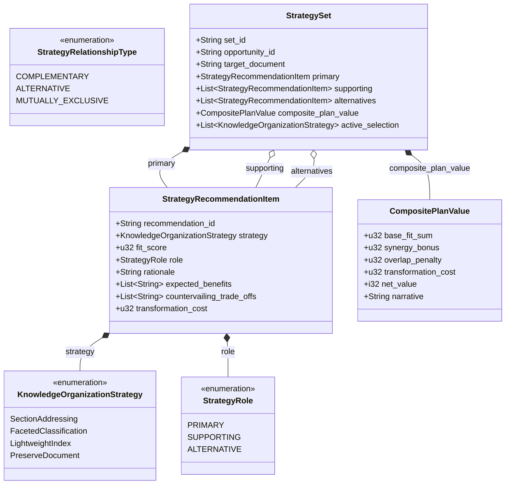
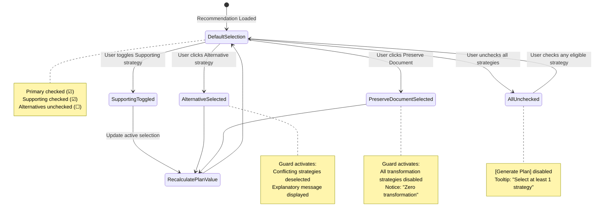

---
wiki:
  content_hash: 794110c6b5f2194690df63d660e9153f35e963108af512fc49d9351a3ad6e892
  fragments:
    phase-1-data-model-strategy-selection-combination:
      tokens: 2103
      inbound: 0
      outbound: 0
    1-domain-entities-enumerations:
      tokens: 375
      inbound: 0
      outbound: 0
    2-entity-specifications:
      tokens: 1212
      inbound: 0
      outbound: 0
    21-strategyrelationshiptype-enumeration:
      tokens: 149
      inbound: 0
      outbound: 0
    22-strategyrole-enumeration:
      tokens: 135
      inbound: 0
      outbound: 0
    23-strategyfitscore-value-object-integer:
      tokens: 104
      inbound: 0
      outbound: 0
    24-strategyrecommendationitem-entity:
      tokens: 187
      inbound: 0
      outbound: 0
    25-compositeplanvalue-value-object:
      tokens: 325
      inbound: 0
      outbound: 0
    26-strategyset-aggregate-root:
      tokens: 305
      inbound: 0
      outbound: 0
    3-pairwise-relationship-canonical-table:
      tokens: 194
      inbound: 0
      outbound: 0
    4-state-transitions-interactive-ui-selection-lifecycle:
      tokens: 260
      inbound: 0
      outbound: 0
---
# Phase 1 Data Model: Strategy Selection & Combination

**Feature**: Strategy Selection & Combination (`007-strategy-selection-combination`)  
**Branch**: `007-strategy-selection-combination`  
**Date**: 2026-09-23  
**Status**: Completed & Validated  

---

## 1. Domain Entities & Enumerations



---

## 2. Entity Specifications

### 2.1 `StrategyRelationshipType` (Enumeration)

Defines the compatibility classification between any two candidate strategies (FR-004).

| Variant | Semantics | Coexistence Permitted |
| :--- | :--- | :--- |
| `COMPLEMENTARY` | Strategies address orthogonal structural aspects and amplify each other synergistically. | **YES** (Can be combined in `StrategySet`) |
| `ALTERNATIVE` | Strategies provide competing, mutually substitutable approaches to solve the problem. | **NO** (Mutually exclusive in active selection) |
| `MUTUALLY_EXCLUSIVE` | Strategies are fundamentally incompatible and cannot coexist on the same document. | **NO** (Strictly prohibited from combining) |

### 2.2 `StrategyRole` (Enumeration)

Designates the functional role of an eligible strategy within a recommendation set (FR-007).

| Variant | Description | UI Default State |
| :--- | :--- | :--- |
| `PRIMARY` | The single highest-fit strategy addressing the detected problem. | Pre-checked (`☑`), cyan badge |
| `SUPPORTING` | Complementary high-fit strategy that synergizes with the primary solution. | Pre-checked (`☑`), green badge |
| `ALTERNATIVE` | Competing or incompatible option offered as an alternative choice. | Unchecked (`☐`), amber badge |

### 2.3 `StrategyFitScore` (Value Object / Integer)

- **Type**: `u32` (Rust) / `number` (TypeScript).
- **Scale**: Strict integer in range $0\text{--}100$ (FR-001, Invariant IX).
- **Eligibility Threshold**: $\text{Fit} \ge 60$ marks an eligible candidate (FR-003). Any score $<60$ marks the strategy as non-recommended and ineligible.

### 2.4 `StrategyRecommendationItem` (Entity)

Represents an evaluated candidate strategy with full evidence and trade-offs.

```rust
#[derive(Debug, Clone, Serialize, Deserialize, PartialEq)]
pub struct StrategyRecommendationItem {
    pub recommendation_id: String,
    pub strategy: KnowledgeOrganizationStrategy,
    pub fit_score: u32,
    pub role: StrategyRole,
    pub rationale: String,
    pub expected_benefits: Vec<String>,
    pub countervailing_trade_offs: Vec<String>,
    pub transformation_cost: u32,
}
```

- **Validation Rules**:
  - `fit_score` MUST be within $[60, 100]$ (any score $<60$ is disqualified before item construction).
  - `expected_benefits` MUST NOT be empty (Invariant XV).
  - `countervailing_trade_offs` MUST NOT be empty (Invariant XV).

### 2.5 `CompositePlanValue` (Value Object)

Represents the multi-factor utility evaluation of an active strategy selection.

```rust
#[derive(Debug, Clone, Serialize, Deserialize, PartialEq)]
pub struct CompositePlanValue {
    pub base_fit_sum: u32,
    pub synergy_bonus: u32,
    pub overlap_penalty: u32,
    pub transformation_cost: u32,
    pub net_value: i32,
    pub narrative: String,
}
```

- **Mathematical Calculation (FR-008, FR-014)**:
  $$\text{net\_value} = \text{base\_fit\_sum} + \text{synergy\_bonus} - \text{overlap\_penalty} - \text{transformation\_cost}$$
- **Components**:
  - `base_fit_sum`: $\sum_{s \in \mathcal{S}} \text{fit}(s)$.
  - `synergy_bonus`: Pairwise synergy bonus (+15 for `section_addressing` + `lightweight_index`; +12 for `faceted_classification` + `lightweight_index`; 0 for other pairs).
  - `overlap_penalty`: Penalizes duplicate routing or redundant navigation (5 for `section_addressing` + `lightweight_index`; 3 for `faceted_classification` + `lightweight_index`; 0 for other pairs).
  - `transformation_cost`: Sum of operation effort ($0$ for preserve, $5$ for section addressing, $10$ for lightweight index, $15$ for faceted classification).

### 2.6 `StrategySet` (Aggregate Root)

The complete recommendation bundle output by the 9-step selection algorithm.

```rust
#[derive(Debug, Clone, Serialize, Deserialize, PartialEq)]
pub struct StrategySet {
    pub set_id: String,
    pub opportunity_id: String,
    pub target_document: String,
    pub primary: StrategyRecommendationItem,
    pub supporting: Vec<StrategyRecommendationItem>,
    pub alternatives: Vec<StrategyRecommendationItem>,
    pub composite_plan_value: CompositePlanValue,
    pub active_selection: Vec<KnowledgeOrganizationStrategy>,
}
```

- **Invariants & Validation Rules**:
  - Exactly one `primary` item MUST be present.
  - Every item in `supporting` MUST have a `COMPLEMENTARY` relationship with `primary`.
  - No item in `supporting` may have relationship `ALTERNATIVE` or `MUTUALLY_EXCLUSIVE` with `primary` or any other item in `supporting` (SC-003).
  - If `primary.strategy == PreserveDocument`, then `supporting` MUST be empty, and all transformation strategies MUST be placed in `alternatives` (Edge Case 4, FR-006).
  - `active_selection` defaults to `[primary.strategy] + supporting.map(|s| s.strategy)`.
  - Zero items with `fit_score < 60` may exist in `primary`, `supporting`, or `alternatives` (FR-003).

---

## 3. Pairwise Relationship Canonical Table

```rust
pub fn get_strategy_relationship(
    a: KnowledgeOrganizationStrategy,
    b: KnowledgeOrganizationStrategy,
) -> StrategyRelationshipType {
    use KnowledgeOrganizationStrategy::*;
    use StrategyRelationshipType::*;

    if a == b {
        return MutuallyExclusive; // Cannot combine a strategy with itself
    }

    match (a, b) {
        (SectionAddressing, LightweightIndex) | (LightweightIndex, SectionAddressing) => {
            Complementary
        }
        (FacetedClassification, LightweightIndex) | (LightweightIndex, FacetedClassification) => {
            Complementary
        }
        (SectionAddressing, FacetedClassification) | (FacetedClassification, SectionAddressing) => {
            Alternative
        }
        (PreserveDocument, _) | (_, PreserveDocument) => {
            MutuallyExclusive
        }
        _ => Alternative,
    }
}
```

---

## 4. State Transitions (Interactive UI Selection Lifecycle)


