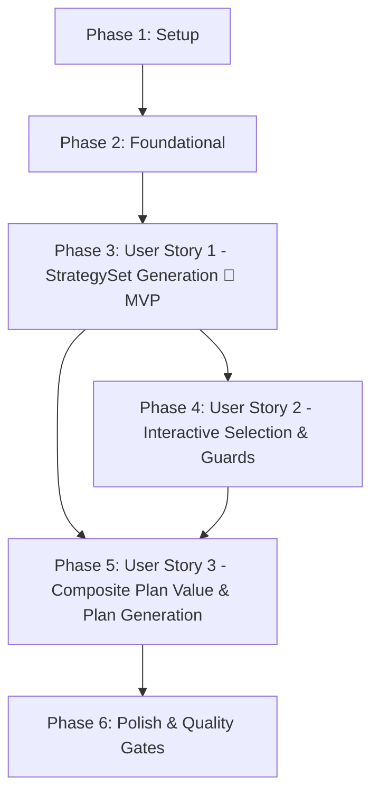

---
wiki:
  content_hash: 738e2dec3ddcc5212cd877eab0edb07ffc156c3e0209e46a2bd545191ee77225
  fragments:
    tasks-strategy-selection-combination-007-strategy-selection-combination:
      tokens: 2661
      inbound: 0
      outbound: 2
    phase-1-setup-shared-infrastructure:
      tokens: 116
      inbound: 0
      outbound: 0
    phase-2-foundational-blocking-prerequisites:
      tokens: 209
      inbound: 0
      outbound: 0
    phase-3-user-story-1-multi-strategy-compatibility-strategy-set-generation-priority-p1-mvp:
      tokens: 592
      inbound: 0
      outbound: 0
    tests-for-user-story-1:
      tokens: 162
      inbound: 0
      outbound: 0
    implementation-for-user-story-1:
      tokens: 285
      inbound: 0
      outbound: 0
    phase-4-user-story-2-interactive-multi-strategy-selection-with-incompatibility-guards-priority-p2:
      tokens: 475
      inbound: 0
      outbound: 0
    tests-for-user-story-2:
      tokens: 90
      inbound: 0
      outbound: 0
    implementation-for-user-story-2:
      tokens: 289
      inbound: 0
      outbound: 0
    phase-5-user-story-3-composite-plan-value-trade-off-valuation-priority-p3:
      tokens: 407
      inbound: 0
      outbound: 0
    tests-for-user-story-3:
      tokens: 94
      inbound: 0
      outbound: 0
    implementation-for-user-story-3:
      tokens: 224
      inbound: 0
      outbound: 0
    phase-6-polish-cross-cutting-concerns:
      tokens: 147
      inbound: 0
      outbound: 0
    dependencies-execution-order:
      tokens: 380
      inbound: 0
      outbound: 0
    phase-dependencies:
      tokens: 143
      inbound: 0
      outbound: 0
    user-story-dependencies:
      tokens: 126
      inbound: 0
      outbound: 0
    parallel-opportunities:
      tokens: 105
      inbound: 0
      outbound: 0
    parallel-example-user-story-1:
      tokens: 84
      inbound: 0
      outbound: 0
    implementation-strategy:
      tokens: 180
      inbound: 0
      outbound: 0
    mvp-first-user-story-1-only:
      tokens: 90
      inbound: 0
      outbound: 0
    incremental-delivery:
      tokens: 86
      inbound: 0
      outbound: 0
---
# Tasks: Strategy Selection & Combination (`007-strategy-selection-combination`)

**Branch**: `007-strategy-selection-combination` | **Spec**: [`specs/007-strategy-selection-combination/spec.md`](spec.md) | **Plan**: [`specs/007-strategy-selection-combination/plan.md`](plan.md)

---

## Phase 1: Setup (Shared Infrastructure)

**Purpose**: Project initialization, module registration, and shared TypeScript domain types

- [X] T001 Configure feature test scaffold and register modules in `crates/core/src/evolution/mod.rs`
- [X] T002 [P] Define TypeScript domain types (`StrategyFitScore`, `StrategyRole`, `StrategyRelationshipType`, `StrategyRecommendationItem`, `StrategySet`, `CompositePlanValue`) and IPC interfaces in `extension/src/types/evolution.ts` matching `contracts/strategy_selection_rpc_protocol.json`

---

## Phase 2: Foundational (Blocking Prerequisites)

**Purpose**: Core mathematical models, compatibility matrix, and valuation formulas that MUST be complete before ANY user story can be implemented

**⚠️ CRITICAL**: No user story work can begin until this phase is complete

- [X] T003 Implement `StrategyRelationshipType`, `StrategyRole`, and `get_strategy_relationship` canonical pairwise matrix in `crates/core/src/evolution/strategies.rs`
- [X] T004 [P] Implement integer Fit Score evaluation ($0\text{--}100$) and strict $\text{fit} \ge 60$ eligibility gate in `crates/core/src/evolution/strategies.rs`
- [X] T005 [P] Define `CompositePlanValue` model, constants (synergy bonuses, overlap penalties, effort costs), and serialization in `crates/core/src/evolution/plan_value.rs`

**Checkpoint**: Foundation ready — user story implementation can now begin in parallel

---

## Phase 3: User Story 1 - Multi-Strategy Compatibility & Strategy Set Generation (Priority: P1) 🎯 MVP

**Goal**: Evaluate candidate strategies (`section_addressing`, `faceted_classification`, `lightweight_index`, `preserve_document`), filter out $\text{fit} < 60$, classify pairwise relationships, and synthesize a structured `StrategySet` (`PRIMARY`, `SUPPORTING`, `ALTERNATIVES`).

**Independent Test**: Verify that providing a problem signature outputs a `StrategySet` with exactly 1 `PRIMARY` strategy, 0 or more `SUPPORTING` strategies, and 0 strategies with $\text{fit} < 60$.

### Tests for User Story 1 ⚠️
> **NOTE: Write these tests FIRST, ensure they FAIL before implementation**

- [X] T006 [P] [US1] Unit test for candidate strategy evaluation and $\text{fit} \ge 60$ filter in `crates/core/tests/strategy_combination_test.rs`
- [X] T007 [P] [US1] Unit test for pairwise relationship matrix classification (`COMPLEMENTARY`, `ALTERNATIVE`, `MUTUALLY_EXCLUSIVE`) in `crates/core/tests/strategy_combination_test.rs`
- [X] T008 [P] [US1] Contract test for `evolution/getStrategySet` JSON-RPC handler in `crates/core/tests/strategy_combination_test.rs`

### Implementation for User Story 1

- [X] T009 [US1] Implement the 9-step Strategy Selection Algorithm producing `StrategySet` in `crates/core/src/evolution/strategies.rs`
- [X] T010 [US1] Implement tie-breaking rules and `preserve_document` fallback logic (Edge Cases 1, 2, 4) in `crates/core/src/evolution/strategies.rs`
- [X] T011 [US1] Integrate `StrategySet` generation into `StructuralOpportunity` builder in `crates/core/src/evolution/opportunity.rs`
- [X] T012 [US1] Implement JSON-RPC handler for `evolution/getStrategySet` in `crates/core/src/ipc/handlers.rs`
- [X] T013 [US1] Implement `getStrategySet` coordinator in `extension/src/evolution/evolutionManager.ts` and dispatch in `extension/src/webview/panelManager.ts`
- [X] T014 [US1] Add Criterion microbenchmark verifying candidate evaluation and StrategySet synthesis executes in $\le 10\text{ ms}$ (SC-006) in `crates/core/benches/strategy_selection_benchmark.rs`

**Checkpoint**: At this point, User Story 1 is fully functional and testable independently (MVP ready!)

---

## Phase 4: User Story 2 - Interactive Multi-Strategy Selection with Incompatibility Guards (Priority: P2)

**Goal**: Render the Strategy Set in the Management & Settings drawer with interactive checkboxes (`☑` / `☐`) and dynamic incompatibility guards preventing contradictory transformations.

**Independent Test**: In the Webview UI, toggle supporting strategies, select an incompatible alternative, and verify that conflicting options are automatically deselected/disabled with an explanatory notice.

### Tests for User Story 2 ⚠️

- [X] T015 [P] [US2] Unit test for client-side incompatibility guards and selection validation in `extension/test/suite/strategySelection.test.ts`
- [X] T016 [P] [US2] Contract test for `evolution/validateStrategySelection` JSON-RPC handler in `crates/core/tests/strategy_combination_test.rs`

### Implementation for User Story 2

- [X] T017 [US2] Implement JSON-RPC handler for `evolution/validateStrategySelection` in `crates/core/src/ipc/handlers.rs`
- [X] T018 [US2] Update client RPC bindings in `extension/webview-ui/src/rpc/webviewRpc.ts`
- [X] T019 [US2] Render `PRIMARY`, `SUPPORTING`, and `ALTERNATIVES` visual groupings with role badges and checkboxes in `extension/webview-ui/src/components/evolutionTab.ts` (ensuring inspection and toggle within $\le 2$ clicks, SC-005)
- [X] T020 [US2] Implement real-time incompatibility guards (swapping/disabling conflicting strategies and `preserve_document` guard) in `extension/webview-ui/src/components/evolutionTab.ts`
- [X] T021 [US2] Implement empty selection validation guard disabling plan generation in `extension/webview-ui/src/components/evolutionTab.ts`
- [X] T022 [US2] Add CSS styling for role badges (`.role-badge-primary`, `.role-badge-supporting`, `.role-badge-alt`), synergy indicators, and conflict notification banner in `extension/webview-ui/public/theme.css`

**Checkpoint**: At this point, User Stories 1 AND 2 both work independently and integrate seamlessly

---

## Phase 5: User Story 3 - Composite Plan Value & Trade-Off Valuation (Priority: P3)

**Goal**: Calculate total plan value for active strategy combinations, balancing individual fit, synergy bonuses, overlap penalties, and transformation effort, and pass selected strategies to multi-strategy plan generation.

**Independent Test**: Verify plan value calculations for single and combined strategies, and verify atomic transformation plan generation incorporating actions for all selected strategies.

### Tests for User Story 3 ⚠️

- [X] T023 [P] [US3] Unit test for composite plan value calculation (fit sum, synergy, overlap, cost) in `crates/core/tests/plan_value_test.rs`
- [X] T024 [P] [US3] Contract test for `evolution/calculatePlanValue` JSON-RPC handler in `crates/core/tests/plan_value_test.rs`

### Implementation for User Story 3

- [X] T025 [US3] Implement composite plan value calculation engine and dynamic valuation routines in `crates/core/src/evolution/plan_value.rs`
- [X] T026 [US3] Implement JSON-RPC handler for `evolution/calculatePlanValue` in `crates/core/src/ipc/handlers.rs`
- [X] T027 [US3] Wire dynamic plan value recalculation on checkbox toggle in `extension/webview-ui/src/components/evolutionTab.ts`
- [X] T028 [US3] Update `TransformationEngine` in `crates/core/src/evolution/transformation.rs` to accept multiple selected strategies and produce an atomic plan and unified diff preview (SC-007)
- [X] T029 [US3] Update `GeneratePlanRequest` and `build_transformation_preview_and_plan` in `crates/core/src/evolution/opportunity.rs` to execute multi-strategy transformation actions atomically

**Checkpoint**: All 3 user stories are independently functional and fully integrated

---

## Phase 6: Polish & Cross-Cutting Concerns

**Purpose**: End-to-end integration, performance validation, and zero regression verification

- [X] T030 [P] End-to-end integration test verifying complete flow from selection to atomic plan generation and click budget ($\le 2$ clicks, SC-005) in `extension/test/suite/strategySelection.test.ts`
- [X] T031 Execute runnable validation scenarios in `specs/007-strategy-selection-combination/quickstart.md`
- [X] T032 Code quality check: run `cargo clippy -- -D warnings`, `cargo test`, and `npm test` to verify 0 regressions and 0 lint warnings

---

## Dependencies & Execution Order

### Phase Dependencies

- **Setup (Phase 1)**: No dependencies — can start immediately.
- **Foundational (Phase 2)**: Depends on Setup completion — BLOCKS all user stories.
- **User Story 1 (Phase 3 - MVP)**: Depends on Foundational completion.
- **User Story 2 (Phase 4)**: Depends on User Story 1 completion (builds on `StrategySet` data model).
- **User Story 3 (Phase 5)**: Depends on User Story 1 and 2 (calculates value for active UI selections and generates atomic plan).
- **Polish (Phase 6)**: Depends on all user stories being complete.

### User Story Dependencies



### Parallel Opportunities

- **Setup Phase**: T001 and T002 can execute in parallel.
- **Foundational Phase**: T004 and T005 can execute in parallel once T003 is established.
- **User Story 1 Tests**: T006, T007, and T008 can be written concurrently in parallel.
- **User Story 2 Tests**: T015 and T016 can be written concurrently in parallel.
- **User Story 3 Tests**: T023 and T024 can be written concurrently in parallel.

---

## Parallel Example: User Story 1

```bash
# Launch test writing in parallel:
Task: "Unit test for candidate strategy evaluation in crates/core/tests/strategy_combination_test.rs"
Task: "Unit test for pairwise relationship matrix classification in crates/core/tests/strategy_combination_test.rs"
Task: "Contract test for evolution/getStrategySet in crates/core/tests/strategy_combination_test.rs"
```

---

## Implementation Strategy

### MVP First (User Story 1 Only)
1. Complete Phase 1 (Setup) and Phase 2 (Foundational).
2. Complete Phase 3 (User Story 1).
3. **STOP and VALIDATE**: Run `cargo test --test strategy_combination_test` to verify candidate evaluation and `StrategySet` synthesis.
4. Verify microbenchmarks satisfy SC-006 ($\le 10\text{ ms}$).

### Incremental Delivery
1. Foundation + US1 $\to$ Core Rust multi-strategy recommender ready (MVP).
2. Add US2 $\to$ Interactive UI with checkboxes and real-time incompatibility guards.
3. Add US3 $\to$ Composite plan value and atomic multi-strategy plan generation.
4. Polish $\to$ E2E validation, quickstart verification, and zero regression sign-off.
