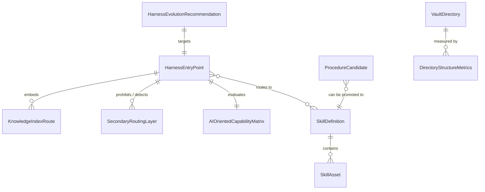
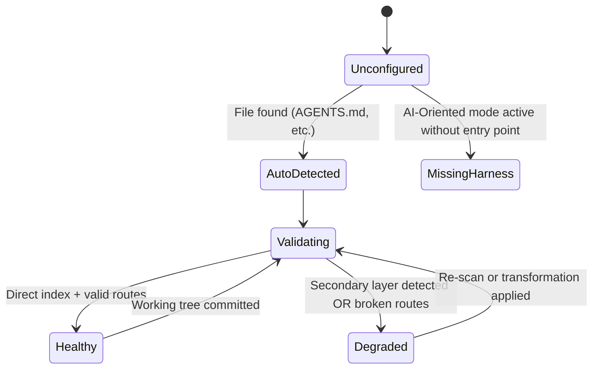
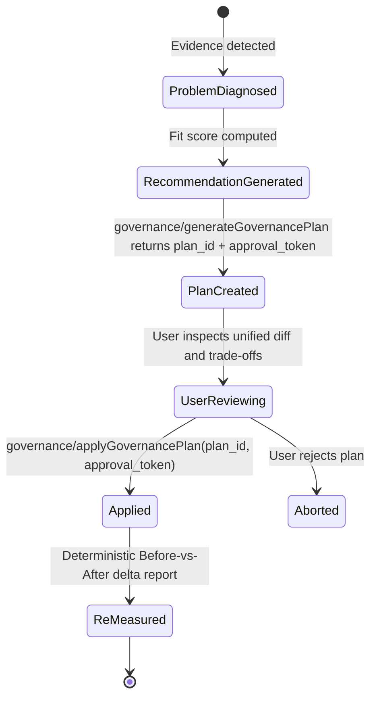

---
wiki:
  content_hash: 4a8be1a1974ec3e2b1e73fef40e913c32410f4bd54a910c06a6848f746782eab
  fragments:
    data-model-ai-oriented-documentation-governance:
      tokens: 2819
      inbound: 0
      outbound: 0
    1-entity-overview-knowledge-model-integration:
      tokens: 193
      inbound: 0
      outbound: 0
    2-core-entities-struct-definitions:
      tokens: 2159
      inbound: 0
      outbound: 0
    a-harnessentrypoint:
      tokens: 414
      inbound: 0
      outbound: 0
    b-knowledgeindexroute:
      tokens: 244
      inbound: 0
      outbound: 0
    c-secondaryroutinglayer:
      tokens: 106
      inbound: 0
      outbound: 0
    d-skilldefinition-skillasset:
      tokens: 316
      inbound: 0
      outbound: 0
    e-procedurecandidate:
      tokens: 121
      inbound: 0
      outbound: 0
    f-directorystructuremetrics-calibration-thresholds:
      tokens: 418
      inbound: 0
      outbound: 0
    g-aiorientedcapabilitymatrix:
      tokens: 160
      inbound: 0
      outbound: 0
    h-harnessevolutionrecommendation-transformation-plan:
      tokens: 370
      inbound: 0
      outbound: 0
    3-state-machines-validation-transitions:
      tokens: 268
      inbound: 0
      outbound: 0
    a-harness-lifecycle-transition:
      tokens: 119
      inbound: 0
      outbound: 0
    b-user-controlled-transformation-lifecycle-invariant-xvi:
      tokens: 138
      inbound: 0
      outbound: 0
    4-invariants-enforced-by-data-model:
      tokens: 155
      inbound: 0
      outbound: 0
---
# Data Model: AI-Oriented Documentation Governance

**Feature**: `008-ai-doc-governance`
**Date**: 2026-09-29
**Status**: Completed (Phase 1)

---

## 1. Entity Overview & Knowledge Model Integration

The AI-Oriented Documentation Governance subsystem introduces first-class entities to model and audit the AI Harness Entry Point, embedded Knowledge Index routes, secondary routing layers, reusable Skills, procedural patterns, directory organization metrics, and AI-oriented capability scores.



---

## 2. Core Entities & Struct Definitions

### A. HarnessEntryPoint
Represents a configured or auto-detected AI agent harness entry point.

```rust
#[derive(Debug, Clone, Serialize, Deserialize, PartialEq)]
pub struct HarnessEntryPoint {
    pub file_path: String,
    pub harness_type: HarnessType,
    pub is_primary: bool,
    pub total_tokens: usize,
    pub heading_count: usize,
    pub embedded_index: Option<EmbeddedIndexMetadata>,
    pub secondary_layers_detected: Vec<SecondaryRoutingLayer>,
    pub quality_ratings: HarnessQualityRatings,
    pub last_modified: Option<i64>,
}

#[derive(Debug, Clone, Copy, Serialize, Deserialize, PartialEq, Eq, Hash)]
pub enum HarnessType {
    #[serde(rename = "agents_md")]
    AgentsMd,
    #[serde(rename = "claude_md")]
    ClaudeMd,
    #[serde(rename = "gemini_md")]
    GeminiMd,
    #[serde(rename = "copilot_instructions")]
    CopilotInstructions,
    #[serde(rename = "custom")]
    Custom,
}

#[derive(Debug, Clone, Serialize, Deserialize, PartialEq)]
pub struct EmbeddedIndexMetadata {
    pub heading_anchor: String,
    pub start_line: usize,
    pub end_line: usize,
    pub routes: Vec<KnowledgeIndexRoute>,
    pub domain_coverage_ratio: f32, // Ratio of discovered vault domains represented (0.0 - 1.0)
}

#[derive(Debug, Clone, Serialize, Deserialize, PartialEq)]
pub struct HarnessQualityRatings {
    pub integrity_score: f32,       // 0 - 100%
    pub structure_score: f32,       // 0 - 100%
    pub consistency_score: f32,     // 0 - 100%
    pub discoverability_score: f32, // 0 - 100%
    pub freshness_score: f32,       // 0 - 100%
    pub context_efficiency: f32,    // 0 - 100% (useful routing tokens vs total tokens)
}
```

### B. KnowledgeIndexRoute
Represents an individual navigational route declared within the embedded Knowledge Index.

```rust
#[derive(Debug, Clone, Serialize, Deserialize, PartialEq)]
pub struct KnowledgeIndexRoute {
    pub domain: String,             // e.g. "Architecture", "Security", "Operations"
    pub label: String,              // Human / AI readable concept title
    pub target_file: String,        // Target Markdown file path
    pub target_anchor: Option<String>, // Normalized fragment anchor (e.g. "token-refresh")
    pub resolution_status: RouteResolutionStatus,
    pub hop_distance_from_entry: u32,  // Directly embedded = 1
    pub target_tokens: usize,       // Tokens of target document or target section fragment
    pub line_number: usize,
}

#[derive(Debug, Clone, Copy, Serialize, Deserialize, PartialEq, Eq)]
pub enum RouteResolutionStatus {
    #[serde(rename = "resolved")]
    Resolved,
    #[serde(rename = "broken_file")]
    BrokenFile,
    #[serde(rename = "broken_anchor")]
    BrokenAnchor,
    #[serde(rename = "excluded_path")]
    ExcludedPath,
}
```

### C. SecondaryRoutingLayer
Represents an anti-pattern intermediate routing document (`index.md`, `memory.md`, `hot-index.md`).

```rust
#[derive(Debug, Clone, Serialize, Deserialize, PartialEq)]
pub struct SecondaryRoutingLayer {
    pub file_path: String,
    pub parent_harness: String,
    pub outgoing_routes_count: usize,
    pub intermediate_hops: u32,
    pub penalty_points: f32,
    pub description: String,
    pub recommendation_hint: String,
}
```

### D. SkillDefinition & SkillAsset
Represents a reusable operational capability and its supporting assets.

```rust
#[derive(Debug, Clone, Serialize, Deserialize, PartialEq)]
pub struct SkillDefinition {
    pub skill_id: String,           // Directory name, e.g. "deploy-service"
    pub dir_path: String,           // e.g. ".agents/skills/deploy-service"
    pub manifest_path: String,      // e.g. ".agents/skills/deploy-service/SKILL.md"
    pub name: String,               // Parsed from YAML frontmatter
    pub description: String,        // Parsed from YAML frontmatter
    pub assets: Vec<SkillAsset>,
    pub status: SkillValidationStatus,
    pub unreferenced: bool,         // True if no document or harness routes to it
    pub overlap_ids: Vec<String>,   // List of skill IDs with high semantic/procedural overlap
}

#[derive(Debug, Clone, Serialize, Deserialize, PartialEq)]
pub struct SkillAsset {
    pub asset_type: SkillAssetType,
    pub file_path: String,
    pub exists_on_disk: bool,
    pub byte_size: u64,
}

#[derive(Debug, Clone, Copy, Serialize, Deserialize, PartialEq, Eq)]
pub enum SkillAssetType {
    Script,
    Template,
    Reference,
}

#[derive(Debug, Clone, Copy, Serialize, Deserialize, PartialEq, Eq)]
pub enum SkillValidationStatus {
    Valid,
    MissingManifest,
    BrokenAssetReference,
    DuplicateCapability,
}
```

### E. ProcedureCandidate
Represents a recurring multi-step procedure detected across documents.

```rust
#[derive(Debug, Clone, Serialize, Deserialize, PartialEq)]
pub struct ProcedureCandidate {
    pub candidate_id: String,
    pub step_signatures: Vec<String>, // Normalized step summaries
    pub occurrence_count: usize,
    pub source_documents: Vec<String>,
    pub associated_scripts: Vec<String>,
    pub recurrence_score: f32,       // 0.0 - 1.0 (>= 0.70 triggers recommendation)
    pub recommended_skill_name: String,
}
```

### F. DirectoryStructureMetrics & Calibration Thresholds
Measures physical repository organization without prescribing a specific folder schema.

```rust
// Calibrated Reference Threshold Constants for Evidence-Based Signal Detection:
pub const MAX_NAVIGATION_DEPTH_THRESHOLD: u32 = 5;         // Directory nesting depth > 5 triggers ExcessiveDepth signal
pub const CONCENTRATION_ENTROPY_THRESHOLD: f32 = 0.35;     // Shannon entropy < 0.35 triggers DocumentOverconcentration signal
pub const DOMAIN_MIXING_THRESHOLD: f32 = 0.60;             // Tag/concept divergence > 0.60 triggers DomainMixing signal
pub const CROSS_FOLDER_COUPLING_THRESHOLD: f32 = 0.75;     // External reference ratio > 0.75 triggers HighNavigationalCoupling
pub const LOW_CONTEXT_EFFICIENCY_THRESHOLD: f32 = 0.40;    // Context efficiency ratio < 0.40 (40%) triggers degradation finding

#[derive(Debug, Clone, Serialize, Deserialize, PartialEq)]
pub struct DirectoryStructureMetrics {
    pub max_directory_depth: u32,
    pub average_directory_depth: f32,
    pub concentration_entropy: f32, // 0.0 (all in one folder) to 1.0 (balanced)
    pub domain_mixing_score: f32,   // High when unrelated topics share same folder
    pub cross_folder_coupling: f32, // High when folder A only links to folder B
    pub organizational_signals: Vec<OrganizationalSignal>,
}

#[derive(Debug, Clone, Serialize, Deserialize, PartialEq)]
pub struct OrganizationalSignal {
    pub target_directory: String,
    pub signal_type: OrganizationalSignalType,
    pub message: String,
    pub cost_evidence: String,
}

#[derive(Debug, Clone, Copy, Serialize, Deserialize, PartialEq, Eq)]
pub enum OrganizationalSignalType {
    ExcessiveDepth,
    DocumentOverconcentration,
    ScatteredRelatedKnowledge,
    HighNavigationalCoupling,
}
```

### G. AIOrientedCapabilityMatrix
The 4-capability scorecard synthesized with the 5 core quality pillars.

```rust
#[derive(Debug, Clone, Serialize, Deserialize, PartialEq)]
pub struct AIOrientedCapabilityMatrix {
    pub entry_score: f32,        // 0 - 100: Deterministic harness accessibility
    pub discovery_score: f32,    // 0 - 100: Knowledge Index domain coverage
    pub retrieval_score: f32,    // 0 - 100: Context Trace hop and token efficiency
    pub reuse_score: f32,        // 0 - 100: Reusable skill health and consolidation
    pub overall_governance_score: f32, // 0 - 100 composite
}
```

### H. HarnessEvolutionRecommendation & Transformation Plan
Structural transformation proposal for AI documentation governance.

```rust
#[derive(Debug, Clone, Serialize, Deserialize, PartialEq)]
pub struct HarnessEvolutionRecommendation {
    pub plan_id: String,
    pub approval_token: String,     // Deterministic token required for execution (Invariant XVI)
    pub strategy_type: GovernanceStrategyType,
    pub target_file_or_dir: String,
    pub title: String,
    pub description: String,
    pub unified_diff: String,
    pub trade_offs: GovernanceTradeOffMatrix,
    pub projected_impact: ProjectedImpact,
}

#[derive(Debug, Clone, Copy, Serialize, Deserialize, PartialEq, Eq, Hash)]
pub enum GovernanceStrategyType {
    #[serde(rename = "embed_knowledge_index")]
    EmbedKnowledgeIndex,
    #[serde(rename = "eliminate_secondary_routing_layer")]
    EliminateSecondaryRoutingLayer,
    #[serde(rename = "create_skill_from_procedure")]
    CreateSkillFromProcedure,
    #[serde(rename = "consolidate_duplicate_skills")]
    ConsolidateDuplicateSkills,
    #[serde(rename = "decompose_harness")]
    DecomposeHarness,
    #[serde(rename = "introduce_section_addressing")]
    IntroduceSectionAddressing,
    #[serde(rename = "restructure_directory_domain")]
    RestructureDirectoryDomain,
}

#[derive(Debug, Clone, Serialize, Deserialize, PartialEq)]
pub struct GovernanceTradeOffMatrix {
    pub expected_benefits: Vec<String>,
    pub countervailing_trade_offs: Vec<String>,
}

#[derive(Debug, Clone, Serialize, Deserialize, PartialEq)]
pub struct ProjectedImpact {
    pub delta_tokens: i64,
    pub delta_hops: i32,
    pub delta_governance_score: f32,
}
```

---

## 3. State Machines & Validation Transitions

### A. Harness Lifecycle Transition


### B. User-Controlled Transformation Lifecycle (Invariant XVI)


---

## 4. Invariants Enforced by Data Model

1. **Deterministic Representation**: All scores are complete floats or integers ($0	ext{--}100$), never pre-formatted strings (Invariant IX).
2. **Document-Centric Identity**: `HarnessEntryPoint` and `SecondaryRoutingLayer` reference full document paths. Sections are addressed via fragment strings attached to routes (Invariant V, VI).
3. **Committed Truth**: Persistent state represents committed git trees; candidate scans exist ephemerally in memory (Invariants I, II).
4. **Approval Gate Requirement**: `HarnessEvolutionRecommendation` requires an explicit, cryptographic or deterministic user `approval_token` before execution via `governance/applyGovernancePlan` (Invariant XVI).
